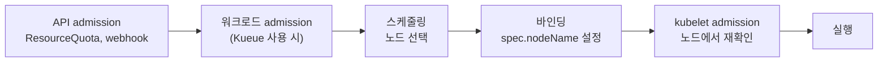

 

# TL;DR

- 클러스터 스케줄러는 구현이 달라도 같은 질문에 답한다. 무엇을 한 번에 배치하나(단위), 누구부터 하나(큐·순서), 어디에 들어갈 수 있나(적합성), 어디가 가장 좋은가(순위), 언제 확정하나(확정), 자리가 없으면 누구를 내보내나(회수), 들여보내도 되나(입장 제어·쿼터)다.
- 설계는 두 축으로 갈린다. **사이클 모델**(이벤트마다 하나씩 처리하는가, 주기마다 일괄 처리하는가)과 **동시성 모델**(Omega 논문의 monolithic / statically partitioned / two-level / shared-state)이다. 두 축은 서로 독립이다.
- 확장 구조는 코어(처리 순서와 확장 지점을 정하는 부분), 플러그인(판단 코드), 설정(조합)으로 이루어지고, 거의 모든 스케줄러에 있다. `kube-scheduler`는 플러그인을 컴파일 시점에 넣고, Slurm은 런타임에 로드한다. **Scheduling Framework**는 그중 `kube-scheduler` 계열의 확장 구조를 가리키는 고유명사다. 스케줄러 일반에 "스케줄링 프레임워크"라는 개념이 따로 있는 것이 아니다.
- 쿠버네티스는 파드(Pod)를 배치 단위로 두고, 파드 생성은 컨트롤러가, 배치는 스케줄러가 맡도록 역할을 나눴다. 기본 스케줄러 `kube-scheduler`는 이벤트마다 파드 하나씩 처리한다. 스케줄러를 여러 개 띄우면 공유 상태(shared-state) 모델에 가까워지지만, 결정을 반영하는 Binding 단계에서 자원 충돌을 검사하지 않는다.
- 쿠버네티스 위의 모든 스케줄러는 `spec.schedulerName`이 자기 이름이고 `spec.nodeName`이 빈 파드를 골라 Binding API로 노드를 지정한다. 스케줄링 동작을 바꾸는 방법은 네 층위(프로필 변경 / 커스텀 빌드 kube-scheduler / 별도 구현 스케줄러 / 스케줄러 앞단의 워크로드 admission)로 나뉜다.

 

# 들어가며

쿠버네티스 스케줄링을 정리하다 보면 두 가지 질문이 반복해서 생긴다.

첫 번째 질문은 이름이 가리키는 대상이 정확히 무엇이냐는 것이다. 이름만 보고는 정체를 짐작하기 어려운 것이 많다.

- Coscheduling은 플러그인이라고 소개되지만, 쓰려면 스케줄러를 따로 띄워야 한다
- Kueue는 이름에 큐가 들어 있지만 파드를 노드에 바인딩하지 않는다
- Scheduling Framework는 `kube-scheduler` 내부 구조의 이름인데, Volcano도 자기 내부 구조를 프레임워크라고 부른다

이 혼동은 `kube-scheduler`의 구조와 스케줄러 일반의 구조를 구분하지 않은 데서 나온다.

두 번째 질문은 지금 정리하는 개념이 쿠버네티스에만 있느냐는 것이다. 선점이나 우선순위 큐가 쿠버네티스만의 것인지, Slurm이나 LSF 같은 HPC 스케줄러에도 있는 스케줄링 일반의 개념인지 궁금해진다. 답은 개념마다 다르다.

- 선점은 양쪽에 다 있지만 방식이 다르다. 쿠버네티스는 victim을 삭제하고, LSF는 기본적으로 일시 중지한다
- backfill은 HPC 스케줄러에는 있지만 `kube-scheduler`에는 없다
- 여러 노드에 걸친 잡에 자원을 한꺼번에 주는 것은 HPC 스케줄러에서는 기본 동작인데, 쿠버네티스에서는 gang scheduling이라는 별도 기능으로 붙여야 한다

두 질문 모두 `kube-scheduler` 하나만 보고는 답하기 어렵다. 그래서 다른 스케줄러를 함께 놓고 비교한다. 다만 이름으로는 맞댈 수 없다. 같은 일을 하는 단계가 시스템마다 이름이 다르고(`kube-scheduler`의 Filter, Volcano의 predicates, Slurm의 select 플러그인), 반대로 Slurm의 Gang Scheduling처럼 이름은 같은데 뜻이 다른 경우도 있기 때문이다.

대신 기능으로 맞춘다. 어떤 스케줄러든 작업을 배치하려면 내려야 하는 결정이 있다. 무엇을 한 번에 배치할지, 누구부터 할지, 어디에 들어갈 수 있는지, 언제 확정할지 같은 것이다. 이 결정을 공통 질문으로 세우고 각 스케줄러의 답을 나란히 놓으면 두 질문에 함께 답할 수 있다. 이름이 달라도 같은 질문에 답하는 단계는 같은 것으로 묶인다. 모든 스케줄러가 같은 질문에 답하면 스케줄링 일반의 개념이고, `kube-scheduler`만 다르게 답하거나 답하지 않으면 쿠버네티스가 내린 설계 선택이다.

이 글은 HPC 배치 스케줄러(Slurm, LSF), 쿠버네티스 위의 다른 스케줄러(Volcano), `kube-scheduler`를 이 공통 질문 위에 놓고 비교한 뒤, 그 안에서 쿠버네티스의 스케줄링 모델이 어디에 있는지 본다.

1. **스케줄러 일반**: 스케줄러의 공통 질문, 사이클 모델, 동시성 모델, 확장 구조, 시스템별 용어 차이
2. **쿠버네티스의 스케줄링 모델**: 배치 단위인 파드, 파드 실행 경로, 스케줄러 공통 규칙, kube-scheduler의 사이클 모델과 동시성 모델, 스케줄링 동작 변경 층위

Slurm, LSF, Volcano는 비교에 필요한 범위에서만 다루고, 각 시스템의 설정과 운영은 다루지 않는다. 쿠버네티스 쪽 서술은 시리즈 기준 버전인 v1.32를 따르고, 그 이후 기능은 등장 지점에 버전을 표기한다. 바로 아래의 [용어 정리](#용어-정리)가 시리즈 전체의 표기 기준이다. 1편부터는 `kube-scheduler`를 중심으로 다루고, 다른 도구(Coscheduling, Volcano, Kueue)는 5편에서 gang scheduling과 함께 다룬다.

 

# 용어 정리

시리즈 전체에서 아래 표기를 쓴다. 같은 대상을 다른 표기로 부르지 않는다. 각 용어는 본문에서 다시 설명하므로, 처음에는 표기 기준으로만 확인하고 넘어가도 된다.

## 일반 용어

| 용어 | 뜻 |
| --- | --- |
| 클러스터 스케줄러 | 여러 작업이 한정된 자원을 나눠 쓰도록 각 작업을 언제 어디서 실행할지 정하는 시스템. CPU 스케줄러(운영체제)나 cron 같은 작업 스케줄러와 구분하려고 "클러스터"를 붙인다. 노드 수와 상관없이 노드 집합을 대상으로 한다 |
| 사이클 모델 | 스케줄러가 언제, 몇 개의 작업을 놓고 결정하는지에 대한 구조 |
| 동시성 모델 | 스케줄러가 여럿일 때 누가 상태를 보고 누가 결정을 확정하는지에 대한 구조 |
| 확장 구조 | 스케줄러가 판단 로직을 바꿔 끼울 수 있게 만든 내부 구조의 일반명사. 코어, 플러그인, 설정으로 이루어진다 |
| 코어 | 확장 구조에서 처리 순서와 확장 지점을 정하고, 각 확장 지점에서 플러그인을 호출하는 부분 |
| 확장 지점 | 코어가 플러그인을 호출하는 자리의 일반명사 |
| 플러그인 | 확장 지점에 끼우는 판단 코드 |
| admission | 작업이나 파드를 들여보낼지 정하는 단계. API admission, 워크로드 admission(Kueue), kubelet admission이 각각 다른 시점에 있다 |
| gang scheduling | 쿠버네티스 맥락에서 파드 그룹을 전부 배치하거나 하나도 배치하지 않는 것 |
| backfill | 큰 잡의 예상 시작 시각을 늦추지 않는 범위에서 작은 잡을 빈 자원에 먼저 실행하는 기법 |

## 쿠버네티스 스케줄러 용어

아래는 쿠버네티스 위에서 파드를 배치하는 스케줄러, 즉 [공통 규칙](#스케줄러-공통-규칙)을 따르는 스케줄러의 표기다. Slurm과 LSF는 쿠버네티스 밖의 클러스터 스케줄러라 이 분류에 들어가지 않는다.

| 표기 | 가리키는 것 | 쓰지 않는 표기 |
| --- | --- | --- |
| `kube-scheduler` | 쿠버네티스 업스트림이 배포하는 기본 스케줄러 바이너리. in-tree 플러그인만 들어 있다 | `kube-scheduler`를 가리키는 "쿠버네티스 스케줄러" |
| 커스텀 빌드 kube-scheduler | `kube-scheduler` 코드에 out-of-tree 플러그인을 추가 등록해 다시 빌드한 바이너리. Scheduling Framework와 프로필 문법은 `kube-scheduler`와 같다. 예: Coscheduling을 넣은 scheduler-plugins 스케줄러, Koordinator의 `koord-scheduler` | "Coscheduling 스케줄러", "플러그인을 설치한 kube-scheduler" |
| kube-scheduler 계열 | `kube-scheduler`와 커스텀 빌드 kube-scheduler를 함께 가리킬 때. Scheduling Framework를 쓰는 스케줄러 전체다 | — |
| 별도 구현 스케줄러 | 쿠버네티스 위에서 동작하는 스케줄러 중 Scheduling Framework를 쓰지 않고 독자 구조로 만든 것. 예: Volcano, YuniKorn | "커스텀 스케줄러" |
| 기본 스케줄러 | 클러스터에서 `default-scheduler`라는 이름을 처리하는 스케줄러(역할). 대개 컨트롤 플레인의 `kube-scheduler`다 | — |
| 두 번째 스케줄러 | 기본 스케줄러와 함께 띄운 다른 스케줄러 프로세스(역할). 위의 세 종류 중 무엇이든 될 수 있고, 같은 `kube-scheduler` 바이너리를 다른 설정으로 띄운 것일 수도 있다 | "확장 스케줄러", "커스텀 스케줄러" |
| gang 스케줄러 | gang scheduling을 처리하는 스케줄러(역할). Coscheduling을 넣은 커스텀 빌드 kube-scheduler, 네이티브 gang scheduling을 켠 `kube-scheduler`, Volcano 등이다 | "Coscheduling 스케줄러" |
| 다중 스케줄러 | 스케줄러 프로세스가 여럿인 구성 | "멀티 스케줄러" |
| `default-scheduler` | 파드 `spec.schedulerName`의 기본값이자 기본 프로필의 이름. 바이너리 이름이 아니다 | — |
| Scheduling Framework | kube-scheduler 계열의 확장 구조(고유명사). 코어와 플러그인이 구현하는 인터페이스를 합친 플러그인 아키텍처다. 영문으로만 쓰고, 같은 글 안에서 앞에 이미 나왔으면 "프레임워크"로 줄여 쓸 수 있다 | "스케줄링 프레임워크", "스케줄러 프레임워크" |
| extension point | Scheduling Framework의 확장 지점(QueueSort, Filter, Score 등). 헤딩과 표 머리에서는 Extension Point로 쓴다 | `kube-scheduler` 맥락의 "확장 지점" |
| 플러그인 | Scheduling Framework의 extension point를 구현한 Go 코드. 기본 바이너리에 들어 있으면 in-tree, 아니면 out-of-tree다. 런타임에 설치하는 것이 아니라 빌드할 때 넣는다 | "플러그인을 설치한다" |
| 프로필 | `KubeSchedulerConfiguration`의 `profiles[]` 항목. `schedulerName` 하나에 프로필 하나다. YAML 필드명과 공식 기능명(Scheduling Profiles)은 원문대로 쓴다 | 산문의 "Profile", "profile", "프로파일" |
| 다중 프로필 | 한 스케줄러 프로세스 안에 프로필을 여럿 두는 구성 | "멀티 프로필" |
| Scheduler Extender | 스케줄러가 HTTP로 외부 프로세스에 판단을 묻는 확장 방식. 플러그인과 달리 바이너리를 다시 빌드하지 않는다 | — |
| 워크로드 admission 컨트롤러 | Kueue처럼 잡을 대기시켰다가 들여보낼 시점을 정하는 컨트롤러. 바인딩은 하지 않는다(Kueue의 TAS는 배치할 토폴로지 도메인까지 정한다). API Server의 admission controller(웹훅·플러그인)와 다르다 | Kueue를 가리키는 "스케줄러", "gang scheduler" |
| PodGroup | 같은 이름의 API가 셋이다. Coscheduling(`scheduling.x-k8s.io`), 네이티브(`scheduling.k8s.io`), Volcano(`scheduling.volcano.sh`). 문맥상 모호하면 소속을 붙인다 | — |
| Workload, 워크로드 | `Workload`는 같은 이름의 API가 둘이다. 네이티브 Workload API(`scheduling.k8s.io`)와 Kueue의 admission 단위(`kueue.x-k8s.io`)다. 문맥상 모호하면 소속을 붙인다. 워크로드는 일반명사 | — |

 

# 스케줄러 일반

## 스케줄러의 공통 질문

클러스터 스케줄러는 여러 작업이 한정된 자원(노드, CPU, 메모리, GPU)을 나눠 쓰도록, 각 작업을 언제 어디서 실행할지 정하는 시스템이다. "클러스터"를 붙이는 것은 운영체제가 프로세스와 스레드를 CPU 코어에 배정하는 CPU 스케줄러나, 정해진 시각에 작업을 실행하는 cron 같은 작업 스케줄러와 구분하기 위해서다. 클러스터 스케줄러가 다루는 대상은 노드의 집합이고, 노드가 한 대뿐인 구성(노드 1대짜리 클러스터)에서도 같은 방식으로 동작한다. 이 시리즈에서 수식어 없이 "스케줄러"라고 쓰면 클러스터 스케줄러를 가리킨다.

비교 대상은 넷이다. `kube-scheduler`와 Volcano는 쿠버네티스 위에서 파드를 노드에 배치하는 스케줄러이고, Slurm과 LSF는 쿠버네티스 없이 자기 데몬으로 노드를 관리하며 잡을 배치하는 HPC 스케줄러다. 구현은 제각각이어도 답하는 질문은 같다.

| 질문 | 공통 개념 | kube-scheduler | Volcano | Slurm | LSF |
| --- | --- | --- | --- | --- | --- |
| 무엇을 한 번에 배치하나 | 스케줄링 단위 | 파드 | PodGroup으로 묶은 파드 그룹 | 잡 | 잡 |
| 누구부터 하나 | 큐·정렬 | 내부 큐(Active Queue 등) + QueueSort 플러그인 | Queue CRD, JobOrder·TaskOrder | 파티션 + 우선순위 플러그인(multifactor) | 큐(`lsb.queues`)의 우선순위 + fairshare |
| 어디에 들어갈 수 있나 | 적합성 판단 | Filter 플러그인 | predicates 플러그인 | select 플러그인(`cons_tres`) | 자원 요구 문자열의 `select[]` |
| 어디가 가장 좋은가 | 순위 매기기 | Score 플러그인 | nodeorder, binpack 플러그인 | 노드 `Weight`(낮은 쪽 우선), select 플러그인, topology 플러그인 | 자원 요구 문자열의 `order[]` |
| 언제 확정하나 | 할당 확정 | Reserve → Permit → Bind | 세션 안에서 commit 또는 discard → Bind | 요청 자원의 할당이 확보되면 잡 시작 | 병렬 잡은 필요한 슬롯이 모두 확보되면 디스패치 |
| 자리가 없으면 누구를 내보내나 | 회수 | PostFilter의 선점(victim 파드 삭제) | preempt, reclaim action | preempt 플러그인(취소·재큐잉·일시 중지 등) | 선점(기본은 일시 중지) |
| 들여보내도 되나 | 입장 제어·쿼터 | 쿼터·용량 기반 정책 없음. PreEnqueue에서 Scheduling Gate 같은 진입 조건만 확인한다(ResourceQuota는 API Server가 파드 생성 시점에 검사) | enqueue action + Queue의 capability | QOS, 계정(association) 한도 | 자원 한도(`lsb.resources`의 Limit 섹션) |

Volcano 열의 단위는 설명이 필요하다. Volcano 스케줄러는 PodGroup(`scheduling.volcano.sh`) 하나와 거기에 속한 파드들을 묶어 내부적으로 job이라고 부르고, 이 묶음을 한 번에 배치한다. 쿠버네티스의 Job(`batch/v1`)과는 다른 것이다. 사용자가 쓰는 Volcano Job(`batch.volcano.sh`) CRD는 이 PodGroup과 파드를 만들어 주는 워크로드 API다. Slurm과 LSF의 잡은 사용자가 `sbatch`나 `bsub`로 제출하는 작업 단위 그대로다.

이 표에서 `kube-scheduler` 열만 두 가지가 다르다. 스케줄링 단위가 파드 그룹이나 잡이 아니라 **파드 하나**이고, 스케줄러 안에 **쿼터·용량을 보고 들여보낼지 정하는 입장 제어가 없다**(진입을 막는 훅인 PreEnqueue만 있다). 이 두 차이가 [5편]()에서 다루는 gang scheduling(파드 그룹을 전부 배치하거나 하나도 배치하지 않는 것) 문제의 출발점이다. 나머지 질문은 이름만 다를 뿐 모든 구현체에 대응하는 단계가 있다.

 

## 사이클 모델

사이클 모델은 스케줄러가 언제, 몇 개의 작업을 놓고 결정을 내리는지에 대한 구조다. 결론부터 말하면 `kube-scheduler`는 이벤트마다 하나씩, Volcano와 LSF는 주기마다 세션을 열어 일괄로 처리하고, Slurm은 두 방식을 섞는다.

### 이벤트 단위 처리

새 파드가 생기거나 클러스터 상태가 바뀌면, 큐에서 작업 하나를 꺼내 노드를 고르고 다음 작업으로 넘어간다. `kube-scheduler`가 이 방식이다([2편 - 스케줄러 큐](#스케줄러-큐)).

- 구조가 단순하고, 작업이 생기면 바로 반응하므로 지연이 짧다
- 작업 하나의 판단만 하므로 대규모 클러스터에서도 처리량을 내기 쉽다
- 여러 작업을 함께 놓고 판단하는 전역 최적화가 어렵다. 그룹 전체가 들어갈 수 있는지 미리 볼 수 없어 gang scheduling에 약하고, 처리 순서에 따라 결과가 달라진다

### 주기 단위 일괄 처리

정해진 주기마다 클러스터 상태의 스냅샷을 찍고, 대기 중인 작업 전체를 놓고 한꺼번에 계산한다. Volcano가 이 방식이다. 기본 1초마다 세션을 열고, 세션 안에서 정해진 action(enqueue, allocate 등)을 순서대로 실행한 뒤 세션을 닫는다.

- 잡에 속한 작업 전체를 가상으로 배치해 본 뒤 확정하거나 되돌릴 수 있어, gang scheduling과 큐 간 공정 분배에 유리하다
- 주기만큼 반응이 늦고, 세션 하나의 계산량이 대기 작업 수와 클러스터 규모에 비례한다

LSF도 이 방식에 가깝다. 배치 데몬(`mbatchd`)이 대기 중인 잡을 `JOB_SCHEDULING_INTERVAL`(`lsb.params`) 간격으로 스케줄러 데몬(`mbschd`)에 넘기고, `mbschd`가 정책과 자원 상황을 보고 결정을 내린다. 이 값은 스케줄링 세션의 최소 주기로, 한 바퀴가 일찍 끝나면 다음 주기까지 쉬고, 0으로 두면 곧바로 다음 세션을 연다.

### Slurm: 혼합 방식

Slurm의 메인 스케줄러는 이벤트(잡 제출, 잡 종료, 설정 변경)가 생기면 큐 앞쪽 일부(`default_queue_depth`, 기본 100개)를 빠르게 훑고, `sched_interval`(기본 60초)마다 큐 전체를 본다. 여기에 별도의 backfill 스케줄러가 `bf_interval`(기본 30초)마다 돈다.

backfill은 우선순위가 높은 큰 잡이 자원을 기다리는 동안, 그 잡의 예상 시작 시각을 늦추지 않는 범위에서 뒤의 작은 잡을 빈 자원에 먼저 실행하는 기법이다. 각 잡의 실행 시간 상한(time limit)을 알아야 예상 시작 시각을 계산할 수 있다. `kube-scheduler`는 파드의 실행 시간 상한을 배치 판단에 쓰지 않으므로 backfill을 할 수 없다. `activeDeadlineSeconds`처럼 상한을 적는 필드는 있지만 스케줄러의 입력은 아니다.

LSF도 같은 기법을 쓴다. 병렬 잡은 필요한 슬롯이 모두 확보되어야 디스패치되므로, 큰 병렬 잡이 굶지 않도록 슬롯을 모아 두는 예약(`SLOT_RESERVE`, 기본 비활성)과, 그 예약된 슬롯을 실행 시간 상한이 있는 짧은 잡에 빌려 주는 backfill(`BACKFILL=Y`)을 함께 쓴다.

 

## 동시성 모델

동시성 모델은 스케줄러가 여럿일 때 누가 클러스터 상태를 보고 누가 결정을 확정하는지에 대한 구조다. 대표적인 분류는 Google의 Omega 논문(EuroSys 2013)이 제시한 네 가지다.

| 구조 | 설명 | 논문이 든 예 |
| --- | --- | --- |
| monolithic | 스케줄러 하나가 모든 작업을 같은 클러스터 상태 위에서 결정한다 | 당시 Google의 클러스터 스케줄러, Maui/Moab, Platform LSF |
| statically partitioned | 클러스터를 고정 분할하고 분할마다 스케줄러를 둔다 | Hadoop, Quincy |
| two-level | 중앙 자원 관리자가 자원을 제안(offer)하고, 애플리케이션별 스케줄러(Mesos의 용어로 framework)가 제안을 받아 결정한다 | Mesos, Hadoop-on-Demand |
| shared-state | 여러 스케줄러가 클러스터 상태를 각자 사본으로 들고 결정한 뒤, 그 결정을 공유 상태에 반영할 때 다른 스케줄러의 결정과 충돌하는지 검사한다(낙관적 동시성) | Omega |

shared-state에서 각 스케줄러는 클러스터 상태의 사본 위에서 결정을 내리고, 그 결정을 원본(공유 상태)에 반영한다. Omega 논문은 이 반영을 트랜잭션 커밋으로 처리한다. 커밋할 때 그사이 다른 스케줄러가 같은 자원을 가져갔으면 커밋이 실패하고, 실패한 스케줄러는 갱신된 상태로 다시 결정한다. 스케줄러끼리 서로를 잠그지 않고 일단 결정부터 하므로 낙관적 동시성이라고 부른다. 워크로드 특성에 맞는 스케줄러를 각자 독립적으로 붙이고 발전시킬 수 있지만, 같은 자원을 동시에 고르는 충돌과 재시도가 생기고, 스케줄러마다 정책이 달라 전역적인 공정성과 쿼터를 맞추기 어렵다.

쿠버네티스는 Google 내부의 Borg와 그 후속 연구인 Omega의 경험 위에서 설계되었다. 쿠버네티스가 이 분류에서 어디에 있는지는 [아래](#kube-scheduler의-사이클-모델과-동시성-모델)에서 본다.

 

## 확장 구조

확장 구조는 스케줄러가 판단 로직을 바꿔 끼울 수 있게 만든 내부 구조다. 결론부터 말하면, 확장 지점을 정해 두고 거기에 판단 코드를 끼우는 구조는 `kube-scheduler`만의 것이 아니라 거의 모든 스케줄러에 있고, 구현체마다 이름과 모양, 플러그인을 넣는 시점이 다르다.

| 요소 | 역할 |
| --- | --- |
| 코어 | 처리 순서와 확장 지점을 정하고, 각 확장 지점에서 플러그인을 호출하는 부분 |
| 플러그인 | 확장 지점에 끼우는 판단 코드 |
| 설정 | 어떤 플러그인을 어떤 조합으로 쓸지 고르는 것 |

구현체별로 보면 다음과 같다.

| 항목 | kube-scheduler | Volcano | Slurm | LSF |
| --- | --- | --- | --- | --- |
| 코어 | **Scheduling Framework**의 런타임. 파드 하나의 처리를 extension point 순서로 고정 | 세션 + action + plugin. action이 세션 안의 큰 흐름(enqueue, allocate 등)을 정하고, plugin은 세션에 콜백 함수(JobOrderFn, PredicateFn, NodeOrderFn 등)를 등록 | 기능 영역별 플러그인 타입(priority, select, sched, preempt 등) | 스케줄러 데몬(`mbschd`)이 스케줄러 모듈을 조합 |
| 플러그인 | Go 패키지(`NodeResourcesFit` 등) | Go 패키지(gang, drf, proportion, binpack 등) | 공유 객체 | 공유 모듈(`schmod_default`, `schmod_fairshare`, `schmod_preemption` 등). 플러그인 SDK로 사용자 모듈 작성 가능 |
| 설정 단위 | `KubeSchedulerConfiguration`의 프로필(`schedulerName`마다 1개) | `volcano-scheduler` ConfigMap의 `actions`·`tiers` | `slurm.conf`의 `PriorityType`, `SelectType`, `SchedulerType`, `PreemptType` | `lsb.modules`의 `PluginModule` 섹션 |
| 플러그인을 넣는 시점 | 컴파일 시점. 없는 플러그인은 재빌드 | 기본은 컴파일 시점. `--plugins-dir`로 Go plugin(`.so`) 런타임 로드 가능 | 런타임 로드 | `LSF_LIBDIR`의 모듈을 설정에 적고 `badmin reconfig`로 반영 |

이 표에서 두 가지를 알 수 있다.

- **플러그인은 자기 스케줄러의 코어에 묶여 있다.** 플러그인은 특정 코어의 확장 지점에 맞춰 작성되므로 다른 스케줄러로 옮겨 끼울 수 없다. `kube-scheduler`용 Coscheduling 플러그인을 Volcano에 넣을 수 없는 이유다. 참고로 Volcano의 predicates·nodeorder 플러그인은 `kube-scheduler` 플러그인의 판단 로직을 일부 가져다 쓴다. 노드를 판단하는 기준은 비슷하되, 그 판단을 파드 하나씩 돌리느냐 잡 단위 세션 안에서 돌리느냐가 다르다
- **설정 단위의 이름과 구조도 구현체마다 다르다.** "프로필"이라는 이름과 구조(`schedulerName`마다 플러그인 조합 1개)는 `kube-scheduler` 고유의 것이다. Volcano는 하나의 설정 아래에서 Queue로 정책을 나눈다

용어는 다음과 같이 구분한다. **Scheduling Framework**(고유명사)는 `kube-scheduler` 계열의 확장 구조, 즉 코어와 플러그인이 구현하는 인터페이스를 합친 플러그인 아키텍처만 가리킨다. 쿠버네티스 공식 문서가 붙인 이름이다. 다른 구현체의 내부 구조까지 통칭할 때는 일반명사로 "확장 구조"라고 쓴다. 이를 "스케줄링 프레임워크"로 옮겨 쓰면 스케줄러 일반에 그런 이름의 개념이 따로 있는 것처럼 읽히므로, 이 시리즈는 그 표기를 쓰지 않는다.

 

## 시스템별 용어 차이

여러 스케줄러를 함께 보면 같은 단어가 시스템마다 다른 뜻으로 쓰인다.

| 용어 | 쿠버네티스 맥락 (예: kube-scheduler, Volcano) | 다른 스케줄러 (예: Slurm, LSF, Mesos) |
| --- | --- | --- |
| gang scheduling | 파드 그룹이 전부 배치되거나 하나도 배치되지 않는 것(all-or-nothing) | Slurm의 Gang Scheduling은 같은 자원에 할당된 여러 잡을 번갈아 일시 중지시키며 시간을 나눠 쓰는 time-slicing을 가리킨다 |
| 큐 | `kube-scheduler` 내부의 파드 큐(사용자가 만들지 않음), Volcano의 Queue CRD(정책 단위), Kueue의 ClusterQueue·LocalQueue(쿼터 단위) | Slurm의 파티션, LSF의 큐는 사용자가 잡을 제출하는 대상이자 정책 단위다 |
| 프레임워크 | `kube-scheduler`의 Scheduling Framework(고유명사, 플러그인 아키텍처). Volcano 문서는 자기 확장 구조(세션·action·plugin)를 framework라고 부른다 | Mesos의 framework는 자원 제안을 받아 결정하는 애플리케이션별 스케줄러다 |
| backfill | Volcano의 backfill action은 자원 요청이 없는(BestEffort) 파드를 배치하는 단계다 | Slurm·LSF의 backfill은 큰 잡의 예상 시작 시각을 늦추지 않는 범위에서 작은 잡을 먼저 실행하는 기법이다 |
| 선점 | `kube-scheduler`는 victim 파드를 삭제하고, 컨트롤러가 새 파드를 만들어 처음부터 다시 스케줄링 | Slurm은 `PreemptMode`에 따라 취소(CANCEL), 재큐잉(REQUEUE), 일시 중지(SUSPEND) 등을 고른다. LSF의 기본 선점은 낮은 우선순위 잡의 일시 중지이고, 설정으로 종료나 재큐잉으로 바꿀 수 있다 |

쿠버네티스 쪽에서는 하나가 더 있다. **Kueue는 이름에 큐가 있지만 파드를 노드에 바인딩하지 않으므로 스케줄러가 아니다.** 스케줄러 앞단에서 워크로드를 들여보낼 시점을 정하는 워크로드 admission 컨트롤러다. Topology Aware Scheduling(TAS)을 쓰면 배치할 토폴로지 도메인(최하위가 노드면 노드)까지 정해 nodeSelector로 넘기지만, 바인딩은 여전히 뒤의 스케줄러가 한다. API Server의 admission controller(웹훅·플러그인)와는 다른 것이다([5편]()).

 

# 쿠버네티스의 스케줄링 모델

## 배치 단위: 파드

쿠버네티스는 파드를 가장 작은 배치 단위로 두고, 역할을 둘로 나눴다. 워크로드를 어떻게 만들지는 컨트롤러(Deployment, Job, 각종 CRD)가, 만들어진 파드를 어디에 놓을지는 스케줄러가 맡는다.

- 스케줄러가 워크로드 종류를 몰라도 되므로, 새 워크로드 타입(CRD)이 생겨도 스케줄러를 바꿀 필요가 없다
- 쿠버네티스가 초기에 주로 겨냥한 워크로드는 서로 독립적인 장기 실행 서비스였다. 파드를 하나씩 빠르게 배치하는 방식이 단순하고 확장성도 좋았다. 스케줄러가 실행 시간 상한을 입력으로 받지 않으므로, [앞의 backfill](#slurm-혼합-방식)처럼 종료 시각을 전제로 한 기법은 기본 구조에 없다

대신 여러 파드가 함께 떠야 의미가 있는 배치·분산 학습 워크로드와는 맞지 않는다. 그래서 gang scheduling은 생태계(Coscheduling, Volcano, Kueue) 쪽 확장으로 먼저 발전했고, v1.35부터는 기본 스케줄러에도 들어오고 있다([5편]()).

 

## 파드 실행 경로

파드가 만들어져 노드에서 실행되기까지는 여러 단계의 검사를 거친다. 스케줄러는 그중 한 단계다.

| 단계 | 하는 일 | 통과하지 못하면 |
| --- | --- | --- |
| API admission | 파드 생성 요청 시점에 ResourceQuota, admission webhook 등이 검사한다 | 파드 생성 자체가 거부된다. 대기하는 큐는 없다 |
| 워크로드 admission (Kueue 사용 시) | 잡을 대기(suspend) 상태로 두었다가, 쿼터와 용량이 허락할 때 풀어 준다 | 잡이 대기 상태로 남는다 |
| 스케줄링 | 스케줄러가 파드를 놓을 노드를 고른다 | 파드가 `spec.nodeName`이 빈 채로 Pending에 남고, 스케줄러 큐에서 재시도한다 |
| 바인딩 | 스케줄러가 Binding API로 `spec.nodeName`을 설정한다 | 큐로 돌아가 재시도한다 |
| kubelet admission | 노드의 kubelet이 실제 자원 등을 다시 확인한다 | 파드가 `Failed`로 끝난다. 컨트롤러가 관리하는 파드라면 새 파드가 만들어진다 |

스케줄러 단계와 kubelet admission이 따로 있다는 점이 [뒤에서 다룰 스케줄러 간 충돌](#kube-scheduler의-사이클-모델과-동시성-모델)과 연결된다. 스케줄러가 노드를 잘못 골라도 자원(CPU·메모리·확장 자원)은 노드에서 한 번 더 걸러지므로 과할당된 채 실행되지는 않지만, 걸러진 파드는 실패로 끝난다. 파드 간 anti-affinity나 토폴로지 분산처럼 kubelet이 다시 보지 않는 규칙은 걸러지지 않고, 깨진 채로 실행된다.

 

## 스케줄러 공통 규칙

쿠버네티스 위의 스케줄러는 `kube-scheduler`든 Volcano든 같은 규칙을 따른다. 노드를 고르는 내부 방식은 달라도, 쿠버네티스와 주고받는 방식은 같다.

- **대상 선택**: 파드를 watch하되, `spec.nodeName`이 비어 있고 `spec.schedulerName`이 자기 이름인 파드만 스케줄링 큐에 넣는다. `kube-scheduler`는 이미 노드가 정해진 파드를 `schedulerName`과 무관하게 캐시에 넣어 노드 자원 계산에 쓴다. `schedulerName`을 지정하지 않은 파드는 API Server가 `default-scheduler`로 채운다(mutating webhook이 바꾸지 않는 한)
- **결정 기록**: 노드를 고르면 Binding API(파드의 `binding` 서브리소스)로 `spec.nodeName`을 지정한다. `kube-scheduler`의 기본 Bind 플러그인도, Volcano(`schedulerName: volcano`)도 같은 API를 쓴다
- **실행 형태**: Static Pod, Deployment, systemd 서비스 등으로 실행되고([1편 - kube-scheduler](#kube-scheduler)), 복제본을 여러 개 두면 리더 선출(leader election)로 같은 lease를 잡은 하나만 동작한다. lease는 스케줄러마다 달라야 한다. kube-scheduler 계열의 기본 lease는 `kube-system/kube-scheduler`라서, 두 번째 스케줄러가 `leaderElection.resourceName`을 바꾸지 않으면 기본 스케줄러와 리더 자리를 다툰다
- **설정 방식**: 구현체마다 다르다([앞의 확장 구조 표](#확장-구조))

쿠버네티스 밖의 HPC 스케줄러를 이 규칙에 연결하는 브리지도 있다. Slinky의 slurm-bridge는 쿠버네티스 워크로드를 대리용 Slurm 잡으로 바꿔 Slurm 컨트롤러가 자원을 할당하게 하고, 할당이 끝나면 파드를 노드에 바인딩한다. slurm-bridge의 스케줄러 자체는 Slurm 연동 플러그인을 넣은 커스텀 빌드 kube-scheduler이고, 기본 스케줄러와 병행하는 두 번째 스케줄러로 쓰도록 설계되어 있다. LSF Connector for Kubernetes도 `schedulerName: lsf`인 파드를 LSF 잡으로 바꿔 LSF 스케줄러의 결정을 받은 뒤 바인딩한다. 이때 쿠버네티스 위의 스케줄러 역할을 하는 것은 브리지와 HPC 스케줄러의 조합이고, Slurm이나 LSF 자체가 쿠버네티스 스케줄러가 되는 것은 아니다.

이 규칙의 상세(스케줄링 대상의 판단 기준, `schedulerName` 매칭, Binding 오브젝트)는 [1편]()에서 다룬다.

 

## kube-scheduler의 사이클 모델과 동시성 모델

앞의 두 축으로 보면 `kube-scheduler`의 위치는 다음과 같다.

- **사이클 모델**: 이벤트마다 파드 하나씩 처리한다. 파드 하나에 대해 노드를 고르는 Scheduling Cycle은 한 번에 하나씩 직렬로 돌고, 바인딩을 수행하는 Binding Cycle만 병렬로 돈다([1편 - Scheduling Framework](#scheduling-framework))
- **동시성 모델**: 스케줄러가 하나면 monolithic이다. 한 프로세스 안에 프로필이 여러 개여도 프로필끼리 캐시를 공유하므로 여전히 monolithic이다. 다른 스케줄러 프로세스를 함께 띄우면 shared-state에 가까워진다. 각자 API Server를 watch해 같은 클러스터 상태를 보고, 각자 결정한 뒤 Binding 요청으로 그 결정을 API Server(공유 상태)에 반영한다. 쿠버네티스에서 Omega의 커밋에 해당하는 단계가 Binding이다

다만 shared-state라고 해도 Omega와는 다르다. Omega는 결정을 반영할 때(커밋) 자원 충돌을 검사하지만, 쿠버네티스의 Binding은 파드에 이미 노드가 지정되었는지 등만 보고 노드의 남은 자원은 보지 않는다. 그래서 두 스케줄러가 같은 노드의 같은 자원을 고르면 두 Binding이 모두 성공하고, 늦게 도착한 파드를 노드의 kubelet이 거부한다([1편 - 자원 뷰 충돌](#자원-뷰-충돌)).

| 구성 | 사이클 모델 | 동시성 모델 |
| --- | --- | --- |
| `kube-scheduler` 하나 (프로필 여러 개 포함) | 이벤트마다 하나씩 | monolithic |
| `kube-scheduler` + 두 번째 스케줄러, 같은 노드 공유 | 스케줄러마다 다름 | shared-state에 가까움. Binding 때 자원 충돌 검사 없음 |
| `kube-scheduler` + 두 번째 스케줄러, 노드 풀 분리 | 스케줄러마다 다름 | statically partitioned에 가까움. 충돌은 줄지만 풀 사이에 자원을 나눠 쓰지 못한다(DaemonSet 파드는 예외) |
| Volcano 단독 | 주기마다 일괄 | monolithic |
| Slurm | 이벤트 + 주기 | monolithic |
| LSF | 주기(세션) | monolithic |

이 표에서 **"프로필이 여러 개인 것"과 "스케줄러가 여러 개인 것"은 다르다**는 점이 드러난다. 프로필은 하나의 상태 위에서 정책만 나누고, 스케줄러를 늘리면 상태 자체가 나뉜다.

 

## 스케줄링 동작 변경 층위

쿠버네티스에서 스케줄링 동작을 바꾸는 방법은 네 층위로 나뉜다. 1~3은 아래로 갈수록 기본 스케줄러에서 멀어지고, 4는 스케줄러를 그대로 두고 그 앞단에 붙는다.

| 층위 | 바꾸는 것 | 바이너리 | 예 | 상세 |
| --- | --- | --- | --- | --- |
| 1. 프로필 변경 | 기본 바이너리에 있는 플러그인의 조합, 가중치, 인자. 기본 바이너리의 기능을 켜는 feature gate 활성화도 여기에 가깝다 | `kube-scheduler` 그대로 | `NodeResourcesFit`을 MostAllocated로 | [1편 - 설정 계층 구조](#설정-계층-구조), [4편]() |
| 2. 커스텀 빌드 kube-scheduler | out-of-tree 플러그인 추가. Scheduling Framework는 그대로 | 커스텀 빌드 kube-scheduler | Coscheduling, CapacityScheduling, Koordinator | [1편 - 플러그인](#플러그인) |
| 3. 별도 구현 스케줄러 | 스케줄러 구조 자체 | Scheduling Framework를 쓰지 않는 별개의 스케줄러 | Volcano, YuniKorn | [1편 - 다중 프로필과 다중 스케줄러](#다중-프로필과-다중-스케줄러) |
| 4. 스케줄러 앞단의 워크로드 admission | 파드가 스케줄링 대상이 되는 시점 | 스케줄러는 그대로, 별도 컨트롤러 추가 | Kueue | [5편]() |

층위 2와 3은 둘 다 별도 바이너리를 띄우지만 성격이 다르다. 2는 `kube-scheduler`를 확장한 것이고, 3은 `kube-scheduler`를 대신하는 것이다. 2로 만든 스케줄러는 프로필 문법과 extension point 순서가 `kube-scheduler`와 같고, 3은 둘 다 다르다. 층위 4는 스케줄러가 아니므로, 노드 배치는 그 뒤에 있는 스케줄러(1~3 중 하나)가 한다.

 

# 정리

이 글에서 다룬 핵심 내용을 정리한다.

1. **스케줄러는 구현이 달라도 같은 질문에 답한다.** 단위, 큐·순서, 적합성, 순위, 확정, 회수, 입장 제어다. `kube-scheduler`는 단위가 파드이고 스케줄러 안에 쿼터·용량 기반 입장 제어가 없다는 점에서 HPC 배치 스케줄러와 다르다.
2. **설계는 사이클 모델과 동시성 모델 두 축으로 갈린다.** `kube-scheduler`는 이벤트마다 하나씩 처리하고, Volcano와 LSF는 주기마다 일괄 처리하며, Slurm은 둘을 섞는다. 동시성 모델은 Omega 논문의 네 분류(monolithic, statically partitioned, two-level, shared-state)로 볼 수 있다.
3. **코어·플러그인·설정은 확장 구조의 일반 요소이고, Scheduling Framework는 그중 `kube-scheduler` 계열의 구현이다.** 플러그인은 자기 스케줄러의 코어에 묶여 있어 다른 스케줄러로 옮길 수 없다. 플러그인을 넣는 시점은 `kube-scheduler`가 컴파일 시점, Slurm이 런타임이다.
4. **쿠버네티스는 파드를 배치 단위로 두고 생성과 배치의 역할을 나눴다.** 쿠버네티스 위의 모든 스케줄러는 `schedulerName`으로 대상을 고르고 Binding API로 결정을 기록한다. 스케줄러를 여러 개 띄우면 공유 상태 모델에 가까워지지만 결정을 반영하는 Binding 단계에서 자원 충돌을 검사하지 않아, 충돌은 kubelet admission에서 드러난다.
5. **스케줄링 동작을 바꾸는 방법은 네 층위다.** 프로필 변경, 커스텀 빌드 kube-scheduler, 별도 구현 스케줄러, 스케줄러 앞단의 워크로드 admission이다. 커스텀 빌드 kube-scheduler와 별도 구현 스케줄러는 둘 다 별도 바이너리지만, 앞은 `kube-scheduler`의 확장이고 뒤는 대안이다.

 

 

## 시리즈 구성

앞으로의 시리즈는 범위가 큰 개념에서 작은 개념 순으로 이어진다. 앞 편의 내용을 전제로 하는 편은 그 뒤에 둔다.

| 편 | 범위 | 핵심 |
| --- | --- | --- |
| 0편 (이 글) | 스케줄러 일반 → 쿠버네티스 모델 | 공통 질문, 사이클·동시성 모델, 확장 구조, 쿠버네티스 위 스케줄러의 공통 규칙, 네 층위 |
| [1편]() | 쿠버네티스 규칙 → kube-scheduler 구조 | 스케줄링 개념, 스케줄러 지정, 판단 기준, 수동 스케줄링, DaemonSet, Scheduling Framework·플러그인·프로필, 다중 스케줄러 구성 |
| [2편]() | kube-scheduler 동작 | 스케줄러 큐, Extension Point, 기본 플러그인, 선점 |
| [3편]() | 파드·노드 측 제어 | Scheduling Gate, nodeSelector, Affinity, Topology Spread, Taint/Toleration, cordon |
| [4편]() | 운영자 설정 | 설정 적용과 롤백, 플러그인 설정 패턴, NodeResourcesFit 전략, GPU 단편화, 성능 튜닝, 다중 프로필 |
| [5편]() | 파드 단위 모델의 한계 | 부분 배정 문제, 해결 레이어, Coscheduling, 네이티브 Workload API, Volcano, Kueue |
| [6편]() | 내부 심화와 진단 | Extension Point 결정권, PreScore, 기본 플러그인 해부, 실패 진단, 수동 배치의 제약 |

 

# 참고 링크

- [Omega: flexible, scalable schedulers for large compute clusters - EuroSys 2013](https://research.google/pubs/omega-flexible-scalable-schedulers-for-large-compute-clusters/)
- [Borg, Omega, and Kubernetes - ACM Queue](https://queue.acm.org/detail.cfm?id=2898444)
- [Slurm - Scheduling Configuration Guide](https://slurm.schedmd.com/sched_config.html)
- [Slurm - Plugin Programmer Guide](https://slurm.schedmd.com/plugins.html)
- [Slurm - Gang Scheduling](https://slurm.schedmd.com/gang_scheduling.html)
- [Slurm - Preemption](https://slurm.schedmd.com/preempt.html)
- [SlinkyProject/slurm-bridge - GitHub](https://github.com/SlinkyProject/slurm-bridge)
- [IBM Spectrum LSF - Deploying Kubernetes jobs in LSF Connector for Kubernetes](https://www.ibm.com/support/knowledgecenter/en/SSWRJV_10.1.0/kubernetes_connector/deploy_jobs.html)
- [IBM Spectrum LSF - lsb.modules](https://www.ibm.com/docs/en/SSWRJV_10.1.0/lsf_config_ref/lsb.modules.5.html)
- [IBM Spectrum LSF - Preemptive scheduling](https://www.ibm.com/docs/en/SSWRJV_10.1.0/lsf_admin/chap_preemptive_lsf_admin.html)
- [Volcano - Scheduler](https://volcano.sh/en/docs/schduler_introduction/)
- [kube-scheduler - Kubernetes 공식 문서](https://kubernetes.io/docs/concepts/scheduling-eviction/kube-scheduler/)
- [Scheduling Framework - Kubernetes 공식 문서](https://kubernetes.io/docs/concepts/scheduling-eviction/scheduling-framework/)

 
