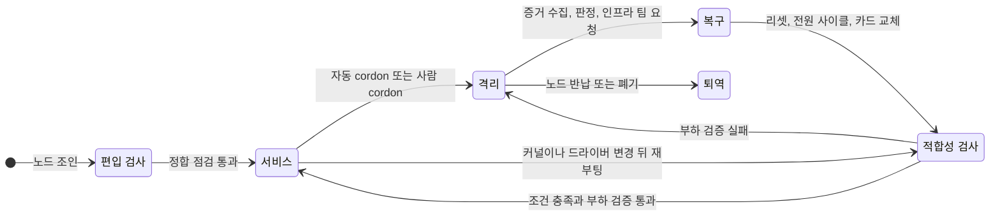

<br>

# TL;DR

- **결과**: 하드웨어 Xid로 GPU가 빠진 노드는 사람 개입 없이 cordon되고, 복구 뒤 부하 검증을 통과하면 자동으로 풀에 돌아온다. 2026년 9월 실사고 1건에서 Xid 발생 12분 26초 뒤 자동 격리됐고, 전원 사이클과 `ip_vs` 수동 복구(2분) 뒤 부하 검증을 거쳐 자동 복귀했다. 같은 결함의 첫 회차는 경보가 울리지 않아 3일 동안 아무도 몰랐다
- 이 체계는 GPU 노드에서 난 장애 네 건에서 나왔다. 두 건은 GPU 하드웨어 장애(ECC DBE, Xid 79)이고, 두 건은 GPU가 아니라 노드 설정이 원인인 장애(OS 자동 업데이트, CoreDNS 오염)다. 하드웨어 장애에서는 감지와 격리가, 설정 장애에서는 호스트 변경 통제와 재부팅 뒤 검사, 편입 검증이 빠져 있었다
- 격리 수단은 노드 단위 cordon이다. `nvidia.com/gpu` 키 taint는 GPU 워크로드가 이미 tolerate해 막지 못하고, 다른 키 taint는 GPU Operator의 DaemonSet까지 막는다. device plugin의 GPU 단위 Unhealthy 표시는 플러그인이 재시작되면 풀린다
- 편입할 때와 재부팅 뒤에 돌리는 정합 점검 스크립트를 만들었다(10월 14일, Ready 노드에 한 번 실행). 점검 항목은 실제 사고에서 나온 것만 뒀다. 반면 호스트의 커널·드라이버 패키지는 아직 버전을 고정하지 않았다
- 남은 과제는 다섯 가지다: GPU 단위 격리와 K8s 밖 실행 경로 차단, 패키지 고정, NVML 불일치 상시 감지, 자동 복귀 경로의 리셋 확인과 재발 이력 반영, Xid 경보식의 사각 — 이 부분의 방향은 조사 결과일 뿐 검증하지 않았다

<br>

# 배경

대상 클러스터는 RKE2 기반의 온프레미스 GPU 학습 클러스터다. GPU 스택은 NVIDIA GPU Operator가 맡고, 드라이버는 노드 호스트에 apt로 설치돼 있다. 2026년 5월부터 9월 사이 이 클러스터의 GPU 노드에서 장애가 네 건 났다.

- **GPU 하드웨어 장애**: GPU 메모리에서 정정 불가 오류(DBE)가 반복된 ECC 장애, GPU가 PCIe 버스에서 떨어진 Xid 79 장애
- **노드 설정 장애**: OS 자동 업데이트가 커널과 NVIDIA 드라이버를 바꾼 장애, 편입 노드의 DNS 설정이 CoreDNS를 오염시킨 장애

노드 설정 장애 두 건은 GPU 하드웨어 결함이 아니라 GPU 노드의 호스트 설정이 원인이다. Xid 79를 뺀 세 건은 블로그에 따로 기록했다([ECC 장애](), [OS 자동 업데이트](), [CoreDNS 오염]()).

네 건은 원인이 있는 계층이 서로 다르지만, 모두 노드 생애주기 가운데 어느 단계가 없어서 났다. 노드 생애주기(node lifecycle)는 노드가 클러스터에 편입돼 워크로드를 받고, 장애나 유지보수로 빠졌다가, 검사를 거쳐 돌아오거나 퇴역하는 전체 과정이다. 여기서는 이 과정을 감지, 격리, 복구, 적합성 검사, 풀 복귀, 변경 관리, 편입 게이트의 일곱 단계로 나눈다. 장애를 겪을 때마다 빠져 있던 단계를 자동화나 검사로 채웠고, 아직 채우지 못한 단계도 있다.

적합성 검사(conformance check)는 노드의 커널 모듈, 드라이버, 쿠버네티스 컴포넌트 설정이 클러스터가 기대하는 기준 상태와 맞는지 확인하는 단계다. 편입 게이트는 새 노드가 클러스터에 들어오기 전에 통과해야 하는 검사 묶음이다.

일곱 단계는 표준으로 정해진 구분이 아니라, 이 클러스터의 장애와 자동화를 정리하려고 나눈 것이다. 단계마다 대응하는 관행은 공개 사례에도 있지만, 단계의 수와 경계는 사례마다 다르다. [NVSentinel](https://github.com/NVIDIA/NVSentinel)은 감지·격리·drain·복구를 모듈로 나누고([남은 과제 절](#남은-과제와-개선-방향미검증)), [CoreWeave](https://docs.coreweave.com/platform/fleet-management/node-lifecycle)는 편입 burn-in과 복귀 전 재검증을 둔다([편입 게이트 절](#편입-게이트-편입-스킬과-정합-점검)).

## 용어

- **Xid**: NVIDIA 드라이버가 GPU 오류를 커널 로그(`NVRM: Xid`)에 남길 때 붙이는 오류 번호다
  - 48은 정정 불가 메모리 오류(DBE), 79는 GPU가 PCIe 버스에서 떨어진 상태다.
  - 13·31·43처럼 사용자 코드가 일으키는 번호도 있다. 읽는 법은 [ECC 장애 글의 Xid 절](#xid-연쇄-읽기)에 있다.
- **row remapping**: 정정 불가 오류가 난 GPU 메모리 행을 예비 행으로 바꾸는 하드웨어 기능이다. 바꾼 행 수는 카드에 영구히 기록된다
- **DCGM**: NVIDIA의 GPU 상태 수집·진단 도구(Data Center GPU Manager)다. dcgm-exporter가 그 값을 Prometheus 지표로 내보낸다
- **NVML**: GPU를 조회·제어하는 NVIDIA 라이브러리(NVIDIA Management Library)다. `nvidia-smi`와 device plugin이 이것을 쓴다
- **device plugin**: GPU를 kubelet에 자원(`nvidia.com/gpu`)으로 등록하고 파드에 배정하는 컴포넌트다. GPU Operator가 노드마다 띄우는 구성 요소(operand) 중 하나이고, dcgm-exporter도 operand다
- **cordon**: 노드의 `spec.unschedulable`을 true로 바꿔 새 파드가 스케줄되지 않게 하는 조작이다
  - 이미 떠 있는 파드에는 영향이 없다([스케줄링 3편의 cordon 절](#cordon의-기술적-의미)).
  - drain은 cordon에 더해 기존 파드를 eviction API로 내보내는 조작이다.
- **정합 점검 스크립트**: 적합성 검사 단계에서 쓰는 도구 중 하나다. 노드의 설정 항목을 기준과 대조한다([적합성 검사와 풀 복귀 절](#적합성-검사와-풀-복귀-부하-검증-뒤-자동-uncordon)에서 다룬다)

<br>

# 장애 네 건과 빠져 있던 단계

## 장애 요약

이하 시각은 KST다.

| 사건 | 영향 | 탐지 경로 | 원인 | 체계상의 빈칸 | 지금 막는 수단 | 상태 |
| --- | --- | --- | --- | --- | --- | --- |
| [GPU ECC DBE]()<br>GPU 하드웨어, `gpu-node-a` GPU 1, 8~10월 5회 | 학습 중단 3회, 4차 뒤 노드 cordon 38일(정상 GPU 3장 포함) | 1차는 remap 경보(25초), 4차는 기록 없음 | 같은 메모리 뱅크의 반복 DBE, 근본 원인 미확정 | 격리: GPU를 빼 두는 설정이 없어 리셋 뒤 다시 배정됨 | cordon 사유 annotation(강제 없는 관례), 새 사고는 자동 cordon | 카드 교체 대기 |
| Xid 79<br>GPU 하드웨어, `gpu-node-b` GPU 4, 9월 2회 | 1회차 3일간 노드의 GPU 배정 전체 실패, Failed 파드를 5분당 약 1,000개씩 재생성 | 1회차는 사용자 제보, 2회차는 경보(46초) | GPU 버스 이탈(근본 원인 미확정), device plugin 배정 결함 | 감지(경보 식), 격리(수동 cordon) | Xid 경보 교정, 자동 cordon과 자동 복귀 | 2회차는 격리·복귀 자동(전원 사이클은 인프라 팀) |
| [OS 자동 업데이트]()<br>노드 설정, `gpu-worker-1`·`-3` 외, 5월·7월 | 재부팅 전 NVML 실패, 재부팅 뒤 kube-proxy 장애, 한 풀은 9일 방치 | 사람이 인벤토리 갱신 중 발견 | 자동 업데이트의 커널·드라이버 갱신, `ip_vs` 영속 설정 부재 | 변경 관리, 재부팅 뒤 적합성 검사, 편입 게이트(`ip_vs` 영속) | GPU 노드 자동 업데이트 꺼짐(10월 14일 점검), `ip_vs` 영속 설정, 정합 점검, 서비스 네트워크 다운 경보 | 패키지 고정 미적용, NVML 불일치 상시 감지 없음 |
| [CoreDNS 오염]()<br>노드 설정, `gpu-node-05`·`-06`, 8월 | CI 이미지 push 간헐 실패 | CI 실패를 보고 사람이 진단(잠복 약 2일 16시간, 완화까지 4시간) | 편입 노드 업스트림 목록의 공용 DNS | 편입 게이트, 편입 뒤 설정 재검사 | 편입 DNS 점검, 버전 정렬, 정합 점검 | 걸러 낸 실적 없음, 팀 절차 밖 편입은 못 막음 |

## GPU 하드웨어 장애

요약 표의 첫 두 건인 ECC DBE와 Xid 79는 GPU 하드웨어 결함에서 시작했다. ECC 장애에서는 경보가 바로 울렸지만, GPU를 빼 두기로 한 판단을 지키게 하는 설정이 없어 같은 GPU가 다시 쓰였다(격리). Xid 79 장애에서는 경보가 울리지 않았고 cordon할 사람도 없어 3일이 지났다(감지, 격리). Xid 79 장애가 자동 cordon과 자동 복귀를 만든 직접 계기다.

### ECC DBE와 격리 판단

결론부터 말하면, 2차 발생 뒤 GPU 1을 풀에서 빼 두기로 판단했지만 그 판단을 클러스터가 지키게 하는 설정은 없었다. 3차와 4차 모두 GPU 1이 다시 풀에 들어간 상태에서 났다.

`gpu-node-a`(RTX PRO 6000 Blackwell 4장)의 GPU 1에서 8월 11일 첫 DBE(Double-Bit Error)가 났다. 같은 위치(FBPA 3, subpartition 0)에서 10월 12일까지 다섯 번 반복됐고, 1~3차는 GPU 단독 리셋으로 복구했다(절차는 [ECC 장애 글](#gpu-핸들-해제와-리셋)).

| 회차 | 발생 | 그때 GPU 1을 쓰던 것 | 처리 |
| --- | --- | --- | --- |
| 1차 | 8월 11일 00:36 | 호스트에서 docker로 띄운 2-GPU 분산 학습 | 같은 날 오후 GPU 단독 리셋 |
| 2차 | 8월 11일 22:25(직전 리셋 5시간 41분 뒤) | 학습 프로세스 | 리셋 |
| 3차 | 8월 14일 22:01(직전 리셋 약 60시간 뒤) | 기록 없음 | 리셋 |
| 4차 | 9월 10일 14:22(직전 리셋 약 27일 뒤) | RayJob 학습 워커(`ray::_RayTrainW`) | 리셋 보류, 노드 cordon |
| 5차 | 10월 12일 19:11 | cordon한 채 건 진단 부하(memtest) | 카드 교체 대기 |

2차 뒤인 8월 12일, 리셋 후에도 풀에 돌려보내지 않는 격리 운용이 안전하다고 판단했다. 이 판단은 [ECC 장애 글 후기의 조치 전환 절](#조치-전환-격리-운용과-선제-rma-문의)에도 적었다. 그런데 리셋 뒤 GPU 1을 빼 두는 설정도, 이유를 적은 cordon도 두지 않았다. 그래서 GPU 1은 이렇게 다시 쓰였다.

- **리셋 절차가 GPU를 풀에 되돌렸다.**
  - device plugin은 Xid 48을 받은 GPU를 Unhealthy로 표시해 allocatable에서 뺀다. 하지만 스스로 Healthy로 돌아오는 경로가 없다. 소스(v0.20.1 기준)에 `FIXME: there is no way to recover from the Unhealthy state.`가 그대로 있고, 플러그인이 재시작해야 장치를 Healthy로 다시 열거한다.
  - 리셋 절차에서 `nvidia.com/gpu.deploy.operands=false` 라벨을 붙였다 떼는 단계가 device plugin 파드를 다시 만든다. 그래서 8월 14일 3차 때도 리셋 뒤 노드가 GPU 4장을 모두 광고했다.
- **그 뒤의 cordon은 ECC 때문이 아니었다.** 8월 18일부터 이 노드에는 cordon이 걸려 있었지만, 사유는 GPU 스모크 테스트용으로 비워 두기, K8s 밖에서 도는 로컬 실험 보호, 인터랙티브 개발 용도로 바뀌었을 뿐이다
- **학습 풀의 GPU가 모자라 cordon을 풀었다.**
  - 9월 10일 13:28, 같은 기종 학습 풀의 GPU가 모두 쓰이고 있었고 대기 중인 잡이 있어 노드를 uncordon했다.
  - 대기하던 RayJob의 GPU 워커가 곧바로 배치됐고, 54분 뒤 GPU 1에서 4차 DBE가 났다. 14:38에 다시 cordon했다.
  - 프로세스 이름(`ray::_RayTrainW`)은 파드 안과 호스트에서 같다. 그래서 쿠버네티스 경로라는 판단은 uncordon과 배치 시각에 근거한다. 어느 제출의 워커였는지는 기록이 남지 않았다.

uncordon하던 시점에 노드 객체에는 ECC 이력이 하나도 없었다. cordon은 `spec.unschedulable` 필드 하나라서, 왜 걸었는지와 언제 풀어도 되는지는 사람의 기억과 노트에만 있었다.

이후의 조치와 지금 상태는 이렇다.

- 사람이 거는 cordon에는 사유와 해제 조건을 annotation으로 남기는 관례를 만들었다(9월 28일). 이 노드에는 "카드 교체 전 uncordon 금지"를 적어 두었다.
- 지금도 GPU 단위 격리 수단은 없다. 10월 15일에는 device plugin 파드가 다시 만들어지면서 이 노드가 GPU 4장을 다시 광고했다.
- 이 노드를 막고 있는 것은 cordon과 사유 annotation뿐이다.

쿠버네티스를 거치지 않는 경로도 남아 있었다. 1차 DBE를 맞은 학습은 호스트에서 docker로 직접 띄운 컨테이너였다. 호스트 직접 실행은 device plugin에도 cordon에도 걸리지 않는다. 당시 이 경로를 막는 수단은 `CUDA_VISIBLE_DEVICES=0,2,3`으로 GPU 1을 피하라는 안내뿐이었다.

4차 뒤로는 노드 전체를 cordon했다. 그래서 결함이 없는 GPU 3장도 10월 18일 기준 38일째 함께 빠져 있다. 계산하면 약 2.7천 GPU-시간이고, 쿠버네티스 밖 사용은 반영하지 않은 값이다. 노드 단위 격리의 비용이고, [남은 과제](#남은-과제와-개선-방향미검증)의 GPU 단위 격리로 이어진다.

5차는 cordon 상태에서 그 GPU에만 건 진단 부하에서 재현됐다. 진단 부하(`dcgmi diag -r 4`)를 건 지 9분 42초 만이었다. 같은 진단에서 행렬 연산 계열 검사와 메모리 할당은 통과했고 memtest만 실패했다. 이 점은 뒤의 [부하 검증의 한계](#적합성-검사와-풀-복귀-부하-검증-뒤-자동-uncordon)와 이어진다.

이 재현으로 벤더 창구가 제시한 접수 기준(교체 대상으로 잡힌 행의 개수)에 도달했고, 지금은 카드 교체를 기다리고 있다. 원인은 확정되지 않았다. 데이터센터 공조 과열도 후보로 검토됐지만 이 노드의 원인으로 확인되지는 않았다.

### Xid 79와 자동 격리의 계기

9월 10일 22:04, 인터랙티브 풀의 `gpu-node-b`(RTX 5090 8장)에서 GPU 4가 버스에서 떨어졌다(Xid 79). 상위 루트 포트의 오류 레지스터에는 링크가 예고 없이 끊긴 흔적(Surprise Down)이 남았지만, 카드·슬롯·라이저 중 어디가 원인인지는 확정하지 못했다.

노드는 capacity 8, allocatable 7을 광고했다. 숫자로는 7장을 쓸 수 있어야 했지만, 실제로는 1장을 요청한 파드도 kubelet admission에서 `UnexpectedAdmissionError`로 거부됐다. 원인은 NVIDIA device plugin(v0.18.1)의 `GetPreferredAllocation`이다.

- 이 메서드는 배정할 장치를 고르기 전에 노드의 전체 장치를 열거해 장치 사이의 링크 정보를 만들고, 그다음에 kubelet이 넘긴 가용 목록으로 거른다.
- 버스에서 떨어진 GPU의 핸들을 열지 못하면 이 단계가 통째로 실패한다.
- 스케줄러는 allocatable 숫자만 보고 계속 그 노드로 파드를 보냈다.
- GPU 워크스페이스의 Deployment는 Failed 파드를 5분당 약 1,000개씩 다시 만들었다.

이 상태가 3일 동안 이어졌다. Xid 경보 규칙은 있었지만 한 번도 울리지 않았고, 사용자 제보로 알았다. 경보가 울리지 않은 이유는 뒤의 [감지 절](#감지-gpu-경보와-xid-게이지-판정식)에서 다룬다. 9월 15일 인프라 팀의 전원 사이클 뒤 사람이 kube-proxy의 `ip_vs`를 고치고, 부하 검증(8장 동시 4분)을 돌려 uncordon했다. 빠져 있던 단계는 감지(경보 식)와 격리(cordon할 사람이 없었다)였다.

- 9월 15일 Xid 경보를 고쳤다.
- 9월 16일 자동 cordon이 들어갔다.
- 9월 22일 그 이후 구간의 자동화가 들어갔다.

11일 뒤 같은 카드가 다시 떨어졌을 때는 [격리](#격리-조건부-자동-cordon)와 [복귀](#적합성-검사와-풀-복귀-부하-검증-뒤-자동-uncordon)가 자동으로 진행됐다. 두 회차를 나란히 놓으면 다음과 같다.

| 회차 | 탐지 | 격리 | 복귀 | 사람이 한 일 | 노드 공백(계산) |
| --- | --- | --- | --- | --- | --- |
| 1회차(9월 10일) | 약 3일 뒤 사용자 제보 | 제보 뒤 사람 cordon | 9월 15일 사람 uncordon | 진단, 전원 사이클 요청, `ip_vs` 복구, 부하 검증 | 약 4.5일, 8장 기준 약 870 GPU-시간(상한) |
| 2회차(9월 21일) | 46초 뒤 경보 | 12분 26초 뒤 자동 cordon | 9월 22일 16:30 자동 uncordon | 전원 사이클 요청, `ip_vs` 복구(2분) | cordon부터 약 25시간, 약 200 GPU-시간 |

2회차는 같은 카드의 두 번째 발생이었다.

- 인프라 팀에 보낸 요청문에는 카드·슬롯·전원 커넥터 점검을 함께 적었고, 정밀 점검이 필요하다는 답을 받았다.
- 가드는 복귀를 판단할 때 이 점검 결과를 보지 않는다. 그래서 전원 사이클 뒤 조건이 채워지자 노드를 풀에 돌려놓았다.
- 10월 18일까지 같은 카드의 세 번째 발생 기록은 없다.

device plugin의 배정 결함은 업스트림에 수정을 제안해 리뷰가 진행 중이다.

## 노드 설정 장애

다른 두 건인 OS 자동 업데이트와 CoreDNS 오염은 원인이 GPU가 아니라 GPU 노드의 호스트 설정(OS 패키지, DNS)에 있었다. 설정이 바뀌었거나 처음부터 어긋나 있었다.

- OS 자동 업데이트는 NVIDIA 드라이버를 바꿔 GPU를 쓸 수 없게 만들었지만, 원인은 호스트 패키지 관리였다. 함께 난 kube-proxy 장애는 GPU와 관계가 없다
- CoreDNS 오염은 GPU 노드를 편입하면서 들어온 DNS 설정이 클러스터 전체의 이름 해석에 영향을 준 경우다

GPU 노드도 다른 노드처럼 편입, 변경, 재부팅을 거치므로 같은 생애주기 안에서 다룬다. 빠져 있던 단계는 변경 관리, 재부팅 뒤 적합성 검사, 편입 게이트다.

### OS 자동 업데이트와 호스트 변경 통제

이 장애에는 세 단계가 빠져 있었다.

- 호스트 패키지 변경을 통제하는 단계
- 재부팅한 노드를 검사하는 단계
- 편입 때 `ip_vs` 영속 설정을 남기는 단계

5월 21일 `gpu-worker-1`·`-3`(RTX 5090 8장)에서 unattended-upgrades가 NVIDIA 드라이버(580.126.09 → 580.159.03)와 커널(5.15.0-179)을 한 번에 설치했다.

- 재부팅 전에는 커널 모듈과 NVML 라이브러리 버전이 어긋나 `nvidia-smi`가 실패했다.
- 재부팅 뒤에는 kube-proxy(IPVS 모드)가 죽었다. IPVS(IP Virtual Server)는 커널의 L4 로드밸런서이고, 이 모드의 kube-proxy는 커널 모듈 `ip_vs`가 있어야 뜬다.
- 그동안 쿠버네티스는 노드를 Ready, GPU 8장으로 보고했다. 이상은 사람이 인벤토리를 갱신하다 우연히 찾았다.

경위는 [OS 자동 업데이트 글]()에 있다.

이후 기록을 이어 보면 같은 패턴이 두 번 더 나왔다.

- 다음 날 같은 잠복이 다른 노드 다섯 대에서 드러났다. 인프라 팀이 드라이버를 다시 설치하고 그 노드들의 자동 업데이트를 껐다. 재부팅 뒤 생긴 kube-proxy 장애는 한 풀에서 쿠버네티스 쪽이 9일 동안 알아채지 못했다
- 7월 25일에는 처음 두 노드에서 unattended-upgrades가 드라이버를 다시 올렸다(580.159.03 → 580.173.02). 두 노드의 자동 업데이트가 그때까지 켜져 있었다는 뜻이다
  - 재발 방지로 `nvidia-`·`libnvidia-` 패키지를 자동 업데이트에서 빼 달라고 인프라 팀에 요청했다. 패키지 정책은 인프라 팀 소관이라 요청으로 남겼다.
  - 블랙리스트가 적용됐는지는 확인하지 못했다.

재부팅 뒤 장애의 원인도 이후 다시 정리됐다. 처음 글에서는 `modprobe`가 참조하는 depmod 바이너리 캐시가 새 커널에서 불완전했다고 추정했다([모순 상황 절](#모순-상황)). 그런데 같은 증상이 4월부터 10월까지 아홉 번 반복되면서 10월 12일에 원인을 다시 판정했다.

- **경고의 정체.** 이 클러스터의 RKE2 kube-proxy static pod는 호스트 `/lib/modules`를 마운트하지 않는다.
  - kube-proxy가 쓰는 IPVS 라이브러리는 시작할 때 컨테이너 안에서 `modprobe -va ip_vs`를 부른다. 그래서 로그의 `Module ip_vs not found in directory …` 경고는 원인과 무관하게 항상 찍힌다.
  - 프로세스를 죽이는 것은 그다음의 `Ipvs not supported`, 즉 호스트 커널에 `ip_vs`가 올라와 있지 않다는 사실이다.
- **모듈이 올라오는 경로.** 이 클러스터의 5.15 커널에서 `ip_vs`는 netlink 패밀리 자동 적재용 별칭을 선언하지 않는다(별칭은 리눅스 5.16에서 추가됐다).
  - 그래서 kube-proxy가 IPVS를 조회해도 커널이 모듈을 올려 주지 않는다.
  - 남는 경로는 부팅 때 `systemd-modules-load`가 `/etc/modules-load.d/*.conf`를 읽는 것뿐이다.
  - 그런데 노드 편입 절차는 조인할 때 `modprobe`로 한 번 올리기만 하고 영속 설정을 남기지 않았다.
- **커널이 바뀌지 않아도 재부팅만 하면 재발한다.** 10월 12일 `gpu-node-a`가 같은 커널로 재부팅했을 때도 같은 증상이 났다. 5월에 `depmod -a`와 `modprobe`로 회복한 것도 실제로는 `modprobe` 덕분이었다

> 참고: 실제 부팅 커널은 `gpu-worker-1`이 5.15.0-171, `gpu-worker-3`이 5.15.0-176이었다. 처음 글의 "177 → 179"는 패키지 이력 기준이다. 177은 디스크에 설치돼 있다가 같은 업데이트에서 제거됐고, 177로 부팅한 기록은 없다. 즉 재부팅 한 번으로 171·176에서 179로 건너뛰었다.

영속 설정 말고 검토할 만한 방법도 둘 있다. 둘 다 검증하지 않았다.

- kube-proxy에 호스트 `/lib/modules`를 마운트하는 RKE2 옵션(`kube-proxy-extra-mount`)을 써서, 컨테이너 안의 `modprobe`가 호스트 커널에 모듈을 올리게 한다.
- 별칭이 있는 5.16 이상 커널로 옮긴다.

### CoreDNS 오염과 편입 검증

이 장애는 검증 없이 한꺼번에 편입한 노드에서 시작됐다. 같은 날 편입한 노드에서는 다른 잠복 결함도 함께 들어왔다.

8월 7일(금) 긴급 워크로드용으로 임대한 노드를 대량 편입했다. 그중 `gpu-node-05`·`-06`의 업스트림 DNS 목록(`/run/systemd/resolve/resolv.conf`)에 공용 DNS가 세 번째로 들어 있었다. 그 노드에 뜬 CoreDNS 레플리카가 사내 레지스트리 이름에 공용 레코드를 간헐적으로 돌려줬다. 구조는 [CoreDNS 글](#coredns-forward와-노드-resolvconf-상속-구조)에 있다.

- **8월 10일**: CI의 이미지 push가 실패하기 시작했다(편입 뒤 약 2일 16시간). 4시간 뒤 CoreDNS 배치 배제로 완화했다.
- **8월 11일**: 노드 DNS 설정을 고친 뒤 kubelet이 읽는 파일 기준으로 재검증을 통과했고, 배제 라벨을 원복했다. 처음 글의 마지막 상태(라벨 유지)보다 진행된 결과다.

같은 날 편입된 노드에서 나온 결함은 DNS만이 아니었다.

- **쿠버네티스 버전**
  - 편입 노드의 kubelet은 v1.35.7, 컨트롤 플레인은 v1.34.3이었다([계기 절의 출력](#계기-긴급-노드-대량-편입)).
  - 버전 스큐 정책은 "kubelet must not be newer than kube-apiserver"라서, 이 조합은 지원 범위 밖이다.
  - 정책은 kube-proxy에도 같은 조건을 둔다. RKE2의 kube-proxy는 노드의 RKE2 버전을 따르므로, 그 노드는 kube-proxy도 지원 범위 밖이었다.
  - RKE2 설치 스크립트는 버전을 지정하지 않으면 stable 채널의 최신판을 설치한다.
- **RKE2 유닛**: 같은 날 편입된 다른 노드 한 대는 워커인데 `rke2-server`가 켜진 채였다. 10월 6일 재부팅 때 에이전트 대신 단독 클러스터로 기동해 노드가 돌아오지 않았다

이날 편입은 긴급 편입이라 팀의 편입 절차를 거치지 않았다. 빠져 있던 단계는 둘이다. 하나는 편입 게이트(DNS·버전·유닛 검증)이고, 다른 하나는 편입 뒤 설정이 다시 어긋났을 때 찾아내는 재검사다.

<br>

# 단계별 구현

아래 구현 가운데 자동 cordon 단계는 동료가 만들었다. 직접 만든 것은 세 가지다.

- 경보 교정
- cordon 이후 구간(증거 수집, 판정, 복구 검증, 자동 복귀)
- 노드 편입 스킬과 정합 점검

감지부터 풀 복귀까지는 주로 GPU 하드웨어 장애에서, 변경 관리와 편입 게이트는 노드 설정 장애에서 나온 단계다. 적합성 검사의 정합 점검은 두 쪽에 걸친다.

## 일곱 단계와 현재 상태

| 단계 | 하는 일 | 이 클러스터에서 맡는 것 | 선언 위치 | 상태 |
| --- | --- | --- | --- | --- |
| 감지 | 장애 신호를 사람과 자동화에 알린다 | DCGM exporter 지표 + Grafana 경보 | 인프라 GitOps 레포 | 운영 중 |
| 격리 | 장애 노드나 GPU에 새 작업이 가지 않게 한다 | device plugin Unhealthy, 자동 cordon, 사람 cordon | 인프라 GitOps 레포(자동 cordon) | 운영 중(실사고 1건) |
| 복구 | 원인을 판정하고 리셋·전원 사이클·교체로 고친다 | 증거 수집 Job, 인프라 팀 | 인프라 GitOps 레포(증거 수집) | 판정 Job은 배포만, 조치는 사람 |
| 적합성 검사 | 복구나 변경 뒤 노드가 기준 상태인지 확인한다 | 부하 검증 Job, 정합 점검 스크립트 | 인프라 GitOps 레포, 팀 플러그인 레포 | 부하 검증 운영 중, 정합 점검은 수동 도구 |
| 풀 복귀 | 검사를 통과한 노드를 다시 스케줄 대상으로 돌린다 | 자동 uncordon | 인프라 GitOps 레포 | 운영 중(실사고 1건) |
| 변경 관리 | 커널·드라이버·OS 패키지 변경을 통제한다 | 일부만 있다 | 없음(호스트 패키지는 인프라 팀 관리) | 일부 |
| 편입 게이트 | 새 노드를 기준 상태일 때만 클러스터에 들인다 | 노드 편입 스킬 | 팀 플러그인 레포 | 도구(걸러 낸 실적 없음) |

표의 선언 위치 열에서 이 체계의 제약이 드러난다.

- 클러스터 쪽 자동화는 인프라 GitOps 레포의 매니페스트로 선언돼 ArgoCD가 동기화한다. 편입·점검 스크립트는 팀 Claude Code 플러그인 레포에 있다.
- 호스트 OS의 패키지와 DNS 설정은 인프라 팀이 관리하는 영역이고, 클러스터 쪽 코드에는 선언돼 있지 않다.
- 예외도 있다. CoreDNS 배치 배제에 쓴 HelmChartConfig(RKE2가 기본 애드온 차트의 값을 덮어쓸 때 쓰는 리소스)는 8월 10일 완화 때 `kubectl apply`로 클러스터에 직접 적용했다([CoreDNS 글의 완화 절](#완화-coredns-배치-배제)). 배제 라벨을 원복한 뒤에도 문제 노드에 다시 쓰려고 남겨 두었지만, GitOps 레포에는 없다.

그래서 호스트 쪽은 설정을 선언하는 대신, 어긋난 상태를 [편입 게이트](#편입-게이트-편입-스킬과-정합-점검)와 정합 점검으로 찾아내는 방식으로 다룬다.

## 상태와 전이



이 가운데 사람 없이 도는 전이는 셋이다.

- 서비스 → 격리(자동 cordon)
- 적합성 검사 → 서비스(자동 uncordon)
- 적합성 검사 → 격리(부하 검증이 실패하면 cordon 유지)

원인 판정은 Job이 하지만, 리셋과 전원 사이클은 사람과 인프라 팀이 한다. 변경 뒤 재부팅에서 시작하는 경로는 전부 사람이 돌린다.

## 감지: GPU 경보와 Xid 게이지 판정식

감지는 dcgm-exporter와 kube-state-metrics 지표에 건 Grafana 경보로 한다. 경보 규칙도 인프라 GitOps 레포의 provisioning 파일로 선언돼 있다.

- **GPU 쪽**: Xid, row remap 2종(정정 불가 remap 증가, remap 실패), 온도, ghost utilization(작업이 없는데 사용률이 높게 잡히는 상태, [Phantom 글]()), GPU 감소(allocatable < capacity), gpu-feature-discovery(노드에 GPU 정보 라벨을 붙이는 GPU Operator 구성 요소) 반복 재시작
- **노드 쪽**: 서비스 네트워크 다운(kube-proxy와 CNI, 즉 파드 네트워크 플러그인이 죽은 상태), cordon 장기 방치

앞의 [Xid 79 장애](#xid-79와-자동-격리의-계기)에서 Xid 경보가 3일 동안 울리지 않은 이유는 지표의 형태에 있다. `DCGM_FI_DEV_XID_ERRORS`는 카운터가 아니다. dcgm-exporter 정의로 "Value of the last XID error encountered", 즉 마지막으로 관측된 Xid 번호를 담는 게이지다.

- Xid가 한 번도 없던 GPU는 시리즈 자체가 없다.
- Xid 79가 나면 값이 79인 시리즈가 새로 생기고, 그 값이 그대로 유지된다.
- `increase()`는 창 안에 점이 두 개 이상 있어야 값을 낸다. `changes()`는 점이 하나면 0을 낸다. Prometheus 문서도 `increase`는 카운터에만 쓰라고 적는다.

시리즈가 79로 처음 나타나 그대로 머무르니, 두 함수 모두 한 번도 0을 넘지 않는다.

```text
# 교정 전 — 게이지에 increase()를 걸어 첫 Xid부터 그 뒤까지 한 번도 0을 넘지 않는다
max by (Hostname, gpu) (increase(DCGM_FI_DEV_XID_ERRORS[5m])) > 0

# 교정 후(9월 15일) — 현재값으로 판정한다
# != 13 … != 109 : 사용자 코드가 일으키는 Xid 제외 (device plugin 헬스 체크의 기본 무시 목록과 같다)
# unless … offset 24h : 24시간 전에 Xid 값이 있던 GPU를 빼서, 경보가 24시간 뒤 스스로 꺼지게 한다
max by (Hostname, gpu) (DCGM_FI_DEV_XID_ERRORS) > 0 != 13 != 31 != 43 != 45 != 68 != 109
  unless on (Hostname, gpu) (max by (Hostname, gpu) (DCGM_FI_DEV_XID_ERRORS offset 24h) > 0)
```

교정 전 식은 7월의 Xid 120(10일 무경보)과 9월의 Xid 79(3일)를 놓쳤다. 교정 뒤 첫 실발화는 9월 21일로, Xid 발생 46초 뒤였다.

교정한 식에도 사각이 있다.

- `unless`의 오른쪽 항은 사용자 코드 Xid를 거르지 않는다.
- 그래서 24시간 전 마지막 값이 13·31·43 같은 사용자 코드 Xid였던 GPU는, 그 뒤 하드웨어 Xid가 나도 경보가 울리지 않는다.
- 학습 클러스터에서 사용자 코드 Xid는 흔하다.

이 글을 검토하며 promtool(Prometheus 규칙 테스트 도구)로 이 동작을 재현했다. 고치는 방향은 [남은 과제](#남은-과제와-개선-방향미검증)에 적었다.

ECC 1차 DBE는 25초 만에 알려졌다([ECC 장애 글의 경보 절](#slack-알림과-grafana-경보)). 그 규칙이 정정 불가 remap 행의 누적 개수(`DCGM_FI_DEV_UNCORRECTABLE_REMAPPED_ROWS`)에 `increase()`를 걸었기 때문이다. 누적 개수에는 `increase()`가 맞고, 마지막 값을 담는 게이지에는 맞지 않다. dcgm-exporter에는 창 단위 Xid 개수(`DCGM_EXP_XID_ERRORS_COUNT`)와 누적 개수(`DCGM_EXP_XID_ERRORS_TOTAL`)도 있다. 다만 기본 수집 목록(4.8.4 기준)에서는 주석 처리돼 있다.

현재값 판정은 24시간 뒤 스스로 꺼진다. 그 뒤로는 GPU 감소(10분)와 gpu-feature-discovery 반복 재시작 warning이 지속 상태를 알린다.

- **cordon된 노드에서는 둘 다 울리지 않는다.** 표준 첫 조치인 cordon이 곧 경보를 끄는 동작이 되고, 경보가 울리고 있으면 아직 아무도 손대지 않았다는 뜻이 된다.
  - 다만 이 클러스터에서 cordon은 장애 격리에만 쓰이지 않는다.
  - 스모크 테스트용으로 비워 두거나 K8s 밖 실험을 보호하려고 건 cordon도 같은 경보를 끈다.
- **cordon이 72시간 넘게 이어지면 다시 알린다.** 하드웨어 Xid가 있는 노드에는 별도 규칙이 걸려 있다.
- **복구 통보는 자동 복귀 짝 규칙으로만 보낸다.** 경보의 해소(resolved)는 조건이 풀렸다는 뜻일 뿐 복구가 아니다([ECC 장애 글의 Resolved 절](#resolved-알림의-의미)).

아직 감지하지 못하는 것도 있다.

- **NVML 불일치**: 커널 모듈과 NVML 라이브러리 버전이 어긋나도 노드는 Ready로 남는다. 상시 감지 수단은 없고, 편입·재부팅 뒤 정합 점검의 `nvidia-match` 항목이 유일하다
- **DNS 오염**: CoreDNS에 걸린 경보 규칙이 없다
- **ECC가 없는 기종**: 정정 불가 remap 지표는 ECC를 지원하는 일부 기종에만 나온다. 나머지 GPU는 메모리 오류 신호 자체가 없다
- **뒤이은 사용자 코드 Xid**: 게이지는 마지막 값만 담는다
  - 하드웨어 Xid 뒤에 같은 GPU에서 무시 목록의 Xid가 이어지면, 경보와 가드 모두 하드웨어 Xid를 보지 못할 수 있다.
  - 예를 들어 Xid 45는 다른 오류 뒤 정리 단계에서 찍힌다.
  - 가능성 분석이고, 실제로 일어난 사례는 확인하지 않았다.

## 격리: 조건부 자동 cordon

이 클러스터의 격리 수단은 노드 단위 cordon이다. GPU 단위 수단과 taint는 각자의 이유로 격리를 보장하지 못했다.

| 수단 | 단위 | 막는 것 | 못 막는 것 | 이 클러스터에서 |
| --- | --- | --- | --- | --- |
| device plugin Unhealthy | GPU | 그 GPU에 대한 신규 K8s 배정 | 실행 중 파드, 호스트 직접 실행, 플러그인 재시작 뒤의 재광고 | 사용자 코드 Xid를 뺀 Xid마다 자동으로 걸리지만 리셋 절차에서 풀린다. 버스에서 떨어진 GPU가 있으면 노드 전체 배정이 실패한다 |
| taint `NoSchedule` | 노드 | 그 키를 tolerate하지 않는 신규 파드 | 그 키를 tolerate하는 파드 | `nvidia.com/gpu` 키는 GPU 워크로드가 이미 tolerate하고, 다른 키는 GPU Operator DaemonSet까지 막는다 |
| taint `NoExecute`(전용 키) | 노드 | 신규 파드, `nodeName` 지정 파드(kubelet admission에서 거부) | 그 taint를 tolerate하는 파드, 호스트 직접 실행 | 실행 중 파드를 즉시 축출해, 축출하지 않는다는 원칙과 맞지 않는다 |
| cordon | 노드 | 스케줄러를 거치는 신규 파드 | 실행 중 파드, `nodeName` 지정 파드, unschedulable taint를 tolerate하는 파드, 호스트 직접 실행 | 채택 |
| `nvidia-smi drain` | GPU(드라이버) | 새 NVML 클라이언트 | 기존 클라이언트. K8s는 플러그인 재시작 전까지 모른다 | 쓴 적 없음 |

toleration은 키가 같아야 taint를 견딘다(매칭 규칙은 [스케줄링 3편](#taints-and-tolerations)). 이 클러스터에서는 두 방향 모두 막혔다.

- **`nvidia.com/gpu` 키 taint**: GPU 워크스페이스 템플릿과 학습 파드가 이 키의 toleration을 이미 갖고 있어, 그 키의 taint를 그대로 통과한다. 가드 설계 문서가 든 이유가 이것이다.
- **다른 키 taint**: GPU Operator operand DaemonSet의 기본 toleration이 `nvidia.com/gpu` 키 하나라서, 리셋 절차에서 operand를 다시 띄우지 못한다.

cordon은 DaemonSet 파드를 막지 않아 이 문제가 없다.

cordon도 모든 경로를 막지는 못한다. 쿠버네티스 문서는 unschedulable taint를 tolerate하는 파드와 `nodeName`을 직접 지정한 파드가 drain된 노드에도 뜬다고 적는다(`nodeName` 경로는 [스케줄링 6편](#cordon된-노드에-nodename을-지정하면)에서 다뤘다). 이 클러스터에서도 두 경로가 실제로 관측됐다.

- 모든 taint를 tolerate하는(`operator: Exists`) 파드가 cordon 노드에 떴다.
- `nodeName`으로 노드를 지정하는 평가 워크로드 잡은 cordon과 무관하게 들어간다. 그래서 cordon과 별도로 그 워크로드 담당에게 배치 대상 제외를 요청하는 절차를 둔다.

아래 판정식과 안전장치, 설계 비교는 동료가 만든 가드 설계다. GPU 노드 가드는 5분마다 Prometheus를 조회해, 세 조건을 모두 만족하는 노드를 cordon하는 CronJob이다.

```text
# ① 하드웨어성 Xid: 마지막 Xid 값이 0보다 크고 사용자 코드 Xid가 아니다
(max by (node) (label_replace(DCGM_FI_DEV_XID_ERRORS > 0 != 13 != 31 != 43 != 45 != 68 != 109,
    "node", "$1", "Hostname", "(.*)")))
# ② GPU 감소가 10분 창 내내 유지된다: 드라이버 업그레이드 같은 일시 감소를 거른다
and on (node) (min_over_time((
      max by (node) (kube_node_status_capacity{resource="nvidia_com_gpu"})
    - max by (node) (kube_node_status_allocatable{resource="nvidia_com_gpu"}))[10m:1m]) > 0)
# ③ 아직 cordon되지 않았다: 사람이 일부러 막아 둔 노드는 건드리지 않는다
and on (node) (max by (node) (kube_node_spec_unschedulable) == 0)
```

두 신호를 AND로 묶은 이유는 한쪽만으로는 오탐 여지가 있어서다. Xid만 보면 애플리케이션 오류와 섞이고, GPU 감소만 보면 드라이버 업그레이드나 MIG(Multi-Instance GPU) 재구성 중의 일시 감소에도 걸린다. `label_replace`는 DCGM 지표의 `Hostname` 라벨을 kube-state-metrics의 `node` 라벨에 맞추려고 쓴다. 두 신호는 노드 단위로 묶이므로, 한 GPU에 남은 오래된 하드웨어 Xid 값과 다른 GPU의 감소가 겹쳐도 조건이 맞는다.

판정에 걸린 노드는 사이클당 한 대만 cordon하고, annotation 네 개를 남긴다.

```yaml
# 가드가 cordon하며 노드에 남기는 annotation (키 접두어는 익명화, 값은 9월 21일 실사고 기준)
metadata:
  annotations:
    example.com/auto-cordon-reason: xid-79                 # 판정에 쓴 Xid
    example.com/auto-cordon-at: "2026-09-21T06:05:10Z"     # cordon 시각(UTC)
    example.com/auto-cordon-boot-id: <bootID>              # 재부팅이 있었는지 가르는 기준값
    example.com/auto-cordon-gpu-capacity: "8"              # 카드가 전량 돌아왔는지 가르는 기준값
```

annotation으로 누가 cordon했는지도 구분한다. 사람이 `kubectl cordon`으로 건 cordon은 `spec.unschedulable`만 바꾸므로, annotation이 있으면 가드가 건 것이다. 뒤의 자동 복귀는 이 annotation이 있는 노드만 다루고, 사람이 일부러 막아 둔 노드는 풀지 않는다.

안전장치는 세 가지다.

- **차단기**: 자동 cordon된 노드가 다섯 대 이상이면 새 격리를 하지 않는다. 지표 오류로 노드가 한꺼번에 잠기는 경로를 끊는다
  - 다섯 대는 운영 상태에 맞춰 정한 절대값이다. 교체를 기다리는 자동 cordon 노드가 쌓이면 새 격리가 멈출 수 있다.
  - 차단기 전용 경보는 없다. 그동안은 Xid 경보 본문의 안내대로 사람이 cordon한다.
  - 복귀 판정은 차단기와 무관하게 돈다. 스크립트에서 복귀 판정이 먼저 실행되기 때문이다.
- **응답 검사**: Prometheus 응답이 비정상이거나 파싱에 실패하면 "대상 없음"으로 넘기지 않고 비정상 종료한다
- **축출 없음**: drain과 축출은 하지 않는다
  - 오탐 한 번으로 며칠짜리 학습을 죽이면 자동화를 신뢰할 수 없게 된다. 스케줄링 배제는 cordon으로 충분하다.
  - 노드가 죽은 뒤 남은 파드의 정리와 제출자 통보는 별도 정리 CronJob(동료 작성)이 맡는다.

가드 설계에서는 node-problem-detector에 그 결과를 받아 cordon하는 도구를 붙이는 조합도 비교했다. 그러나 커널 로그를 다시 파싱해 DCGM이 이미 주는 정보를 중복 수집하는 컴포넌트가 둘 늘어난다는 이유로 쓰지 않았다. node-problem-detector는 문제를 NodeCondition과 Event로 보고만 하고, cordon이나 taint 같은 조치는 별도 도구의 몫이다.

9월 21일 `gpu-node-b`의 같은 카드가 다시 떨어졌을 때의 흐름은 이렇다.

| 시각 | 사건 |
| --- | --- |
| 14:52:44 | GPU 4에서 Xid 79 |
| 14:53:30 | Xid 경보(46초) |
| 15:05:10 | 자동 cordon(12분 26초). 10분 유지 창과 5분 주기를 합친 지연이다 |
| 15:15:30 | 자동 cordon 통보 |

첫 회차 같은 Failed 파드 재생성은 없었다. 다만 cordon 전 12분 26초 동안은 노드가 열려 있었고, 그 사이 그 노드로 배정이 시도됐는지는 기록에 없다. 하드웨어성이 분명한 Xid 79에도 10분 유지 창이 똑같이 걸린다.

운영 기록은 아직 짧다.

- 9월 16일 배포 뒤 10월 18일까지 가드가 cordon한 것은 9월 21일 한 건이다. 오탐으로 기록된 cordon은 없지만, 표본이 한 건이라 오탐률을 말할 수는 없다.
- 9월 16일 판정식을 처음 실측했을 때는 실제 장애 노드 두 대를 정확히 골라냈다.
  - `gpu-node-a`가 그중 하나였다. Xid 48에 GPU 감소가 겹쳐 있었고, 이미 사람이 cordon해 둔 상태라 조치 대상에서는 빠졌다.
  - 이것도 그날 한 시점의 확인이다.

자동 cordon 대상이 아닌 경우도 있다.

- **이미 cordon된 노드는 판정에서 빠진다.** `gpu-node-a`의 5차처럼 사람이 cordon해 둔 노드의 사고는 사람이 다룬다. 4차는 가드가 배포되기 전이다.
- **Xid 지표가 나오지 않는 노드는 잡지 못한다.** GPU operand를 꺼 둔 대여 노드가 그 예다.
- **GPU 감소가 따르지 않는 장애도 대상이 아니다.**
- **오탐으로 cordon된 노드는 사람이 풀어야 한다.** 재부팅 계열 Xid는 bootID가 바뀌지 않아 자동 복귀가 일어나지 않는다. 사람이 uncordon하면 가드는 annotation만 정리한다.

## 복구: 증거 수집과 판정

cordon 직후 가드는 그 노드에 증거 수집 Job을 띄운다.

- `nodeName`으로 노드를 고정해 cordon을 의도적으로 우회한다. [스케줄링 6편](#cordon된-노드에-nodename을-지정하면)에서 다룬 그 경로다.
- `privileged: false`인 파드지만, CAP_SYS_ADMIN·CAP_SYS_PTRACE·CAP_SYS_CHROOT와 hostPID를 갖고 `nsenter -t 1 -m`으로 호스트 mount 네임스페이스에 들어가 `journalctl`·`lspci`를 실행한다. 권한이 호스트 root에 가깝다.
- 읽는 것: Xid 코드, Xid 154의 복구 지시, PCI 설정 공간(configuration space)이 전부 `ff`로 읽히는지, 상위 루트 포트의 AER(Advanced Error Reporting) 레지스터
- 판정과 인프라 팀 요청문 초안을 표준 출력에 쓰고, 호스트에는 아무것도 쓰지 않는다.
- 권한이 넓은 만큼, 가드가 만드는 Job은 ValidatingAdmissionPolicy로 모양을 고정했다. ValidatingAdmissionPolicy는 API 요청을 규칙으로 검사해 거부하는 쿠버네티스 admission 기능이다.

| 판정 | 조건 | 사람이 할 일 |
| --- | --- | --- |
| 전원 사이클 | Xid 79, 또는 설정 공간이 전부 `ff` | 인프라 팀에 전원 차단 후 재기동 요청. soft reboot는 죽은 GPU의 종료 응답을 기다리다 멈춘다 |
| 리셋 절차 | Xid 48·94·95·119·120이고 설정 공간이 정상 | 그 GPU를 쓰는 파드를 비우고 GPU 리셋 |
| RMA(제조사 교체) | Xid 143 | 카드 교체 요청 |
| 사람 진단 | 그 밖의 코드 | 코드표와 기록으로 판단 |

판정은 드라이버의 복구 지시보다 Xid 코드와 설정 공간을 우선한다. 이 우선순위는 9월 21일 사례에서 정했다. 그날 드라이버는 Xid 154로 리셋을 지시했지만 설정 공간이 `ff`라 리셋이 닿지 않았고, 사람이 전원 사이클로 판정했다. 증거 수집 Job이 들어오기 전이다.

NVIDIA Xid 카탈로그는 Xid마다 즉시 조치(Immediate Action)를 두고, 이를 시스템을 서비스로 되돌리는 데 바로 필요한 조치로 정의한다.

- Xid 79: 베어메탈 재시작
- Xid 95: GPU 리셋
- Xid 48: 단독이면 리셋, row remap(Xid 63·64)과 함께면 drain 후 리셋

카탈로그와 다르게 정한 곳도 있다.

- **Xid 94**: 카탈로그상 즉시 조치는 앱 재시작이고, 리셋은 편할 때 하라고 권한다. 가드는 device plugin이 Unhealthy를 스스로 풀지 않으므로 이 코드를 리셋 절차에 묶었다.
- **Xid 143**: 카탈로그상 즉시 조치는 GPU 리셋이다. 가드는 리셋과 전원 사이클로 복구되지 않는 코드로 보고(런북 기준) 교체 요청으로 둔다.

또 카탈로그의 적용 대상 열에는 A100·H100·B100·GB200만 있고, 이 클러스터의 RTX PRO 6000 Blackwell과 RTX 5090은 없다. 표의 매핑은 그 문서를 참고해 정한 운영 기준이다.

장애 원장은 cordon마다 카드 UUID와 PCI 슬롯을 한 줄씩 남기는 ConfigMap이다. git과 ArgoCD가 관리하지 않는 런타임 상태다. 원장이 배포된 9월 23일, [앞의 Xid 79 카드](#xid-79와-자동-격리의-계기) 두 회차를 손으로 옮겨 적었다. 그 직후의 원장은 이렇다.

```yaml
# 장애 원장 ConfigMap (노드 이름과 UUID는 익명화, 값은 9월 23일 기준)
apiVersion: v1
kind: ConfigMap
metadata:
  name: gpu-fault-ledger
data:
  # 키는 노드 이름, 값은 사고 한 건에 한 줄
  # 열: <시각(UTC)> <xid-코드> <PCI 주소(슬롯)> <GPU UUID(카드)> <기록 주체>
  gpu-node-b: |
    2026-09-10T13:03:59Z xid-79 0000:99:00.0 GPU-1a2b3c4d-5e6f-7a8b-9c0d-1e2f3a4b5c6d manual
    2026-09-21T05:52:44Z xid-79 0000:99:00.0 GPU-1a2b3c4d-5e6f-7a8b-9c0d-1e2f3a4b5c6d manual
```

두 줄은 손으로 옮겨 적은 것이라 기록 주체가 `manual`이고, 시각도 Xid 발생 시각이다. 가드가 쓰는 줄은 cordon 시각으로 남고 `gpu-node-guard`로 끝난다.

cordon할 때 가드는 이 원장에서 회수를 센다. 같은 카드 회수는 모든 노드의 줄에서 UUID로, 같은 슬롯 회수는 그 노드의 줄에서 PCI 주소로 센다. 카드 회수를 1차 기준으로 둔 것은 카드가 다른 슬롯이나 노드로 옮겨 가도 이력이 이어지게 하려는 것이다. 회수에 따라 요청문의 이력 문장이 바뀐다.

- 같은 카드 2회째: 점검 요청
- 3회째부터: 교체 요청
- 카드는 새것인데 같은 슬롯이 반복될 때: 라이저·슬롯·전원 점검

위 원장 상태에서 이 카드가 다시 떨어지면 같은 카드 3회째로 세어져, 요청문의 이력 문장이 교체 요청이 된다.

카탈로그는 즉시 조치를 자동화할 수 있는 조치로 설명한다. 그래도 리셋·재부팅·전원 조작은 자동화하지 않았다. 리셋은 그 GPU의 워크로드를 죽이고, 재부팅과 전원은 인프라 팀 소관이다. `nvidia-smi` 문서도 GPU 리셋을 "not recommended for production environments at this time"이라 적는다. 그리고 리셋한 GPU는 다시 쓰기 전에 상태를 확인하라고 권한다.

증거 수집 Job과 원장은 9월 22~23일에 배포됐다. 그 뒤로 자동 cordon 사고가 없어서 실제 장애 노드에서 돈 기록은 아직 없다. 정상 노드에서의 실행과 오프라인 재현까지가 확인한 범위다.

## 적합성 검사와 풀 복귀: 부하 검증 뒤 자동 uncordon

자동 복귀는 두 가지를 모두 통과해야 일어난다. 하나는 노드가 돌아왔다는 클러스터 쪽 증거이고, 다른 하나는 부하 검증이다. 다만 지금의 부하 검증은 GPU 연산이 고르게 도는지만 본다. 메모리 결함, 호스트 설정, 리셋 여부는 직접 보지 않는다.

런북은 인프라 팀이 복구를 마친 뒤 사람이 세 가지를 확인하게 한다. 노드 Ready와 ping, kube-proxy READY, GPU capacity와 allocatable의 일치다. 다만 가드는 이 확인을 기다리지 않는다. 5분마다 자기가 cordon한 노드(annotation이 있는 노드)를 다시 보고, 아래 조건을 순서대로 모두 만족해야 다음으로 넘어간다.

1. 아직 cordon 상태다. 사람이 먼저 풀었으면 annotation만 정리한다
2. bootID(부팅마다 새로 생기는 노드 식별자)가 cordon 때와 다르다. 재부팅이 있었다는 클러스터 쪽 증거다
   - soft reboot와 전원 사이클은 가리지 못한다. 카드가 돌아왔는지는 3번 조건과 부하 검증이 본다.
   - 리셋 계열 Xid(48·94·95·119·120)는 재부팅 없이 복구되므로 이 조건을 생략한다.
   - 대신 리셋 절차의 operand 라벨 사이클로 dcgm-exporter가 재시작돼 Xid 게이지가 비어야 4번 조건을 통과한다.
3. 노드가 Ready이고, GPU capacity가 cordon 때 값과 같고 allocatable과도 같다. 카드가 영구히 빠진 채 7/7로 맞아떨어지는 상태를 전량 복귀로 오판하지 않으려고, cordon 때 값을 annotation에 남겨 둔다
4. 부팅 뒤 하드웨어성 Xid가 없다
5. 그 노드에 GPU를 쥔 Running 파드가 없다

모두 만족하면 부하 검증 Job을 띄운다.

- 검사 내용: 모든 GPU에 8192×8192 fp16 행렬곱을 90초 동안 건다.
- 판정 기준: GPU 장수, 예외 여부, 카드별 처리량의 최저/최고 비율(0.8 이상)
- 카드 사이의 비율만 보므로, 노드 전체가 함께 느려지면 통과한다.
- 통과하면 uncordon하고 annotation을 지운다. 실패하면 cordon을 유지하고 Job 실패 경보로 사람을 부른다.

9월 22일 `gpu-node-b`의 흐름은 이랬다.

- 인프라 팀의 전원 사이클 뒤 NIC이 올라오지 않아 점검을 한 번 더 거쳤다.
- 노드가 돌아온 뒤 사람이 손댄 것은 `ip_vs` 복구 2분이었다.
- 16:25 조건이 충족됐다.
- 16:28 부하 검증을 통과했다(8장 203.6~212.7 TFLOPS).
- 16:30 자동 uncordon됐다. 복귀 통보 규칙은 9월 28일에 들어왔다.

9월 30일에는 정상 노드에 리셋 계열 사유로 annotation을 손으로 붙였다. bootID 조건을 건너뛰는 경로와 복귀 통보를 확인했고, cordon 뒤 약 8분 만에 복귀했다.

정합 점검 스크립트는 노드가 클러스터 기준 상태인지 확인하고, 되돌리기 쉬운 것만 그 자리에서 고치는 스크립트다(10월 14일). 점검 항목은 실제 사고에서 나온 것만 뒀다.

| 항목 | 보는 것 | 나온 사고 |
| --- | --- | --- |
| `ipvs-resolvable` `ipvs-persist` `ipvs-loaded` | `ip_vs`의 모듈 색인, 영속 설정, 적재 | 재부팅 뒤 `ip_vs` 미적재(9회) |
| `nvidia-match` | 적재된 NVIDIA 커널 모듈 버전과 NVML 라이브러리 버전 | OS 자동 업데이트 |
| `rke2-unit` | 워커에는 `rke2-agent`만 켜져 있는가 | 편입 때 켠 `rke2-server`가 남아 재부팅 때 단독 클러스터로 기동 |
| `rke2-version` | 컨트롤 플레인과 minor가 다르면 FAIL, patch만 다르면 WARN | 편입 때 버전 지정이 빠져 최신판이 설치됨 |
| `auto-upgrade` | unattended-upgrades의 주기 실행이 꺼져 있는가 | OS 자동 업데이트(정책이 정해지지 않아 보고만) |

`nvidia-match`는 `nvidia-smi`를 부르지 않는다. 대신 `/sys/module/nvidia/version`과 라이브러리 파일의 버전을 비교한다. 멈춘 드라이버에서 `nvidia-smi`를 부르면 프로세스가 D 상태로 걸릴 수 있기 때문이다.

자동으로 고치는 것(`FIX=1`)은 `ip_vs` 항목뿐이고, 영속 설정 파일도 없을 때만 만든다. 나머지는 보고만 하고 사람이 처리한다. 10월 14일에는 디스크 압박으로 점검 파드가 뜨지 못한 한 대를 뺀 Ready 노드 전부에 읽기 전용으로 한 번 돌렸다. FAIL은 없었고, WARN은 두 종류였다. GPU가 없는 관리·서비스 노드의 자동 업데이트, 그리고 컨트롤 플레인보다 patch만 높은 노드의 RKE2 버전이다.

지금의 검사가 확인하지 않는 것은 다음과 같다.

- **복귀 조건이 리셋을 직접 확인하지 않는다.**
  - 리셋 계열은 bootID 조건을 생략하고, operand 재시작으로 Xid 게이지가 빈 것을 리셋의 대리 증거로 쓴다.
  - 그런데 GPU Operator 업그레이드나 operand 파드 재생성처럼, 리셋 없이 operand만 다시 떠도 게이지가 빈다. device plugin도 GPU를 다시 광고해 3·4번 조건이 채워질 수 있다.
  - 그렇게 되면 남는 검사는 부하 검증뿐이다.
- **자동 복귀 경로에는 정합 점검도, kube-proxy·CNI 확인도 없다.**
  - 재부팅 뒤 `ip_vs`가 빠지면 CNI와 GPU Operator 파드가 뜨지 못해 GPU 수 조건에서 걸리기는 한다(간접 확인). 하지만 서비스 네트워크를 직접 보는 조건은 없다.
  - 9월 22일에는 영속 설정도 정합 점검도 없어서, 사람이 런북대로 kube-proxy를 확인하고 `ip_vs`를 고쳤다.
  - 지금은 영속 설정이 들어갔고 [서비스 네트워크 다운 경보](#감지-gpu-경보와-xid-게이지-판정식)도 걸려 있다. 다만 이 경보는 복귀 뒤에 울리고, 아직 실발화 기록이 없다.
  - 전원 사이클 뒤 PCIe 링크 폭·세대와 다중 GPU 통신(NCCL)도 복귀 조건에 없다.
- **부하 검증은 메모리 결함을 놓칠 수 있다.**
  - 부하 검증은 처리량이 고른지만 본다. `gpu-node-a`의 5차는 행렬 연산 계열 진단을 통과하고 memtest에서만 걸렸다.
  - memtest가 들어 있는 `dcgmi diag -r 4`는 DCGM 문서 기준 4장 서버에서 45분 안쪽(Hopper 실측 상한)이다. 메모리 계열 Xid가 난 GPU에만 걸면 시간을 줄일 수 있다.
- **재발 이력을 보지 않는다.**
  - 복귀 조건에 원장 조회가 없다.
  - 9월 22일 복귀한 `gpu-node-b`의 GPU 4는 11일 사이 두 번째 Xid 79였다. 그래도 전원 사이클 계열은 인프라 팀이 전원을 넣으면 사람의 판단 없이 부하 검증만으로 돌아온다.
- **사람 쪽 보류를 읽지 않는다.**
  - 가드는 자기 annotation만 본다. 사람이 따로 단 보류 annotation은 읽지 않는다.
  - 그래서 자동 복귀를 막으려면 auto-cordon annotation을 지워 사람 cordon으로 바꿔야 한다.
  - 9월 22일 복귀가 이 경우였다. 정밀 점검이 필요하다는 답을 받은 뒤에도 auto-cordon annotation이 남아 있어, 조건이 채워지자 가드가 노드를 복귀시켰다.
- **사람이 먼저 uncordon하면 부하 검증을 건너뛴다.**

복귀 판정이 틀렸을 때의 결과는 기종에 따라 다르다. ECC 기종이면 다음 오류에서 그 위의 작업이 죽고 가드가 다시 cordon한다. ECC가 없는 기종이면 ECC 오류라는 신호 자체가 없으므로, 메모리 결함이 계산 결과에만 남을 수 있다. 실제로 일어난 사례는 확인하지 않았다.

## 변경 관리: 호스트 패키지와 재부팅

변경 관리는 일곱 단계 중 구현이 가장 적다. 노드 구성 변경은 일부 노드부터 넓히는 방식으로 하고 있지만, 호스트의 커널과 드라이버는 아직 버전을 고정하지 않았다.

이 클러스터는 GPU Operator를 `driver.enabled=false`로 쓰고, 드라이버를 호스트에 apt로 설치한다. GPU Operator 문서는 "The GPU Operator only manages the lifecycle of containerized drivers. Drivers which are pre-installed on the host are not managed by the GPU Operator."라고 적는다. Operator의 드라이버 업그레이드 컨트롤러(노드별 cordon, 검증, uncordon)는 이 클러스터에 적용되지 않고, 드라이버 버전은 호스트 apt가 정한다.

unattended-upgrades의 필터는 출처 단위와 패키지 단위로 나뉜다.

- **출처 단위**: `Allowed-Origins`(origin:archive 허용 목록), `Origins-Pattern`(glob 패턴). 특정 패키지를 고르지 못한다.
- **패키지 단위**: `Package-Blacklist`(패키지 이름 정규식으로 제외), `Package-Whitelist`. 블랙리스트 패키지에 의존하는 패키지도 함께 업그레이드에서 빠진다.

처음 글의 방지책 표는 "Allowed-Origins에서 nvidia/kernel 제외"라고 적었는데, 이 구분과 맞지 않는다([방지책 절](#어떻게-막을-수-있는가)).

Ubuntu 22.04의 기본 설정은 `-security` 출처를 허용한다. jammy-security에는 커널 메타패키지와 NVIDIA 드라이버 패키지(restricted)가 실제로 게시돼 있다. 그래서 기본 설정만으로 둘 다 자동 업데이트 대상이 된다. Ubuntu 문서는 NVIDIA 드라이버가 갱신되면 minor 업데이트라도 재부팅 전까지 새 CUDA 프로세스를 띄울 수 없다고 적는다. 이미 떠 있는 프로세스는 그대로 돌기 때문에, 노드가 Ready로 남아 이상이 늦게 드러난다.

10월 14일 정합 점검 실측 기준으로 지금 상태는 이렇다.

- **자동 업데이트**: 이날 점검한 GPU 노드는 모두 unattended-upgrades의 주기 실행이 꺼져 있었다(`APT::Periodic::Unattended-Upgrade "0"`). 켜진 곳은 GPU가 없는 관리·서비스 노드(컨트롤 플레인 포함)뿐이다.
- **기록·정책**: 일부 노드(7월 재발 노드 등)는 언제 누가 껐는지 기록이 없고, 전 노드에 적용할 정책도 정하지 못했다.
- **패키지 고정**: `apt-mark hold`도 걸려 있지 않다. 그래서 사람이 apt를 돌리면 커널과 드라이버가 함께 올라갈 수 있다.
- **버전 분화**: 6월에 한 기종 풀의 드라이버와 커널을 한 버전으로 맞췄지만, 그 상태를 유지하는 수단이 없었다. 10월에는 그 풀 안의 드라이버가 다시 여러 버전으로 갈라져 있었다.

노드 구성 변경은 단계적으로 했다.

- `ip_vs` 영속 파일은 10월 12일 다섯 대에 먼저 두고, 14일 나머지 노드로 넓혔다. 그 결과 디스크 압박으로 점검 파드가 뜨지 못한 한 대를 뺀 Ready 노드 전부에 들어갔다.
- 이 파일은 스크립트로 써 넣은 것이라, 선언되거나 다시 맞춰지지는 않는다.
- 학습 풀 노드에 taint를 거는 변경도 canary 노드(변경을 먼저 적용해 보는 노드) 한 대에서 시작했다.
- 같은 절차가 커널·드라이버 변경에는 아직 없다.

조사한 방향은 아래와 같고, 모두 검증하지 않았다.

- **패키지 고정**: 자동 업데이트에서 커널과 드라이버를 빼는 `Package-Blacklist` 예시는 아래와 같다
  - 정규식이 앞쪽 고정이라 `"nvidia-"`는 `libnvidia-*`를 막지 못한다. 따로 적어야 한다.
  - `"linux-"`는 `linux-firmware`·`linux-libc-dev`까지 막는다.
  - `apt-mark hold`로 같은 패키지 계열을 묶는 방법도 있다. hold는 unattended-upgrades뿐 아니라 apt 전체에 적용된다.
- **단계적 롤아웃**: 커널·드라이버도 canary 노드 한 대에서 바꾸고 재부팅한 뒤, 정합 점검과 부하 검증을 통과하면 풀로 넓히는 방식이다
  - 재부팅 조율 도구 kured는 `/var/run/reboot-required`를 보고 클러스터 락을 잡아, 한 번에 정해진 대수만 cordon·drain·재부팅·uncordon한다.
  - 락을 잡기 전에 이미 cordon돼 있던 노드는 재부팅 뒤에도 uncordon하지 않는다(소스 기준). 그래서 가드의 격리와 충돌하지 않는다.
  - 다만 패키지를 고정하지 않은 채 자동 업데이트와 함께 쓰면, 새 커널로의 재부팅이 검사 없이 진행된다. 자동 업데이트로 새 커널이 깔리면 `/var/run/reboot-required`가 생기고, kured는 이 파일이 생기면 재부팅을 진행하기 때문이다. 두 도구의 문서상 동작을 이은 결론이고, 이 클러스터에서 시험하지는 않았다.
- **NVML 불일치 상시 감지**: 정합 점검의 `nvidia-match` 비교를 노드에서 주기적으로 돌려 지표로 내보내고, 경보와 cordon에 연결하는 방식이다
- **드라이버 선언화**: GPU Operator의 드라이버 컨테이너로 옮기면 드라이버 버전이 ClusterPolicy(GPU Operator 설정 리소스)로 선언되고, 노드별 cordon·검증·uncordon을 Operator의 업그레이드 컨트롤러가 맡는다
  - 대신 호스트 드라이버를 걷어내야 한다. precompiled 이미지를 쓰면 태그가 커널 버전에 묶인다.
  - 업그레이드 컨트롤러는 cordon된 노드 수가 이미 `maxUnavailable`에 닿으면 진행하지 않는다. 그래서 가드의 격리와 함께 봐야 한다.

```text
// /etc/apt/apt.conf.d/50unattended-upgrades 에 넣는 형태 (미검증 예시)
Unattended-Upgrade::Package-Blacklist {
    "linux-";                      // 커널 이미지·헤더·모듈 (linux-firmware, linux-libc-dev 도 함께 막힌다)
    "nvidia-";                     // 드라이버·유틸·dkms
    "libnvidia-";                  // "nvidia-" 는 앞쪽 고정 정규식이라 libnvidia-* 를 따로 적는다
    "xserver-xorg-video-nvidia-";  // 드라이버 한 벌에 같이 들어 있는 X 드라이버 패키지
};
```

## 편입 게이트: 편입 스킬과 정합 점검

노드 편입 스킬은 팀 Claude Code 플러그인에 들어 있는 편입 절차다. 에이전트가 사전 점검과 설치, 검증 명령을 실행한다. SSH 키 등록, sudo 권한 부여, 역할 라벨 승인은 사람이 한다.

| 단계 | 내용 | 들어온 계기 |
| --- | --- | --- |
| 사전 점검 | 클라우드 여부, 컨트롤 플레인 버전, 진행 중인 잡, 기존 라벨 형식, DNS 업스트림 | DNS는 CoreDNS 장애 다음 날(8월 11일) 추가 |
| 호스트 설정 | swap과 방화벽, `ip_vs` 적재와 영속 설정 | 영속 설정은 10월 14일 추가 |
| RKE2 설치 | 컨트롤 플레인과 같은 버전을 지정해 설치하고 버전 문자열을 검증, 다르면 rollback | 5월 편입 때 sudo가 버전 변수를 지워 minor가 하나 높은 버전이 설치된 일 |
| 정합 점검 게이트 | 앞 절의 점검 항목, FAIL이 남으면 다음 단계로 가지 않음 | 10월 14일 추가 |
| 역할 라벨 | 형제 노드에서 추론하고 사람이 승인, 학습 풀이면 taint를 등록 때 함께 | taint는 10월 16일 추가 |
| GPU 검증 | 단일 노드 NCCL smoke 테스트 | — |

DNS 점검은 kubelet이 실제로 파드에 넣어 주는 업스트림 목록을 본다.

- RKE2는 기동할 때 `/etc/resolv.conf`와 `/run/systemd/resolve/resolv.conf`를 차례로 검사해, loopback 같은 주소가 없는 파일을 kubelet의 `--resolv-conf`로 쓴다. 둘 다 쓸 수 없으면 8.8.8.8을 쓰는 스텁 파일을 만든다.
- 이 클러스터 노드는 `/etc/resolv.conf`가 systemd-resolved stub(127.0.0.53, loopback)이라 두 번째 파일이 쓰인다. 그래서 점검도 그 파일을 본다.
- stub이 아닌 노드라면 `/etc/resolv.conf`가 그대로 쓰이므로, 그 파일을 먼저 봐야 한다.
- CoreDNS 파드는 `dnsPolicy: Default`라 그 목록을 그대로 물려받는다.

```shell
# 편입 사전 점검의 DNS 항목 — kubelet이 파드에 넣어 주는 실제 업스트림 목록을 본다(systemd-resolved stub 노드 기준)
~$ ssh <노드> 'grep ^nameserver /run/systemd/resolve/resolv.conf'
# 사내 DNS 외의 리졸버(공용 DNS 등)가 보이면 편입을 멈춘다
# 노드 쪽 원천 설정(netplan 등)을 고치고 다시 확인한다. stub 파일만 고치면 반영되지 않는다
```

한계도 분명하다.

- 실제 편입에서 이 게이트가 노드를 걸러 낸 기록은 아직 없다. [CoreDNS 글의 체크리스트 절](#노드-편입-체크리스트)을 쓴 뒤로 상황이 그대로다
- 팀 절차 밖에서 편입하는 경로는 막지 못한다. 8월 7일 긴급 편입이 그런 경우였다
- DNS 점검은 편입 때 한 번뿐이다. 편입 뒤 노드의 DNS 설정이 바뀌면 정합 점검에서도 잡히지 않는다
- 드라이버 버전의 하한이나 고정 여부는 보지 않는다

공개된 대규모 운영 사례도 편입과 복귀에 검사를 둔다.

- **CoreWeave**: 새 노드는 24시간 burn-in 테스트(장시간 부하로 초기 불량을 거르는 시험)를 거쳐 Ready 상태가 돼야 고객 환경에 나가고, 장애 노드는 다시 검증한 뒤 돌려보낸다. 장애 상태로 옮길 때는 cordon 사유를 노드 annotation에 남긴다.
- **Meta 연구 클러스터**: 5분 주기 헬스 체크에서 실패한 노드를 remediation 상태로 빼고, 모든 체크를 통과해야 다시 스케줄한다.

규모와 하드웨어가 달라 수치를 이 클러스터에 대입할 수는 없다. 다만 편입과 복귀에 같은 성격의 검사를 둔다는 점에서, 편입은 정합 점검을 쓰고 자동 복귀는 부하 검증만 쓰는 지금의 구조와는 차이가 있다.

<br>

# 검증 범위와 남은 과제

## 검증한 범위

| 대상 | 확인한 것 | 범위 |
| --- | --- | --- |
| Xid 경보 | 교정 뒤 실발화, `unless` 사각 | 실사고 1건(46초), 사각은 규칙 테스트로 재현 |
| 자동 cordon | 실사고 동작, 판정식 첫 실측 | 실사고 1건(12분 26초), 9월 16일 한 시점의 판정 |
| 자동 복귀 | 조건 판정, 부하 검증, uncordon | 실사고 1건(9월 22일), 훈련 1건(9월 30일) |
| 복귀 통보 | 짝 규칙 발화 | 훈련 1건(9월 30일) |
| 증거 수집 Job과 원장 | 정상 노드 실행, 오프라인 재현 | 실제 장애 노드에서 돈 기록 없음 |
| 정합 점검 | 스크립트 자체 시험(정상 노드 전 항목 PASS, 영속 설정을 지우면 FAIL, `FIX=1` 뒤 FIXED, 역할을 틀리게 주면 FAIL), Ready 노드 1회 실행 | 재부팅한 장애 노드에 돌린 기록 없음 |
| 편입 게이트 | 스킬 단계 구현 | 실제 편입에서 걸러 낸 기록 없음 |
| 서비스 네트워크 다운 경보 | 지난 10일 지표로 판정식을 역산 | 배포 뒤 발화 기록 없음 |

## 남은 과제와 개선 방향(미검증)

아래는 조사한 결과다. 이 클러스터에 적용하거나 검증한 것은 없다.

| 과제 | 나온 곳 | 조사한 방향 | 주의할 점 | 담당과 상태 |
| --- | --- | --- | --- | --- |
| Xid 경보식의 사각 | 사용자 코드 Xid가 남은 GPU의 하드웨어 Xid 미경보 | - 24시간 전 값과 지금 값이 같을 때만 빼는 식<br>- `xid` 라벨이 붙는 `DCGM_EXP_XID_ERRORS_COUNT`를 켜서 판정 | 창 단위 지표는 기본 수집 목록에서 꺼져 있다 | 팀, 미착수 |
| GPU 단위 격리와 호스트 직접 실행 차단 | `gpu-node-a`의 정상 GPU 3장이 38일째 함께 빠져 있다. 호스트 docker 학습은 cordon을 거치지 않는다 | - `nvidia-smi drain`: 그 GPU가 새 요청을 받지 않고, 새로 뜬 NVML 프로세스의 장치 목록에서 빠진다<br>- compute mode `PROHIBITED`(`nvidia-smi -c`): `nvidia-smi` 문서상 그 GPU에는 컨텍스트를 하나도 만들 수 없다. 장치 단위 설정이라 호스트 직접 실행과 `nodeName` 지정 잡도 막힌다 | - drain은 NVML 문서상 fully supported 제품 대상이라 이 기종에서 되는지부터 확인해야 한다<br>- drain이 CUDA 컨텍스트 생성까지 막는지는 문서에 없다<br>- drain의 원래 용도는 전원 차단 준비다<br>- compute mode는 재부팅하면 기본값으로 돌아간다<br>- 둘 다 device plugin은 모른다 | 팀, 미착수 |
| 복귀 판정 보강 | 리셋 없이 operand 재시작만으로 조건이 채워질 수 있다. 반복 결함 카드도 돌아온다. 사람 보류를 읽지 않는다 | - 사람의 리셋 완료 annotation 요구<br>- ECC 기종은 row remap pending 0 확인<br>- 원장에서 같은 UUID가 2회 이상이면 보류<br>- 보류 annotation이 있는 노드의 uncordon을 ValidatingAdmissionPolicy로 거부 | 보류 기준은 운영 결정이다 | 팀, 미착수 |
| 복귀 경로 검사 보강 | 9월 22일 `ip_vs` 수동 복구, `gpu-node-a`의 memtest 재현 | - 복귀 조건에 정합 점검, kube-proxy·CNI 파드 Ready, PCIe 링크 폭 비교 추가<br>- 메모리 계열 Xid면 그 GPU에만 memtest | memtest는 수십 분 단위라 복귀가 늦어진다 | 팀, 미착수 |
| 호스트 패키지 고정과 단계적 롤아웃 | OS 자동 업데이트 장애, 드라이버 버전 분화 | - `Package-Blacklist`나 `apt-mark hold`로 고정<br>- 일부 노드(canary)에 먼저 적용한 뒤 확대<br>- 또는 GPU Operator 드라이버 컨테이너로 선언 | 호스트 설정은 인프라 팀 소관이라 합의가 먼저다 | 인프라 팀 소관, 7월 요청 뒤 적용 여부 미확인 |
| NVML 불일치 상시 감지 | 재부팅 전 불일치 상태에서도 노드는 Ready로 남는다 | `nvidia-match` 비교를 지표로 내보내 경보에 연결 | — | 팀, backlog |
| 편입 게이트 강제 | 팀 절차 밖 편입(8월 7일 긴급 편입) | 등록 때 RKE2 `node-taint`로 보류 taint를 달고 게이트 통과 뒤 제거 | 절차 밖 편입도 그 등록 설정을 따라야 한다 | 팀, 미착수 |
| DNS 설정 재검사 | 편입 뒤 DNS 설정이 바뀌어도 다시 검사하지 않는다 | - `coredns_proxy_request_duration_seconds_count`(`proxy_name="forward"`)를 `to` 라벨별로 합산해 업스트림별 요청 수를 본다<br>- 사내 존을 HelmChartConfig로 명시적으로 forward하고 GitOps에 둔다 | CoreDNS 1.11부터 forward 지표 이름이 바뀌었다 | 팀, 미착수 |
| 인프라성 실패의 자동 재제출 | ECC와 Xid로 죽은 학습은 사람이 다시 제출했고, 장애 GPU를 쓰던 분산 학습은 NCCL timeout까지 기다렸다 | 실패 원인을 인프라성과 코드성으로 나눠, 인프라성이면 다른 노드로 재제출 | 이 체계는 노드 쪽만 다룬다 | 범위 밖 |

비교하지 않은 대안도 있다. NVIDIA가 공개한 NVSentinel은 감지, cordon·taint, drain, GPU 리셋·재부팅 복구를 모듈로 나눈 오픈소스다.

- 2026년 3월 v1.0에서 실험 단계를 벗어났다.
- 기본 설치는 감지만 하고, 격리와 복구는 플래그로 켠다.
- 쿠버네티스 1.34 이상과 별도 데이터베이스를 요구하고, 차단기는 cordon된 노드 비율로 건다.
- 가드를 설계할 때는 비교 대상에 없었다. 지금 비교한다면 데이터베이스 운영 부담, 기본 동작, 호스트 드라이버 노드와 GeForce 기종 지원을 먼저 보게 된다(미검증).

GPU 단위 격리의 쿠버네티스 쪽 경로로는 NVIDIA DRA 드라이버의 device taint가 있다. 아직 알파이고 device plugin 방식과 함께 쓸 수 없다.

장기적으로는 kube-proxy의 IPVS 모드가 쿠버네티스 v1.35부터 deprecated 상태다. v1.40에서 기본 비활성, v1.43에서 제거될 예정이다. 프록시 모드를 바꾸면 `ip_vs` 의존 자체가 없어진다.

<br>

# 참고 링크

- [사례로 보는 GPU ECC 장애: VRAM DBE부터 row remapping까지]()
- [OS 자동 업데이트가 K8s GPU 노드를 두 번 깨뜨린 이야기]()
- [CoreDNS 업스트림 DNS 오염: 노드 편입이 부른 간헐적 이름 해석 실패]()
- [GPU ECC: 메모리 오류를 검출하고 정정하는 원리]()
- [쿠버네티스 스케줄링 - 3. 스케줄링 제어]()
- [쿠버네티스 스케줄링 - 6. Extension Point 심화와 스케줄링 실패 진단]()
- [NVIDIA k8s-device-plugin — health check 소스](https://github.com/NVIDIA/k8s-device-plugin/blob/main/internal/rm/health.go)
- [NVIDIA Xid Catalog](https://docs.nvidia.com/deploy/xid-errors/analyzing-xid-catalog.html)
- [NVIDIA GPU Memory Error Management — RMA Policy Thresholds](https://docs.nvidia.com/deploy/a100-gpu-mem-error-mgmt/rma-policy-thresholds-for-row-remapping.html)
- [nvidia-smi documentation](https://docs.nvidia.com/deploy/nvidia-smi/index.html)
- [NVML API — Drain states](https://docs.nvidia.com/deploy/nvml-api/api/group__nvmlZPI.html)
- [dcgm-exporter default counters](https://github.com/NVIDIA/dcgm-exporter/blob/main/etc/default-counters.csv)
- [DCGM Diagnostics](https://docs.nvidia.com/datacenter/dcgm/latest/user-guide/dcgm-diagnostics.html)
- [NVIDIA GPU Operator — GPU Driver Upgrades](https://docs.nvidia.com/datacenter/cloud-native/gpu-operator/latest/gpu-driver-upgrades.html)
- [NVIDIA NVSentinel](https://github.com/NVIDIA/NVSentinel)
- [Prometheus — Query functions](https://prometheus.io/docs/prometheus/latest/querying/functions/)
- [Kubernetes — Taints and Tolerations](https://kubernetes.io/docs/concepts/scheduling-eviction/taint-and-toleration/)
- [Kubernetes — Safely Drain a Node](https://kubernetes.io/docs/tasks/administer-cluster/safely-drain-node/)
- [Kubernetes — Device Plugins](https://kubernetes.io/docs/concepts/extend-kubernetes/compute-storage-net/device-plugins/)
- [Kubernetes — Version Skew Policy](https://kubernetes.io/releases/version-skew-policy/)
- [Kubernetes — Virtual IPs and Service Proxies](https://kubernetes.io/docs/reference/networking/virtual-ips/)
- [Linux — ipvs: autoload ipvs on genl access](https://github.com/torvalds/linux/commit/2199f562730d)
- [node-problem-detector](https://github.com/kubernetes/node-problem-detector)
- [unattended-upgrades](https://github.com/mvo5/unattended-upgrades)
- [Ubuntu Server — Automatic updates](https://documentation.ubuntu.com/server/how-to/software/automatic-updates/)
- [Ubuntu SRU — NVIDIA driver updates](https://documentation.ubuntu.com/project/SRU/reference/exception-NVidia-Updates/)
- [RKE2 — Advanced Options (Nameserver Viability Checks)](https://docs.rke2.io/advanced)
- [CoreDNS forward plugin](https://coredns.io/plugins/forward/)
- [kured](https://kured.dev/docs/)
- [CoreWeave — Node lifecycle](https://docs.coreweave.com/platform/fleet-management/node-lifecycle)
- [Revisiting Reliability in Large-Scale Machine Learning Research Clusters (arXiv 2410.21680)](https://arxiv.org/abs/2410.21680)

<br>
