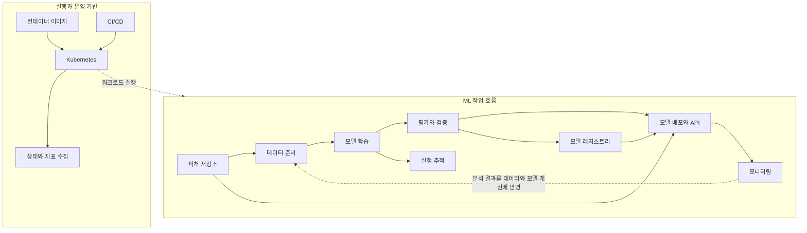
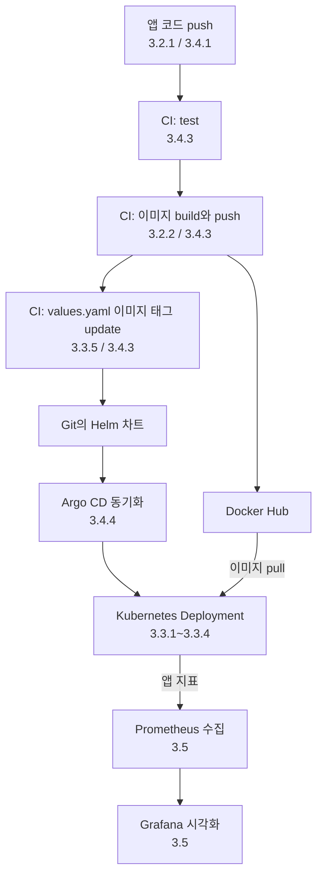
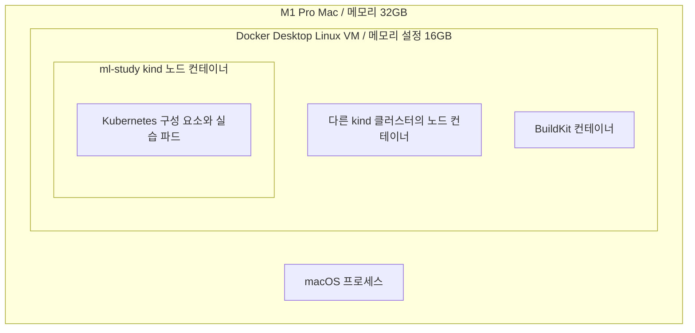

*[서종호(가시다)](https://www.linkedin.com/in/gasida99/)님의 Machine Learning Platform Engineering Study 1주차 학습 내용을 기반으로 합니다.*

<br>

# TL;DR

- ML 시스템은 데이터 준비 → 학습·평가 → 배포 → 모니터링을 반복한다. 코드·데이터·설정·모델의 버전을 연결해 기록하고, 컨테이너·Kubernetes·CI/CD로 실행과 배포를 자동화한다
- 농담을 반환하는 FastAPI 앱 하나로 로컬 실행 → 이미지 빌드 → Kubernetes 배포 → 자동화 → 지표 수집 경로를 따라간다
- 스터디는 buster 기반 이미지를 bookworm으로 바꾸고, GitLab 대신 Gitea를 사용한다. 내 실습 환경은 M1 Pro + Docker Desktop + kind 노드 v1.29.14다
- Mac에서는 이미지의 arm64 지원 여부, Docker Desktop Linux VM의 메모리 상한, 노드 포트와 호스트 포트의 연결을 함께 확인해야 한다

<br>

# ML 플랫폼과 3장의 위치

스터디는 『머신러닝 플랫폼 엔지니어링』을 따르고, 이 글은 그 책의 3장 도입·3.1절과 실습 환경을 정리한다. 원서는 Benjamin Tan Wei Hao, Shanoop Padmanabhan, Varun Mallya가 쓴 *Machine Learning Platform Engineering*(Manning, 2026년 2월)이고, 번역서는 허정준 옮김, 책만 출판으로 2026년 7월에 나왔다. [원서](https://www.manning.com/books/machine-learning-platform-engineering)와 [번역서](https://www.onlybook.co.kr/entry/mlops)의 출판사 페이지에서 서지와 목차를 확인할 수 있다.

3장은 피처 저장소, ML 파이프라인, 실험 추적 같은 ML 전용 도구를 다루기 전에, 그 도구들이 공통으로 쓰는 실행·배포·운영 기반을 먼저 다룬다. 책은 이 기반으로 Docker, Kubernetes, CI/CD, 모니터링을 고르지만, 같은 목표를 이룰 수 있다면 다른 도구로 바꿔도 된다는 입장이다. ML 전용 도구는 4~5장부터 이 기반 위에서 실행된다.

## 머신러닝 수명주기와 운영

MLOps는 모델의 개발·배포·모니터링·갱신을 반복할 수 있도록 사람과 프로세스, 도구를 연결하는 운영 방식이다. 출발점은 해결할 문제와 성공 기준을 정하는 것이다. 예를 들어 신분증에서 번호를 읽는 시스템이라면 인식 품질뿐 아니라 응답 시간과 실패 시 처리 방식도 서비스 요구사항이 된다.

실험 단계에서는 데이터를 수집·정제하고, 학습과 평가를 반복하면서 모델을 선택한다. 운영 단계에서는 선택한 모델을 서비스에 통합하고, 실제 요청을 처리하며, 성능과 데이터 변화를 관찰한다. 평가에서 드러난 오류는 데이터 수집이나 모델 설계로 돌아가는 근거가 되고, 배포 후 관찰한 문제도 새 실험의 입력이 된다. 이 피드백이 다음 데이터 준비·학습·배포로 이어지는 구조가 반복적인 ML 수명주기다.

1장의 수명주기와 2장의 반복 운영 원칙을 3장 실습에 연결하면 다음과 같다.

| ML 시스템의 요구 | 플랫폼이 제공할 기능 | 3장에서 확인하는 기반 |
|---|---|---|
| 실험 코드를 다른 환경에서도 실행 | 코드와 의존성을 담은 실행 환경 | Dockerfile과 이미지 빌드 |
| 여러 단계의 작업을 반복 실행 | 단계의 순서·의존성·실행 상태 관리 | Kubernetes에서 워크로드를 실행하고 관찰하는 방법 |
| 새 서비스 버전을 배포하고 복구 | 버전별 배포 설정과 교체 절차 | Deployment 업데이트·롤백, Helm 차트 |
| 검증한 변경을 서비스에 반영 | 테스트와 배포 자동화 | Git 기반 CI와 Argo CD의 동기화 |
| 운영 중 발생한 문제를 파악 | 지표 수집과 알림, 버전별 결과 비교 | Prometheus와 Grafana를 사용하는 관찰 경로 |

이 관계에서 3장은 ML 작업을 실행·배포할 공통 기반을 다룬다. 데이터 품질 기준, 모델 평가 방법, 재학습 시점은 그 위의 ML 워크플로에서 결정한다.

## ML 플랫폼의 구성

ML 플랫폼은 데이터를 준비하고 모델을 학습·평가·배포하는 작업에 공통 실행 환경과 운영 도구를 제공한다. 같은 조직의 여러 프로젝트가 실행 환경과 기록·배포 절차를 공유하면, 프로젝트마다 이를 따로 구성하는 작업을 줄일 수 있다. 구성 요소는 데이터 형태, 서비스 요구사항, 팀의 운영 여건에 맞춰 선택한다.

책이 다루는 ML 플랫폼의 구성 요소와 도구는 다음과 같다. 피처(feature)는 모델이 입력으로 사용하는 특성이다.

| 구성 요소 | 역할 | 책에서 쓰는 도구 |
|---|---|---|
| 피처 저장소(feature store) | 학습과 추론에 사용할 피처의 정의와 조회 관리 | Feast |
| 파이프라인 오케스트레이션(pipeline orchestration) | 작업 단계의 순서·의존 관계·실행 상태 관리 | Kubeflow Pipelines |
| 실험 추적(experiment tracking) | 실행별 설정·지표·산출물 기록 | MLflow |
| 모델 레지스트리(model registry) | 모델 버전과 그 모델을 만든 실행의 관계 관리 | MLflow |

MLflow의 실행 기록과 등록된 모델 버전의 관계는 [MLflow Tracking](https://mlflow.org/docs/latest/ml/tracking/)과 [Model Registry](https://mlflow.org/docs/latest/ml/model-registry/) 문서에서 확인할 수 있다.

## 코드와 데이터 및 모델의 추적성

모델 산출물(artifact)은 학습 실행으로 만들어진 가중치 파일 등 결과물이다. 리니지(lineage)는 산출물이 어떤 입력과 처리 과정을 거쳐 만들어졌는지 연결한 이력이다. 모델을 다시 학습하거나 문제를 분석하려면 코드 버전, 데이터 버전, 학습 설정, 실행 환경, 결과 모델을 함께 식별할 수 있어야 한다.

예를 들어 전처리 코드는 같아도 입력 데이터가 바뀌면 학습 결과가 달라질 수 있다. 배포된 예측 결과에 문제가 생겼을 때는 서비스의 이미지 버전에서 출발해 사용한 모델 버전과 학습 실행, 데이터까지 거슬러 올라간다. 3장에서 확인하는 Git 커밋, 이미지 태그·다이제스트, Helm 배포 설정은 이 연결 가운데 코드와 실행 환경, 배포 상태를 식별하는 부분이다.

재현성을 확보하려면 버전 기록과 함께 난수 시드, 라이브러리·하드웨어 조건, 비결정적 연산도 관리해야 한다. [PyTorch 재현성 문서](https://docs.pytorch.org/docs/stable/notes/randomness.html)는 릴리스나 플랫폼이 달라질 때 결과의 완전한 일치를 보장하지 않는다. 따라서 같은 입력으로 다시 실행할 수 있는 조건을 남기고, 결과를 비교할 기준도 함께 정해야 한다.

## 3장이 다루는 기반 레이어

데이터 준비부터 모델 API 운영까지 각 단계에는 실행할 코드와 그 코드가 의존하는 환경이 있다. 컨테이너 이미지는 코드·라이브러리·런타임을 함께 배포할 수 있는 형태로 만들고, Kubernetes(쿠버네티스, K8s)는 컨테이너 워크로드를 배치하고 상태를 관리한다. CI/CD는 변경을 테스트하고 배포하는 과정을 자동화하며, 모니터링은 실행 중인 시스템의 상태를 관찰한다.


<center><sup>출처: 『머신러닝 플랫폼 엔지니어링』 그림 3.1. AI를 이용해 재구성했다</sup></center>

3장에서는 이 기반 위에 작은 웹 애플리케이션을 올린다. 모델을 서빙하는 API나 학습 파이프라인 구성 요소를 배포할 때도 이미지 생성, 실행 자원 확보, 네트워크 연결이 필요하다. 컨테이너와 Kubernetes의 전반적인 역할은 [컨테이너와 K8s 아키텍처]()에서 다룬다.

## MLOps에서 CI/CD의 위치

지속적 통합(Continuous Integration, CI)은 코드 변경을 통합하면서 빌드와 테스트를 반복하는 과정이다. 지속적 전달(Continuous Delivery)은 검증된 변경을 배포 가능한 상태로 유지하는 과정이고, 지속적 배포(Continuous Deployment)는 배포까지 자동으로 수행하는 방식이다.

ML 시스템에는 코드 변경을 반영하는 과정과 모델을 다시 학습하는 과정이 함께 있다. 지속 학습(Continuous Training, CT)은 새 데이터나 일정 등의 계기에 따라 모델 학습과 검증을 자동으로 반복하는 과정이다. [Google Cloud의 MLOps 설명](https://docs.cloud.google.com/architecture/mlops-continuous-delivery-and-automation-pipelines-in-machine-learning)은 학습 파이프라인 구현 자체의 CI/CD와, 배포된 파이프라인을 실행해 모델을 학습·등록·서빙하는 과정을 연결한다.

| 자동화 대상 | 계기와 수행 내용 | 산출물 |
|---|---|---|
| 애플리케이션 코드의 CI/CD | 코드 변경 → 테스트 → 이미지 빌드·푸시 → 배포 | 새 버전의 앱과 실행 설정 |
| 학습 파이프라인 구현의 CI/CD | 학습·전처리 코드 변경 → 구성 요소 테스트·패키징 → 파이프라인 배포 | 실행 가능한 파이프라인 |
| 모델의 지속 학습 | 새 데이터·일정 등 → 데이터 검증 → 학습 → 모델 평가·등록 | 검증된 모델 버전 |

2장의 MLOps 성숙도 구분도 자동화 대상을 기준으로 이해할 수 있다. Google Cloud의 구분에서 Level 0은 수동 중심의 ML 작업, Level 1은 학습 파이프라인의 자동화, Level 2는 파이프라인 자체의 CI/CD 자동화다. 3장의 작은 웹 애플리케이션(농담을 반환하는 API)은 표의 첫 번째 경로인 애플리케이션 코드의 CI/CD를 연습하는 앱이다. 같은 테스트·패키징·배포 동작을 ML 파이프라인에 적용할 때는 데이터 검증과 모델 평가를 함께 구성해야 한다.

2주차 학습 범위인 Kubeflow Pipelines는 ML 작업의 여러 단계를 실행 순서와 의존 관계에 따라 관리하는 도구다. [각 구성 요소도 컨테이너 이미지로 실행](https://www.kubeflow.org/docs/components/pipelines/concepts/component/)하므로 이미지와 Kubernetes에 대한 이해를 이어서 사용한다.

CI/CD의 배포 쪽은 GitOps로 구성할 수 있다. GitOps는 Git에 선언한 목표 상태를 실제 시스템에 반영하는 운영 방식이다. Argo CD는 Kubernetes 리소스의 선언과 클러스터 상태를 비교해 동기화하는 GitOps 도구다. 이 방식은 MLflow 같은 상시 서비스나 서빙 인프라처럼 항상 유지할 상태가 있는 대상에 맞는다. 반면 한 번 실행하고 끝나는 학습 Job은 유지할 상태가 없으므로, 실행 시점·재시도·산출물 관리를 워크플로 엔진이 맡는다. MLOps 시스템을 구성하며 이 역할 구분을 고민한 내용은 [MLOps와 GitOps]()에 정리했다.

## 3장 실습 흐름

3장은 작은 앱 하나를 로컬 실행부터 Kubernetes 배포, 배포 자동화, 지표 관찰까지 옮겨 본다. FastAPI는 Python으로 HTTP API를 만드는 웹 프레임워크다. 실습 앱은 FastAPI로 만들었고 `/` 요청에 농담을 반환한다.

앱 코드를 push하면 CI가 테스트 후 이미지를 빌드해 레지스트리에 올리고, Helm 차트의 `values.yaml`에 새 이미지 태그를 반영한다. Argo CD가 이 변경을 동기화하면 Kubernetes의 Deployment가 파드를 새 버전으로 교체하고, 배포된 앱의 지표를 수집해 시각화한다. 그림은 이 흐름이며, 각 단계 옆 번호는 그 단계를 다루는 블로그 편이다.


<center><sup>출처: 『머신러닝 플랫폼 엔지니어링』 그림 3.2. AI를 이용해 재구성했다</sup></center>

그림에 나오는 도구는 다음과 같다.

- 레지스트리: 컨테이너 이미지를 저장하고 배포하는 서비스. 실습에서는 Docker Hub를 쓴다
- Gitea: Git 저장소를 호스팅하는 도구. Gitea Actions는 저장소 이벤트에 따라 작업을 실행하는 CI 기능이다
- Helm: Kubernetes 배포 템플릿과 설정을 차트(chart)라는 패키지로 관리하는 도구
- Prometheus·Grafana: 애플리케이션 지표를 수집·저장·질의하는 도구와, 지표를 대시보드로 시각화하는 도구

앱과 Dockerfile은 [3.2.1편](), 이미지 빌드와 푸시는 [3.2.2편]()에서 다룬다. 컨테이너부터 Helm까지의 실습에 이어 [3.4.1편]()에서 Gitea와 러너를 구성하고, [3.4.2편]()에서 주소 설계와 운영 문제를 다룬다. [3.4.3편]()에서 테스트·이미지 빌드·차트 갱신을, [3.4.4편]()에서 Argo CD 동기화까지 다룬다. 모니터링은 진행 예정이다. <!-- LINK: 3.5편 -->

요청 수와 HTTP 오류율은 서비스가 요청을 처리하는 상태를 보여준다. ML 시스템에서는 여기에 입력 데이터의 분포, 정답을 확보한 뒤 측정하는 예측 품질, 서비스의 비즈니스 지표를 연결한다. 이 관찰 결과가 [ML 수명주기](#머신러닝-수명주기와-운영)의 데이터 보완·재학습·배포 판단으로 이어진다.

<br>

# 실습 환경

## 책과 스터디 환경의 차이

책과 비교하면 스터디에서는 지원이 끝난 베이스 이미지를 바꾸고, Git 저장소와 CI를 로컬 클러스터에 설치했다. 책·스터디 공통 구성·내 Mac 구성을 구분하면 다음과 같다.

| 항목 | 책 | 스터디 | 내 Mac |
|---|---|---|---|
| Python 베이스 이미지 | `python:3.10-slim-buster` | `python:3.10-slim-bookworm` | bookworm 이미지 |
| Git과 CI | GitLab + GitLab Runner | Gitea + Gitea Actions | Gitea 구성 사용 |
| 이미지 레지스트리 | Docker Hub | Docker Hub | Docker Hub |
| Kubernetes | 1.24 | K3s 1.29 또는 kind 1.29 | kind 노드 v1.29.14 |
| 실행 환경 | 책의 설치 환경 | K3s 서버 또는 OrbStack의 컨테이너 환경 | M1 Pro + Docker Desktop 4.37.2, Engine 27.4.0 |

K3s는 설치와 구성을 간소화한 Kubernetes 배포판이고, kind는 컨테이너를 노드로 사용하는 로컬 Kubernetes 클러스터 도구다. 나는 Docker Desktop에서 kind를 사용했다. 노드 구성과 API 서버 접근 경로는 [3.3.1편]()에 있다.

스터디가 Kubernetes를 1.29로 올린 이유는 Gitea Actions 러너다. 러너(runner)는 CI 작업을 실행하는 프로세스다. 실습의 `actions` 0.1.2 차트는 Docker-in-Docker(DinD), 즉 컨테이너 안에서 Docker 데몬을 실행하는 구성을 쓰고, 이 데몬을 Kubernetes 1.29에서 기본 활성화된 네이티브 사이드카(native sidecar)로 실행한다. 근거는 [3.3.1편의 실습 클러스터 선택](#실습-클러스터-선택)에 있다.

## 내 Mac 환경

실습 호스트는 Apple M1 Pro, 메모리 32GB의 Mac이다. Docker Desktop의 Engine은 27.4.0이고 이미지 저장소 드라이버는 `overlay2`다. kind 노드는 `kindest/node:v1.29.14`를 사용한다. Apple Silicon의 arm64 아키텍처에 맞는 이미지를 선택하고, 다른 아키텍처용 이미지를 함께 배포할 때는 멀티 아키텍처 빌드를 사용했다.

uv는 Python 버전·가상 환경·패키지를 관리하는 도구다. 로컬 Python은 3.11 계열로 고정하고 루트 가상 환경에는 공통 도구를, 각 챕터의 `.venv`에는 해당 챕터 의존성을 설치했다. 앱 컨테이너의 Python 3.10은 로컬 가상 환경과 따로 관리된다.

```toml
# 실습 저장소 루트 pyproject.toml의 Python 범위
[project]
requires-python = ">=3.11,<3.12"
```

실습 저장소는 원본 압축 파일을 `source/`, 챕터별 코드를 `chapters/`, 학습 기록을 `notes/`, 작은 실험을 `scratch/`에 둔다. 이 시리즈의 `~/ml-study/chapters/ch03-k8s`는 실습 저장소 경로를 줄인 표기다. 클러스터 설정 파일 `kind-ml-study.yaml`과 공통 Python 설정은 저장소 루트에 있다.

Mac에서 클러스터 안의 서비스에 접속하려면 kind 노드와 Mac 사이에 포트를 매핑해야 한다. 실습에서는 NodePort `30000~30003`과 `30420`을 매핑했다. 반대로 파드 안의 `localhost`는 Mac이 아니라 그 파드 자신을 가리키므로, 파드에서 Mac 쪽 서비스에 접속할 때는 `localhost`를 쓸 수 없다. 포트 매핑과 Service의 관계는 [3.3.4편]()에서 확인한다.

## 실습 가능 여부 판정 기준

책 코드를 내 Mac에서 그대로 실습할 수 있는지는 다음 항목으로 판단했다.

| 확인 항목 | 확인할 내용 |
|---|---|
| 이미지 존재와 아키텍처 | 필요한 태그가 레지스트리에 있는지, arm64용 이미지가 제공되는지 |
| Kubernetes API | 매니페스트가 사용하는 API를 노드 버전 1.29에서 지원하는지 |
| 베이스 이미지와 패키지 | 지원 종료(EOL)된 배포판을 쓰는지, 패키지 버전이 고정돼 있는지 |
| GPU 의존성 | CUDA 코드나 `nvidia.com/gpu` 요청이 있는지, CPU 실행 경로가 있는지 |
| 자원 | Docker VM 메모리와 디스크, 데이터셋 크기를 감당할 수 있는지 |
| 외부 의존성 | API 키·외부 서비스·고정 IP·토큰·인증서에 의존하는지 |

이미지의 arm64 제공 여부는 `docker manifest inspect`로 확인한다. 레지스트리에 있는 이미지 매니페스트를 조회하는 명령이며, 멀티 플랫폼 이미지라면 플랫폼별 매니페스트 목록이 나온다.

2026-10-21에 실습 저장소의 책 코드 전체를 검색했을 때 `cuda`, `nvidia.com/gpu`, `set_gpu_limit` 문자열은 없었다. 2주차의 Kubeflow는 여러 구성 요소의 이미지를 함께 설치하므로 이미지마다 아키텍처와 버전 호환성을 확인해야 하며, 이때 점검 대상으로 잡은 이미지는 약 80개였다. 표의 자원 항목은 [다음 절](#docker-desktop-vm과-메모리-상한)에서 Docker Desktop VM의 메모리 한도를 올려 맞췄다.

표의 외부 의존성 가운데 인증서 문제는 이 Mac에서 실제로 겪었다. 사내 VPN 중에는 보안 장비가 HTTPS 통신을 중간에서 복호화해 검사하는 TLS 검사(SSL inspection)를 하는 경우가 있다. 이때 장비는 접속한 사이트의 원래 인증서 대신, 회사 루트 인증서로 다시 서명한 인증서를 내려보낸다. Mac에는 회사가 배포한 루트 인증서가 키체인에 설치돼 있어 브라우저는 정상 동작한다. 반면 컨테이너와 파드는 이미지 안에 든 인증서 목록만 신뢰하므로, 회사 루트 인증서로 서명된 인증서를 검증하지 못한다. 그래서 VPN을 켠 상태에서는 컨테이너와 파드 안의 패키지 설치와 이미지 pull이 `x509: certificate signed by unknown authority` 오류로 실패했다. 실습은 VPN을 끈 상태에서 진행했다. 인증서 신뢰 경로는 [kubectl과 VPN의 TLS 복호화](), [Notion MCP의 인증서 오류]()에 정리돼 있다.

## Docker Desktop VM과 메모리 상한

Mac의 Docker Desktop은 Linux 가상 머신(Virtual Machine, VM) 안에서 Linux 컨테이너를 실행한다. Resources의 Memory limit은 Docker VM에 제공하는 메모리 한도다. kind 노드 컨테이너와 이미지 빌드를 수행하는 BuildKit 컨테이너가 이 VM의 자원을 공유한다. [Docker Desktop 리소스 설정](https://docs.docker.com/desktop/settings-and-maintenance/settings/#advanced)에서 메모리·스왑·디스크 한도를 조절할 수 있다.


<center><sup>AI를 이용해 직접 그린 도식. kind 노드와 BuildKit이 Docker Desktop Linux VM의 메모리를 공유한다</sup></center>

`docker stats`는 컨테이너별 CPU·메모리 사용량과 한도를 보여 주는 명령이다. 메모리 설정을 올리기 전에 이 명령으로 잰 사용량은 다음과 같았다.

| 컨테이너 | 사용량 | 표시된 한도 |
|---|---|---|
| `ml-study-control-plane` | 1.56GiB | 7.75GiB |
| 다른 kind 클러스터 노드 | 1.76GiB | 7.75GiB |
| BuildKit | 약 0.2GiB | 기록 없음 |

두 kind 노드에 표시된 7.75GiB는 같은 VM의 메모리를 기준으로 한 값이다. 각 노드에 7.75GiB씩 독립된 물리 메모리가 생기는 것이 아니라, 두 노드와 BuildKit이 이 한도를 나눠 쓴다.

이 한도가 부족하면 Kubernetes에서는 파드 배치와 실행 단계에서 각각 문제가 생긴다. 스케줄러는 파드의 메모리 요청량(requests)이 노드의 남은 할당 가능 자원에 들어가는지 판단한다. 맞는 노드가 없으면 파드는 `Pending`에 머물고 `Insufficient memory` 이벤트가 발생할 수 있다. 실행 중에는 컨테이너의 메모리 제한 초과로 OOM 종료가 발생하거나, 노드의 메모리 압박에 대응해 kubelet이 파드를 축출할 수 있다. [Kubernetes 자원 관리](https://kubernetes.io/docs/concepts/configuration/manage-resources-containers/)에서 요청량과 제한의 역할을 구분한다.

그래서 이후 Kubernetes에 여러 구성 요소를 설치할 때의 여유를 확보하려고 Memory limit을 8GB에서 16GB로, Swap을 1GB에서 2GB로, 디스크 한도를 59.8GB에서 64GB로 바꿨다. CPU 설정은 10개를 유지했다.

{: .align-center}
<center><sup>직접 캡처. Docker Desktop의 Resources 설정. Memory limit 16GB, Swap 2GB, Disk usage limit 64GB이고 Resource Saver가 켜져 있다</sup></center>

`docker info`는 Docker Engine의 실행 환경을 조회하는 명령이다. 재시작 후 `MemTotal`을 조회한 결과는 다음과 같았다.


```bash
# Docker Engine이 인식하는 총 메모리 조회, 단위는 바이트
docker info --format '{{.MemTotal}}'

# 실행 결과
16748941312
```


설정을 올린 뒤에는 `docker stats`의 한도도 모든 컨테이너에서 15.6GiB로 바뀌었다. 이때 실행 중인 컨테이너는 kind 노드 하나와 BuildKit 두 개였다.


```bash
# 컨테이너별 메모리 사용량과 한도를 한 번만 조회
docker stats --no-stream --format 'table {{.Name}}\t{{.MemUsage}}'

# 실행 결과(2026-10-25)
# NAME                             MEM USAGE / LIMIT
# buildx_buildkit_multi0           102.6MiB / 15.6GiB
# ml-study-control-plane           2.756GiB / 15.6GiB
# buildx_buildkit_multiplatform0   93.96MiB / 15.6GiB
```


16GB는 VM이 쓸 수 있는 상한이지, Mac의 메모리를 미리 떼어 두는 예약이 아니다. VM은 실행 중인 컨테이너가 쓰는 만큼 Mac의 메모리를 차지한다. 이 Mac은 메모리가 32GB라 VM이 상한까지 써도 macOS에 16GB가 남으므로, 실습이 끝난 뒤에도 설정값은 다시 낮추지 않았다.

Docker Desktop에는 [Resource Saver](https://docs.docker.com/desktop/use-desktop/resource-saver/)도 있다. 실행 중인 컨테이너가 없는 상태로 기본 5분이 지나면 Linux VM을 멈춰 메모리를 macOS에 돌려주는 기능이며, 위 설정 화면 아래쪽에서 켜져 있다. 다만 kind 노드도 컨테이너이므로 클러스터를 켜 두는 동안에는 이 기능이 동작하지 않는다. 그래서 실습하지 않을 때는 노드 컨테이너를 멈춰 둔다.

kind CLI에는 `kind stop` 같은 클러스터 일시 중지 명령이 없다. 대신 kind 노드가 Docker 컨테이너라는 점을 이용해, `docker stop`으로 노드 컨테이너를 멈추고 `docker start`로 다시 켠다. `kind delete cluster`는 노드 컨테이너 자체를 삭제하므로 그 안에 저장된 클러스터 상태도 사라진다.

```bash
# 단일 노드 실습 클러스터의 노드 컨테이너 중지
docker stop ml-study-control-plane

# 같은 노드 컨테이너 다시 시작
docker start ml-study-control-plane
```

<br>

# 시리즈 구성

블로그 편 번호와 책의 절 번호는 일부 다르다. 책의 kubectl 개괄과 기타 객체 절은 별도 편으로 나누지 않았고, kind 노드 내부를 한 편으로 다룬다.

| 편 | 책 절 | 다루는 것 |
|---|---|---|
| 3.1 | 3장 도입과 3.1 | 개요와 실습 환경 |
| [3.2.1편]() | 3.2.1~3.2.2 | 앱 로컬 실행과 Dockerfile |
| [3.2.2편]() | 3.2.3 | 멀티 아키텍처 이미지 빌드와 푸시 |
| [3.3.1편]() | 3.3.1 | kind 클러스터와 API 서버 접근 경로 |
| [3.3.2편]() | 3.3.1 확장 | kind 노드 내부: kindnet, 네임스페이스, containerd |
| [3.3.3편]() | 3.3.3 | Pod, ReplicaSet, Deployment |
| [3.3.4편]() | 3.3.4 | Service와 클러스터 안 트래픽 경로 |
| [3.3.5편]() | 3.3.6~3.3.7 | Helm 차트 |
| [3.4.1편]() | 3.4.1 전반 | Gitea와 Actions 러너 |
| [3.4.2편]() | 3.4.1 확장 | 주소 설계와 운영 트러블슈팅 |
| [3.4.3편]() | 3.4.1 후반 | 테스트, 이미지 빌드, Helm 차트 갱신 |
| [3.4.4편]() | 3.4.2 | Argo CD 설치와 GitOps 동기화 |

<br>

# 정리

1~2장의 핵심은 문제 정의에서 시작해 데이터·모델·서비스를 반복해서 개선하고, 그 과정의 입력과 결과를 추적하는 것이다. 3장은 이를 지원하는 이미지 패키징, Kubernetes 실행, 변경 배포, 지표 수집을 작은 앱으로 연결한다. 피처 저장소·학습 파이프라인·서빙 시스템도 이 실행·운영 기반을 사용한다.

내 Mac에서는 arm64 이미지, Docker Desktop VM의 자원 한도, 호스트와 kind 노드 사이의 포트 연결이 실습 조건을 바꿨다. 다른 환경에 같은 플랫폼을 구성할 때도 이 조건들을 다시 확인해야 한다.

<br>

# 참고 링크

- [Machine Learning Platform Engineering — Manning](https://www.manning.com/books/machine-learning-platform-engineering)
- [머신러닝 플랫폼 엔지니어링 — 책만](https://www.onlybook.co.kr/entry/mlops)
- 책 3장 코드: https://github.com/practical-mlops/chapter-3
- [MLOps의 CI/CD와 CT — Google Cloud](https://docs.cloud.google.com/architecture/mlops-continuous-delivery-and-automation-pipelines-in-machine-learning)
- [kind Quick Start](https://kind.sigs.k8s.io/docs/user/quick-start/)
- [Docker Desktop 리소스 설정](https://docs.docker.com/desktop/settings-and-maintenance/settings/#advanced)
- [Docker Desktop Resource Saver](https://docs.docker.com/desktop/use-desktop/resource-saver/)
- [Kubernetes 파드와 컨테이너 자원 관리](https://kubernetes.io/docs/concepts/configuration/manage-resources-containers/)

<br>
