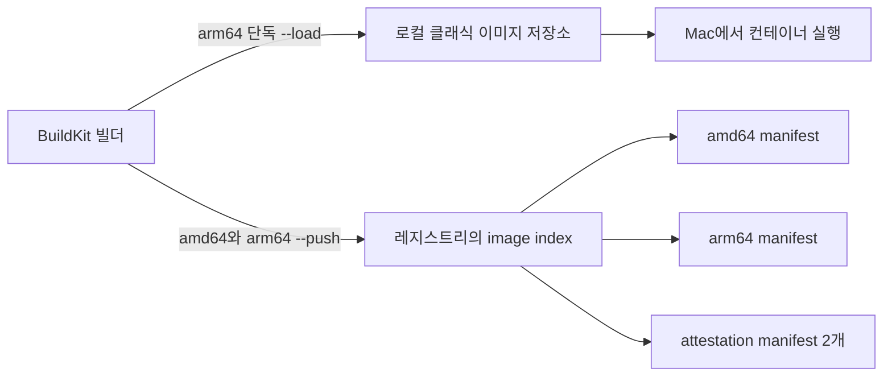

*[서종호(가시다)](https://www.linkedin.com/in/gasida99/)님의 Machine Learning Platform Engineering Study 1주차 학습 내용을 기반으로 합니다.*

<br>

# TL;DR

- M1 Mac에서 로컬 실행은 `linux/arm64 --load`, Docker Hub 업로드는 `linux/amd64,linux/arm64 --push`로 나눠 확인했다
- 당시 사용한 클래식 이미지 저장소는 manifest list를 담지 못해 두 아키텍처를 함께 `--load`하면 실패했다
- `default` 빌더의 오류는 `/var/run/docker.sock` 부재였다. `desktop-linux`에 연결한 별도 빌더의 빌드는 정상 동작했다
- 레지스트리의 index 아래에서 amd64와 arm64 manifest를 확인했다. 추가 `unknown/unknown` 두 항목은 실행 이미지가 아닌 attestation manifest였다

<br>

# 이미지 빌드와 레지스트리

책 3.2.3절에 대응하는 실습이다. [3.2.1편]()의 앱과 Dockerfile을 이미지로 만들고, 다른 머신에서 받을 수 있도록 Docker Hub에 올렸다.

컨테이너 레지스트리(container registry)는 이미지와 그 메타데이터를 저장하고 배포하는 서비스다. 로컬에서 빌드한 결과를 레지스트리에 푸시(push)하면 서버는 같은 이미지 참조로 풀(pull)해 컨테이너를 실행할 수 있다.


<center><sup>출처: 『머신러닝 플랫폼 엔지니어링』 그림 3.3. AI를 이용해 재구성했다</sup></center>

`hello-joker:v1`의 `v1`은 태그(tag)다. 버전이나 Git 커밋 ID로 이름을 붙일 수 있지만, 태그는 나중에 다른 내용을 가리킬 수도 있다. 내용이 같은지 비교할 때는 다이제스트(digest)를 본다. 두 식별자의 차이는 [이미지 참조](#이미지-참조-태그와-다이제스트)에 정리했다.

M1 Mac의 CPU 아키텍처는 arm64다. x86 서버용 amd64 이미지와 실행할 바이너리가 다르므로, 두 환경에 제공하려면 플랫폼별 이미지를 만들어 같은 태그 아래 묶는다. 이 목록을 Docker에서는 manifest list, OCI 형식에서는 image index라고 부른다. 이번 출력은 OCI image index이며, [하드웨어 아키텍처와 이미지 이식성](#하드웨어-아키텍처)에서 다룬 조건이 여기에도 적용된다.

<br>

# buildx와 빌더 해부

## 빌더와 드라이버

Buildx는 Docker CLI에서 빌드를 요청하고 빌더를 관리하는 도구이고, BuildKit은 실제 빌드를 수행하는 엔진이다. 빌더(builder)는 BuildKit이 실행되는 환경을 나타내며, 드라이버(driver)는 그 환경을 어떻게 구성할지 정한다.

| 드라이버 | BuildKit 실행 위치 | 이번 환경에서의 사용 |
|---|---|---|
| `docker` | Docker Engine에 내장 | `desktop-linux` 빌더, BuildKit v0.17.3 |
| `docker-container` | Docker 컨테이너 | 기존 `multiplatform` 빌더, BuildKit v0.28.1 |

별도 컨테이너의 BuildKit은 내장 버전과 다를 수 있다. `docker-container`만 멀티 플랫폼 빌드를 지원한다는 뜻은 아니다. 현재 Docker 문서상 `docker` 드라이버도 containerd 이미지 저장소를 사용하면 멀티 플랫폼 빌드를 지원한다. 이번에는 [별도 빌더로 빌드하고 레지스트리에 직접 출력하는 방식](https://docs.docker.com/build/building/multi-platform/)을 사용했다.

`docker buildx ls`는 빌더 목록을 보여 준다. 처음 확인한 결과를 플랫폼 목록만 줄여 발췌했다.

```text
# docker buildx ls 실행 결과 발췌
NAME/NODE          DRIVER/ENDPOINT    STATUS   BUILDKIT   PLATFORMS
multiplatform*     docker-container
  multiplatform0   desktop-linux     running  v0.28.1    linux/amd64 (+2), linux/arm64, ...
desktop-linux      docker
  desktop-linux    desktop-linux     running  v0.17.3    linux/amd64 (+2), linux/arm64, ...
default                              error

Cannot load builder default: Cannot connect to the Docker daemon at unix:///var/run/docker.sock. Is the docker daemon running?
```

- `NAME/NODE`: 빌더와 그 아래 실행 노드. `*`는 선택된 빌더
- `DRIVER/ENDPOINT`: 빌더 드라이버와 노드의 접속 대상
- `STATUS`: 실행 상태. 새 빌더는 처음 빌드하기 전 `inactive`일 수 있음
- `BUILDKIT`: 해당 실행 환경의 BuildKit 버전
- `PLATFORMS`: 지원하는 플랫폼. `(+2)`와 `...`는 출력에서 묶거나 생략한 항목

## default 빌더 오류

오류가 난 `default`와 실제 빌드에 쓰는 빌더는 접속 대상이 달랐다. Docker 컨텍스트(context)는 Docker Engine에 접속할 엔드포인트 등의 설정을 담는다. 엔드포인트가 유닉스 소켓이면, 그 경로에 소켓이 있어야 접속할 수 있다.

```text
# docker context ls 실행 결과
NAME              DESCRIPTION                               DOCKER ENDPOINT
default           Current DOCKER_HOST based configuration   unix:///var/run/docker.sock
desktop-linux *   Docker Desktop                            unix:///Users/<user>/.docker/run/docker.sock
```

```bash
# default가 사용하려는 소켓의 존재 확인
ls -l /var/run/docker.sock

# 실행 결과
ls: /var/run/docker.sock: No such file or directory
```

명령들이 확인하는 대상은 순서대로 이어진다.

| 확인 | 이 기록에서 알 수 있는 것 |
|---|---|
| `docker buildx ls` | 오류 빌더는 `default`, 정상 빌더의 엔드포인트는 `desktop-linux` |
| 오류 메시지와 `docker context ls` | 실패한 접속 경로는 `/var/run/docker.sock`, 현재 컨텍스트는 다른 소켓 사용 |
| `ls -l /var/run/docker.sock` | 실패한 경로에 파일 자체가 없음 |
| `sudo docker buildx ls` | 같은 오류가 지속됨. 앞선 파일 부재 증거와 일치 |

`sudo`의 결과만으로 모든 권한 문제를 배제하는 것은 아니다. 여기서는 **실패한 엔드포인트에 소켓이 없다는 직접 확인**이 원인 판정의 근거다. `desktop-linux`를 쓰는 빌더는 이미 실행 중이었고, 이후 빌드도 성공했다.

{: .align-center}
<center><sup>직접 캡처. Docker Desktop Advanced 설정에서 기본 Docker 소켓 사용 옵션이 꺼져 있다.</sup></center>

Docker Desktop의 **Allow the default Docker socket to be used**는 `/var/run/docker.sock` 심볼릭 링크를 만드는 옵션이다. [Mac 권한 설정 문서](https://docs.docker.com/desktop/setup/install/mac-permission-requirements/#installing-symlinks)에 따르면 이 옵션을 끄면 링크와 이를 다시 만드는 시작 작업도 생성하지 않는다. 이번에는 이 옵션을 변경하지 않고 정상 빌더로 진행했다.

<br>

# 적용과 관찰

## 베이스 이미지와 빌더 준비

앱 디렉터리에서 베이스 이미지부터 확인했다.

```bash
# ~/ml-study는 실습 저장소 경로를 줄인 표기
cd ~/ml-study/chapters/ch03-k8s
head -n 1 Dockerfile

# 실행 결과
FROM python:3.10-slim-bookworm
```

처음에는 `multiplatform`이 있었지만, 실습 명령은 `multi`라는 빌더를 새로 만들었다.

```bash
# 새 빌더 생성 후 선택
docker buildx create --name multi --driver docker-container --use

# 이미 multi를 만들었다면 생성 대신 선택만 수행
# docker buildx use multi
```

노트의 명령은 생성 뒤에 `2>/dev/null || docker buildx use multi`를 붙였다. 이는 오류 출력을 숨기고 **어떤 이유로든** 생성에 실패하면 기존 빌더 선택을 시도한다. 실패 원인이 “이미 존재함”인지 구분하는 검사는 아니다. 기존 `multiplatform`을 계속 선택해 사용하는 방법도 있다.

## arm64 이미지의 로컬 실행

로컬 확인에는 arm64 하나만 빌드했다. `--load`는 빌드 결과를 로컬 Docker 이미지 저장소에 적재하는 옵션이다.

```bash
# M1에서 실행할 arm64 이미지 빌드 및 로컬 적재
docker buildx build --platform linux/arm64 -t hello-joker:v1 . --load
docker images hello-joker

# 실행 결과 발췌
REPOSITORY    TAG   IMAGE ID       CREATED          SIZE
hello-joker   v1    5ebc7ebff246   26 seconds ago   539MB
```

컨테이너 안 Uvicorn은 8083에서 수신한다. `-p 8081:8083`은 Mac의 8081을 컨테이너의 8083에 연결한다.

```bash
# 종료 시 자동 삭제되는 컨테이너로 실행
docker run --rm -it -p 8081:8083 hello-joker:v1

# 실행 결과 발췌
INFO:     Started server process [7]
INFO:     Uvicorn running on http://0.0.0.0:8083 (Press CTRL+C to quit)
```

다른 터미널에서 호스트의 8081 포트로 호출했다.

```bash
# 호스트의 매핑된 포트로 요청
curl -s localhost:8081 | jq

# 실행 결과
{
  "random_joke": "You don't have to know how the computer works, just how to work the computer."
}
```

실행 터미널에서 `Ctrl+C`를 누르자 종료 로그가 나왔고, `--rm`으로 컨테이너가 삭제됐다. 남은 컨테이너를 확인할 때도 이 앱으로 범위를 좁혔다.

```bash
# 이 이미지로 실행한 컨테이너만 조회
docker ps -a --filter ancestor=hello-joker:v1

# 남은 컨테이너가 있으면 확인한 ID만 지정해 삭제
# docker rm -f <container-id>
```

스터디의 전체 컨테이너 삭제 명령을 그대로 쓰면 kind 노드와 BuildKit 컨테이너도 삭제된다. 같은 Docker Engine에서 실행 중이므로 앱 컨테이너만 정리해야 한다. kind 노드의 구조는 [3.3.1편]()에서 다룬다.

## 두 아키텍처 빌드와 Docker Hub 푸시

로컬 실행을 확인한 뒤, amd64와 arm64를 함께 빌드해 Docker Hub로 직접 보냈다. 아래 계정 변수는 자신의 Docker Hub 계정으로 바꾼다.

```bash
# 계정명을 지정하고 로그인
DHID='<dockerhub-user>'
docker login

# 플랫폼별 이미지를 같은 태그로 묶어 레지스트리에 출력
docker buildx build \
  --platform linux/amd64,linux/arm64 \
  -t "$DHID/hello-joker:v1" . --push

# 레지스트리의 이미지 메타데이터 확인
docker buildx imagetools inspect "$DHID/hello-joker:v1"
```

`-t`에서 Docker Hub 계정까지 포함한 이름을 지정했으므로 별도의 `docker tag`가 필요 없다. `--push`는 결과를 레지스트리로 내보낸다. `--load`도 `--push`도 지정하지 않은 `docker-container` 빌드는 성공하더라도, 결과가 빌드 캐시에만 남을 수 있으므로 배포 가능한 이미지가 저장됐는지 따로 확인해야 한다.

실제 빌드는 `docker-container:multi`에서 완료됐다. arm64 단계는 앞선 빌드의 캐시를 재사용했고, amd64 단계는 새로 실행했다. 시스템 패키지 설치 단계는 이전 arm64 빌드에서 13.0초, amd64 빌드에서 26.3초였다. Docker Desktop은 다른 아키텍처의 빌드에 에뮬레이션을 지원해 이 경우 느려질 수 있지만, 두 시간은 다운로드와 캐시 조건을 통제하지 않은 관찰값이다.

<br>

# 검증: manifest list 읽기

`imagetools inspect`는 이미지 레이어를 내려받지 않고 레지스트리의 manifest 정보만 조회한다. 그래서 이번에 확인한 것은 로컬의 **arm64 앱 실행**과 레지스트리의 **두 플랫폼 이미지 등록**이다.

## index와 플랫폼별 다이제스트

출력의 핵심 항목은 다음과 같다.

```text
# imagetools inspect 출력의 index 부분
Name:      docker.io/<dockerhub-user>/hello-joker:v1
MediaType: application/vnd.oci.image.index.v1+json
Digest:    sha256:01115bdc2a1babf288f962efa55a0fec3e6442d049a259c202afc056c00f99eb
```

그 아래 manifest 네 개는 역할이 다르다.

| Platform | 다이제스트 접두어 | 역할 |
|---|---|---|
| `linux/amd64` | `58fded8efadd` | amd64 실행 이미지의 manifest |
| `linux/arm64` | `6d63206c03a1` | arm64 실행 이미지의 manifest |
| `unknown/unknown` | `7201e9bcf8d5` | amd64를 참조하는 attestation manifest |
| `unknown/unknown` | `67d199a4ad18` | arm64를 참조하는 attestation manifest |

index 다이제스트는 빌드 로그의 `exporting manifest list` 값과 같았다. arm64 manifest 다이제스트도 로컬 빌드 로그와 같았다.

```text
# 로컬 arm64 빌드와 레지스트리 조회에서 일치한 manifest digest
sha256:6d63206c03a15c67f2b3eab6afca44752121d8ab8bdef8836109e4947daed63f

# 두 빌드 로그에서 일치한 arm64 config digest
sha256:5ebc7ebff2461f86c114dbbd464914296fccf4da9d1a1d21f57b74a2d4030a6d
```

로컬 `docker images`의 `IMAGE ID`는 config digest의 앞부분인 `5ebc7ebff246`이었다. manifest digest와 IMAGE ID는 서로 다른 대상을 식별한다. 이 두 값을 각각 대조하면, 로컬에서 실행한 arm64 이미지의 내용이 레지스트리에도 올라갔음을 확인할 수 있다.

## attestation과 Docker Hub 화면

어테스테이션(attestation)은 이미지에 붙는 빌드 관련 메타데이터다. 프로비넌스(provenance)는 그중 빌드의 재료와 과정에 관한 정보를 담는다. BuildKit은 기본적으로 최소 수준의 provenance를 생성하며, 이번처럼 `docker-container` 빌더에서 레지스트리로 푸시하면 index에 함께 저장할 수 있다. 클래식 이미지 저장소에 `--load`하는 경로는 이를 보존하지 못한다. [Docker build attestations 문서](https://docs.docker.com/build/metadata/attestations/)에서 출력 경로와 저장소의 조건을 설명한다.

두 `unknown/unknown` 항목에는 `vnd.docker.reference.type: attestation-manifest`가 있었고, `vnd.docker.reference.digest`는 각각의 실행 이미지 manifest를 가리켰다. 실행할 대상이 아니므로 플랫폼을 `unknown/unknown`으로 표시한다. 자세한 형식은 [attestation 저장 구조](https://docs.docker.com/build/metadata/attestations/attestation-storage/)를 참고하면 된다. 기본 provenance는 빌드 옵션 `--provenance=false`로 뺄 수 있다. 이번에는 이 옵션을 쓰지 않았고, attestation 내부(predicate)도 열어 보지 않았다.

{: .align-center}
<center><sup>직접 캡처. Docker Hub의 v1 태그 아래 linux/amd64와 linux/arm64 이미지가 표시된다.</sup></center>

Docker Hub 화면의 두 다이제스트도 CLI 결과와 일치한다. 같은 태그를 받더라도 런타임은 대상 플랫폼에 맞는 이미지를 선택한다. arm64 kind 노드에는 arm64 이미지가 필요하다. 파드 배포에서 이 태그를 사용하는 과정은 [3.3.3편]()에서 다룬다.

## v2 응답 구분

이후 Deployment 업데이트를 구분하기 위해 응답에 `version`을 추가하고 v2 이미지를 따로 푸시했다. 현재 실습 저장소의 `main.py`에도 이 변경이 들어 있다.

```python
# v2에서 바뀐 반환 값: 농담과 함께 버전 표시
return {"version": "v2", "random_joke": random_joke}
```

버전 문자열은 요청이 어느 앱 버전에 도달했는지 확인하기 위한 것이다. 여기서는 v1의 빌드와 조회 결과를 분석했으며, v2의 롤링 업데이트는 [3.3.3편의 파드 배포 실습](#이미지-변경과-롤링-업데이트)에 해당한다.

<br>

# 트러블슈팅

## 증상

처음에는 스터디의 멀티 아키텍처 빌드 명령에 `--load`를 붙여 그대로 실행했다. 빌드 결과를 로컬로 내보내는 단계에서 사용할 수 없는 조합이라는 오류가 즉시 발생했다.

```bash
# 당시 실패한 명령
docker buildx build --platform linux/amd64,linux/arm64 -t hello-joker:v1 . --load

# 실행 결과
ERROR: docker exporter does not currently support exporting manifest lists
```

## 증거

같은 Dockerfile을 `linux/arm64` 하나로 `--load`하면 성공했고 앱도 실행됐다. 두 아키텍처를 지정해 `--push`했을 때도 성공했다. 이 차이는 앱 코드나 두 플랫폼 빌드 자체보다 **결과를 어디에 어떤 형식으로 내보내는가**와 관련된다.

## 원인

클래식 이미지 저장소는 여러 플랫폼을 묶는 image index와 manifest list를 지원하지 않는다. 당시 Mac 환경에서는 이 저장소를 사용해 멀티 플랫폼 결과를 로컬에 적재할 수 없었다. [Docker Desktop의 이미지 저장소 문서](https://docs.docker.com/desktop/features/containerd/)에서 확인할 수 있는 제한이다.

실습 환경은 Docker Desktop 4.37.2(Docker Engine 27.4.0)였다. 글을 쓰는 시점에도 이 Mac의 저장소 드라이버는 클래식 저장소인 `overlay2`였다.

```bash
# 현재 Docker Engine이 쓰는 저장소 드라이버 확인
docker info | grep -i "storage driver"

# 실행 결과
 Storage Driver: overlay2
```

containerd 이미지 저장소를 쓰면 `docker info`의 드라이버 정보에 `io.containerd.snapshotter.v1`이 나온다([Engine 문서](https://docs.docker.com/engine/storage/containerd/)). 현재 Docker 문서는 containerd 이미지 저장소를 기본으로 설명하므로, 다른 환경에서는 실제 설정을 확인해야 한다.


<center><sup>AI를 이용해 직접 그린 도식. 로컬 실행용 단일 플랫폼 출력과 레지스트리의 멀티 플랫폼 출력 경로.</sup></center>

## 해결

이번에 확인한 해결은 설정을 바꾸지 않고 출력 경로를 나누는 것이었다. arm64 하나만 `--load`해 실행하고, 두 아키텍처는 `--push`로 레지스트리에 올렸다.

다른 방법은 Docker Desktop의 **Use containerd for pulling and storing images**를 켜는 것이다. 이 옵션을 위해 Mac에 containerd를 별도로 설치할 필요는 없다. Docker Desktop에 포함된 이미지 저장 방식을 바꾸는 설정이다. containerd는 Docker Engine이 컨테이너 실행에도 사용하는 런타임이며, **런타임으로 사용한다는 사실과 이미지 저장소로 사용한다는 사실은 구분해야 한다.** [dockerd와 containerd의 이미지 저장 구조]()에서 그 차이를 다뤘다.

문서상 전환 전의 이미지와 컨테이너는 삭제되지 않고 비활성 저장소에 남으며, 원래 저장소로 돌아오면 다시 보인다. kind 노드 컨테이너도 영향을 받을 수 있다.

스터디 노트의 OrbStack 환경에서는 두 아키텍처를 함께 `--load`한 결과가 있다. [Engine 문서](https://docs.docker.com/engine/storage/containerd/)는 29.0 이상 **신규 설치**의 기본값이 containerd이고 기존 설치를 업그레이드하면 이전 저장소를 유지한다고 설명한다. 저장소 전환은 해 보지 않아 kind 클러스터를 다시 만들어야 하는지는 확인하지 못했다. 진행자 OrbStack 인스턴스의 저장소 설정과 설치 이력도 확인하지 않아, Engine 29라는 버전만으로 그쪽 저장소를 단정할 수는 없다.

<br>

# 정리

| 단계 | 스터디 노트의 OrbStack 흐름 | 내 Mac에서 확인한 흐름 |
|---|---|---|
| 로컬 적재 | 두 플랫폼 함께 `--load` | arm64만 `--load` |
| 실행 | 호스트 8081 → 컨테이너 8083 | 동일, `--rm` 추가 |
| 정리 | 전체 컨테이너 삭제 명령 포함 | 앱 컨테이너만 정리 |
| 업로드 | 로컬 이미지에 계정 태그를 붙여 push | 두 플랫폼 빌드에서 바로 `--push` |

멀티 아키텍처 이미지가 필요하다는 판단과, 그 결과를 로컬에 저장할 수 있다는 판단은 별개였다. 이번에는 빌더의 접속 경로, 출력 대상, 플랫폼별 manifest를 각각 확인해 빌드에서 레지스트리까지 연결했다.

ML 플랫폼에서는 학습과 서빙 컴포넌트를 여러 노드에서 실행한다. 이때 노드 아키텍처에 맞는 이미지가 있는지는 배포 전에 확인할 기본 조건이다. Kubeflow처럼 여러 이미지를 함께 설치하는 구성에도 같은 확인이 필요하다. 레지스트리를 직접 운영하는 확장 과제는 Harbor이며, 이번 실습에서는 Docker Hub를 사용했다.

<br>

# 참고 링크

- [Docker multi-platform builds](https://docs.docker.com/build/building/multi-platform/)
- [Docker Buildx 빌더 드라이버](https://docs.docker.com/build/builders/drivers/)
- [Docker Desktop containerd image store](https://docs.docker.com/desktop/features/containerd/)
- [Docker Engine containerd image store](https://docs.docker.com/engine/storage/containerd/)
- [Docker Desktop Mac 권한과 소켓 설정](https://docs.docker.com/desktop/setup/install/mac-permission-requirements/)
- [Build attestations](https://docs.docker.com/build/metadata/attestations/)
- [docker buildx imagetools inspect](https://docs.docker.com/reference/cli/docker/buildx/imagetools/inspect/)

<br>
