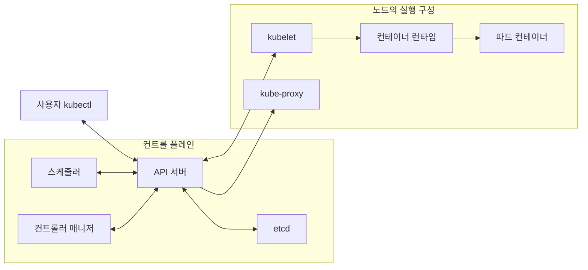
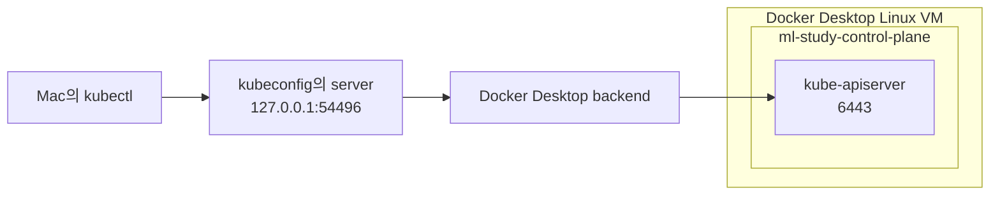

*[서종호(가시다)](https://www.linkedin.com/in/gasida99/)님의 Machine Learning Platform Engineering Study 1주차 학습 내용을 기반으로 합니다.*

<br>

# TL;DR

- Mac의 kind 노드는 Docker Desktop Linux VM 안에서 실행되는 컨테이너다. 노드 IP에 직접 접근하는 대신 호스트로 공개된 포트를 사용한다
- API 서버의 6443 포트는 kind가 자동으로 Mac의 빈 포트에 매핑하고, 접속 주소와 인증 정보를 kubeconfig에 기록한다
- 실습에서는 `127.0.0.1:54496`의 Docker Desktop 리스너, 노드 안 `kube-apiserver`의 6443 리스너, 인증서 SAN을 차례로 확인했다
- `extraPortMappings`, Service의 `NodePort`, 파드의 `hostPort`는 서로 다른 구간을 연결한다

<br>

# K8s 아키텍처와 실습 클러스터

책 3.3.1절 전반에 대응하는 실습이다. [3.2.2편]()에서 레지스트리에 올린 이미지를 클러스터에 배포하려면, 먼저 클러스터를 만들고 `kubectl`로 접근할 수 있어야 한다.

쿠버네티스(Kubernetes, K8s)는 컨테이너화된 애플리케이션의 배치와 실행 상태를 관리한다. **컨트롤 플레인(control plane)**은 클러스터 상태를 관리하고, **노드(node)**의 kubelet과 컨테이너 런타임은 파드(Pod)를 실행한다. 파드는 쿠버네티스가 배포하는 기본 단위로, 하나 이상의 컨테이너를 묶는다.


<center><sup>출처: 『머신러닝 플랫폼 엔지니어링』 그림 3.4. AI를 이용해 재구성했다</sup></center>

| 구성 요소 | 역할 |
|---|---|
| API 서버 | 클러스터 API 요청을 받아 인증·인가하고 리소스를 조회·변경하는 접점 |
| etcd | 클러스터 상태를 저장하는 키-값 저장소 |
| 스케줄러 | 아직 노드가 배정되지 않은 파드의 실행 노드를 선택 |
| 컨트롤러 매니저 | 현재 상태를 원하는 상태에 맞추는 제어 루프 실행 |
| kubelet | 노드에 배정된 파드가 실행되도록 런타임과 협력 |
| 컨테이너 런타임 | 이미지와 컨테이너 생명주기 관리 |
| kube-proxy | Service 접근을 위한 노드의 네트워크 규칙 관리 |

그림은 역할 구분이다. 이번 단일 노드 kind에서는 컨트롤 플레인 구성 요소와 파드 실행 구성 요소가 같은 노드에 있다. 이 실습에서는 API 서버가 접근 접점이고 kubelet과 런타임이 실행을 담당한다는 구분까지면 충분하다. 전체 구성은 [쿠버네티스 개요]()와 [공식 구성 요소 문서](https://kubernetes.io/docs/concepts/overview/components/)를 참고한다.

## 실습 클러스터 선택

스터디에서는 Linux·WSL2의 K3s와 macOS의 kind 두 방안을 제시했다. K3s는 경량 쿠버네티스 배포판이고, kind는 컨테이너를 노드로 사용하는 로컬 쿠버네티스 도구다. 내 환경은 M1 Pro Mac과 Docker Desktop 4.37.2(Engine 27.4.0)이므로 kind를 사용했다.

| 구분 | 쿠버네티스 환경 |
|---|---|
| 책 | 1.24 기반 |
| 스터디 | K3s 1.29 또는 kind 1.29 기반 |
| 내 Mac | `kindest/node:v1.29.14` 단일 노드 |

스터디가 버전을 올린 이유는 뒤에 설치하는 Gitea Actions 러너와의 호환성이다. 다만 [공식 배포 차트 `actions-0.1.2.tgz`](https://dl.gitea.com/charts/actions-0.1.2.tgz)의 `Chart.yaml`에는 최소 쿠버네티스 버전을 선언하는 `kubeVersion` 필드가 없다. 확인 가능한 근거는 StatefulSet 템플릿에서 Docker-in-Docker(DinD) 컨테이너를 `initContainers` 아래에 두고 `restartPolicy: Always`를 지정한다는 점이다. 이는 앱 컨테이너와 함께 계속 실행되는 native sidecar 기능을 사용한다. [공식 sidecar 가이드](https://kubernetes.io/docs/tutorials/configuration/pod-sidecar-containers/)에 따르면 이 기능은 1.29에서 beta로 기본 활성화되었다. 따라서 1.29 선택은 이 기능과 연결해서 이해할 수 있지만, 차트의 명시적 최소 지원 버전 선언과는 구분해야 한다.

K3s 방안은 Traefik을 비활성화하고 kubeconfig 파일 모드를 `644`로 설정했다. Flannel의 `host-gw` 설정은 스터디 노트에서 DinD의 MTU 문제를 피하기 위한 선택으로 설명한다. 이 kind 클러스터 생성 실습에서는 K3s를 설치하거나 그 환경의 DinD 동작을 시험하지 않았다.

<br>

# kind 클러스터 구성 해부

저장소 루트의 `kind-ml-study.yaml`로 클러스터를 만들었다. 아래 `~/ml-study`는 실습 저장소 경로를 줄인 표기다.

```yaml
# 단일 노드와 이후 실습에 필요한 호스트 포트 매핑
kind: Cluster
apiVersion: kind.x-k8s.io/v1alpha4
name: ml-study
nodes:
  - role: control-plane
    image: kindest/node:v1.29.14
    extraPortMappings:
      - { containerPort: 30000, hostPort: 30000 } # Gitea
      - { containerPort: 30001, hostPort: 30001 } # Argo CD HTTPS
      - { containerPort: 30002, hostPort: 30002 } # Prometheus
      - { containerPort: 30003, hostPort: 30003 } # Grafana
      - { containerPort: 30420, hostPort: 30420 } # NodePort 실습
```

`role: control-plane`인 노드 하나를 만들고 노드 이미지로 쿠버네티스 버전을 정했다. `extraPortMappings`는 노드 컨테이너의 포트를 Mac의 포트로 공개하는 설정이다. 기본 프로토콜은 TCP이며, 여기서는 `listenAddress`를 생략해 모든 IPv4 주소(`0.0.0.0`)에 바인딩된다. 필드 의미는 [kind 설정 문서](https://kind.sigs.k8s.io/docs/user/configuration/#extra-port-mappings)에서 확인할 수 있다.

## NodePort 실습용 30420 매핑

30000~30003은 뒤의 플랫폼 도구 접속용이고, 30420은 `joker-nodeport-service`의 NodePort 실습용이다. Docker Desktop의 노드 IP `172.18.0.2`는 VM 안 네트워크에 있어 Mac에서 직접 라우팅할 수 없다. 그래서 Mac의 `localhost:30420`을 노드 컨테이너의 30420에 연결했다.

이 설정만으로 Service가 만들어지지는 않는다. 해당 노드 포트를 사용하는 Service를 별도로 생성해야 파드로 이어진다. kind의 [NodePort 매핑 조건](https://kind.sigs.k8s.io/docs/user/configuration/#nodeport-with-port-mappings)상 `containerPort`는 Service의 `nodePort`와 같아야 한다. Mac 쪽 `hostPort`까지 반드시 같은 값이어야 하는 것은 아니지만, 실습에서는 셋을 30420으로 맞췄다.

kind 설정 파일의 포트 매핑은 클러스터 생성 시 적용된다. 이 방식으로 매핑을 추가하려면 클러스터를 재생성해야 하므로 필요한 포트를 처음 구성에 넣었다. 이미 올린 리소스도 재배포 대상이 된다.

`kubectl port-forward`를 사용하면 매핑되지 않은 포트의 앱에도 접근할 수 있다. 다만 이는 API 서버를 경유하는 별도 경로여서 NodePort를 검증한 결과가 되지는 않는다. Service의 NodePort 경로는 [3.3.4편](#mac과-다른-pc에서의-호출)에서 다룬다.

<br>

# 적용과 관찰

## 클러스터 생성과 컨텍스트

```bash
# 저장소 루트에서 설정 파일로 생성
cd ~/ml-study
kind create cluster --config kind-ml-study.yaml

# 생성 로그의 접속 안내
# Set kubectl context to "kind-ml-study"

# 생성한 노드 확인
kind get nodes --name ml-study
# ml-study-control-plane

# 현재 접속 대상 확인
kubectl config current-context
# kind-ml-study
```

`kind create cluster`는 클러스터를 만든 뒤 kubeconfig에 접속 정보를 추가하고 현재 컨텍스트를 `kind-ml-study`로 설정했다. **컨텍스트(context)**는 클러스터 주소·인증 정보·기본 네임스페이스의 조합을 선택하는 이름이다.

| kubeconfig 항목 | 이번 실습의 내용 |
|---|---|
| `clusters` | `kind-ml-study`: API 서버 주소와 CA 인증서 |
| `users` | `kind-ml-study`: 클라이언트 인증서와 키 |
| `contexts` | 위 cluster와 user를 묶고 기본 네임스페이스 선택 |
| `current-context` | 현재 사용하는 `kind-ml-study` 컨텍스트 |

기본 네임스페이스는 kubectx 패키지의 `kubens`로 `default`를 선택했다. 같은 설정을 kubectl로 할 때는 `kubectl config set-context kind-ml-study --namespace=default`를 사용할 수 있다. kubeconfig 파일 병합과 항목 구조는 [kubeconfig 구조]()에 정리되어 있다.

## 노드와 시스템 파드

```bash
# 대상 컨텍스트를 명시해 API 서버와 노드 확인
kubectl --context kind-ml-study cluster-info
# Kubernetes control plane is running at https://127.0.0.1:54496

kubectl --context kind-ml-study get nodes -o wide
# 실행 결과의 주요 열
# NAME                     STATUS   VERSION    INTERNAL-IP   CONTAINER-RUNTIME
# ml-study-control-plane   Ready    v1.29.14   172.18.0.2    containerd://2.0.2

kubectl --context kind-ml-study get pods -A -o wide
# 실행 결과 발췌: 파드 이름과 IP
# coredns-76f75df574-h99t8                  10.244.0.2
# coredns-76f75df574-rr9kg                  10.244.0.3
# kube-apiserver-ml-study-control-plane    172.18.0.2
# kindnet-wbljt                           172.18.0.2
# local-path-provisioner-55ff44bb8-ckn8n    10.244.0.4
```

노드는 `Ready`이고 런타임은 containerd 2.0.2였다. 같은 노드 위에서도 CoreDNS는 별도 파드 IP를, API 서버와 kindnet은 노드 IP를 사용한다. 파드 네트워크와 런타임 계층은 [3.3.2편]()에서 확인한다.

<br>

# 검증: Mac에서 API 서버까지의 경로

노드는 VM 안에 있는데 `kubectl cluster-info`에는 `127.0.0.1:54496`이 나왔다. 이 주소가 어디로 이어지는지, 접속 주소가 루프백인데도 인증서 검증을 통과하는 이유가 무엇인지 차례로 확인했다.


<center><sup>AI를 이용해 직접 그린 도식. Mac의 공개 포트에서 kind 노드 안 API 서버까지 이어지는 접속 경로</sup></center>

## 주소와 양쪽 리스너

먼저 kubeconfig의 주소와 Docker의 포트 매핑을 대조했다.

```bash
# 1. kubectl이 접속하는 주소
kubectl --context kind-ml-study config view --minify \
  -o jsonpath='{.clusters[0].cluster.server}'
# https://127.0.0.1:54496

# 2. 노드의 6443이 공개된 호스트 주소
docker port ml-study-control-plane 6443
# 127.0.0.1:54496

# 3. Mac에서 공개 포트를 듣는 프로세스
lsof -nP -iTCP:54496 -sTCP:LISTEN
# 실행 결과 발췌
# COMMAND     PID   USER    NAME
# com.docke 72340 <user>    TCP 127.0.0.1:54496 (LISTEN)

# 4. 노드 안에서 6443을 듣는 프로세스
docker exec ml-study-control-plane ss -tnlp | grep 6443
# LISTEN 0 4096 *:6443 *:* users:(("kube-apiserver",pid=573,fd=3))
```

1번과 2번은 **접속 주소와 포트 매핑이 일치함**을 보여준다. 3번은 Mac에 실제 리스너가 있음을, 4번은 매핑 반대편에서 API 서버가 대기함을 보여준다. `lsof`의 `com.docke`는 잘린 명령 이름이다. [Docker Desktop 네트워킹 문서](https://docs.docker.com/desktop/features/networking/)의 `com.docker.backend` 포트 전달 구조와 맞는다.

54496은 이 클러스터를 생성할 때 선택된 호스트 포트다. kind는 기본적으로 API 서버용 빈 포트를 선택하며 `networking.apiServerPort`로 고정할 수도 있다. 생성 당시 `docker inspect`의 `HostConfig.PortBindings`에도 이 값이 들어 있었다. 같은 컨테이너의 stop/start에서는 설정이 유지되고, 재생성 시에는 다른 포트가 선택될 수 있다. 접속 주소는 kind가 kubeconfig에 반영하므로 이 숫자를 외울 필요는 없다.

## TLS 인증서와 접속 주소

포트가 연결되어도 TLS(Transport Layer Security, 전송 계층 보안) 검증 조건을 만족하지 못하면 HTTPS 요청은 실패한다. 다섯 번째 확인은 API 서버 인증서의 **SAN(Subject Alternative Name, 주체 대체 이름)**이다.

```bash
# 5. 서버 인증서가 허용하는 DNS 이름과 IP 확인
docker exec ml-study-control-plane openssl x509 \
  -in /etc/kubernetes/pki/apiserver.crt -noout -ext subjectAltName

# 실행 결과
# X509v3 Subject Alternative Name:
# DNS:kubernetes, DNS:kubernetes.default, DNS:kubernetes.default.svc,
# DNS:kubernetes.default.svc.cluster.local, DNS:localhost,
# DNS:ml-study-control-plane, IP Address:10.96.0.1,
# IP Address:172.18.0.2, IP Address:127.0.0.1
```

SAN에 `IP Address:127.0.0.1`이 있으므로 kubeconfig의 접속 IP와 인증서의 대상 IP가 일치한다. `DNS:localhost`도 포함되어 있다. 이름 일치와 인증서 신뢰는 별개 조건이다. kubeconfig의 `certificate-authority-data`는 서버 인증서의 서명을 검증할 CA를 제공하고, `client-certificate-data`와 `client-key-data`는 API 서버가 클라이언트를 인증하는 데 사용한다.

즉 이번 접속에는 세 가지가 함께 갖춰져 있다.

- **네트워크 경로**: Mac의 54496에서 노드의 6443으로 포트 전달
- **접속·인증 설정**: kubeconfig에 서버 주소, CA, 클라이언트 인증서·키 등록
- **서버 신원 일치**: 접속 IP인 `127.0.0.1`이 서버 인증서 SAN에 포함

인증서와 kubeconfig의 대응은 [kubeadm 인증서 확인](), 인증서 필드는 [X.509](), 주소 검증은 [SNI와 SAN]()에서 더 자세히 다룬다.

## 포트 연결 방식 비교

API 서버와 실습 앱은 모두 호스트 포트를 사용하지만, 설정 주체와 바인딩 범위가 다르다.

| 구분 | API 서버 | 실습 앱 |
|---|---|---|
| 설정 | kind가 자동 구성 | `extraPortMappings`에 명시 |
| Mac 포트 | 이번 생성에서는 54496 | 30000~30003, 30420 |
| 바인딩 | `127.0.0.1` | `0.0.0.0` |
| 노드 컨테이너 포트 | 6443 | 매핑에 지정한 포트 |

실습 포트를 `0.0.0.0`에 바인딩하면 Mac의 LAN 주소(예: `192.168.0.10`)로 들어오는 연결도 받을 수 있다. 이는 파드나 DinD에서 Mac 쪽 공개 서비스에 접근할 때 필요한 조건 중 하나다. 파드 안 `localhost`는 Mac이 아닌 파드 자신의 네트워크 공간을 가리킨다. 실제 접근 가능 여부에는 라우팅과 방화벽도 영향을 준다. 뒤의 실습에서 Argo CD는 이 경로(Mac LAN IP의 30000)로 Gitea 저장소를 받았고, CI 잡의 checkout은 클러스터 내부 주소를 썼다([3.4.2편](#gitea-접속-주체와-주소)).

같은 이유로 이 설정은 루프백 전용 공개가 아니다. 다른 기기에서도 네트워크·방화벽 조건이 허용하면 접근할 수 있으므로, 로컬 실습 서비스의 공개 범위를 판단할 때 바인딩 주소를 함께 확인해야 한다.

| 포트 연결 | 처리 계층 | 연결 구간 |
|---|---|---|
| kind `extraPortMappings` | Docker의 포트 공개와 Desktop 전달 | Mac ↔ 노드 컨테이너 |
| Service `NodePort` | 이 구성에서는 kube-proxy | 노드 포트 → Service 대상 파드 |
| 파드 `hostPort` | 이 CNI 구성에서는 `portmap` | 파드가 실행 중인 노드의 포트 → 해당 파드 |

따라서 `extraPortMappings`에 있는 `hostPort` 필드와 파드 매니페스트의 `hostPort` 필드는 이름이 같아도 대상 호스트가 다르다. 전자는 Mac 쪽 공개 포트, 후자는 쿠버네티스 노드 쪽 포트다.

<br>

# 정리

kind로 클러스터를 생성한 뒤에는 API 서버의 접속 주소, Docker 포트 매핑, 양쪽 리스너, TLS 인증서가 같은 경로를 설명하는지 확인할 수 있었다. `kubectl`의 성공은 노드 IP로 직접 접근했다는 뜻이 아니라, kind가 준비한 호스트 포트와 인증 설정이 함께 동작했다는 뜻이다.

ML 플랫폼의 피처 스토어·파이프라인·서빙 도구도 이 클러스터 API를 통해 배포된다. 로컬 플랫폼 실습에서는 애플리케이션 포트에 앞서 **관리 API에 닿는 경로와 인증 설정**을 구분하는 것이 기반 작업이다.

<br>

# 참고 링크

- [kind 설정](https://kind.sigs.k8s.io/docs/user/configuration/)
- [Docker Desktop 네트워킹](https://docs.docker.com/desktop/features/networking/)
- [쿠버네티스 구성 요소](https://kubernetes.io/docs/concepts/overview/components/)
- [쿠버네티스 Sidecar Containers](https://kubernetes.io/docs/concepts/workloads/pods/sidecar-containers/)
- [Gitea Actions 차트 저장소](https://gitea.com/gitea/helm-actions)

<br>
