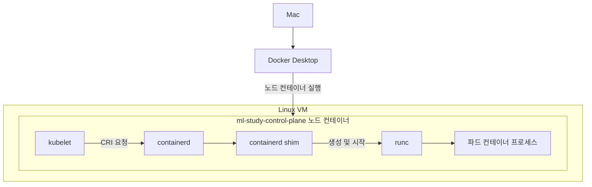
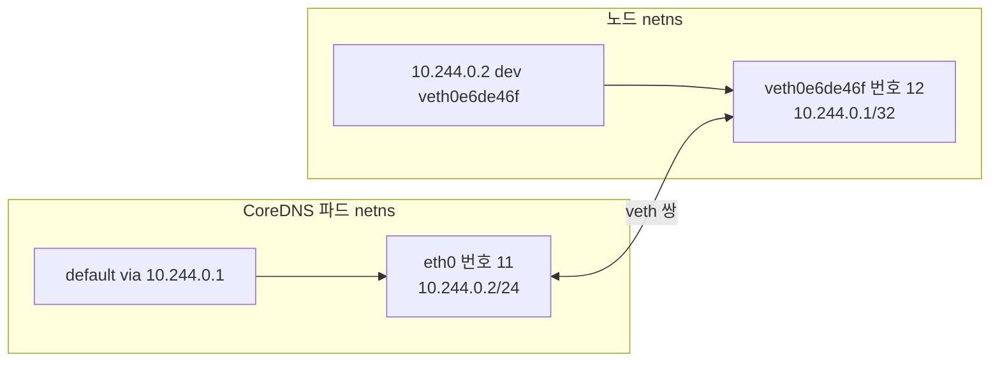

*[서종호(가시다)](https://www.linkedin.com/in/gasida99/)님의 Machine Learning Platform Engineering Study 1주차 학습 내용을 기반으로 합니다.*

<br>

# TL;DR

- Mac의 `docker ps`에는 kind 노드 컨테이너만 보이고, 파드 컨테이너는 노드 안의 containerd가 관리한다
- 이 클러스터의 kindnet은 `ptp`, `host-local`, `portmap` CNI 플러그인과 kindnetd로 구성된다. 파드와 노드는 브리지 없이 veth와 라우트로 연결된다
- CoreDNS의 `10.244.0.2`를 노드의 veth, 파드 netns, host-local 할당 기록, CRI 샌드박스 정보에 차례로 대조했다
- 리눅스 네임스페이스는 커널 자원의 격리 단위이고, 쿠버네티스 네임스페이스는 API 리소스의 이름·관리 범위다. 쿠버네티스 네임스페이스를 나누는 것만으로 통신이 차단되지는 않는다

<br>

# kind 노드의 런타임 계층

책 3.3.1절 후반에 대응하는 실습이다. [3.3.1편]()에서 생성한 노드 안으로 들어가, 파드 네트워크와 컨테이너가 실제로 어떻게 구성되는지 확인했다.

Mac에서 `docker ps`를 실행하면 `ml-study-control-plane`이 보인다. 하지만 `kubectl get pods -A`의 CoreDNS나 API 서버 파드가 각각 Docker 컨테이너 목록에 나오는 것은 아니다. **Docker가 관리하는 노드 컨테이너 안에 별도의 containerd가 있기 때문**이다.


<center><sup>AI를 이용해 직접 그린 도식. Docker의 노드 컨테이너와 그 안에서 동작하는 쿠버네티스 런타임의 관계</sup></center>

**CRI(Container Runtime Interface, 컨테이너 런타임 인터페이스)**는 kubelet이 컨테이너 런타임에 파드와 컨테이너 관리를 요청하는 인터페이스다. 이 클러스터에서 kubelet이 사용하는 런타임은 containerd 2.0.2이고, 하위 런타임인 runc는 OCI(Open Container Initiative)의 컨테이너 실행 규격을 구현한다. runc가 컨테이너 프로세스를 생성·시작하며, 실행 중인 컨테이너의 관리는 containerd와 컨테이너 사이를 중계하는 shim 프로세스를 통해 이어진다. 그림의 화살표는 실행 요청 관계를 나타낸다.

```bash
# 노드 런타임 확인
kubectl --context kind-ml-study get nodes -o wide
# CONTAINER-RUNTIME 열: containerd://2.0.2

# 노드 안 런타임과 컨테이너를 조회하는 명령
docker exec ml-study-control-plane crictl version
docker exec ml-study-control-plane crictl ps
```

`crictl`은 CRI를 통해 조회하고, `ctr`은 containerd를 직접 다루는 도구다. `ctr`로 쿠버네티스 컨테이너를 볼 때 사용하는 containerd의 `k8s.io` 네임스페이스 역시 뒤에서 다룰 [리눅스·쿠버네티스 네임스페이스](#리눅스-네임스페이스와-쿠버네티스-네임스페이스)와 별개다. 명령 선택은 [노드 이미지 조회](), 런타임 구성은 [containerd 설치]()와 [containerd 설정]()을 참고한다. Docker와 containerd의 이미지 저장 경로 차이는 [이미지 중복 저장 구조]()에서 다뤘다.

<br>

# kindnet 해부

## CNI 구성과 파드 대역

**CNI(Container Network Interface, 컨테이너 네트워크 인터페이스)**는 컨테이너 네트워크를 설정하는 플러그인의 호출 규약이다. 쿠버네티스에서는 런타임이 파드의 네트워크 공간을 준비하고 CNI 플러그인을 호출해 인터페이스·주소·경로를 설정한다. 전체 호출 순서는 [CNI 동작 흐름]()에 정리되어 있다.

kind의 기본 네트워크 구성은 kindnet이다. 실행 중인 kindnetd 이미지와 노드의 CNI 설정 파일을 확인했다.

```bash
# 노드마다 네트워크를 관리하는 DaemonSet의 이미지
kubectl --context kind-ml-study -n kube-system get ds kindnet \
  -o jsonpath='{.spec.template.spec.containers[0].image}'
# docker.io/kindest/kindnetd:v20250214-acbabc1a

# 노드의 CNI 설정과 파드 CIDR 확인
docker exec ml-study-control-plane cat /etc/cni/net.d/10-kindnet.conflist
kubectl --context kind-ml-study get node ml-study-control-plane \
  -o jsonpath='{.spec.podCIDR}'
# 10.244.0.0/24
```

**IPAM(IP Address Management, IP 주소 관리)**은 주소 할당·회수를 담당한다. `10-kindnet.conflist`에는 `ptp`의 IPAM으로 `host-local`이 지정되어 있고, 그 뒤에 `portmap`이 연결되어 있었다.

| 구성 요소 | 하는 일 | 이 클러스터의 근거 |
|---|---|---|
| `ptp` | 파드와 노드 사이의 veth 쌍과 경로 구성 | 노드에 파드별 veth와 호스트 경로 존재 |
| `host-local` | 노드의 파드 대역에서 IP를 할당하고 파일로 상태 관리 | `10.244.0.0/24`, `/run/cni-ipam-state` |
| `portmap` | 파드의 `hostPort`에 필요한 포트 전달 규칙 구성 | `portMappings: true`; hostPort 파드 동작은 시험하지 않음 |
| `kindnetd` | CNI 설정 파일 생성, 다른 노드의 파드 대역 경로와 masquerade 관리 | kindnet DaemonSet과 노드의 설정 파일 |

<details markdown="1">
<summary>노드의 CNI 설정 파일</summary>

<!-- 노드의 CNI 플러그인 체인과 IPAM 설정 -->
```json
{
  "cniVersion": "0.3.1",
  "name": "kindnet",
  "plugins": [
    {
      "type": "ptp",
      "ipMasq": false,
      "ipam": {
        "type": "host-local",
        "dataDir": "/run/cni-ipam-state",
        "routes": [{ "dst": "0.0.0.0/0" }],
        "ranges": [[{ "subnet": "10.244.0.0/24" }]]
      },
      "mtu": 65535
    },
    {
      "type": "portmap",
      "capabilities": { "portMappings": true }
    }
  ]
}
```

`ptp`의 `ipMasq: false`는 클러스터 전체에서 주소 변환을 하지 않는다는 뜻이 아니다. kindnetd가 별도로 masquerade를 관리한다. `ranges`의 대역은 이 노드에 배정된 `spec.podCIDR`과 일치한다.

</details>

이 구성은 파드 패킷을 그대로 노드의 라우트로 전달한다. VXLAN 같은 오버레이는 노드 사이에서 원래 패킷을 다른 패킷 안에 캡슐화하는 방식이다. 오버레이 통신에도 노드 간 연결·방화벽·MTU 조건이 필요하다.

eBPF는 커널의 특정 지점에 프로그램을 실행하는 기술이고, 관측 기능은 통신 흐름과 허용·차단 결과를 보여주는 기능이다. 이 kindnet 구성에는 Cilium의 eBPF 데이터 경로나 Hubble 같은 흐름 관측 기능이 없다. 이번 실습은 기본 인터페이스와 라우팅 테이블을 직접 조회했다.

## NetworkPolicy 지원 범위

NetworkPolicy는 파드의 인바운드·아웃바운드 통신 허용 조건을 정의하는 쿠버네티스 리소스다. 이를 실제로 집행하는 네트워크 구현이 함께 있어야 한다.

kind는 [v0.24.0 릴리스](https://github.com/kubernetes-sigs/kind/releases/tag/v0.24.0)에서 `kube-network-policies` 기반 지원을 추가했다. 이는 쿠버네티스 노드 버전 `v1.29.14`와 다른 버전 축이다. 실습 이미지 태그의 커밋에 해당하는 [kindnetd 소스](https://github.com/kubernetes-sigs/kind/blob/acbabc1a/images/kindnetd/cmd/kindnetd/main.go)에도 정책 컨트롤러 구성이 있다.

```bash
# 실습 당시 kindnet ClusterRole의 리소스와 권한 조회
kubectl --context kind-ml-study get clusterrole kindnet \
  -o jsonpath='{range .rules[*]}{.resources}{" "}{.verbs}{"\n"}{end}'

# 실행 결과 중 정책 조회 권한
# ["networkpolicies"] ["list","watch"]
```

이 권한은 컨트롤러가 정책을 읽을 수 있다는 근거다. **권한이 있는 것과 통신 차단을 검증한 것은 다르다.** 이번 기록에는 deny 정책을 적용한 통신 시험이 없으므로, 버전·소스의 지원 여부와 정책 집행 실측을 구분한다.

## 다른 CNI와의 비교

네트워크 구현은 IP 할당, 노드 사이 전달 방식, 정책 집행을 나눠 비교하면 차이가 명확하다. 아래는 대표 구성의 비교이며, 대체 CNI 설치나 성능 비교를 이 클러스터에서 실행한 것은 아니다.

| 구현 | IPAM | 노드 간 전달 | NetworkPolicy |
|---|---|---|---|
| 이 실습의 kindnet | 노드 PodCIDR에서 host-local 할당 | 다른 노드의 파드 대역으로 직접 라우팅 | kind 0.24.0부터 기본 지원, 실습에서는 차단 시험 없음 |
| K3s의 Flannel | 노드별 대역과 host-local | 기본 VXLAN, 스터디 설정은 `host-gw` 직접 라우팅 | K3s 내장 정책 컨트롤러가 담당 |
| Calico | Calico IPAM 등 선택 | BGP 기반 라우팅 또는 IPIP·VXLAN | 표준·확장 정책 지원 |
| Cilium | cluster-pool 등 여러 IPAM 모드 | VXLAN·Geneve 또는 native routing | 표준·확장 정책 지원 |
| AWS VPC CNI | VPC의 ENI 주소·프리픽스 활용 | VPC 네트워크로 전달 | 지원 버전·환경에서 기능 활성화 필요 |

K3s의 정책 집행은 Flannel의 패킷 전달 기능과 구분된다. [K3s 공식 문서](https://docs.k3s.io/networking/networking-services/#network-policy-controller)는 kube-router의 정책 컨트롤러 라이브러리를 내장한다고 설명한다. Cilium 역시 eBPF를 사용한다는 사실만으로 오버레이인지 직접 라우팅인지 정해지지는 않는다. [라우팅 모드](https://docs.cilium.io/en/stable/network/concepts/routing/)와 [IPAM 모드](https://docs.cilium.io/en/stable/network/concepts/ipam/)는 별도 선택이다.

Calico의 선택지는 [네트워킹 구성 문서](https://docs.tigera.io/calico/latest/networking/determine-best-networking), VPC CNI의 구조는 [EKS VPC CNI](), 정책 지원 조건은 [EKS NetworkPolicy 문서](https://docs.aws.amazon.com/eks/latest/userguide/cni-network-policy.html)를 참고한다. kind에서 다른 CNI를 시험하려면 생성 설정의 `networking.disableDefaultCNI: true`로 기본 CNI를 끄고 별도 설치하는 방식을 사용할 수 있다.

<br>

# 검증: 파드 netns와 veth 쌍

## 노드 라우트와 인터페이스

**네트워크 네임스페이스(network namespace, netns)**는 인터페이스·주소·라우팅 테이블 등을 분리하는 리눅스 커널 기능이다. **veth(virtual Ethernet)**는 두 인터페이스가 쌍으로 동작하는 가상 네트워크 장치로, 한쪽으로 보낸 패킷이 다른 쪽에 전달된다.

Mac의 `ifconfig`에서는 이 파드 veth가 보이지 않는다. Docker Desktop VM 안 노드의 netns에 있기 때문이다. 노드 안에는 `ifconfig`도 없어 `ip` 명령으로 확인했다. 실습 노드에는 `tcpdump` 역시 없었다.

```bash
# 이후 조회에 사용할 노드 이름
N=ml-study-control-plane

# 노드의 IPv4 라우팅 테이블
docker exec "$N" ip route

# 실행 결과
# default via 172.18.0.1 dev eth0
# 10.244.0.2 dev veth0e6de46f scope host
# 10.244.0.3 dev veth608a53f2 scope host
# 10.244.0.4 dev vethdd068c62 scope host
# 172.18.0.0/16 dev eth0 proto kernel scope link src 172.18.0.2
```

일반 파드 세 개에 대해 각각 veth로 가는 경로가 있다. `10.244.0.2`는 `coredns-76f75df574-h99t8`, `10.244.0.3`은 다른 CoreDNS 파드, `10.244.0.4`는 local-path-provisioner다. API 서버·etcd·kube-proxy 등 `hostNetwork` 파드는 노드의 네트워크 공간을 공유해 `172.18.0.2`를 사용한다.

CoreDNS 하나를 골라 노드 쪽 인터페이스를 확인했다.

```bash
# 파드 10.244.0.2로 가는 veth와 반대편 netns 조회
docker exec "$N" ip -d link show veth0e6de46f
# 실행 결과 핵심 필드
# 12: veth0e6de46f@if11: ...
# link-netns cni-bd656c65-1c54-76d4-02d9-09cf30fd424e

# 노드 쪽 주소와 실제 경로 선택
docker exec "$N" ip -br addr show veth0e6de46f
# veth0e6de46f@if11 UP 10.244.0.1/32 ...
docker exec "$N" ip route get 10.244.0.2
# 10.244.0.2 dev veth0e6de46f src 10.244.0.1 uid 0
```

`ip route get`은 목적지에 대해 커널이 선택하는 경로를 조회한다. 패킷을 실제로 보내는 명령은 아니지만, `10.244.0.2`의 전달 인터페이스가 `veth0e6de46f`라는 점을 확인할 수 있다.

## 파드 쪽 인터페이스와 게이트웨이

`link-netns`의 이름으로 반대편 네트워크 공간에 들어갔다. 아래 이름과 veth 이름은 당시 값이며 파드를 재생성하면 바뀔 수 있다.

```bash
# 노드에서 이름으로 접근할 수 있는 파드 netns 목록
docker exec "$N" ip netns list
# cni-bd656c65-1c54-76d4-02d9-09cf30fd424e (id: 1)
# cni-8a5d35c6-ca1b-1a9f-a0b1-92a8e6a58ba4 (id: 3)
# cni-15aa94d7-bf54-8d89-6080-d41b8641c169 (id: 2)

# 위 link-netns에서 확인한 이름
POD_NETNS=cni-bd656c65-1c54-76d4-02d9-09cf30fd424e
docker exec "$N" ip netns exec "$POD_NETNS" ip -br addr
# 실행 결과 중 파드 인터페이스
# eth0@if12 UP 10.244.0.2/24 ...

docker exec "$N" ip netns exec "$POD_NETNS" ip route
# default via 10.244.0.1 dev eth0
# 10.244.0.0/24 via 10.244.0.1 dev eth0 src 10.244.0.2
# 10.244.0.1 dev eth0 scope link src 10.244.0.2
```

`ip netns exec`는 **노드에 설치된 `ip`를 대상 netns에서 실행**한다. CoreDNS 이미지에 셸이나 네트워크 도구가 없어도 인터페이스를 조회할 수 있는 이유다.


<center><sup>AI를 이용해 직접 그린 도식. CoreDNS 파드의 eth0와 노드의 veth를 잇는 주소와 경로</sup></center>

노드의 `veth0e6de46f@if11`에서 `12`는 자기 인터페이스 번호이고, `@if11`은 반대편 번호다. 파드에서는 `eth0@if12`로 보인다. 그런데 노드의 다른 veth 두 개도 모두 `@if11`이었다. 인터페이스 번호는 netns마다 별도로 관리되므로 다른 파드에서도 11번이 나올 수 있다. **번호만으로 파드를 특정하지 말고 `link-netns`를 함께 대조해야 한다.**

`ptp` 구성에서는 노드 쪽 veth들이 같은 게이트웨이 주소 `10.244.0.1/32`를 사용한다. 노드는 각 파드 IP의 개별 경로로 전달 대상을 결정하고, 파드는 같은 노드의 다른 파드로 보낼 때도 게이트웨이를 거친다. `cni0` 브리지로 연결하는 [Flannel 실습]()과 다른 구조다. Docker의 바깥 `kind` 네트워크가 bridge 드라이버라는 사실과, 노드 안 파드 연결에 브리지를 쓰지 않는다는 사실은 양립한다.

## IP 할당 기록에서 파드 이름까지

처음에는 `kubectl get pods -A -o wide`에서 같은 IP를 찾아 CoreDNS로 연결했다. 이를 반대 방향으로 확인하려고 host-local의 할당 기록에서 시작했다.

```bash
# 이 IP를 할당받은 CNI 컨테이너 식별자와 인터페이스
docker exec "$N" cat /run/cni-ipam-state/kindnet/10.244.0.2
# d88d5b61d447929e4bb78880396ed43adbe8abac514773f69ce56fc68b950cf9
# eth0

# 이 구성에서는 위 식별자가 CRI 파드 샌드박스 ID다
docker exec "$N" crictl inspectp \
  d88d5b61d447929e4bb78880396ed43adbe8abac514773f69ce56fc68b950cf9
```

**파드 샌드박스(Pod sandbox)**는 런타임이 파드의 공유 실행 환경을 준비하는 단위다. `crictl inspectp` 출력의 관련 필드를 대조하면 다음과 같다.

| 출력 필드 | 값 |
|---|---|
| `status.metadata.name` | `coredns-76f75df574-h99t8` |
| `status.metadata.namespace` | `kube-system` |
| `status.network.ip` | `10.244.0.2` |
| `info.cniResult.Interfaces.eth0.Sandbox` | `/var/run/netns/cni-bd656c65-1c54-76d4-02d9-09cf30fd424e` |
| `info.pid` | `1399` |
| `info.runtimeType` | `io.containerd.runc.v2` |

IP와 파드 이름뿐 아니라 netns 경로도 `link-netns`의 이름과 일치했다. 따라서 `10.244.0.2 → veth0e6de46f → 해당 netns → 샌드박스 ID → CoreDNS 파드`를 서로 다른 조회 결과로 연결할 수 있었다.

<br>

# 리눅스 네임스페이스와 쿠버네티스 네임스페이스

## 이름과 격리 대상의 차이

CoreDNS에 `kubectl exec`를 시도할 때 `-n kube-system`을 빠뜨려 NotFound가 나왔다. 이는 API가 기본 네임스페이스에서 파드 이름을 찾았기 때문이다. 반면 `ip netns exec cni-...`는 그 파드가 사용하는 리눅스 네트워크 공간에서 명령을 실행한다. 두 명령의 네임스페이스는 같은 개념이 아니다.

| 구분 | 리눅스 네임스페이스 | 쿠버네티스 네임스페이스 |
|---|---|---|
| 정의 | 커널 자원의 가시성과 식별자 범위를 분리하는 기능 | API 리소스 이름과 관리 범위를 나누는 객체 |
| 대상 | net, pid, mnt, uts, ipc, user, cgroup, time 등 | 네임스페이스 범위의 파드·Service 등 |
| 확인 | `lsns`, `/proc/<pid>/ns`, `ip netns list` | `kubectl get namespaces` |
| 격리의 의미 | 종류에 따라 네트워크·PID·마운트 등의 뷰를 분리 | 이름 범위 제공, RBAC·할당량 적용 단위; 자동 네트워크 차단은 아님 |

쿠버네티스 네임스페이스의 접근 권한과 할당량은 각각 RBAC와 ResourceQuota로 설정한다. 네임스페이스가 다른 파드 사이의 통신 제한에는 NetworkPolicy와 집행 구현이 필요하다. 기본 네트워크 모델은 [쿠버네티스 네트워킹 모델]()과 연결된다.

## CoreDNS 프로세스의 공유 범위

CoreDNS 프로세스의 리눅스 네임스페이스를 `lsns`로 확인했다.

```bash
# 노드 내부 CoreDNS 프로세스 하나 선택
P=$(docker exec "$N" pgrep -x coredns | head -1)
docker exec "$N" lsns -p "$P" -o TYPE,NS,PATH

# 실행 결과
# TYPE           NS PATH
# time   4026531834 /proc/1/ns/time
# user   4026531837 /proc/1/ns/user
# net    4026532864 /proc/1399/ns/net
# uts    4026533271 /proc/1399/ns/uts
# ipc    4026533272 /proc/1399/ns/ipc
# mnt    4026533274 /proc/1596/ns/mnt
# pid    4026533275 /proc/1596/ns/pid
# cgroup 4026533276 /proc/1596/ns/cgroup

# net·uts·ipc의 PATH에 등장한 프로세스 확인
docker exec "$N" cat /proc/1399/comm
# pause
```

`PATH`는 해당 네임스페이스에 접근할 수 있는 프로세스 경로다. 그 프로세스가 네임스페이스를 독점 소유한다는 뜻은 아니다. 이 출력에서는 net·uts·ipc에 pause 프로세스 경로가, mnt·pid·cgroup에 CoreDNS 프로세스 경로가 나왔다. user·time은 노드 PID 1의 경로였다.

pause 컨테이너는 파드의 공유 네임스페이스를 유지한다. **같은 파드의 컨테이너끼리 `localhost`로 통신하는 이유는 netns를 공유하기 때문**이다. 이 기본 구성에서는 PID 네임스페이스가 컨테이너별이지만, 파드의 `shareProcessNamespace` 같은 설정에 따라 달라질 수 있다. cgroup 네임스페이스는 프로세스에 보이는 cgroup 경로를 분리하고, 실제 자원 사용량 제한은 cgroup 설정이 담당한다.

pause와 파드 통신은 [파드 간 통신](), 격리와 자원 관리의 차이는 [컨테이너 격리와 시스템 지표]()에서 다뤘다.

<br>

# 정리

노드 컨테이너 안에서 주소·경로·netns·런타임 정보를 함께 조회하니, `kubectl`에 보이는 파드를 실제 리눅스 네트워크 구성에 연결할 수 있었다. 이 편에서 확인한 것은 단일 노드의 CoreDNS와 기본 kindnet 구성이다. veth와 netns를 직접 만드는 과정은 [컨테이너 네트워크 네임스페이스 실습]()에서 더 깊이 다룬다.

ML 플랫폼에서도 파이프라인 작업이나 서빙 파드는 이 런타임과 네트워크 위에서 실행된다. 앱 연결 문제를 조사할 때 **Docker 노드 컨테이너, 파드 샌드박스, API 네임스페이스, 리눅스 netns 중 무엇을 조회하는지** 구분해야 관찰 결과를 잘못 해석하지 않는다.

<br>

# 참고 링크

- [kind 기본 CNI 설정](https://kind.sigs.k8s.io/docs/user/configuration/#disable-default-cni)
- [kind 0.24.0 릴리스](https://github.com/kubernetes-sigs/kind/releases/tag/v0.24.0)
- [실습 이미지 커밋의 kindnetd 소스](https://github.com/kubernetes-sigs/kind/blob/acbabc1a/images/kindnetd/cmd/kindnetd/main.go)
- [CNI ptp 플러그인](https://www.cni.dev/plugins/current/main/ptp/)
- [CNI host-local 플러그인](https://www.cni.dev/plugins/current/ipam/host-local/)
- [CNI portmap 플러그인](https://www.cni.dev/plugins/current/meta/portmap/)
- [쿠버네티스 네임스페이스](https://kubernetes.io/docs/concepts/overview/working-with-objects/namespaces/)

<br>
