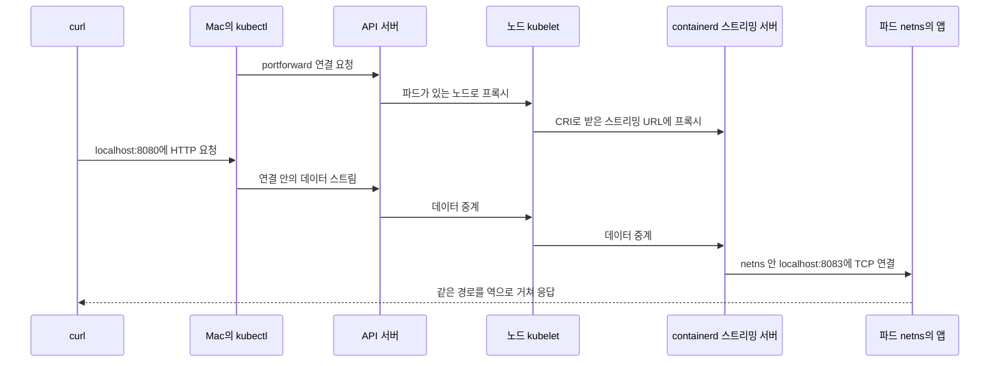
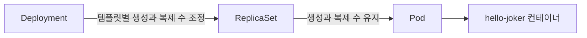

*[서종호(가시다)](https://www.linkedin.com/in/gasida99/)님의 Machine Learning Platform Engineering Study 1주차 학습 내용을 기반으로 합니다.*

<br>

# TL;DR

- Pod는 컨테이너 실행 단위, ReplicaSet은 파드 복제 수 유지 단위, Deployment는 ReplicaSet을 통한 배포와 업데이트 단위다
- 단독 파드를 실행한 뒤 ReplicaSet의 파드 재생성과 3개에서 4개로의 확장을 확인했다
- Deployment의 이미지 태그를 `v1`에서 `v2`로 바꾸자 새 ReplicaSet이 늘고 기존 ReplicaSet이 줄었다. 롤백에서는 기존 `v1` ReplicaSet이 다시 확장됐다
- `kubectl port-forward`는 API 서버와 노드의 스트리밍 경로를 통해 선택한 파드의 TCP 포트에 연결한다

<br>

# 오브젝트 관계 지도

책 3.3.3절에 대응하는 실습이다. [3.3.1편]()에서 만든 kind 클러스터에 hello-joker를 실행한다. 실습 위치는 `~/ml-study/chapters/ch03-k8s`로, 실습 저장소 경로를 줄인 표기다.

매니페스트(manifest)는 쿠버네티스 오브젝트의 원하는 상태를 선언한 파일이다. 같은 앱을 실행해도 어떤 오브젝트에 선언하는지에 따라 파드 수와 업데이트를 관리하는 주체가 달라진다.

{: .align-center}
<center><sup>AI를 이용해 직접 그린 도식. ch03 매니페스트에서 점선은 레이블 선택, 가는 실선은 오브젝트에 적힌 참조를 나타낸다.</sup></center>

지도에서 `app=fast-api`는 레이블(label), 이를 조건으로 오브젝트를 찾는 설정은 셀렉터(selector)다. `ownerReferences`는 자식 오브젝트에 저장되는 소유자 참조다. 그래서 지도에서는 파드 → ReplicaSet → Deployment 방향으로 소유자를 가리킨다. Service는 셀렉터로 통신 대상을 찾는다. Service의 포트와 요청 경로는 [3.3.4편]()에서 확인한다.

## 설정 참조 파일의 오류

지도의 아래쪽에는 ConfigMap과 Secret도 있다. ConfigMap은 일반 설정 데이터를, Secret은 비밀번호 같은 민감 데이터를 전달하는 오브젝트다. 책 3.3.5절의 이 예제는 실행하지 않았고, 파일을 읽어 참조 오류를 확인했다.

`k8s/pod-using-secret.yaml`에는 두 문제가 있다.

- `test-secret`을 `configMapKeyRef`로 찾는다. Secret을 참조하려면 `secretKeyRef`를 사용해야 한다
- 파드가 찾는 키는 `database-username`과 `database-password`인데, `k8s/secret.yaml`의 키는 `database_username`과 `database_password`다

참조할 오브젝트의 종류와 키 이름을 모두 맞춰야 한다. 설정 주입 방식은 [ConfigMap과 Secret 참조]()에서 다뤘다.

<br>

# Pod

파드(Pod)는 쿠버네티스에서 컨테이너를 실행하는 가장 작은 배포 단위다. 하나 이상의 컨테이너가 네트워크 네임스페이스를 공유하고, 볼륨을 함께 마운트할 수 있다. 이번 파드는 FastAPI 앱 컨테이너 하나를 실행한다.

## 매니페스트와 실행

```yaml
# k8s/pod.yaml: hello-joker 컨테이너 하나를 실행한다
apiVersion: v1
kind: Pod
metadata:
  name: joker
  labels:
    app: fast-api
spec:
  containers:
    - name: hello-joker
      image: <dockerhub-user>/hello-joker:v1
      ports:
        - containerPort: 8083
```

이미지는 [3.2.2편]()에서 만든 공개 멀티 플랫폼 이미지다. M1 Mac의 kind 노드는 arm64이므로 노드 안 containerd가 목록에서 `linux/arm64` 이미지를 선택한다. `containerPort`는 앱의 수신 포트를 선언한다. 실제 소켓은 진입 스크립트의 `uvicorn --host 0.0.0.0 --port 8083`이 연다.

`kubectl`은 쿠버네티스 API를 호출하는 CLI다. `create -f`로 파일의 오브젝트를 생성하고, `get -w`로 상태 변화를 계속 관찰한다.

```bash
# 생성 후 상태 변화 관찰
kubectl create -f k8s/pod.yaml
kubectl get pod -w

# 실행 결과
NAME    READY   STATUS              RESTARTS   AGE
joker   0/1     ContainerCreating   0          15s
joker   1/1     Running             0          21s
```

`kubectl describe`는 상세 상태와 이벤트를 보여 준다. `joker`는 `ml-study-control-plane`에 배치됐고, 파드 IP는 `10.244.0.7`이었다. 이벤트는 이미지 pull → 컨테이너 생성 → 시작 순서였다.

`kubectl exec`는 컨테이너 안에서 명령을 실행한다. `env`로 환경변수를 보니 `PYTHONPATH=/app`과 `KUBERNETES_SERVICE_HOST=10.96.0.1` 등이 있었다. `ENVIRONMENT` 변수는 없었다. Dockerfile에는 `ENV PYTHONPATH`만 있고, 파드에도 별도 `env` 설정이 없다. 환경변수 설정 방법은 [컨테이너 환경변수]()에서 다뤘다.

`kubectl logs`는 컨테이너의 로그를 조회한다.

```bash
# 앱이 실제로 수신하는 주소와 포트 확인
kubectl logs joker

# 실행 결과
INFO:     Started server process [11]
INFO:     Waiting for application startup.
INFO:     Application startup complete.
INFO:     Uvicorn running on http://0.0.0.0:8083 (Press CTRL+C to quit)
```

## port-forward 연결과 종료

`kubectl port-forward`는 로컬 TCP 포트로 들어온 연결을 파드의 포트에 전달하는 명령이다. `curl`은 HTTP 요청을 보내고, `jq`는 JSON 출력을 읽기 좋게 정렬한다.

```bash
# Mac의 8080 포트에서 파드의 8083 포트로 전달
kubectl port-forward joker 8080:8083 &

# 다른 터미널에서 앱 호출
curl -s localhost:8080 | jq

# 실행 결과
{
  "random_joke": "I went to a street where the houses were numbered 8k, 16k, 32k, 64k, 128k, 256kand 512k. It was a trip down Memory Lane."
}
```

스터디 노트에 책의 port-forward 명령 포트가 잘못 적혀 있다는 메모가 있다. 이 앱에서 `8083`이 맞다는 근거는 진입 스크립트, Uvicorn 로그, `8080:8083`으로 받은 응답이다. **파드를 대상으로 지정하면 앱이 듣는 포트로 연결하고, Service를 지정하면 Service의 `port`를 대응하는 `targetPort`로 해석한다.** [kubectl 명령 문서](https://kubernetes.io/docs/reference/kubectl/generated/kubectl_port-forward/)에도 Service 포트를 이용하는 예제가 있다.

백그라운드 실행에서도 포워딩 로그는 같은 터미널에 출력됐다. 로그를 파일로 보낼 때는 다음과 같이 리다이렉션할 수 있다. `jobs`는 현재 셸의 작업 목록을 보여 주고, `kill %1`은 그 목록의 1번 작업에 종료 신호를 보낸다. `lsof`는 프로세스가 연 파일과 소켓을 조회하는 도구다.

```bash
# 로그를 파일에 저장하는 실행 예
kubectl port-forward pod/joker 8080:8083 > /tmp/pf.log 2>&1 &

# 작업 번호를 확인하고 해당 포워딩 종료
jobs
kill %1

# 8080 포트를 사용하는 프로세스 확인
lsof -i :8080
```

실습에서는 포워딩 작업을 직접 종료한 다음 `kubectl delete pod joker`로 파드를 지웠다. 파드 삭제 시 포워딩 프로세스가 어떻게 끝나는지는 따로 시험하지 않았다. 공식 명령 문서는 선택한 파드가 종료되면 세션이 끝나므로 명령을 다시 실행해야 한다고 설명한다.

## port-forward 동작 원리

포워딩은 API 서버의 `pods/joker/portforward` 하위 리소스에 요청하면서 시작된다. 기존 SPDY 경로의 POST 요청에는 역할 기반 접근 제어(RBAC)에서 `pods/portforward`의 `create` 권한이 필요하다. API 서버는 파드가 배치된 노드의 kubelet으로 요청을 넘긴다. kubelet은 컨테이너 런타임 인터페이스(CRI)를 통해 스트리밍 URL을 얻고, 그 URL로 연결을 프록시한다. v1.29.14의 [`getPortForward`와 `proxyStream`](https://github.com/kubernetes/kubernetes/blob/v1.29.14/pkg/kubelet/server/server.go)에 이 흐름이 있다.

노드의 containerd는 파드 샌드박스의 네트워크 네임스페이스 안에서 `localhost:8083`에 TCP로 접속하고, 연결 양쪽의 바이트를 복사한다. 실습 노드의 containerd 2.0.2도 [이 구현](https://github.com/containerd/containerd/blob/v2.0.2/internal/cri/server/sandbox_portforward_linux.go)을 사용한다.


<center><sup>AI를 이용해 직접 그린 도식. port-forward의 연결 설정과 요청 데이터 중계 경로.</sup></center>

여기서 SPDY와 WebSocket은 **kubectl과 서버 사이에서 데이터를 운반하는 방식**이다. SPDY는 한 연결 안에서 여러 논리 스트림을 다중화하는 프로토콜이다. WebSocket은 HTTP 업그레이드로 시작해 양방향 메시지를 주고받는 프로토콜이다. Kubernetes의 port-forward 전환 구현은 SPDY 프레임을 WebSocket으로 터널링한다. 로컬 TCP 연결마다 데이터 스트림과 오류 스트림 한 쌍을 사용하는 구조는 유지된다. [KEP-4006](https://www.kubernetes.dev/resources/keps/4006/)

`PortForwardWebsockets`는 서버 v1.30에서 도입됐고, v1.31부터 기본 활성화됐다. kubectl도 v1.31부터 WebSocket을 기본 시도한다. v1.35.2의 [클라이언트 구현](https://github.com/kubernetes/kubectl/blob/v0.35.2/pkg/cmd/portforward/portforward.go)은 업그레이드 실패 등의 조건에서 SPDY로 폴백한다. [전환 안내](https://kubernetes.io/blog/2024/08/20/websockets-transition/)

2026-10-24에 조회한 로컬 kubectl은 v1.35.2이고 실습 서버는 v1.29.14다. 이 서버 버전과 구현을 대조하면 SPDY 경로로 연결되는 조건이다. 다만 실습 당시의 클라이언트 버전과 협상 로그는 남아 있지 않아 당시 폴백 과정을 직접 확인하지는 못했다. 이 버전 조합은 공식 지원 범위인 API 서버 기준 ±1 마이너 버전도 벗어난다. [버전 차이 지원 정책](https://kubernetes.io/releases/version-skew-policy/#kubectl)

이 경로는 Service의 가상 IP와 kube-proxy 규칙을 통과하지 않는다. `svc/`나 `deploy/`를 지정해도 시작할 때 파드 하나를 선택하며, 여러 파드로 부하를 분산하거나 교체된 파드에 자동으로 재연결하지 않는다. kind에서는 [3.3.1편의 API 서버 접근 경로]()를 사용하므로 앱 포트를 위한 `extraPortMappings`가 없어도 호출할 수 있다.

디버깅에 필요한 핵심은 로컬 포트, 선택한 파드, API 서버를 통과하는 TCP 연결이다. 프록시 설정과 스트리밍 제약은 [kubeconfig의 proxy-url](#proxy-url)에 정리했다.

<br>

# ReplicaSet

레플리카셋(ReplicaSet)은 셀렉터에 맞는 파드의 수를 선언한 복제 수에 맞추는 오브젝트다. 컨트롤러가 현재 상태와 원하는 상태를 비교해 부족한 파드를 만들거나 초과한 파드를 지운다.

## 매니페스트의 선택 조건과 템플릿

```yaml
# k8s/replicaset.yaml: app=fast-api 파드 3개 유지
apiVersion: apps/v1
kind: ReplicaSet
metadata:
  name: joker-replicaset
  labels:
    app: fast-api
spec:
  replicas: 3
  selector:
    matchLabels:
      app: fast-api
  template:
    metadata:
      name: joker
      labels:
        app: fast-api
    spec:
      containers:
        - name: hello-joker
          image: <dockerhub-user>/hello-joker:v1
          ports:
            - containerPort: 8083
```

`selector.matchLabels`는 관리할 파드의 조건이고, `template`은 새 파드를 만들 때 사용할 명세다. 템플릿의 레이블이 셀렉터와 일치해야 한다. `template.metadata.name`이 `joker`여도 실제 생성되는 이름에는 ReplicaSet 이름과 접미사가 붙는다.

공식 문서에 따르면 같은 네임스페이스에서 셀렉터에 맞고 다른 컨트롤러가 소유하지 않는 파드는 ReplicaSet이 입양할 수 있다. 지도에서 단독 `joker` 파드가 ReplicaSet으로 향하는 선이 이 경우다. 실습에서는 단독 파드를 먼저 삭제했으므로 입양 동작은 시험하지 않았다. [ReplicaSet의 파드 소유 관계](https://kubernetes.io/docs/concepts/workloads/controllers/replicaset/#how-a-replicaset-works)

## 파드 재생성과 복제 수 확장

```bash
# ReplicaSet 생성과 복제 수 확인
kubectl create -f k8s/replicaset.yaml
kubectl get replicasets,pod -owide

# 실행 결과 중 ReplicaSet
NAME                              DESIRED   CURRENT   READY   AGE   CONTAINERS    IMAGES                          SELECTOR
replicaset.apps/joker-replicaset   3         3         3       8s    hello-joker   <dockerhub-user>/hello-joker:v1   app=fast-api

# 파드 하나 삭제
kubectl delete pod joker-replicaset-hmfbp
```

다른 터미널에서 `kubectl get pod -owide -w`로 관찰하니 삭제한 파드가 `Terminating`으로 바뀌는 동안 `joker-replicaset-fjncn`이 새로 생성됐다. 새 파드는 1초 뒤 `Running`이 됐고 IP는 `10.244.0.11`이었다. 파드 이름과 IP가 바뀌면서 복제 수 3개를 유지했다.

`kubectl scale`은 오브젝트의 원하는 복제 수를 변경하는 명령이다.

```bash
# 원하는 복제 수를 4개로 변경
kubectl scale replicaset joker-replicaset --replicas 4

# 실행 결과
replicaset.apps/joker-replicaset scaled
```

네 번째 파드 `joker-replicaset-vm6bg`가 생성됐고, 조회 결과 `DESIRED`, `CURRENT`, `READY`가 모두 4였다. 실습을 마친 뒤 `kubectl delete replicasets joker-replicaset`을 실행하자 소유한 파드 네 개도 종료됐다.

<br>

# Deployment

디플로이먼트(Deployment)는 파드 템플릿과 복제 수를 선언하고, ReplicaSet을 관리해 배포 상태를 조정하는 오브젝트다. 템플릿 변경에 따른 롤링 업데이트(rolling update)와 이전 리비전으로의 롤백(rollback)을 제공한다.


<center><sup>출처: 『머신러닝 플랫폼 엔지니어링』 그림 3.5. AI를 이용해 재구성했다</sup></center>

## 생성과 ReplicaSet 확인

`k8s/deployment.yaml`은 앞의 ReplicaSet 매니페스트와 같은 `replicas: 3`, 셀렉터, 파드 템플릿을 사용한다. 오브젝트 종류와 이름은 다음과 같다.

```yaml
# k8s/deployment.yaml의 오브젝트 선언
apiVersion: apps/v1
kind: Deployment
metadata:
  name: joker-deployment
  labels:
    app: fast-api
```

```bash
# Deployment와 하위 오브젝트 조회
kubectl create -f k8s/deployment.yaml
kubectl get deployments,replicasets,pod -owide

# 실행 결과 중 Deployment
NAME                               READY   UP-TO-DATE   AVAILABLE   AGE   CONTAINERS    IMAGES                          SELECTOR
deployment.apps/joker-deployment   3/3     3            3           9s    hello-joker   <dockerhub-user>/hello-joker:v1   app=fast-api
```

하위 ReplicaSet의 이름은 `joker-deployment-77cbff5455`였다. ReplicaSet과 파드에는 `pod-template-hash=77cbff5455` 레이블이 붙었다. 이 해시는 파드 템플릿에서 계산되어 같은 Deployment 안의 서로 다른 템플릿을 구분한다. 생성된 파드 세 개의 IP는 `10.244.0.13`~`10.244.0.15`였다.

## 이미지 변경과 롤링 업데이트

`k8s/deployment.yaml`의 이미지 태그를 `v2`로 바꾸고 적용했다. `kubectl apply`는 파일의 선언을 클러스터 오브젝트에 반영한다.

```yaml
# 파드 템플릿의 이미지 필드 변경
image: <dockerhub-user>/hello-joker:v2
```

```bash
# 한 터미널에서 파드 변화를 관찰
kubectl get pods -owide -w

# 다른 터미널에서 변경 적용
kubectl apply -f k8s/deployment.yaml
```

새 ReplicaSet `joker-deployment-5b78d974b8`의 첫 파드가 `Running`이 된 뒤 기존 파드가 종료되기 시작했다. `kubectl describe deployment joker-deployment`의 `ScalingReplicaSet` 이벤트에도 같은 순서가 남았다.

```text
# 이벤트 Message 발췌
Scaled up replica set joker-deployment-5b78d974b8 to 1
Scaled down replica set joker-deployment-77cbff5455 to 2 from 3
Scaled up replica set joker-deployment-5b78d974b8 to 2 from 1
Scaled down replica set joker-deployment-77cbff5455 to 1 from 2
Scaled up replica set joker-deployment-5b78d974b8 to 3 from 2
Scaled down replica set joker-deployment-77cbff5455 to 0 from 1
```

완료 뒤에는 `v2` ReplicaSet의 파드 복제 수가 3, `v1` ReplicaSet의 파드 복제 수가 0이었다. 기본 RollingUpdate 전략의 `maxSurge`와 `maxUnavailable`은 각각 25%다. 복제 수가 3이면 추가 허용 수는 올림해 1, 사용 불가 허용 수는 내림해 0이 된다. 파드 교체 조건과 설정의 영향은 [Deployment 업데이트 전략]()에서 다뤘다. 이번에는 파드 상태와 이벤트를 관찰했고, 업데이트 중 HTTP 요청의 실패율은 측정하지 않았다.

## 롤백과 정리

`kubectl rollout undo`는 Deployment의 파드 템플릿을 이전 리비전으로 되돌리는 명령이다.

```bash
# 이전 리비전으로 롤백하고 결과 조회
kubectl rollout undo deployment/joker-deployment
kubectl get deployments,replicasets,pod -owide
```

기존 `v1` ReplicaSet `77cbff5455`의 파드 복제 수가 다시 3으로 늘고, `v2` ReplicaSet `5b78d974b8`의 파드 복제 수는 0으로 줄었다. 파드는 새로 만들어져 IP가 `10.244.0.19`~`10.244.0.21`이었다.

실습 후 Deployment를 삭제하고, 로컬 `k8s/deployment.yaml`의 이미지 태그도 `v1`으로 돌렸다. `rollout undo`가 바꾸는 대상은 클러스터의 Deployment다. 로컬 파일에 `v2`가 남은 채 다시 apply하면 그 선언이 적용된다.

<br>

# 정리

| 오브젝트 | 선언하는 것 | 실습에서 관찰한 동작 |
|---|---|---|
| Pod | 실행할 컨테이너 | 앱 기동과 port-forward 응답 |
| ReplicaSet | 파드 템플릿과 복제 수 | 파드 삭제 후 재생성, 3개에서 4개로 확장 |
| Deployment | 배포할 템플릿과 업데이트 전략 | 새 ReplicaSet으로 교체, 이전 리비전으로 롤백 |

ML 플랫폼의 서빙 API와 관리 서비스도 컨테이너를 실행하고 복제 수를 유지하며 버전을 바꿔야 한다. 이번 실습은 그 워크로드 관리 계층에 해당한다. 파드 교체 뒤에도 같은 주소로 요청하려면 [3.3.4편의 Service]()가 필요하다.

<br>

# 참고 링크

- [Kubernetes ReplicaSet](https://kubernetes.io/docs/concepts/workloads/controllers/replicaset/)
- [Kubernetes Deployment](https://kubernetes.io/docs/concepts/workloads/controllers/deployment/)
- [kubectl port-forward](https://kubernetes.io/docs/reference/kubectl/generated/kubectl_port-forward/)
- [Kubernetes 1.31의 WebSocket 전환](https://kubernetes.io/blog/2024/08/20/websockets-transition/)
- [KEP-4006](https://www.kubernetes.dev/resources/keps/4006/)

<br>
