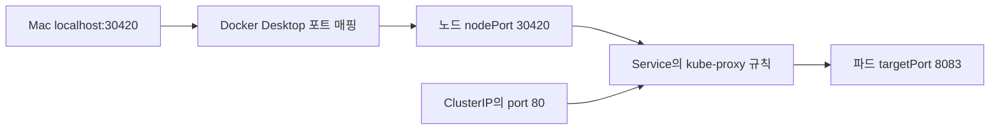
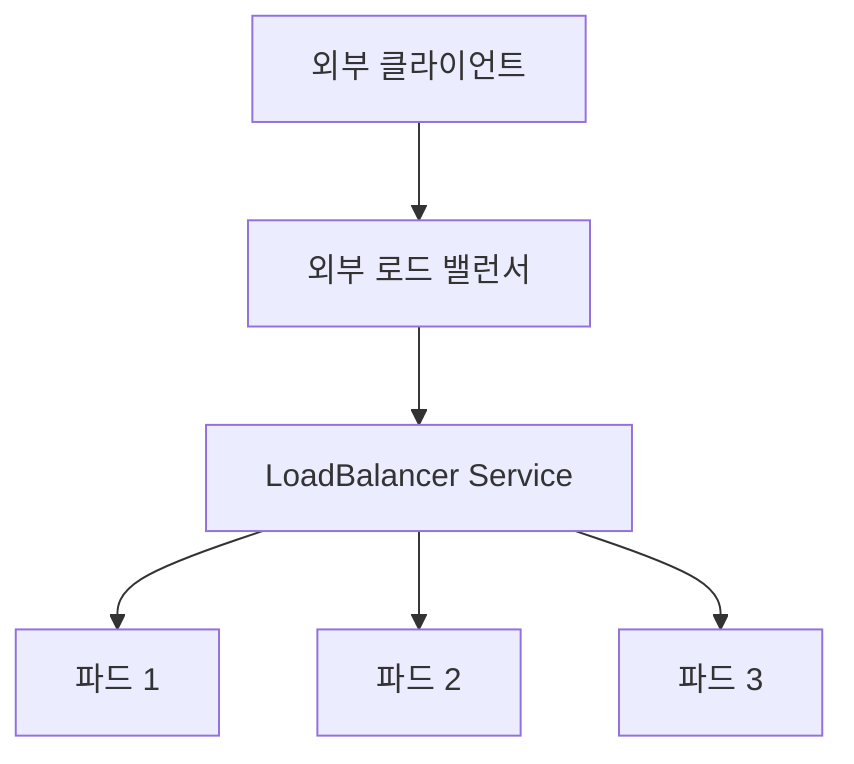

*[서종호(가시다)](https://www.linkedin.com/in/gasida99/)님의 Machine Learning Platform Engineering Study 1주차 학습 내용을 기반으로 합니다.*

<br>

# TL;DR

- Service는 파드가 교체돼도 사용할 수 있는 주소와 포트를 제공한다. 셀렉터가 선택한 파드의 IP와 포트가 통신 대상이 된다
- ClusterIP 호출, 서비스명 호출, 파드의 DNS 설정과 노드의 iptables 규칙을 확인했다. 별도의 `nslookup`에는 `NXDOMAIN`도 기록됐다
- NodePort `30420`을 kind의 호스트 포트 매핑과 연결해 Mac과 같은 LAN의 다른 PC에서 앱 응답을 받았다
- kind의 기본 구성에는 LoadBalancer를 구현할 컨트롤러가 없어 외부 주소가 `<pending>`으로 남았다

<br>

# Service 개념

책 3.3.4절에 대응하는 실습이다. [3.3.3편]()에서는 파드가 재생성되며 이름과 IP가 바뀌었다. 클라이언트가 이 변화를 매번 따라가지 않고 앱을 호출할 수 있도록 Service를 붙인다.

서비스(Service)는 파드 같은 백엔드 집합을 하나의 네트워크 접근 지점으로 노출하는 오브젝트다. 일반적인 Service에는 클러스터 IP와 DNS 이름이 부여된다. 셀렉터(selector)가 있는 Service라면 같은 네임스페이스에서 레이블이 맞는 파드가 백엔드가 된다. EndpointSlice는 이 백엔드들의 주소·포트·준비 상태를 담는 오브젝트다. 네트워킹의 전체 문제 구분은 [쿠버네티스 네트워킹 모델](), Service 구현은 [Service와 kube-proxy]()에서 다뤘다.


<center><sup>출처: 『머신러닝 플랫폼 엔지니어링』 그림 3.6. AI를 이용해 재구성했다</sup></center>

이번에는 ClusterIP, NodePort, LoadBalancer 세 유형을 차례로 적용한다. 뒤의 유형은 앞의 유형 위에 외부 노출 경로를 더한다. 먼저 [3.3.3편]()에서 지운 Deployment를 `v1` 이미지로 다시 만들어 백엔드 파드 세 개를 준비했다. 실습 위치 `~/ml-study/chapters/ch03-k8s`는 실습 저장소 경로를 줄인 표기이고, `kubectl apply -f`는 파일의 선언을 클러스터에 반영한다.

```bash
# hello-joker 파드 3개 준비
kubectl apply -f k8s/deployment.yaml
```

<br>

# ClusterIP

ClusterIP는 클러스터 내부 접근에 사용하는 Service 유형이다. 클라이언트는 가상 IP와 Service 포트로 요청하고, 노드의 네트워크 규칙이 이를 백엔드로 전달한다. 이번 Mac 환경에서는 클러스터 안의 임시 파드와 kind 노드에서 호출했다.

## IP와 서비스명 호출

```yaml
# k8s/cluster-ip-service.yaml
apiVersion: v1
kind: Service
metadata:
  name: joker-cluster-ip-service
spec:
  type: ClusterIP
  ports:
    - targetPort: 8083
      port: 80
  selector:
    app: fast-api
```

```bash
# Service 생성과 주소 확인
kubectl apply -f k8s/cluster-ip-service.yaml
kubectl get svc,ep joker-cluster-ip-service -owide

# 실행 결과 중 Service
NAME                               TYPE        CLUSTER-IP     EXTERNAL-IP   PORT(S)   AGE   SELECTOR
service/joker-cluster-ip-service   ClusterIP   10.96.179.55   <none>        80/TCP    10s   app=fast-api

# curl이 들어 있는 임시 파드의 셸 실행
kubectl run curl-test --rm -it --image=curlimages/curl:latest -- sh
```

`port`는 Service의 클러스터 IP로 접근할 때 쓰는 포트다. `targetPort`는 선택된 파드에서 앱이 수신하는 포트다. `kubectl run`은 파드를 생성한다. 이 명령은 셸에 연결하고, 종료 후 `--rm`에 따라 파드를 지운다. 파드 안에서 `http://10.96.179.55:80`과 `http://joker-cluster-ip-service`로 각각 호출해 앱 응답을 받았다. HTTP 기본 포트가 80이어서 서비스명 호출에서는 포트를 생략할 수 있다.

```shell
# 임시 파드 안에서 서비스명 호출
~$ curl -s http://joker-cluster-ip-service
{"random_joke":"Why don't jokes work in octal? Because 7 10 11."}
```

다른 시점에 다시 조회한 클러스터 IP는 `10.96.3.3`이었다. 그사이 Service를 다시 만들어 주소가 바뀌었다. 클러스터 IP는 Service 오브젝트가 유지되는 동안만 같은 값이다. 이 주소를 kind 노드 컨테이너 안에서도 호출했다. `docker exec`는 실행 중인 컨테이너 안에서 명령을 실행한다.

```bash
# 해당 시점의 주소를 조회한 뒤 노드에서 요청
kubectl get service joker-cluster-ip-service
docker exec ml-study-control-plane curl -s http://10.96.3.3:80

# curl 실행 결과
{"random_joke":"The best thing about a Boolean is that even if you are wrong, you are only off by a bit."}
```

## CoreDNS 이름 해석

CoreDNS는 클러스터의 DNS 질의를 처리하는 서버다. kubelet은 파드의 DNS 정책과 클러스터 설정에 따라 컨테이너의 `/etc/resolv.conf`를 구성한다. 임시 파드에서 확인한 내용은 다음과 같다.

```text
# 파드의 /etc/resolv.conf
search default.svc.cluster.local svc.cluster.local cluster.local
nameserver 10.96.0.10
options ndots:5
```

`10.96.0.10`은 `kubectl -n kube-system get svc kube-dns`로 확인한 DNS Service의 ClusterIP다. `search`는 짧은 이름에 덧붙일 검색 도메인이고, `ndots:5`는 이름의 점 개수에 따른 검색 순서에 영향을 준다. 보통 같은 네임스페이스의 `joker-cluster-ip-service`는 `joker-cluster-ip-service.default.svc.cluster.local`로 확장해 찾는다. 완전한 도메인 이름(FQDN)을 직접 쓰거나 다른 네임스페이스의 `서비스명.네임스페이스` 형태를 사용할 수도 있다([Kubernetes DNS 문서](https://v1-32.docs.kubernetes.io/docs/concepts/services-networking/dns-pod-service/)).

CoreDNS의 `kubernetes` 플러그인은 API 서버에서 Service와 EndpointSlice 등의 변화를 감시한다. 일반 Service의 IPv4 A 레코드는 ClusterIP를, `clusterIP: None`인 헤드리스(headless) Service는 조건에 맞는 백엔드 주소들을 반환한다. DNS 요청 자체도 `kube-dns` Service 주소를 거쳐 CoreDNS 파드로 전달된다([CoreDNS 플러그인 문서](https://coredns.io/plugins/kubernetes/)).

다만 별도로 실행한 DNS 조회 명령 `nslookup`에는 다음 실패가 남았다. `NXDOMAIN`은 질의한 이름이 존재하지 않는다는 DNS 응답이다.

```text
# nslookup joker-cluster-ip-service 출력 발췌
Server:         10.96.0.10
Address:        10.96.0.10:53
** server can't find joker-cluster-ip-service.default.svc.cluster.local: NXDOMAIN
```

서비스명으로 호출한 curl은 응답을 받았지만, `nslookup`은 검색 도메인마다 NXDOMAIN을 출력했다. 두 결과가 엇갈린 원인은 확인하지 못했다. 검색 도메인과 `ndots`의 동작은 [Kubernetes DNS 문서](https://kubernetes.io/docs/concepts/services-networking/dns-pod-service/#pod-dns-config)를 참고한다. DNS 장애를 조사한 사례는 [CoreDNS의 간헐적 레지스트리 이름 해석 실패]()에 정리했다.

## kube-proxy의 iptables DNAT

kube-proxy는 Service와 EndpointSlice 변화를 감시해 노드에 전달 규칙을 구성하는 컴포넌트다. iptables는 Linux 커널의 패킷 처리 규칙을 관리하는 도구이며, DNAT(Destination NAT)는 패킷의 목적지 주소와 포트를 바꾸는 동작이다.

실습 클러스터의 kube-proxy ConfigMap에서 `mode: iptables`를 확인했다. 이 모드에서는 패킷이 커널의 iptables 규칙을 따라 처리된다([Service 가상 IP 구현](https://kubernetes.io/docs/reference/networking/virtual-ips/#iptables-proxy-mode)).

`grep`은 일치하는 문자열이 있는 줄을 추리고, `iptables-save`는 현재 규칙을 출력한다. `-t nat`은 주소 변환을 다루는 테이블을 지정한다.

```bash
# ConfigMap의 모드 조회와 nat 테이블 확인
kubectl -n kube-system get cm kube-proxy -o yaml | grep mode
docker exec ml-study-control-plane iptables-save -t nat | grep joker
```

이때 Service IP는 `10.96.3.3`, 엔드포인트는 `10.244.0.22`·`.23`·`.24`의 세 개였다.

<details markdown="1">
<summary>Service 선택과 DNAT 규칙 발췌</summary>

```text
# Service 주소와 포트를 매칭
-A KUBE-SERVICES -d 10.96.3.3/32 -p tcp -m comment --comment "default/joker-cluster-ip-service cluster IP" -m tcp --dport 80 -j KUBE-SVC-LG72KV2OS4S5IKG3
# 백엔드 선택
-A KUBE-SVC-LG72KV2OS4S5IKG3 -m comment --comment "default/joker-cluster-ip-service -> 10.244.0.22:8083" -m statistic --mode random --probability 0.33333333349 -j KUBE-SEP-QSQ5Q5CFT74RM336
-A KUBE-SVC-LG72KV2OS4S5IKG3 -m comment --comment "default/joker-cluster-ip-service -> 10.244.0.23:8083" -m statistic --mode random --probability 0.50000000000 -j KUBE-SEP-FWKPPZ6JL4VOSDU3
-A KUBE-SVC-LG72KV2OS4S5IKG3 -m comment --comment "default/joker-cluster-ip-service -> 10.244.0.24:8083" -j KUBE-SEP-X4B4INJNZCYRIMJC
# 선택한 파드의 IP와 포트로 목적지 변환
-A KUBE-SEP-QSQ5Q5CFT74RM336 -p tcp -m comment --comment "default/joker-cluster-ip-service" -m tcp -j DNAT --to-destination 10.244.0.22:8083
-A KUBE-SEP-FWKPPZ6JL4VOSDU3 -p tcp -m comment --comment "default/joker-cluster-ip-service" -m tcp -j DNAT --to-destination 10.244.0.23:8083
-A KUBE-SEP-X4B4INJNZCYRIMJC -p tcp -m comment --comment "default/joker-cluster-ip-service" -m tcp -j DNAT --to-destination 10.244.0.24:8083
```

</details>

규칙의 연결은 **`KUBE-SERVICES` → `KUBE-SVC-…` → `KUBE-SEP-…` → DNAT**다. 첫 번째 엔드포인트는 1/3 확률로 선택한다. 거기서 선택되지 않은 연결의 1/2이 두 번째로 가고, 나머지가 세 번째로 간다. 결과적으로 각 엔드포인트의 선택 확률은 1/3이다.

conntrack은 커널이 연결 상태와 NAT 매핑을 추적하는 기능이다. 같은 TCP 연결의 후속 패킷은 처음 선택한 파드로 전달되고, 응답에는 역방향 주소 변환이 적용된다. HTTP keep-alive로 같은 연결을 재사용하면 그 연결 안에서는 같은 파드가 요청을 받는다. 커널 처리 과정은 [iptables와 conntrack]()에서 다뤘다.

## ClusterIP와 ping

ClusterIP의 동작을 `ping`으로 확인할 수 없는 이유도 위 규칙에서 보인다. 이번 iptables 모드의 ClusterIP는 인터페이스에 할당한 주소가 아니라 전달 규칙에서 사용하는 가상 주소다. 위 규칙은 `-p tcp --dport 80`을 매칭하므로 ICMP Echo 요청인 `ping`은 이 Service 전달 경로를 시험하지 못한다. HTTP Service의 동작은 해당 포트로 요청해 확인하는 것이 맞다.

IPVS(IP Virtual Server)는 Linux 커널의 전송 계층 부하 분산 기능이다. kube-proxy를 IPVS 모드로 쓰면 서비스 IP를 `kube-ipvs0`이라는 더미 인터페이스에 바인딩하므로([v1.29.14 IPVS 구현](https://github.com/kubernetes/kubernetes/blob/v1.29.14/pkg/proxy/ipvs/proxier.go)), ClusterIP가 인터페이스에 없다는 설명은 iptables 모드에 한정된다.

<br>

# NodePort

NodePort는 ClusterIP에 더해 클러스터 노드의 포트로도 Service에 접근하게 하는 유형이다. 이 실습에서 앱은 파드 안 `8083`에서 수신하고, Service 포트는 `80`, 노드 포트는 `30420`이다.

## 매니페스트와 세 포트

```yaml
# k8s/node-port-service.yaml
apiVersion: v1
kind: Service
metadata:
  name: joker-nodeport-service
spec:
  type: NodePort
  ports:
    - targetPort: 8083
      port: 80
      nodePort: 30420
  selector:
    app: fast-api
```

| 필드 | 값 | 역할 |
|---|---|---|
| `port` | 80 | Service의 클러스터 IP로 접근할 때 사용하는 포트 |
| `targetPort` | 8083 | 선택된 파드에서 앱이 수신하는 포트 |
| `nodePort` | 30420 | 노드 주소를 통해 접근할 때 사용하는 포트 |

NodePort로 들어온 패킷도 [앞에서 본 kube-proxy 규칙](#kube-proxy의-iptables-dnat)을 거쳐 파드의 `8083`으로 향한다. 노드 포트 요청은 `KUBE-NODEPORTS` 체인에서 같은 Service의 `KUBE-SVC-…` 체인으로 이어진다. Service 포트 `80`에서 별도 프로세스가 패킷을 받아 다시 보내는 것은 아니다. 포트 역할을 혼동했던 사례는 [Service 포트와 노출 포트]()에 있다.

```bash
# Service 생성과 연결 대상 확인
kubectl apply -f k8s/node-port-service.yaml
kubectl get svc,ep joker-nodeport-service -owide

# 실행 결과
NAME                             TYPE       CLUSTER-IP     EXTERNAL-IP   PORT(S)        AGE   SELECTOR
service/joker-nodeport-service   NodePort   10.96.39.173   <none>        80:30420/TCP   17s   app=fast-api

NAME                               ENDPOINTS                                            AGE
endpoints/joker-nodeport-service   10.244.0.22:8083,10.244.0.23:8083,10.244.0.24:8083   17s
```

`svc`는 Service, `ep`는 Endpoints의 단축 이름이다. 출력에는 같은 Deployment의 파드 세 개와 `8083` 포트가 연결 대상으로 나타났다.

## Mac과 다른 PC에서의 호출

Mac의 Docker Desktop에서는 kind 노드가 Linux VM 안의 컨테이너로 실행된다. [3.3.1편]()의 `extraPortMappings`에는 호스트 `30420` → 노드 컨테이너 `30420` 매핑이 있다.


<center><sup>출처: 『머신러닝 플랫폼 엔지니어링』 그림 3.7. AI를 이용해 재구성했다. Mac의 포트 매핑과 두 접근 경로를 함께 나타냈다</sup></center>

`curl`은 HTTP 요청을 보내는 도구다. Mac에서 포트 매핑을 통해 호출하자 농담 JSON이 반환됐다.

```bash
# Mac에서 NodePort 호출
curl -s http://localhost:30420

# 실행 결과
{"random_joke":"How do you generate a random string? Put a first year Computer Science student inVim and ask them to save and exit."}
```

다른 PC에서는 Mac의 LAN 주소로 요청했다. `ifconfig`는 네트워크 인터페이스의 주소와 상태를 보여 주는 도구다. 당시 Mac의 `en0`에서 확인한 IPv4 주소를 사용했다.

```text
# ifconfig 출력 중 en0의 IPv4 주소
inet 192.168.0.10 netmask 0xffffff00 broadcast 192.168.0.255
```

`jq`는 JSON 출력의 구조를 보기 좋게 정렬한다.

```shell
# 같은 LAN의 다른 PC에서 호출
other-pc:~$ curl -s http://192.168.0.10:30420 | jq
{
  "random_joke": "What's the object-oriented way to become wealthy? Inheritance."
}
```

포트 매핑이 `0.0.0.0`에 바인딩되어 있어 LAN 인터페이스로도 요청을 받을 수 있었다. 호출 확인 뒤 `kubectl delete -f k8s/node-port-service.yaml`로 Service를 삭제했다.

<br>

# LoadBalancer

LoadBalancer는 외부 로드 밸런서와 연동해 Service를 노출하는 유형이다. 외부 주소의 할당과 트래픽 전달은 클러스터에 설치된 구현이 맡는다.


<center><sup>출처: 『머신러닝 플랫폼 엔지니어링』 그림 3.8. AI를 이용해 재구성했다</sup></center>

```yaml
# k8s/loadbalancer-service.yaml
apiVersion: v1
kind: Service
metadata:
  name: joker-load-balancer-service
spec:
  type: LoadBalancer
  ports:
    - port: 80
      targetPort: 8083
  selector:
    app: fast-api
```

스터디 자료의 K3s 환경에서는 노드 주소가 `EXTERNAL-IP`에 표시됐다. K3s에는 ServiceLB가 기본 포함돼, `klipper-lb` 컨테이너를 쓰는 파드로 Service 포트를 노출하기 때문이다([K3s ServiceLB 문서](https://docs.k3s.io/networking/networking-services#service-load-balancer)). 같은 매니페스트를 kind에 적용하자 결과가 달랐다.

<br>

# 트러블슈팅

## 증상

LoadBalancer Service를 생성했지만 `EXTERNAL-IP`가 `<pending>`으로 남았다.

## 증거

```bash
# Service 생성 후 주소와 엔드포인트 조회
kubectl apply -f k8s/loadbalancer-service.yaml
kubectl get svc,ep joker-load-balancer-service -owide

# 실행 결과
NAME                                  TYPE           CLUSTER-IP   EXTERNAL-IP   PORT(S)        AGE   SELECTOR
service/joker-load-balancer-service   LoadBalancer   10.96.93.9   <pending>     80:31089/TCP   34s   app=fast-api

NAME                                    ENDPOINTS                                            AGE
endpoints/joker-load-balancer-service   10.244.0.22:8083,10.244.0.23:8083,10.244.0.24:8083   34s
```

Service와 파드 엔드포인트는 생성됐다. K3s에서 LoadBalancer를 처리하는 `klipper-lb` 파드도 생기지 않았다.

## 원인

이번 kind 기본 구성에는 LoadBalancer의 외부 주소를 할당하고 구현할 컨트롤러가 없다. `type: LoadBalancer` 선언만으로 외부 로드 밸런서가 생기는 것은 아니다. K3s ServiceLB, 클라우드의 로드 밸런서 컨트롤러처럼 선언을 처리할 구현이 필요하다.

## 해결

외부 주소 없이 앱에 접근하려면 port-forward를 쓴다. API 서버를 통해 선택한 파드의 `8083`으로 연결하므로 외부 LB 할당과 별개로 앱을 호출할 수 있다. [3.3.3편의 port-forward 동작 원리](#port-forward-동작-원리)에서 이 경로를 다뤘다.

```bash
# Service가 존재할 때 실행할 접근 명령
kubectl port-forward svc/joker-load-balancer-service 8080:80

# 다른 터미널에서 호출
curl -s localhost:8080
```

외부 LB 구현은 설치하지 않았으므로 `<pending>` 상태는 그대로 두었다.

kind용 외부 LB 구현으로는 [cloud-provider-kind](https://github.com/kubernetes-sigs/cloud-provider-kind)가 있다. 호스트에서 실행해 LB 컨테이너를 관리하며, 공식 README에 바이너리 설치와 macOS 실행 조건이 안내돼 있다. EKS의 외부 LB 연동은 [Service와 LoadBalancer]()에서 다뤘다.

<br>

# 정리

| 유형 | 접근 주소 | 이번 kind on Mac에서의 확인 방법 |
|---|---|---|
| ClusterIP | 클러스터 IP와 Service 포트 | 임시 파드와 노드에서 HTTP 호출 |
| NodePort | 노드 주소와 nodePort | 호스트 `30420` 매핑으로 Mac과 LAN PC에서 호출 |
| LoadBalancer | 구현이 할당하는 외부 주소 | `<pending>`과 엔드포인트 확인, 포워딩 접근 명령 기록 |

ML 플랫폼에서는 서빙 API, 피처 저장소, 실험 추적 서버처럼 서로 호출해야 하는 서비스가 많다. 파드의 교체와 확장은 워크로드 컨트롤러가 관리하고, 호출 주소와 백엔드 연결은 Service가 담당한다. 이 실습은 그 서비스 연결 계층을 확인한 과정이다.

<br>

# 참고 링크

- [Kubernetes Service](https://kubernetes.io/docs/concepts/services-networking/service/)
- [Service의 가상 IP와 프록시 구현](https://kubernetes.io/docs/reference/networking/virtual-ips/)
- [CoreDNS kubernetes 플러그인](https://coredns.io/plugins/kubernetes/)
- [K3s ServiceLB](https://docs.k3s.io/networking/networking-services#service-load-balancer)
- [cloud-provider-kind](https://github.com/kubernetes-sigs/cloud-provider-kind)

<br>
