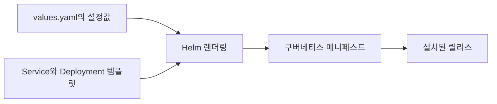

*[서종호(가시다)](https://www.linkedin.com/in/gasida99/)님의 Machine Learning Platform Engineering Study 1주차 학습 내용을 기반으로 합니다.*

<br>

# TL;DR

- Helm은 쿠버네티스 애플리케이션을 차트로 패키징하고 설치·업그레이드·삭제하는 도구다
- `helm create`의 기본 차트는 바이너리에 내장된 nginx 예제에서 생성된다. 실습에서는 그 차트의 이미지·태그·Service 유형·포트를 바꿨다
- 사용한 템플릿은 `service.port`를 컨테이너 포트에도 참조한다. 이 값을 `8083`으로 바꾸자 Service, 컨테이너, 이름이 `http`인 프로브 포트가 연결됐다
- `funny` 네임스페이스에 파드 1개와 NodePort Service가 생성됐다. 자동 할당된 NodePort(31418)는 kind 생성 때 정한 호스트 매핑(30420)과 달라 Mac에서 바로 닿지 않는다

<br>

# Helm 개념

책 3.3.6절에 대응하는 실습이다. [3.3.3편]()의 Deployment와 [3.3.4편]()의 Service를 각각 파일로 적용했다. Helm에서는 이런 리소스 묶음과 설정값을 하나의 패키지로 관리한다.

헬름(Helm)은 쿠버네티스용 패키지 매니저다. 차트(chart)는 애플리케이션을 배포하는 데 필요한 템플릿, 기본값, 메타데이터 등을 묶은 패키지다. 릴리스(release)는 차트를 특정 이름과 설정으로 설치한 인스턴스다.


<center><sup>출처: 『머신러닝 플랫폼 엔지니어링』 그림 3.9. AI를 이용해 재구성했다</sup></center>

같은 차트를 사용하면서 이미지 태그, 복제 수, 서비스 유형 같은 값을 바꿀 수 있다. 어떤 값을 변경할 수 있는지는 템플릿이 어떤 값들을 참조하는지에 달려 있다.

## 기존 차트 다운로드

`helm repo add`는 차트 저장소 주소를 등록하고, `helm repo update`는 등록된 저장소의 차트 목록을 갱신한다. `helm pull --untar`는 차트를 내려받아 압축을 푸는 명령이다.

```bash
# Bitnami 차트 저장소를 등록하고 Redis 차트 다운로드
helm repo add bitnami https://charts.bitnami.com/bitnami
helm repo update
helm pull bitnami/redis --untar

# 실행 결과
Error: failed to untar: a file or directory with the name redis already exists
```

작업 디렉토리에 `redis`가 이미 있어 압축 해제가 중단됐다. Redis 설치 실습은 여기서 건너뛰었다.

이 차트로 Redis를 설치하려면 이미지 출처부터 확인해야 한다. Bitnami는 2025년 카탈로그를 바꾸면서 기존 이미지를 업데이트와 지원이 중단되는 임시 저장소 `bitnamilegacy`로 옮겼다([Bitnami 공식 공지](https://github.com/bitnami/containers/issues/83267)).

<br>

# helm create 해부

## 차트 생성과 파일 구성

`helm create`는 새 차트의 기본 파일을 생성하는 명령이다. 실습 위치 `~/ml-study/chapters/ch03-k8s`는 실습 저장소 경로를 줄인 표기다. 그 아래 `k8s`에서 hello-joker 차트를 만들었다. 저장소에는 책 코드의 `hello-joker/`도 있지만, 이번 실습 대상은 **`k8s/hello-joker/`**다.

```bash
# 실습 디렉토리 아래에 차트 생성
cd ~/ml-study/chapters/ch03-k8s/k8s
helm create hello-joker

# 실행 결과
Creating hello-joker
```

주요 파일의 역할은 다음과 같다.

| 경로 | 역할 |
|---|---|
| `Chart.yaml` | 차트 이름과 버전, 앱 버전 등의 메타데이터 |
| `values.yaml` | 템플릿에 전달할 기본 설정값 |
| `templates/deployment.yaml` | Deployment 매니페스트 템플릿 |
| `templates/service.yaml` | Service 매니페스트 템플릿 |
| `templates/_helpers.tpl` | 이름과 레이블 생성에 사용하는 공통 템플릿 |
| `templates/NOTES.txt` | 설치 후 출력할 안내문 |
| `templates/tests/` | `helm test`로 실행할 테스트 리소스 |
| `charts/` | 의존하는 하위 차트 |
| `.helmignore` | 패키지에서 제외할 파일 패턴 |

2026-10-24에 조회한 로컬 Helm은 v3.15.2다. 이 버전의 [`pkg/chartutil/create.go`](https://github.com/helm/helm/blob/v3.15.2/pkg/chartutil/create.go)에는 nginx 이미지와 기본 템플릿 문자열이 들어 있고, `Create` 함수가 이를 파일로 쓴다. 기본 `helm create`는 이 내장 내용을 사용하므로 차트 저장소에서 다운로드할 필요가 없다.

실습 차트의 Deployment와 Service 템플릿을 Helm v3.15.2로 새로 만든 기본본과 대조하니 동일했다. 기본 파일 목록은 Helm 버전에 따라 달라질 수 있다.

## values 참조와 starter


템플릿은 `{{ .Values.image.repository }}`처럼 `.Values`에서 설정을 읽는다. `grep`은 파일에서 문자열이 나타나는 줄을 찾는 도구다.

```bash
# 차트 루트에서 템플릿이 사용하는 값의 위치 확인
grep -rn '\.Values' templates/
```



설치 시 `-f my-values.yaml`로 값 파일을 추가하거나 `--set image.tag=v2`로 특정 값을 지정할 수 있다. 템플릿이 읽는 키에 값을 전달해야 렌더링 결과에 반영된다([Helm 설치 옵션](https://helm.sh/docs/v3/helm/helm_install/)).

스타터(starter)는 `helm create`의 출발점으로 사용할 사용자 정의 차트다. `helm env`는 Helm의 환경 설정을 조회한다. macOS의 기본 데이터 경로는 `~/Library/helm`이고, 그 아래 `starters/`에 스타터를 둘 수 있다([차트 스타터 문서](https://helm.sh/docs/v3/topics/charts/#chart-starter-packs)).

```bash
# 데이터 경로 조회
helm env HELM_DATA_HOME

# mystarter를 준비했을 때 사용하는 명령 예
helm create myapp --starter mystarter
```

차트의 `charts/` 디렉토리에는 의존 차트가 들어간다. `Chart.yaml`에 의존성을 선언한 뒤 `helm dependency update`로 필요한 차트를 내려받을 수 있다. 이번 차트는 기본 내장 템플릿으로 만들었고 의존 차트는 없다.

<br>

# 적용과 관찰

## 이미지와 Service 값 변경

기본 차트의 nginx를 hello-joker로 바꾸었다. `values.yaml`에서 바꾼 값은 이미지 저장소, 태그, Service 유형, 포트다. **복제 수는 기본값인 1을 유지했다.**

```diff
# Helm 3.15.2 기본 values.yaml과 실습 설정의 차이
 image:
-  repository: nginx
+  repository: <dockerhub-user>/hello-joker
   pullPolicy: IfNotPresent
-  tag: ""
+  tag: v1

 service:
-  type: ClusterIP
-  port: 80
+  type: NodePort
+  port: 8083
```

이미지는 [3.2.2편]()에서 확인한 amd64·arm64 멀티 플랫폼 이미지다. arm64 kind 노드에서 실행할 수 있는 플랫폼 항목이 포함돼 있다.

## Service와 컨테이너의 포트 연결

이 차트는 `service.port`를 Service 포트와 컨테이너 포트에 모두 참조한다. Service의 `targetPort`와 프로브는 포트 이름 `http`를 사용한다.


```yaml
# templates/service.yaml의 포트 부분
spec:
  type: {{ .Values.service.type }}
  ports:
    - port: {{ .Values.service.port }}
      targetPort: http
      protocol: TCP
      name: http
```

```yaml
# templates/deployment.yaml의 컨테이너 부분
image: "{{ .Values.image.repository }}:{{ .Values.image.tag | default .Chart.AppVersion }}"
imagePullPolicy: {{ .Values.image.pullPolicy }}
ports:
  - name: http
    containerPort: {{ .Values.service.port }}
    protocol: TCP
livenessProbe:
  {{- toYaml .Values.livenessProbe | nindent 12 }}
readinessProbe:
  {{- toYaml .Values.readinessProbe | nindent 12 }}
```


라이브니스 프로브(liveness probe)는 컨테이너가 계속 동작할 수 있는지 검사해 반복 실패 시 재시작을 유도한다. 레디니스 프로브(readiness probe)는 파드가 트래픽을 받을 준비가 됐는지 검사한다. 둘 다 이번 설정에서는 `/` 경로와 이름이 `http`인 포트를 참조한다.

```yaml
# values.yaml의 프로브 설정
livenessProbe:
  httpGet:
    path: /
    port: http
readinessProbe:
  httpGet:
    path: /
    port: http
```

`service.port: 8083`을 넣으면 컨테이너의 `http` 포트가 `8083`이 되고, Service의 `targetPort: http`와 두 프로브가 이를 참조한다. 따라서 이번 템플릿에서는 values 변경만으로 포트를 맞출 수 있었다. Service의 두 포트를 독립적으로 설정해야 하는 앱이라면 템플릿에도 각각의 값을 참조할 자리가 필요하다.

## 렌더링 결과 확인

`helm template`은 템플릿과 값을 합쳐 쿠버네티스 매니페스트를 출력하는 명령이다. `helm lint`는 차트 구조와 템플릿에 문제가 있는지 검사한다. 2026-10-24에 로컬 실습 차트를 두 명령으로 확인했다.

```bash
# 실습 차트 검사와 로컬 렌더링
helm lint ./hello-joker
helm template hello-joker-check ./hello-joker --namespace funny
```

lint는 실패 0건이었다. `Chart.yaml`에 아이콘을 권장하는 INFO가 하나 있었다. 렌더링된 주요 값은 다음과 같다.

| 리소스 | 렌더링된 값 |
|---|---|
| Deployment | `replicas: 1`, 이미지 `<dockerhub-user>/hello-joker:v1` |
| 컨테이너 포트 | `name: http`, `containerPort: 8083` |
| 두 프로브 | `path: /`, `port: http` |
| Service | `type: NodePort`, `port: 8083`, `targetPort: http` |

[다음 절](#릴리스-설치와-조회)의 실제 설치 결과도 이 값과 같았다.

## 릴리스 설치와 조회

`helm install`은 차트를 릴리스로 설치한다. 실습에서는 `funny` 네임스페이스에 자동 생성한 릴리스 이름을 사용했다.

```bash
# k8s 디렉토리에서 로컬 차트 설치
helm install hello-joker --generate-name --create-namespace -n funny

# 실행 결과 발췌
NAME: hello-joker-1792687714
LAST DEPLOYED: Fri Oct 23 01:48:35 2026
NAMESPACE: funny
STATUS: deployed
REVISION: 1
```

| 인자 | 의미 |
|---|---|
| `hello-joker` | `--generate-name`과 함께 지정한 차트 경로. 현재 디렉토리의 `hello-joker/` |
| `--generate-name` | 릴리스 이름 자동 생성 |
| `--create-namespace` | 대상 네임스페이스가 없으면 생성 |
| `-n funny` | 설치할 네임스페이스 |

`helm list`는 설치된 릴리스를 조회한다. `kubectl get`으로 실제 리소스도 확인했다. `deploy`, `svc`, `ep`는 각각 Deployment, Service, Endpoints의 단축 이름이다.

```bash
# 릴리스와 그 리소스 조회
helm list -n funny
kubectl get deploy,pod,svc,ep -n funny

# kubectl 실행 결과
NAME                                     READY   UP-TO-DATE   AVAILABLE   AGE
deployment.apps/hello-joker-1792687714   1/1     1            1           117s

NAME                                         READY   STATUS    RESTARTS   AGE
pod/hello-joker-1792687714-7d995fddb-ll55c   1/1     Running   0          117s

NAME                             TYPE       CLUSTER-IP     EXTERNAL-IP   PORT(S)          AGE
service/hello-joker-1792687714   NodePort   10.96.174.81   <none>        8083:31418/TCP   117s

NAME                               ENDPOINTS          AGE
endpoints/hello-joker-1792687714   10.244.0.27:8083   117s
```

Deployment의 준비된 복제 수는 1이고, Service는 파드 `10.244.0.27:8083`을 가리켰다. `helm list`의 `APP VERSION`은 `1.16.0`이었다. 이는 `Chart.yaml`의 `appVersion` 메타데이터다. 이번 이미지는 `image.tag: v1`을 명시했으므로 실제 배포 태그는 `v1`이다.

## Mac 접근과 릴리스 삭제

자동 할당된 NodePort는 `31418`로, [3.3.1편]()의 호스트 매핑(`30420`)과 달라 Mac에서 이 NodePort로 바로 접근할 수 없다. Mac에서 호출하려면 API 서버를 경유해 파드의 포트로 연결하는 `kubectl port-forward`를 쓴다. 이번 배포 확인은 위 조회 결과의 파드 `Running`과 Endpoint 생성까지로 했다. `curl`은 HTTP 요청을 보내는 도구다.

```bash
# Mac에서 호출할 때의 접근 명령: Service 포트 8083을 로컬 8083에 연결
kubectl port-forward -n funny svc/hello-joker-1792687714 8083:8083

# 다른 터미널에서 요청
curl -s localhost:8083
```

`helm uninstall`은 릴리스가 관리하는 리소스를 삭제한다.

```bash
# 실습 릴리스 삭제
helm uninstall -n funny hello-joker-1792687714

# 실행 결과
release "hello-joker-1792687714" uninstalled

# 리소스 정리 상태 조회
kubectl get deploy,pod,svc,ep -n funny
```

삭제 직후에는 파드 하나가 `Terminating`으로 남아 있었다. Deployment와 Service는 조회 결과에서 사라졌다.

<br>

# 정리

Helm 차트에서 반복해서 바꿀 설정은 values에 두고, 쿠버네티스 리소스의 구조와 값의 연결은 템플릿에 둔다. 이번 차트는 기본 템플릿의 참조 구조가 앱에 맞아 네 값만 바꾸어 배포했다.

ML 플랫폼의 피처 저장소, 실험 추적 서버, 파이프라인 구성 요소도 여러 쿠버네티스 리소스를 함께 배포한다. Helm은 이런 구성 요소를 설치하고 환경별 설정을 전달하는 배포 계층에 해당한다.

책 3.4절의 CI/CD 흐름에서는 CI가 차트의 이미지 태그를 바꿔 Git에 반영하고 Argo CD가 클러스터 상태를 동기화한다. 차트 갱신은 [3.4.3편](), 실제 동기화 결과는 [3.4.4편]()에 있다.

<br>

# 참고 링크

- [Helm 차트](https://helm.sh/docs/v3/topics/charts/)
- [helm create](https://helm.sh/docs/v3/helm/helm_create/)
- [Helm 3.15.2의 기본 차트 소스](https://github.com/helm/helm/blob/v3.15.2/pkg/chartutil/create.go)
- [helm install](https://helm.sh/docs/v3/helm/helm_install/)
- [Bitnami 카탈로그 변경 공지](https://github.com/bitnami/containers/issues/83267)

<br>
