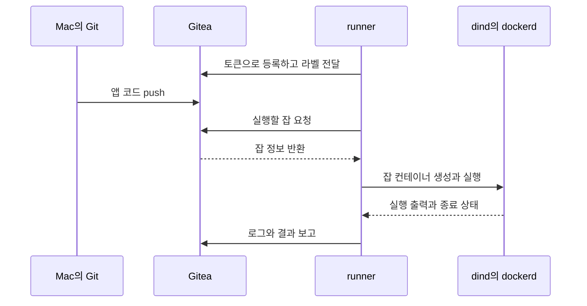
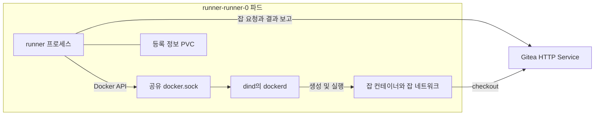

*[서종호(가시다)](https://www.linkedin.com/in/gasida99/)님의 Machine Learning Platform Engineering Study 1주차 학습 내용을 기반으로 합니다.*

<br>

# TL;DR

- Gitea는 Git 저장소와 CI 잡을 관리하고, 러너가 Gitea에 접속해 잡을 받아 실행한다
- 러너 파드는 `reach-gitea` 초기화 컨테이너, `dind` 사이드카, `runner` 컨테이너로 구성된다. runner는 공유 유닉스 소켓으로 dind의 Docker 데몬을 호출한다
- dind와 runner에서 같은 Gitea 연결이 보인 것은 두 컨테이너가 파드의 네트워크 네임스페이스를 공유하기 때문이다
- Gitea는 SQLite·LevelDB·메모리 세션을 쓰는 단일 파드 구성이다. 같은 `/data`를 쓰는 파드가 겹치지 않도록 교체 전략을 함께 고려해야 한다

<br>

# CI 서버와 러너의 분리

책 3.4.1절 전반에 대응하는 실습이다. 책은 GitLab과 GitLab Runner로 앱의 테스트·빌드를 자동화하고, 스터디는 로컬 클러스터에 Gitea와 Gitea Actions 러너를 설치한다. Gitea용 Helm 설정과 워크플로는 스터디에서 새로 구성한 것이다.

Gitea는 Git 저장소, 웹 UI, API를 제공하는 설치형 Git 서버다. Gitea Actions는 저장소 이벤트로 워크플로를 실행하는 CI 기능이다. **워크플로와 잡 상태를 관리하는 서버와, 명령을 실제로 실행하는 러너(runner)는 별도 프로그램**이다.

| 역할 | 책 | 스터디와 내 Mac |
|---|---|---|
| Git 저장소와 CI 서버 | GitLab | kind 클러스터의 Gitea |
| 잡 실행 | GitLab Runner | Gitea Actions 러너(act_runner 계열) |
| Docker 실행 환경 | `docker:20.10.16-dind` 서비스 | 러너 파드의 dind 사이드카 |
| 워크플로 파일 | `.gitlab-ci.yml` | `.gitea/workflows/ci.yaml` |

워크플로(workflow)는 이벤트와 실행할 작업을 정의한 파일이고, 잡(job)은 그 안에서 여러 단계(step)를 묶어 실행하는 단위다. 이 실습은 앱 테스트, 이미지 빌드·push, Helm 차트 갱신을 잡으로 나눈다. CI/CD가 ML 플랫폼에서 담당하는 범위는 [3.1편](#mlops에서-cicd의-위치)에서 다뤘다.

## Gitea Actions 동작 원리

러너는 등록 토큰으로 Gitea에 자신을 등록하고 실행할 수 있는 환경을 라벨로 알린다. 이후 Gitea에 접속해 잡을 가져와 실행하고 로그와 결과를 돌려준다. 연결을 시작하는 쪽은 러너다. 이 구조는 [Gitea Actions 설계 문서](https://docs.gitea.com/usage/actions/design/)에서 설명한다.


<center><sup>출처: Gitea Actions 설계 문서. AI를 이용해 실습의 등록·잡 실행 순서로 재구성했다</sup></center>

러너는 GitHub Actions 실행기인 `act`를 기반으로 하며, 워크플로의 `runs-on` 라벨을 실제 실행 환경에 연결한다. 이 환경의 `ubuntu-latest`는 dind가 실행하는 `docker.gitea.com/runner-images:ubuntu-latest` 이미지에 대응한다. 이 이미지로 Linux 잡 컨테이너를 띄운다.

워크플로 문법은 GitHub Actions와 호환되는 부분이 많다. Gitea의 기본 검색 경로는 `.gitea/workflows`, `.github/workflows` 순서이며 먼저 존재하는 디렉터리를 사용한다. 이 실습은 `.gitea/workflows/ci.yaml`을 쓴다. 지원 범위와 검색 경로는 [Gitea 설정 문서](https://docs.gitea.com/administration/config-cheat-sheet/#actions-actions)와 [GitHub Actions와의 차이](https://docs.gitea.com/usage/actions/comparison/)를 기준으로 확인할 수 있다.

<br>

# Gitea 워크로드 해부

Gitea와 러너는 각자의 Helm 차트로 설치했다. Helm은 values 파일을 차트 템플릿에 적용해 쿠버네티스 리소스를 만드는 도구이며, 앱 차트를 직접 만든 과정은 [3.3.5편]()에서 다뤘다. 설치 명령은 [뒤에서](#gitea와-러너-설치) 보고, 여기서는 설치된 리소스부터 확인한다.

```bash
# 설치 직후 kind 클러스터의 워크로드 조회
kubectl -n gitea get deploy,sts,pod -o wide

# 실행 결과 중 이름·상태·이미지
# deployment.apps/gitea          1/1  docker.gitea.com/gitea:1.27.0-rootless
# statefulset.apps/runner-runner  1/1  docker.gitea.com/runner:2.0.1
# pod/gitea-6799485489-hdd2q      1/1  Running
# pod/runner-runner-0            2/2  Running
```

Gitea 차트는 `12.7.0`, 앱 이미지는 `1.27.0-rootless`였다. 러너는 `actions` 차트 `0.1.2`로 설치했다. 이 차트의 `appVersion` 표기는 `0.261.3`이지만 실제 파드 이미지 태그는 `2.0.1`이었다. 실행 중인 프로그램을 확인할 때는 차트 메타데이터와 파드의 이미지를 함께 봐야 한다.

## HTTP와 SSH 서비스

Gitea에는 HTTP와 SSH 두 Service가 생겼다. 둘 다 Git 저장소에 접근하는 경로지만 인증과 연결 방식이 다르다.

| Service | 타입과 주소 | 포트 | 역할 |
|---|---|---|---|
| `gitea-http` | NodePort, `10.96.81.9` | 노드 `30000` → Service `3000` → 파드 `3000` | 웹 UI, API, HTTP clone·push |
| `gitea-ssh` | Headless, `clusterIP: None` | Service `22` → 대상 `2222` | SSH 키를 사용하는 clone·push |

Headless Service는 별도 가상 IP 없이 DNS로 대상 파드 주소를 알려 주는 Service다. 이 실습에서는 SSH의 외부 포트 매핑을 만들지 않고 HTTP만 Mac에 노출했다. rootless Gitea의 내장 SSH 서버가 듣는 포트는 `2222`였다.

`netstat`은 네트워크 소켓과 연결 상태를 조회하는 도구다. 실제 프로세스의 수신 포트와 Service의 대상 포트가 일치하는지 확인했다.

```bash
# Gitea 프로세스가 수신하는 포트
kubectl -n gitea exec deploy/gitea -c gitea -- netstat -tln

# 실행 결과 발췌
# tcp  :::3000  LISTEN
# tcp  :::2222  LISTEN

# Service가 선택한 파드의 포트
kubectl -n gitea get svc,ep

# 실행 결과 중 엔드포인트
# endpoints/gitea-http  10.244.0.29:3000
# endpoints/gitea-ssh   10.244.0.29:2222
```

포트를 여는 것은 Gitea 프로세스이고, Service는 그 포트로 연결할 이름과 경로를 제공한다. `nodePort`, `port`, `targetPort`의 관계는 [3.3.4편](#매니페스트와-세-포트)에 연결된다.

## 단일 파드와 파일 기반 상태

실습용 values는 PostgreSQL과 Valkey 서브차트를 끄고 Gitea 하나로 동작하도록 구성했다. SQLite는 파일 기반 관계형 DB이고, LevelDB는 디스크에 키·값을 저장하는 라이브러리다. Gitea의 내부 작업 큐는 `queue.TYPE: level`로 LevelDB를 사용한다.

<details markdown="1">
<summary>values-gitea.yaml</summary>

```yaml
# Gitea 12.7.0 차트에 넘기는 실습용 설정
service:
  http:
    type: NodePort
    clusterIP: ""                 # 기본 headless 설정을 비워 일반 ClusterIP 할당
    nodePort: 30000
persistence:
  enabled: true
  size: 5Gi                      # 저장소·DB·큐가 있는 /data 보존
postgresql-ha:
  enabled: false
postgresql:
  enabled: false
valkey-cluster:
  enabled: false
valkey:
  enabled: false
gitea:
  admin:
    existingSecret: gitea-admin  # 비밀번호는 별도 Secret으로 전달
    email: mlops@example.com
    passwordMode: keepUpdated
  config:
    server:
      DOMAIN: 192.168.0.38
      ROOT_URL: http://192.168.0.38:30000/
    database:
      DB_TYPE: sqlite3
    session:
      PROVIDER: memory
    cache:
      ADAPTER: memory
    queue:
      TYPE: level
```

</details>

차트의 HTTP `clusterIP` 기본값은 `None`이다. NodePort로 노출할 때는 `""`로 바꿔 일반 ClusterIP가 할당되게 했다. `DOMAIN`과 `ROOT_URL`은 설치 명령에서 당시 Mac IP로 덮어썼다.

PVC(PersistentVolumeClaim, 영구 볼륨 요청)는 파드가 사용할 저장 공간을 요청하는 리소스다. Gitea의 `gitea-shared-storage`는 `5Gi`, 러너의 `data-runner-runner-runner-0`은 `1Gi`였고, 둘 다 `standard` StorageClass를 썼다. Gitea의 `/data`에는 `git/`, `gitea.db`, `queues/`, `actions_log/`, `actions_artifacts/` 등이 있었다. 세션과 캐시는 메모리에 있으므로 파드가 바뀌면 웹 로그인 세션도 사라진다.

차트는 초기화 컨테이너 세 개를 실행한다. `init-directories`가 디렉터리를 준비하고, `init-app-ini`가 설정을 조합하며, `configure-gitea`가 DB 마이그레이션과 관리자 계정을 처리한다. 차트가 지정한 설정 파일은 `/data/gitea/conf/app.ini`다. `keepUpdated`는 초기화 때 관리자 비밀번호를 Secret 값으로 맞추는 설정이다.

| Secret | 생성 주체 | 역할 |
|---|---|---|
| `gitea-admin` | 설치 명령 | 관리자 이름과 비밀번호 |
| `gitea-runner-token` | 설치 명령 | 러너 등록 토큰 |
| `gitea-inline-config` | Gitea 차트 | values에서 구성한 Gitea 설정 |
| `gitea` | Gitea 차트 | 설정 생성 스크립트와 구성 검증 |
| `gitea-init` | Gitea 차트 | 디렉터리·앱 초기화 스크립트 |
| `sh.helm.release.v1.*` | Helm | 릴리스 리비전 정보 |

표의 생성 주체와 역할은 [Gitea 차트 12.7.0](https://dl.gitea.com/charts/gitea-12.7.0.tgz)의 템플릿과 클러스터의 Secret 목록을 대조해 확인했다. 차트가 만든 Secret 세 개는 초기화 스크립트와 설정 문자열을 담는다.

이 구성은 파드 하나와 `/data` 하나에 파일 상태가 모인다. LevelDB는 같은 DB를 한 프로세스만 열 수 있어, 교체 중 두 Gitea 프로세스가 같은 큐를 여는 상황을 피해야 한다. Helm 설치 결과도 메모리 캐시·세션과 LevelDB 큐를 운영용 구성으로 권장하지 않는다는 경고를 출력했다. 실제 설정 변경 중 발생한 재시작과 교체 전략 변경은 [3.4.2편](#사례-2-helm-upgrade-시간-초과)에서 다룬다.

<br>

# 러너 워크로드 해부

러너의 values는 Gitea 주소, 등록 토큰 Secret, 실행 설정을 지정한다. `giteaRootURL`은 쿠버네티스 내부 서비스 DNS 이름이다.

```yaml
# actions 0.1.2 차트의 values-runner.yaml
enabled: true
existingSecret: gitea-runner-token
existingSecretKey: token
giteaRootURL: http://gitea-http.gitea.svc.cluster.local:3000
statefulset:
  runner:
    config: |
      # 러너의 진단 로그와 Docker 준비 대기 설정
      log:
        level: debug
      cache:
        enabled: false
      container:
        require_docker: true
        docker_timeout: 300s
```

## 파드 안 컨테이너 세 개

[Actions 차트 0.1.2](https://dl.gitea.com/charts/actions-0.1.2.tgz)는 러너를 StatefulSet으로 배포한다. StatefulSet은 파드별 이름과 볼륨 연결을 유지하는 컨트롤러다. 이 차트는 러너마다 `/data` PVC를 연결하고, 러너는 여기에 등록 정보를 보관한다. 실제 `/data/.runner` 파일도 확인했다.

| 컨테이너 | 실행 방식 | 역할 |
|---|---|---|
| `reach-gitea` | 일반 init container | `wget`으로 Gitea 응답을 기다린 뒤 종료 |
| `dind` | `initContainers` + `restartPolicy: Always` | `docker:29.5.2-dind`의 Docker 데몬을 계속 실행 |
| `runner` | 일반 container | `docker.gitea.com/runner:2.0.1`로 잡을 받아 실행 |

`wget`은 HTTP 자원을 요청하는 도구다. `reach-gitea`는 서버가 응답할 때까지 이를 반복한다. dind는 네이티브 사이드카(native sidecar)로, 초기화 순서에 참여한 뒤 앱 컨테이너와 함께 계속 실행한다. 러너 파드의 `READY 2/2`는 dind와 runner가 준비됐다는 뜻이다. 이 기능과 Kubernetes 1.29 선택의 관계는 [3.3.1편](#실습-클러스터-선택)에서 다뤘다.

| 볼륨 | 종류 | 연결 위치 |
|---|---|---|
| `docker-socket` | `emptyDir` | dind의 `/var/run/`, runner의 `/var/run/docker.sock` |
| `data-runner` | PVC | runner의 `/data` |
| `runner-config` | ConfigMap | runner의 `/runner/config.yaml` |

유닉스 소켓(Unix domain socket)은 같은 호스트 안 프로세스들이 통신하는 소켓이다. 여기서는 dind가 만든 `docker.sock` 파일을 `emptyDir`로 공유한다. dind의 startup·liveness probe는 `test -S /var/run/docker.sock`으로 소켓 파일의 존재를 검사한다. 검사 범위는 소켓 파일의 존재이며, Docker API 응답까지 확인하지 않는다.

## Gitea와 dind의 관계

**Gitea와 통신하는 프로그램은 runner이고, 잡 컨테이너를 생성하는 엔진은 dind의 dockerd다.** Docker-in-Docker(DinD)는 컨테이너 안에 Docker 데몬을 띄우는 구성이다. 이 파드에서 runner는 Docker API 클라이언트로서 공유 소켓을 호출한다.


<center><sup>AI를 이용해 직접 그린 도식. runner의 서버 연결과 dind를 통한 잡 컨테이너 실행 경로</sup></center>

프로세스 목록에서 runner 컨테이너에는 `gitea-runner daemon --config /runner/config.yaml`, dind 컨테이너에는 `docker-init`, `dockerd`, `containerd`가 있었다. dockerd는 유닉스 소켓과 TLS를 사용하는 TCP `2376` 포트를 열었고, 차트가 runner에 연결한 것은 유닉스 소켓이었다.

그런데 dind에서 `netstat`을 실행해도 Gitea로 향하는 연결이 보였다. 같은 명령을 runner에서도 실행하고 네트워크 네임스페이스(netns)를 대조했다. `readlink`는 심볼릭 링크의 대상 경로를 읽는 명령이다.

```bash
# 두 컨테이너에서 TCP 연결 조회
kubectl -n gitea exec runner-runner-0 -c dind -- netstat -tn
kubectl -n gitea exec runner-runner-0 -c runner -- netstat -tn

# 두 명령 모두 같은 연결을 출력
# tcp  0  0  10.244.0.8:53124  10.96.81.9:3000  ESTABLISHED

# 각 컨테이너에서 현재 프로세스의 netns 확인
kubectl -n gitea exec runner-runner-0 -c dind -- readlink /proc/self/ns/net
kubectl -n gitea exec runner-runner-0 -c runner -- readlink /proc/self/ns/net

# 두 명령 모두 같은 결과
# net:[4026534617]
```

파드 안 두 컨테이너는 같은 netns를 공유한다. 그래서 어느 컨테이너에서 조회해도 runner가 만든 TCP 연결이 보인다. **dind에서 보이는 연결이라는 이유만으로 dockerd가 Gitea에 잡을 요청했다고 볼 수는 없다.** 파드 네트워크 공간을 공유하는 원리는 [3.3.2편]()에 연결된다.

잡이 없던 시점에는 dind 안의 `docker ps`가 빈 목록이었고, 네트워크도 `bridge`, `host`, `none`만 있었다. 이후 run #1 로그에는 잡 이미지 pull, `GITEA-ACTIONS-TASK-…-JOB-test_code-…` 컨테이너와 잡별 네트워크 생성이 기록됐다. `RUNNER_ARCH=ARM64`였고, 잡 종료 뒤 네트워크를 정리했다.

같은 로그에서 러너는 `actions/checkout@v4`와 `actions/setup-python@v5`의 코드를 GitHub에서 내려받았다. 액션 코드 다운로드는 러너가, 앱 저장소 checkout은 잡 컨테이너가 수행한다. 이 구성은 외부 액션·이미지·패키지를 받으므로 인터넷 접근도 필요하다.

잡 안 `docker build`의 데몬 연결은 별도로 봐야 한다. 러너가 잡을 생성할 때 사용하는 소켓과 잡 컨테이너에 전달하는 Docker 연결은 러너 설정의 `container.docker_host`가 정한다. 실습 러너의 설정 파일에는 이 키가 없어 기본값인 빈 문자열이 적용된다.

```bash
# 러너에 적용된 설정 파일
kubectl -n gitea exec runner-runner-0 -c runner -- cat /runner/config.yaml

# 실행 결과 중 container 항목
# container:
#   require_docker: true
#   docker_timeout: 300s

# runner 2.0.1이 출력하는 기본 설정의 docker_host 설명
kubectl -n gitea exec runner-runner-0 -c runner -- gitea-runner generate-config | grep -B3 'docker_host:'

# 실행 결과
#   # If it's empty, runner will find an available docker host automatically.
#   # If it's "-", runner will find an available docker host automatically, but the docker host won't be mounted to the job containers and service containers.
#   # If it's not empty or "-", the specified docker host will be used. An error will be returned if it doesn't work.
#   docker_host: ""
```

기본 설정의 설명대로라면 빈 값일 때 러너가 찾은 Docker 호스트는 잡 컨테이너에도 마운트된다. run #2 잡의 `docker version`이 dind 이미지와 같은 서버 버전 29.5.2를 출력했고 이미지 빌드도 성공했다. ([3.4.3편]() 참고)

## DinD를 쓰는 이유와 다른 방식

이 실습의 kind 노드는 파드 실행에 containerd를 사용한다. 노드 안에 Docker 데몬이 없으므로, 노드의 Docker 소켓을 마운트하는 방법을 그대로 쓸 수 없다. 러너 파드에 전용 dockerd를 띄우면 Docker 기반 잡 실행과 이미지 빌드에 필요한 API를 제공할 수 있다.

Docker-outside-of-Docker(DooD)는 바깥 Docker 데몬의 소켓을 컨테이너에 연결하는 방식이다. 데몬과 이미지 캐시를 공유하는 대신, 잡이 그 데몬이 관리하는 다른 컨테이너에도 영향을 줄 수 있다. 이미지가 어느 런타임에 저장되는지는 [DooD 환경의 이미지 저장 문제]()에서 다뤘다.

DinD는 전용 데몬을 제공하지만 이 차트의 dind는 `privileged: true`로 실행된다. 이미지 캐시는 러너별로 쌓이고, 잡 네트워크도 파드 네트워크 안에 추가된다. 전용 데몬을 쓴다는 사실만으로 보안 격리가 완성되는 것은 아니다.

다른 선택지는 실행 위치와 빌드 방식을 나눠 볼 수 있다. 러너의 `host` 모드는 러너가 있는 환경에서 step을 직접 실행한다. 여기서도 Docker CLI 빌드를 하려면 데몬 연결이 필요하다. rootless DinD는 데몬을 비루트 사용자로 실행하는 방향이며, [BuildKit](https://github.com/moby/buildkit)은 Docker 데몬 대신 별도 `buildkitd`를 사용할 수 있는 빌드 도구다. [GitLab Runner Kubernetes executor](https://docs.gitlab.com/runner/executors/kubernetes/)는 잡마다 쿠버네티스 파드를 만든다. 이 대안들은 현재 러너 구성에 적용해 시험하지 않았다.

## 잡 컨테이너의 네트워크 층

잡 컨테이너는 액션 코드, 이미지, 패키지를 외부에서 받는다. 이 다운로드는 잡 컨테이너 → dind의 Docker 네트워크 → 파드 netns → kind 노드 → Docker Desktop VM을 거친다. MTU(Maximum Transmission Unit, 최대 전송 단위)는 링크에서 보낼 수 있는 패킷 크기다. 경로의 MTU가 더 작고 패킷 크기를 줄이는 과정이 제대로 동작하지 않으면 작은 요청은 성공하면서 큰 전송이 멈출 수 있다.

스터디의 K3s 구성은 Flannel VXLAN을 쓸 때 MTU 우회를 두었다가 host-gw로 바꾸며 제거했다. 내 kind 환경에서는 이 장애를 겪지 않았고, 층별 MTU 조정도 시험하지 않았다. 다음은 같은 증상이 생겼을 때 구분할 확인 지점이다.

<details markdown="1">
<summary>네트워크 오류와 MTU 확인 지점</summary>

| 관찰 | 먼저 확인할 것 |
|---|---|
| `x509: certificate signed by unknown authority` | 인증서 체인, 사내 VPN의 TLS 복호화 여부 |
| `Could not resolve host` | DNS 서버와 이름 해석 |
| 즉시 `Connection refused` | 접속 대상·포트와 수신 프로세스, 방화벽 거부 |
| 작은 요청은 성공하고 큰 전송만 정지 | 경로 MTU, 패킷 손실, 프록시 등 |

```bash
# 노드와 러너 파드의 인터페이스 MTU 비교
docker exec ml-study-control-plane ip link show eth0
kubectl -n gitea exec runner-runner-0 -c dind -- ip link show eth0
kubectl -n gitea exec runner-runner-0 -c dind -- ip link show docker0

# 잡 실행 중 실제 사용 중인 네트워크를 선택해 옵션 확인
kubectl -n gitea exec runner-runner-0 -c dind -- docker network ls
# 아래 이름은 위 목록에서 선택
kubectl -n gitea exec runner-runner-0 -c dind -- docker network inspect '<job-network>'
```

`ip link`는 네트워크 인터페이스 정보를 조회하는 명령이다. Docker의 기본 `bridge`와 잡마다 만드는 사용자 정의 브리지는 설정 범위가 다르다. `dockerd --mtu`를 바꾸기 전에 실제 잡 네트워크의 옵션과 인터페이스를 확인해야 한다. 설정 항목은 [Docker bridge 문서](https://docs.docker.com/engine/network/drivers/bridge/)를 참고한다.

</details>

<br>

# 적용과 관찰

## Gitea와 러너 설치

`~/ml-study`는 실습 저장소 경로를 줄인 표기다. 앱·차트 원본은 `~/ml-study/chapters/ch03-k8s`, Gitea values는 `~/ml-study/chapters/ch03-infra/gitea`, push할 별도 Git 저장소는 `~/ml-study/chapters/app-ci`에 뒀다. kind의 `30000` 포트 매핑은 [3.3.1편](#kind-클러스터-구성-해부)에서 설정했다.

`ipconfig getifaddr en0`는 Mac의 `en0` 인터페이스에 할당된 IPv4 주소를 읽는다. 최초 설치 때는 `192.168.0.38`이었다. 비밀번호는 화면에 표시하지 않고 변수로 받아 Secret을 만들었다.

<details markdown="1">
<summary>최초 설치 명령</summary>

```bash
# values 파일이 있는 디렉터리에서 실행
cd ~/ml-study/chapters/ch03-infra/gitea
MYPC=$(ipconfig getifaddr en0)

# 관리자 Secret 생성
read -rs GITEA_ADMIN_PW
kubectl create ns gitea
kubectl -n gitea create secret generic gitea-admin \
  --from-literal=username=mlops \
  --from-literal=password="$GITEA_ADMIN_PW" \
  --from-literal=email=mlops@example.com
unset GITEA_ADMIN_PW

# Gitea를 설치하고 준비 상태 대기
helm install gitea gitea --repo https://dl.gitea.com/charts/ \
  --version 12.7.0 -n gitea -f values-gitea.yaml \
  --set "gitea.config.server.DOMAIN=$MYPC" \
  --set "gitea.config.server.ROOT_URL=http://$MYPC:30000/" \
  --wait --timeout 8m

# 등록 토큰은 출력하지 않고 Secret으로 전달
GITEA_RUNNER_TOKEN=$(kubectl -n gitea exec deploy/gitea -c gitea -- \
  gitea actions generate-runner-token | tail -1)
kubectl -n gitea create secret generic gitea-runner-token \
  --from-literal=token="$GITEA_RUNNER_TOKEN"
unset GITEA_RUNNER_TOKEN

# 러너 설치
helm install runner actions --repo https://dl.gitea.com/charts/ \
  --version 0.1.2 -n gitea -f values-runner.yaml --wait --timeout 6m
```

</details>

이 설치 명령은 Gitea Deployment의 기본 교체 전략(RollingUpdate)을 그대로 쓴다. 이후 주소를 바꾸는 upgrade에서 문제가 생겨 `--set strategy.type=Recreate --set strategy.rollingUpdate=null`을 추가했고, 그 경위와 적용 결과는 [3.4.2편](#해결-파드-수-조정과-recreate-전환)에 있다.

Gitea와 러너 릴리스 모두 `STATUS: deployed`, `REVISION: 1`로 설치됐다. Mac에서 `http://localhost:30000`을 열자 Gitea `1.27.0` 화면이 나왔다.

{: .align-center}
<center><sup>직접 캡처. kind 클러스터에 설치한 Gitea 1.27.0의 첫 화면</sup></center>

## 저장소 생성과 첫 push

웹에서 `mlops`로 로그인해 `gitea-ci-example` 저장소를 만들었다. 이때 `.gitignore` 템플릿(Python)과 README를 선택해, Gitea가 두 파일을 담은 초기 커밋 `786f1b3`을 만들었다.

{: .align-center}
<center><sup>직접 캡처. 저장소를 만든 직후 Gitea가 생성한 초기 커밋 786f1b34b3과 .gitignore, README.md</sup></center>

앱 파일과 `hello-joker` 차트를 `app-ci`에 복사하고, 이 디렉터리를 별도 Git 저장소로 초기화했다. 바깥 스터디 저장소의 `.gitignore`에는 `chapters/app-ci/`를 추가했다.

```bash
# app-ci 안에서만 사용할 Git 신원 지정
cd ~/ml-study/chapters/app-ci
git init --initial-branch=main
git config user.name mlops
git config user.email mlops@example.com

# 새 저장소에는 origin이 없으므로 add 사용
MYPC=$(ipconfig getifaddr en0)
git remote add origin "http://$MYPC:30000/mlops/gitea-ci-example.git"
git add .
git commit -m "Initial commit"
```

처음에는 스터디 자료의 push 절차에 있던 `git config --global`을 그대로 실행해 Mac 전역 신원이 `mlops`로 바뀌었다. 위처럼 저장소 안에서 `--global` 없이 지정하면 해당 저장소의 설정만 바뀐다. 인증 저장에 사용한 `credential.helper store`는 `~/.git-credentials` 등에 비밀번호를 평문으로 저장한다. 이는 [Git 공식 문서](https://git-scm.com/docs/git-credential-store)가 명시한 동작이다.

push 때는 Mac IP가 `192.168.0.78`로 바뀌어 한 번 실패했다. [3.4.2편의 주소 갱신](#사례-1-mac-ip-변경)을 거친 뒤 최초 로컬 커밋 `c11f2c2`를 올렸다.

```bash
# 실제 첫 push는 원격 main의 기존 커밋을 덮어썼다
git push -u origin main --force

# 실행 결과 발췌
# To http://192.168.0.78:30000/mlops/gitea-ci-example.git
# + 786f1b3...c11f2c2 main → main (forced update)
# branch 'main' set up to track 'origin/main'.
```

`--force`는 원격 이력을 덮어쓰는 옵션이다. 원격에 이미 있던 커밋 `786f1b3`을 교체하려고 썼으며, 빈 저장소에 처음 push할 때는 필요 없다.

{: .align-center}
<center><sup>직접 캡처. Initial commit 이후 앱 파일과 hello-joker 차트가 보이는 Gitea 저장소</sup></center>

이때 `ci.yaml`은 빈 파일이었다. 파일 내용을 채운 뒤 run #1에서 잡 컨테이너 생성과 테스트 실행을 확인했고, run #2에서 이미지 빌드와 차트 갱신까지 성공했다. 워크플로와 두 실행의 문제 해결은 [3.4.3편]()에서 다룬다.

<br>

# 정리

Gitea, runner, dind는 각각 코드와 잡 상태 관리, 잡 실행 제어, 컨테이너 실행을 맡는다. 서버 주소는 runner가 사용하고, Docker 소켓은 runner가 dind에 명령할 때 사용한다. 같은 netns에서 보이는 연결과 실제 요청 프로세스를 구분하면 이 관계를 설명할 수 있다.

ML 플랫폼에서도 학습·검증 단계를 컨테이너로 실행한다. 잡을 관리하는 서버와 실행기를 분리하고, 실행기가 사용할 네트워크·스토리지·권한을 확인하는 일이 그 기반이다. 이전 [EKS GitOps 기반 SaaS 실습]()에서도 Gitea Actions가 컨테이너 이미지를 빌드하고 Flux가 배포를 맡는 구성을 썼다.

<br>

# 참고 링크

- [Gitea Actions 설계](https://docs.gitea.com/usage/actions/design/)
- [Gitea Runner 등록](https://docs.gitea.com/runner/registration/)
- [Gitea 설정](https://docs.gitea.com/administration/config-cheat-sheet/)
- [Gitea Helm 차트 12.7.0](https://dl.gitea.com/charts/gitea-12.7.0.tgz), [Actions 차트 0.1.2](https://dl.gitea.com/charts/actions-0.1.2.tgz)
- [Docker bridge 네트워크](https://docs.docker.com/engine/network/drivers/bridge/)
- [Git credential-store](https://git-scm.com/docs/git-credential-store)

<br>
