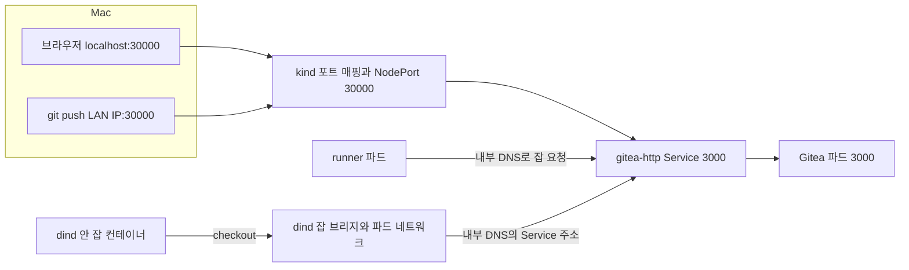

*[서종호(가시다)](https://www.linkedin.com/in/gasida99/)님의 Machine Learning Platform Engineering Study 1주차 학습 내용을 기반으로 합니다.*

<br>

# TL;DR

- Mac의 `git push`는 LAN IP를, 브라우저는 `localhost`를 사용했다. LAN IP가 바뀌어도 브라우저는 열려 있어 push 실패와 서버 장애를 구분해야 했다
- 러너 등록과 실제 CI 잡의 checkout은 클러스터 내부 주소를 사용했다. checkout 주소를 `ROOT_URL`과 동일하게 예상했던 설명은 run #1 로그와 달랐다
- IP를 고치던 `helm upgrade --wait`는 새 파드가 준비되지 않아 실패했다. Helm 리비전이 실패해도 values는 이미 바뀌어 있었다
- Gitea 파드를 `0 → 1`개로 조정한 뒤 정상화됐고 교체 전략을 Recreate로 바꿨다.

<br>

# Gitea 접속 주체와 주소

책 3.4.1절에 대응하는 실습을 확장한 운영 기록이다. 책의 GitLab 대신 설치한 Gitea에서 Mac IP 변경과 파드 교체 실패를 연이어 겪었다. [3.4.1편]()의 서버·러너 구성이 전제다.

같은 Gitea라도 접속 주체가 어디에서 실행되는지에 따라 주소가 달라진다. `ROOT_URL`은 Gitea가 외부에 알리는 기본 URL이며, 웹에서 만드는 링크와 clone 주소 등에 사용한다. 러너가 서버에 등록할 때 쓰는 `giteaRootURL`과는 설정 위치가 다르다.

| 접속 주체 또는 사용처 | 실행 위치 | 실습에서 쓴 주소 | 설정 위치 |
|---|---|---|---|
| 브라우저 | Mac | `http://localhost:30000` | kind `extraPortMappings`로 노출 |
| `git push` | Mac | `http://192.168.0.38:30000/…` → `.78`로 수정 | app-ci의 `git remote` |
| 러너 등록과 잡 요청 | runner 컨테이너 | `http://gitea-http.gitea.svc.cluster.local:3000` | `values-runner.yaml`의 `giteaRootURL` |
| 잡의 `actions/checkout` | dind 안 잡 컨테이너 | 같은 내부 DNS 주소(run #1 실측) | 러너 등록에 사용한 주소와 일치 |
| 웹의 clone 주소와 생성 링크 | Gitea가 생성 | `http://192.168.0.38:30000/` → `.78`로 수정 | `gitea.config.server.DOMAIN`·`ROOT_URL` |
| 이후 Argo CD의 저장소 조회 | argocd 파드 | Mac LAN IP의 `30000` | Application의 `repoURL` |

Argo CD는 Git에 선언한 상태와 클러스터 상태를 맞추는 GitOps 도구다. 당시 IP 변경 사건 때는 아직 설치 전이었고, 이후 실습에서는 `repoURL`에 Mac LAN IP를 넣었다. ([3.4.4편]() 참고)


<center><sup>AI를 이용해 직접 그린 도식. Mac의 외부 접근과 러너·잡의 내부 Service 접근 경로</sup></center>

## localhost와 checkout 주소

`localhost`는 호출하는 프로세스가 속한 네트워크 공간의 루프백 주소다. Mac의 브라우저에서 쓰는 `localhost`와 파드 안에서 쓰는 `localhost`는 서로 다른 대상을 가리킨다. 잡 컨테이너는 러너 파드와도 별도 네트워크 공간을 가진다. [Gitea Actions 설계 문서](https://docs.gitea.com/usage/actions/design/#connection-2-job-containers-to-gitea-instance)도 러너 등록 주소에 루프백을 쓰면 잡의 저장소 접근이 실패할 수 있음을 설명한다.

처음에는 `ROOT_URL`을 checkout도 사용한다고 예상했다. 하지만 run #1의 test_code 로그는 내부 주소에서 앱 코드를 받았음을 보여 줬다.

```text
# run #1 test_code의 git fetch 결과
From http://gitea-http.gitea.svc.cluster.local:3000/mlops/gitea-ci-example
```

이 실행에서 잡 컨테이너는 클러스터 DNS 이름을 해석해 저장소를 가져왔다. checkout은 이 실행에서 성공했다. 러너의 `server_url`을 구성하는 정확한 코드 경로는 실습 버전의 소스로 확인하지 못했으므로, 주소 선택은 이 실행의 관찰 결과로 한정한다.

Mac LAN IP를 쓰는 범위는 Mac의 remote, 웹에 표시할 URL, 이후 IP로 등록한 Argo CD `repoURL`이다. 내부 주소를 쓰는 러너 설정은 유지했다.

<br>

# 트러블슈팅

## 사례 1: Mac IP 변경

### 증상: 75초 뒤 실패한 push

Gitea를 설치할 때 Mac IP는 `192.168.0.38`이었다. 약 3시간 뒤 같은 공유기에 연결된 상태에서 앱을 push했는데, 75초 정도 기다린 뒤 연결 오류가 났다. 브라우저의 `localhost:30000`은 계속 열렸다.

```bash
# 당시 셸에 남아 있던 주소와 실패한 명령
echo "$MYPC"
# 192.168.0.38
git push -u origin main --force

# 실행 결과
# fatal: unable to access 'https://192.168.0.38:30000/mlops/gitea-ci-example.git/': Failed to connect to 192.168.0.38 port 30000 after 75005 ms: Couldn't connect to server
```

이때 remote를 추가하고 바꾸는 과정에서 `https://`도 섞였다. 실습 Gitea의 `30000`은 HTTP로 노출했으므로 IP와 함께 프로토콜도 고쳐야 했다.

### 증거: 현재 IP와 저장된 주소의 불일치

`ipconfig getifaddr`는 Mac 인터페이스의 IPv4 주소를 읽는다. 현재 값은 `.78`인데 셸 변수와 원격 주소, Gitea 설정은 `.38`이었다. 아래 remote 조회는 프로토콜을 HTTP로 고친 뒤에도 옛 IP가 남아 있던 시점이다.

```bash
# 현재 Mac IP
ipconfig getifaddr en0
# 192.168.0.78

# 앱 저장소의 remote
git remote -v
# origin  http://192.168.0.38:30000/mlops/gitea-ci-example.git (fetch)
# origin  http://192.168.0.38:30000/mlops/gitea-ci-example.git (push)

# Helm에 저장된 사용자 지정 값
helm get values -n gitea gitea | grep -E 'DOMAIN|ROOT_URL'
# DOMAIN: 192.168.0.38
# ROOT_URL: http://192.168.0.38:30000/

# localhost 경로의 HTTP 응답
curl -s -o /dev/null -w '%{http_code}\n' http://localhost:30000
# 200
```

`curl`은 HTTP 요청을 보내는 명령이다. `kubectl -n gitea get pod,svc`에서도 Gitea는 `1/1 Running`, 러너는 `2/2 Running`이고 HTTP Service는 `3000:30000/TCP`였다. 서버 실행과 localhost 경로는 정상이었지만, push는 옛 LAN IP에 연결하고 있었다.

`after 75005 ms`는 연결을 맺는 동안 약 75초가 걸렸다는 뜻이다. Mac의 커널 설정을 읽는 `sysctl net.inet.tcp.keepinit` 값은 `75000`이었고, [Apple XNU 소스](https://github.com/apple-oss-distributions/xnu/blob/main/bsd/netinet/tcp_timer.h)는 연결 성립 전 대기 제한을 75초로 정의한다. 관찰된 대기 시간은 이 설정과 부합한다. 당시 패킷을 캡처하지 않아 정확한 재전송 과정까지 확인하지는 못했다.

시간 초과만으로 특정 IP에 기기가 없다고 확정할 수는 없다. 방화벽의 폐기나 경로 문제도 후보가 된다. 즉시 `Connection refused`가 나오는 경우는 거부 응답을 받은 것이므로, 목적지와 포트의 수신 상태를 살펴야 한다. 이번 IP 오류의 직접 증거는 `ipconfig`와 저장된 주소의 불일치다.

### 원인: 변경된 IP와 셸에 남은 MYPC

셸 변수 `MYPC`는 값을 대입한 시점의 문자열을 유지한다. 인터페이스 IP가 바뀌어도 자동으로 갱신되지 않는다. 이 값을 이용해 만든 Git remote와 `ROOT_URL`도 옛 IP로 고정돼 있었다.

IP가 `.38 → .78`로 바뀐 것은 출력으로 확인했다. 공유기의 DHCP(Dynamic Host Configuration Protocol, 동적 호스트 설정 프로토콜) 재할당을 원인으로 추정했지만, 공유기 임대 기록은 확인하지 않았다.

### 해결: remote와 ROOT_URL 갱신

주소를 다시 읽고 remote를 HTTP의 새 IP로 바꿨다. `~/ml-study`는 실습 저장소 경로를 줄인 표기다. 원본 앱·차트는 `~/ml-study/chapters/ch03-k8s`, 별도 Git 저장소는 `~/ml-study/chapters/app-ci`에 있다.

```bash
# app-ci에서 현재 주소로 remote 갱신
cd ~/ml-study/chapters/app-ci
MYPC=$(ipconfig getifaddr en0)
git remote set-url origin "http://$MYPC:30000/mlops/gitea-ci-example.git"
git remote -v

# 실행 결과
# origin  http://192.168.0.78:30000/mlops/gitea-ci-example.git (fetch)
# origin  http://192.168.0.78:30000/mlops/gitea-ci-example.git (push)

# 실습 저장소의 기존 원격 커밋을 교체한 push
git push -u origin main --force

# 실행 결과 발췌
# To http://192.168.0.78:30000/mlops/gitea-ci-example.git
# + 786f1b3...c11f2c2 main → main (forced update)
# branch 'main' set up to track 'origin/main'.
```

새 IP로는 인증 정보를 다시 입력했고 push가 성공했다. `--force`는 이 실습에서 원격의 기존 커밋을 덮어쓴 옵션이다. 주소를 고치는 데 강제 push가 필요한 것은 아니다.

이후 Gitea가 생성하는 URL도 맞추려고 Helm upgrade를 실행했다. `--reuse-values`는 기존 사용자 지정 값을 재사용하면서 새로 준 값을 합치는 옵션이다.

```bash
# 기존 값을 유지하고 Gitea의 외부 URL 변경
helm upgrade gitea gitea --repo https://dl.gitea.com/charts/ \
  --version 12.7.0 -n gitea --reuse-values \
  --set "gitea.config.server.DOMAIN=$MYPC" \
  --set "gitea.config.server.ROOT_URL=http://$MYPC:30000/" \
  --wait
```

push는 복구됐지만 이 명령은 5분 뒤 실패했다. 주소 변경이 파드 교체를 일으키면서 [두 번째 사례](#사례-2-helm-upgrade-시간-초과)로 이어졌다.

## 사례 2: helm upgrade 시간 초과

### 증상: context deadline exceeded와 두 파드

Helm이 `Error: UPGRADE FAILED: context deadline exceeded`를 출력했다. 파드 목록에는 기존 Gitea와 새 Gitea가 함께 있었고, 새 파드만 재시작을 반복했다.

```bash
# upgrade 실패 후 파드 상태
kubectl -n gitea get pod

# 실행 결과
# NAME                     READY STATUS             RESTARTS      AGE
# gitea-6799485489-hdd2q    1/1   Running            0             3h31m
# gitea-7f8865779c-nxvp6    0/1   CrashLoopBackOff   5 (117s ago)  5m56s
# runner-runner-0           2/2   Running            0             28m
```

`CrashLoopBackOff`는 컨테이너가 반복해서 종료돼 재시작 간격을 늘리며 기다리는 상태다. 이름의 ReplicaSet 해시와 AGE를 보면 `6799485489`가 기존 파드, `7f8865779c`가 새 파드였다. Deployment와 ReplicaSet의 연결은 [3.3.3편]()에서 다뤘다.

### 증거: 실패한 리비전과 변경된 values

Helm의 리비전(revision)은 릴리스 변경 이력의 번호다. `helm history`는 그 번호와 상태를, `helm get values`는 릴리스에 저장된 사용자 지정 값을 보여 준다.

```bash
# 릴리스 상태와 저장된 주소를 함께 조회
helm history -n gitea gitea

# 실행 결과 중 리비전·상태·설명
# 1  deployed  Install complete
# 2  failed    Upgrade "gitea" failed: context deadline exceeded

helm get values -n gitea gitea | grep -E 'DOMAIN|ROOT_URL'
# DOMAIN: 192.168.0.78
# ROOT_URL: http://192.168.0.78:30000/
```

리비전 2는 실패했지만 values에는 새 주소가 저장돼 있었다. `--wait`는 리소스가 준비될 때까지 기다리는 옵션이며, 당시 명령의 기본 timeout은 5분이다. 이 명령에는 실패 시 자동 복구 옵션이 없었다. **대기 실패가 이미 적용한 값을 모두 되돌렸다는 뜻은 아니다.** 옵션 동작은 [Helm upgrade 문서](https://helm.sh/docs/v3/helm/helm_upgrade/)를 참고한다.

처음에는 실패한 새 파드를 지웠다. 그러나 ReplicaSet이 같은 설정의 파드를 다시 만들었고, 그 파드도 종료됐다.

```bash
# 새 파드 삭제 후 관찰한 변화
kubectl -n gitea delete pod gitea-7f8865779c-nxvp6
kubectl -n gitea get pod -w

# 실행 결과 발췌
# gitea-6799485489-hdd2q  1/1 Running 0           3h32m
# gitea-7f8865779c-d8vqm  0/1 Running 0           11s
# gitea-7f8865779c-d8vqm  0/1 Error   0           14s
# gitea-7f8865779c-d8vqm  0/1 Running 1 (1s ago)  15s
```

### 원인: 파드 중첩과 파일 잠금 후보

RollingUpdate는 기존 파드를 유지하면서 새 파드로 점진적으로 교체하는 전략이다. Gitea 차트 `12.7.0`의 기본값은 `maxSurge: 100%`, `maxUnavailable: 0`이었다. replica가 1개일 때도 새 파드 한 개를 추가하고, 새 파드가 준비될 때까지 기존 파드를 유지할 수 있다.

두 파드는 같은 PVC의 `/data`를 사용했다. [3.4.1편의 파일 기반 상태 구성](#단일-파드와-파일-기반-상태)에는 SQLite DB와 LevelDB 큐가 있다. [LevelDB 문서](https://github.com/google/leveldb/blob/main/doc/index.md#concurrency)에 따르면 같은 DB는 한 번에 한 프로세스만 열 수 있고 운영체제 잠금을 사용한다. Gitea의 `queue.TYPE: level`은 이 방식의 큐다.

따라서 기존 Gitea가 큐를 연 상태에서 새 Gitea가 같은 큐를 열려 했다는 가설이 성립한다. 기존 파드가 없어진 뒤 새 파드가 바로 Ready가 된 것도 이 가설을 뒷받침한다. 다만 새 파드의 종료 직전 로그에서 잠금 메시지를 직접 확인하지 못해 **LevelDB 잠금을 확정 원인으로 판정하지 않았다.**

같은 상황을 다시 조사한다면 새 파드가 종료되기 직전의 로그가 필요하다. `--previous`는 해당 컨테이너의 이전 실행 로그를 조회하는 옵션이다.

```bash
# 재발 시 새 파드 이름을 넣어 확인할 명령
kubectl -n gitea logs '<new-pod>' -c gitea --previous --tail=30
```

### 해결: 파드 수 조정과 Recreate 전환

Gitea Deployment를 0개로 줄여 기존·새 파드를 모두 내린 뒤 1개로 복구했다. 새 설정의 파드는 11초에 `1/1 Running`이 됐다. 러너는 계속 실행 중이었다.

```bash
# Gitea 파드를 모두 종료
kubectl -n gitea scale deploy gitea --replicas=0
# deployment.apps/gitea scaled
kubectl -n gitea get pod -w
# runner-runner-0  2/2 Running 0 34m

# 새 설정의 파드 하나만 실행
kubectl -n gitea scale deploy gitea --replicas=1
# deployment.apps/gitea scaled
kubectl -n gitea get pod -w
# gitea-7f8865779c-jzbxs  0/1 Running 0 6s
# gitea-7f8865779c-jzbxs  1/1 Running 0 11s
```

`get pod -w`는 계속 변경을 관찰하므로 결과를 본 뒤 `Ctrl-C`로 종료하고 다음 명령을 실행한다. 기존 파드 하나만 지우는 대신 전체 replica 수를 0으로 만든 것은, 롤링 중인 기존 ReplicaSet이 파드를 다시 만드는 상황까지 함께 끝내기 위해서였다.

그 뒤 교체 전략을 Recreate로 바꿨다. Recreate는 기존 파드를 내린 뒤 새 파드를 생성하는 전략이다. 단일 Gitea가 잠시 중단되는 대신 교체 중 두 프로세스가 같은 파일 상태에 접근하는 상황을 피한다.

```bash
# 다음 교체부터 Recreate 적용
helm upgrade gitea gitea --repo https://dl.gitea.com/charts/ \
  --version 12.7.0 -n gitea --reuse-values \
  --set strategy.type=Recreate --set strategy.rollingUpdate=null \
  --wait --timeout 8m

# 실행 결과 발췌
# Release "gitea" has been upgraded. Happy Helming!
# NAME: gitea
# NAMESPACE: gitea
# STATUS: deployed
# REVISION: 3
```

리비전 3이 `deployed`가 됐고, 후속 조회에서 Deployment 전략도 `{"type":"Recreate"}`였다. 메모리 세션을 쓰므로 파드 교체 뒤 웹에는 다시 로그인했다. 업데이트 전략 일반론은 [Deployment 교체 전략]()과 연결된다.

실제 명령에는 `strategy.rollingUpdate=null`도 들어갔다. 쿠버네티스 API는 Recreate와 `rollingUpdate` 필드를 함께 보내면 [검증에서 거부한다](https://github.com/kubernetes/kubernetes/blob/v1.29.14/pkg/apis/apps/validation/validation.go#L466-L480). 다만 **이 차트 12.7.0은 전략이 RollingUpdate일 때만 해당 필드를 렌더한다.** `helm template`에 `strategy.type=Recreate`만 넘겨도 생성된 Deployment에는 `type: Recreate`만 있었다. 이 버전의 템플릿은 `type` 설정만으로 두 필드가 함께 생성되는 상황을 막는다.

## 재발 방지

주소 변경과 파드 교체를 함께 점검해야 한다. 이번 복구에서 직접 확인한 조치는 remote·URL 갱신과 replica 조정, Recreate 전환이다. DHCP 예약, Argo CD의 내부 주소 전환, `host.docker.internal` 대체는 이 환경에서 시험하지 않았다.

- 주소를 쓰는 명령 직전에 `MYPC`를 다시 읽고 빈 값이면 인터페이스부터 확인한다. `networksetup -listallhardwareports`는 Mac의 하드웨어 포트와 인터페이스 이름을 나열한다
- 집 공유기에서는 DHCP 예약으로 주소 변화를 줄이는 방법을 검토할 수 있다. 다른 네트워크로 이동할 때는 주소를 다시 확인한다
- IP 기반 `repoURL`을 쓴 Argo CD도 변경 대상이다. 클러스터 내부 Service 주소를 사용하면 Mac LAN IP에 대한 의존성을 줄일 수 있다. 이후 실습은 LAN IP를 사용했다. ([3.4.4편]() 참고)
- `host.docker.internal` 같은 이름을 쓰려면 Mac·파드·잡 각각에서 이름 해석과 접근을 확인해야 한다
- 파일 상태를 공유하는 단일 파드 앱은 교체 중 중첩 실행을 허용할 수 있는지 검토하고 전략을 정한다. 이번 구성은 Recreate로 바꿨다
- `--wait`가 실패하면 `helm history`, `helm get values`, `kubectl get pod`를 함께 확인한다. 파드를 삭제하기 전에는 ReplicaSet 해시와 AGE로 대상을 구분한다

<br>

# 정리

첫 문제는 Mac의 접속 주소가 낡은 것이었다. 두 번째 문제는 그 주소를 바꾸는 작업이 파드 교체를 일으키면서 나타났다. 네트워크 설정 변경도 애플리케이션의 상태 저장 방식과 배포 전략에 영향을 받을 수 있다.

로컬 ML 플랫폼에도 Mac, 파드, 잡 컨테이너, GitOps 도구가 각자의 주소를 가진다. 접속 주체와 설정 위치를 표로 관리하고, 변경 후에는 설정값과 실제 실행 상태를 함께 확인하는 것이 운영의 기본이다.

<br>

# 참고 링크

- [Gitea Actions 네트워크 설계](https://docs.gitea.com/usage/actions/design/)
- [Gitea 설정](https://docs.gitea.com/administration/config-cheat-sheet/)
- [Gitea 차트 12.7.0](https://dl.gitea.com/charts/gitea-12.7.0.tgz)
- [Helm 3 upgrade](https://helm.sh/docs/v3/helm/helm_upgrade/)
- [LevelDB 동시 접근](https://github.com/google/leveldb/blob/main/doc/index.md#concurrency)
- [Kubernetes 1.29.14 Deployment 전략 검증](https://github.com/kubernetes/kubernetes/blob/v1.29.14/pkg/apis/apps/validation/validation.go#L466-L480)
- [Apple XNU TCP 타이머](https://github.com/apple-oss-distributions/xnu/blob/main/bsd/netinet/tcp_timer.h)

<br>
