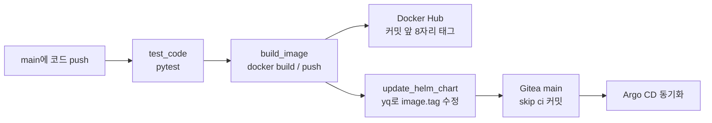

*[서종호(가시다)](https://www.linkedin.com/in/gasida99/)님의 Machine Learning Platform Engineering Study 1주차 학습 내용을 기반으로 합니다.*

<br>

# TL;DR

- `test_code → build_image → update_helm_chart`를 `needs`로 연결했다. 테스트가 성공하면 이미지를 올리고, 그 태그를 Helm 차트에 커밋한다
- 첫 push에는 `ci.yaml`이 0바이트라 워크플로가 인식되지 않았다. 내용을 채운 run #1에서는 Secrets에 넣은 계정명을 `vars`로 읽어 이미지 이름이 깨졌다
- run #2에서 세 잡이 성공했다. 이미지 태그는 `9fc8cad1`, 차트 갱신 커밋은 `37ae87f`였고, checkout과 push는 클러스터 내부 Gitea 주소를 사용했다

<br>

# 워크플로 해부: GitLab CI에서 Gitea Actions로

책 3.4.1절의 CI 워크플로에 대응하는 실습이다. 책의 GitLab CI 구성을 Gitea Actions로 옮겼다. [3.4.1편]()에서 설치한 러너가 잡을 받아 DinD(Docker-in-Docker)의 컨테이너에서 실행한다.

지속 통합(Continuous Integration, CI)은 코드 변경을 합칠 때 빌드와 테스트를 자동으로 실행하는 과정이다. 이번 워크플로는 테스트를 통과한 코드로 이미지를 만들고, 배포할 이미지 태그까지 Git에 반영한다. 파일 위치는 `~/ml-study/chapters/app-ci/.gitea/workflows/ci.yaml`이다. `~/ml-study`는 실습 저장소 경로를 줄인 표기이며, `app-ci`는 Gitea로 push하는 별도 Git 저장소다.

| 책의 GitLab CI | Gitea Actions에서 사용한 구성 |
|---|---|
| `stages: [test, build, update]` | 세 `jobs`와 `needs` 의존 관계 |
| 잡의 `image`와 `services: dind` | `runs-on: ubuntu-latest` 라벨에 연결된 잡 이미지와 러너의 dind |
| `CI_PROJECT_DIR` | checkout한 작업 디렉터리인 `github.workspace` |
| `CI_COMMIT_SHA` | 셸 환경 변수 `GITHUB_SHA` |
| `CI_COMMIT_SHA` 앞 8자리 | `cut -c1-8`로 계산한 `SHORT_SHA` |
| 차트 수정 후 액세스 토큰으로 push | checkout이 설정한 자동 토큰 인증으로 push |

잡(job)은 여러 단계(step)를 순서대로 실행하는 단위다. `needs`는 앞 잡의 성공을 다음 잡의 실행 조건으로 만든다. 잡마다 작업 공간을 새로 준비하므로 세 잡 모두 checkout한다.


<center><sup>AI를 이용해 직접 그린 도식. 세 CI 잡의 의존 관계와 이미지·차트 변경의 전달 경로.</sup></center>

`on.push.branches: [main]`은 실행 대상 브랜치를 고른다. 차트를 갱신하는 잡도 `main`에 push하므로, 이 필터만으로 재실행을 막을 수는 없다. 차트 커밋에는 실행을 건너뛰도록 `[skip ci]`를 넣었다. Gitea v1.27에는 Actions 자동 토큰 사용자가 만든 이벤트의 재귀 실행을 막는 처리도 있다([Gitea v1.27 소스](https://github.com/go-gitea/gitea/blob/v1.27.0/services/actions/notifier_helper.go)).

## 변수와 시크릿

저장소의 Settings → Actions에는 Variables와 Secrets가 따로 있다. 컨텍스트(context)는 워크플로 식에서 값을 조회하는 이름 공간이다. Variables는 `vars`, Secrets는 `secrets`로 읽는다.

| 이름 | 용도 | run #2에서 읽은 위치 |
|---|---|---|
| `DOCKER_USERNAME` | Docker Hub 이미지의 계정명 | Secrets. Variables를 먼저 조회하고 비어 있으면 Secrets 사용 |
| `DOCKER_PASSWORD` | Docker Hub push 인증 | Secrets의 개인 액세스 토큰 |
| `MY_ACCESS_TOKEN` | 별도로 생성한 Gitea 액세스 토큰 | 이 워크플로에서는 참조하지 않음 |

일반 변수는 로그에 표시되고, 시크릿 값은 러너가 `***`로 가린다. 변수 이름에는 `GITEA_`·`GITHUB_` 예약 접두사를 쓸 수 없다([Gitea 변수 문서](https://docs.gitea.com/1.27/usage/actions/actions-variables/)). Docker Hub 토큰에는 이미지를 올릴 쓰기 권한이 필요하다. `docker login --password-stdin`은 토큰을 표준 입력으로 받아 인증한다([Docker 로그인 문서](https://docs.docker.com/reference/cli/docker/login/)).

계정명을 Variables에 두면 로그에서 이미지 이름을 확인하기 편하다. 이번 성공 실행은 Secrets에 둔 값을 폴백으로 읽었으며, Variables로 옮긴 뒤의 실행은 시험하지 않았다.

## 자동 토큰과 액세스 토큰

자동 토큰은 Gitea가 Actions 잡에 발급하는 인증 수단이다. 사용자가 직접 만들어 등록하는 개인 액세스 토큰(Personal Access Token, PAT)과 발급·관리 방식이 다르다. 책의 GitLab 예제는 별도 액세스 토큰으로 차트 변경을 push하지만, 이 워크플로는 `actions/checkout@v4`가 기본 토큰으로 구성한 Git 인증을 사용한다.

[Gitea 1.27의 토큰 권한 문서](https://docs.gitea.com/1.27/usage/actions/token-permissions/)는 잡 단위 `permissions`와 `contents` 범위를 지원한다고 설명한다. `contents: write`는 코드·릴리스 쓰기 권한 요청이며, 실제 권한에는 저장소·소유자 설정의 상한도 적용된다. run #2에서는 이 설정으로 같은 저장소에 push했다. `MY_ACCESS_TOKEN`은 워크플로에 등장하지 않는다.

## 세 잡의 실행 내용

테스트 잡은 `actions/setup-python@v5`로 Python 3.10을 준비하고 `requirements.txt`를 설치한 뒤 pytest를 실행한다. pytest는 파이썬 테스트 실행 도구다. [3.2.1편]()의 앱에 들어 있는 HTTP 테스트 한 개가 대상이다.

실습 의존성에는 `httpx==0.27.2`가 들어 있다. 오래된 Starlette의 `TestClient`는 httpx에 `app` 인자를 넘기는데, httpx 0.28은 이 인자를 제거했다. Starlette에서는 0.37.2에 해당 호출을 고쳤다([httpx 0.28 릴리스](https://github.com/encode/httpx/releases/tag/0.28.0), [Starlette 릴리스 노트](https://www.starlette.io/release-notes/#0372-march-5-2024)). 이 조합으로 run #1의 테스트가 통과했고, `app` 인자의 폐기 예정 경고 한 건이 남았다.

빌드 잡은 소스 커밋 앞 8자리로 태그를 만든다. 차트 갱신 잡은 YAML 편집 도구인 `yq`로 `hello-joker/values.yaml`의 `image.tag`를 바꾼다. 따라서 앱 코드 커밋과 차트 수정 커밋의 해시는 달라진다. 이미지 태그는 앱 코드를 빌드한 커밋을 가리킨다.

<details markdown="1">
<summary><b>run #2의 ci.yaml</b></summary>


```yaml
# .gitea/workflows/ci.yaml: 테스트 → 이미지 push → 차트 갱신
name: ci
on:
  push:
    branches: [main]
jobs:
  test_code:
    runs-on: ubuntu-latest
    steps:
      - uses: actions/checkout@v4
      - uses: actions/setup-python@v5
        with:
          python-version: "3.10"
      - name: Test
        run: |
          pip install -r "${{ github.workspace }}/requirements.txt"
          pytest "${{ github.workspace }}/"
  build_image:
    needs: test_code
    runs-on: ubuntu-latest
    steps:
      - uses: actions/checkout@v4
      - name: Build and push image
        env:
          DOCKER_USERNAME: ${{ vars.DOCKER_USERNAME || secrets.DOCKER_USERNAME }}
          DOCKER_PASSWORD: ${{ secrets.DOCKER_PASSWORD }}
        run: |
          docker version
          test -n "${DOCKER_USERNAME}" || { echo "::error::DOCKER_USERNAME이 비어 있음. 저장소 Settings → Actions → Variables(또는 Secrets)에 등록"; exit 1; }
          IMAGE="${DOCKER_USERNAME}/hello-joker"
          SHORT_SHA=$(echo "${GITHUB_SHA}" | cut -c1-8)
          docker build . -t "${IMAGE}:${SHORT_SHA}"
          echo "${DOCKER_PASSWORD}" | docker login -u "${DOCKER_USERNAME}" --password-stdin
          docker push "${IMAGE}:${SHORT_SHA}"
  update_helm_chart:
    needs: build_image
    runs-on: ubuntu-latest
    permissions:
      contents: write
    steps:
      - uses: actions/checkout@v4
      - name: Install git and yq
        run: |
          command -v git >/dev/null || (apt-get update && apt-get install -y git)
          mkdir -p "$HOME/.local/bin"
          wget https://github.com/mikefarah/yq/releases/download/v4.2.0/yq_linux_amd64 -O "$HOME/.local/bin/yq"
          chmod +x "$HOME/.local/bin/yq"
          echo "$HOME/.local/bin" >> "$GITHUB_PATH"
      - name: Update helm chart image tag
        run: |
          SHORT_SHA=$(echo "${GITHUB_SHA}" | cut -c1-8)
          git config --global user.email "${GITHUB_ACTOR}@noreply.local"
          git config --global user.name "${GITHUB_ACTOR}"
          yq e -i ".image.tag |= \"${SHORT_SHA}\"" hello-joker/values.yaml
          git add hello-joker/values.yaml
          git commit -m "[skip ci] Update helm chart ${SHORT_SHA}"
          git push origin HEAD:main
```


</details>

`wget`은 yq 바이너리를 내려받고, `chmod +x`는 실행 권한을 붙인다. `GITHUB_PATH` 파일에 쓴 디렉터리는 다음 step부터 PATH에 추가된다. 여기의 `git config --global`은 일회성 잡 컨테이너 안의 Git 신원 설정이다.

<br>

# 적용과 관찰: 첫 실행

내용을 채운 `ci.yaml`을 push한 run #1의 커밋은 `0d9be20`이었다. 러너는 `docker.gitea.com/runner-images:ubuntu-latest`를 받아 잡 컨테이너와 잡 전용 네트워크를 만들었다. 액션 구현은 GitHub에서, 앱 코드는 Gitea에서 각각 받았다.

```text
# run #1 test_code 로그의 다운로드 경로
https://github.com/actions/checkout
https://github.com/actions/setup-python
From http://gitea-http.gitea.svc.cluster.local:3000/mlops/gitea-ci-example
```

checkout은 러너 등록에 사용한 클러스터 내부 주소로 성공했다. Mac LAN IP를 넣은 `ROOT_URL`과의 구분은 [3.4.2편](#localhost와-checkout-주소)에 있다.

첫 `test_code`는 이미지 pull 약 26초를 포함해 44초가 걸렸다. Python 3.10.22에서 테스트 한 개가 통과했지만, 다음 `build_image`가 이미지 태그 오류로 실패해 `update_helm_chart`는 건너뛰었다.

<br>

# 트러블슈팅

## 사례 1: 빈 워크플로 파일

### 증상: Workflow config file is invalid EOF

처음 저장소를 push했을 때 Actions 화면에 `Workflow config file is invalid. Please check your config file: EOF`가 표시됐다. 잡은 시작되지 않았다.

### 증거: 첫 커밋의 0바이트 ci.yaml

Gitea 로그에는 다음 메시지가 있었다. 첫 커밋 `c11f2c2`에 들어 있는 `.gitea/workflows/ci.yaml`도 0바이트였다.

```text
# Gitea가 워크플로를 읽다가 남긴 로그
ignore invalid workflow "ci.yaml": EOF
```

### 원인: 내용 없이 커밋된 파일

경로만 만들어진 빈 파일이 커밋됐다. EOF(End of File)는 읽을 내용 없이 파일 끝에 도달했음을 나타낸다. 파일 생성 시각과 빈 내용은 확인했지만, 어떤 명령으로 빈 파일을 만든 것인지는 기록에 남아 있지 않다.

### 해결: 워크플로 작성 후 재push

세 잡을 정의한 YAML을 채워 `0d9be20`으로 push했다. run #1에서 `test_code`가 실행되면서 워크플로 인식을 확인했다. 이후 push 전에 파일 크기와 커밋 내용을 확인할 수 있다.

```bash
# 워크플로 파일 크기와 실제 커밋 내용을 확인
wc -c .gitea/workflows/ci.yaml
git show HEAD:.gitea/workflows/ci.yaml
```

## 사례 2: 이미지 이름의 계정명 누락

### 증상: invalid reference format

run #1의 `Build and push image` step은 `docker version`까지 정상적으로 출력한 뒤 실패했다. Docker 클라이언트는 29.9.2, 서버는 29.5.2였고 둘 다 `linux/arm64`였다.

```text
# run #1 build_image 오류
ERROR: failed to build: invalid tag "/hello-joker:0d9be204": invalid reference format
```

### 증거: vars 평가 결과와 빈 환경 변수

잡 로그에서 `vars.DOCKER_USERNAME`으로 조합한 이미지 이름이 `/hello-joker`로 평가됐고, step 환경의 `DOCKER_USERNAME`도 비어 있었다. 저장소 설정에서는 이 이름을 Secrets에 등록한 상태였다.

### 원인: 서로 다른 변수 저장 위치

`vars.DOCKER_USERNAME`은 Variables를 조회한다. Secrets에 같은 이름이 있어도 이 조회의 값은 채워지지 않는다. run #1에서는 없는 변수의 조회 결과가 빈 문자열이 되어 Docker까지 전달됐다. 이미지 이름의 계정명 부분이 사라진 이유다.

### 해결: 폴백과 빈 값 검사

커밋 `9fc8cad`에서 Variables를 먼저 읽고, 비어 있으면 Secrets를 읽도록 바꿨다. `||`는 앞 값이 거짓으로 평가되면 뒤 값을 선택하는 식 연산자다([Actions 식 문서](https://docs.github.com/en/actions/reference/workflows-and-actions/expressions)).


```yaml
# build step의 환경 변수: Variables 우선, 없으면 Secrets
DOCKER_USERNAME: ${{ vars.DOCKER_USERNAME || secrets.DOCKER_USERNAME }}
```


전역 `env`에 있던 `IMAGE` 조합은 build step의 셸 안으로 옮겼다. 계정명이 비었으면 `test -n` 검사에서 명시적인 오류를 내고 종료한다. 이 수정 뒤 run #2가 이미지를 정상적으로 push했다.

<br>

# 검증: run #2

세 잡의 결과는 `test_code` 2초, `build_image` 2분 23초, `update_helm_chart` 2초로 모두 성공이었다.

{: .align-center}
<center><sup>직접 캡처. run #2에서 세 잡이 성공했고 build_image의 빌드·push 단계가 완료됐다.</sup></center>

## 이미지 태그와 플랫폼

build 로그에서 계정명은 `***`로 가려졌고 이미지 태그는 `9fc8cad1`이었다. Docker Hub에도 같은 태그가 생겼다. 플랫폼은 `linux/arm64` 하나였으며, 화면의 digest 앞자리 `c09f5bf621b8`은 로그의 이미지 manifest digest와 일치했다.

{: .align-center}
<center><sup>직접 캡처. 9fc8cad1은 linux/arm64이고, 앞선 수동 빌드의 v2는 amd64와 arm64를 포함한다.</sup></center>

로그에는 `exporting manifest list`와 `exporting attestation manifest`도 있었다. attestation은 빌드 출처 같은 부가 정보를 담는다. manifest list가 출력됐다는 사실만으로 실행 가능한 CPU 아키텍처가 여러 개라는 뜻은 아니다. 이번에는 Docker Hub의 플랫폼 목록과 이미지 manifest를 함께 확인했다. amd64와 arm64 이미지를 함께 배포하는 빌드는 [3.2.2편]()에서 다룬다.

이 출력만으로 dind의 실제 이미지 저장소 backend를 확정하지는 않았다. `docker info`의 storage driver 확인이 더 필요하다.

## 차트 갱신 커밋

update 잡은 자동 토큰을 이용한 `AUTHORIZATION: basic ***` 인증으로 checkout하고 같은 내부 주소에 push했다. 로그에 남은 핵심 결과다.

```text
# run #2 update_helm_chart의 커밋·push 결과
[main 37ae87f] [skip ci] Update helm chart 9fc8cad1
9fc8cad..37ae87f  HEAD -> main
Job succeeded
```

arm64 잡 컨테이너에서 다운로드한 `yq_linux_amd64`도 실행됐다. Mac 실습에서 Rosetta로 실행한 yq 4.2.0 확인과 일치한다. 다른 arm64 러너에서의 amd64 바이너리 실행은 시험하지 않았다.

CI가 원격 `main`에 커밋을 하나 추가했으므로 로컬 `app-ci`는 그만큼 뒤에 남는다. 다음 변경을 올리기 전에 `git pull`로 차트 갱신 커밋을 가져온다.

<br>

# 정리

이번 CI는 테스트 결과, 컨테이너 이미지, 배포할 이미지 태그를 연결했다. ML 플랫폼에서 서비스 코드나 플랫폼 구성 요소를 갱신할 때도 이 세 결과의 연결이 필요하다. 이 실습은 앱 테스트와 이미지 배포 준비까지 다뤘으며, 모델의 품질 평가나 학습 파이프라인 실행은 포함하지 않았다.

차트 변경을 실제 Kubernetes 배포로 연결하는 과정은 [3.4.4편]()에 이어진다. 코드 커밋과 이미지 태그, 배포 설정 커밋을 각각 추적하면 어느 코드가 배포됐는지 확인할 수 있다.

<br>

# 참고 링크

- [Gitea 1.27 Actions 변수](https://docs.gitea.com/1.27/usage/actions/actions-variables/)
- [Gitea 1.27 잡 토큰 권한](https://docs.gitea.com/1.27/usage/actions/token-permissions/)
- [actions/checkout v4](https://github.com/actions/checkout/tree/v4)
- [Docker 이미지 attestation](https://docs.docker.com/build/metadata/attestations/)
- [yq v4.2.0](https://github.com/mikefarah/yq/releases/tag/v4.2.0)

<br>
