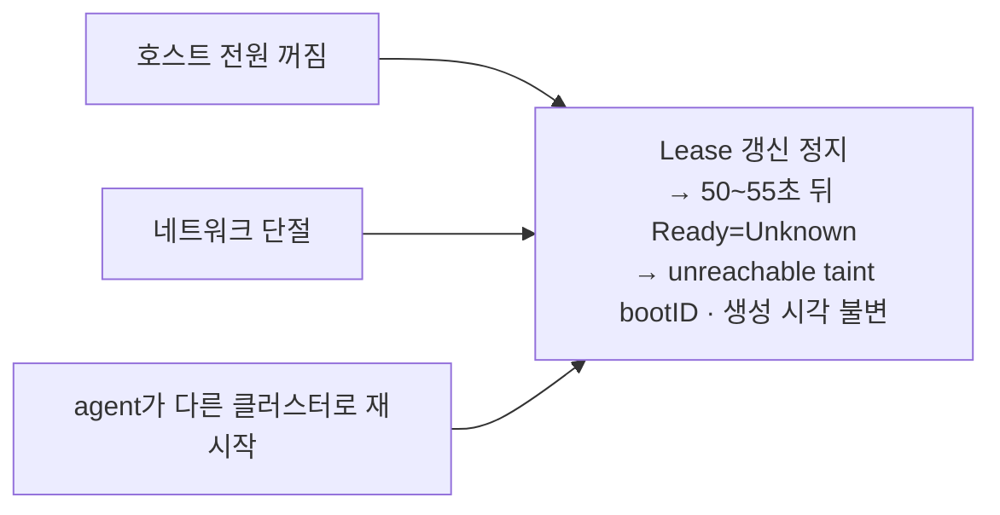
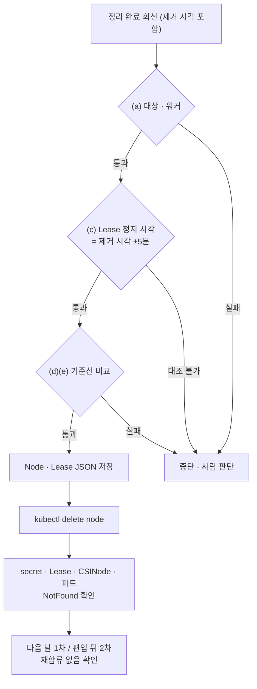
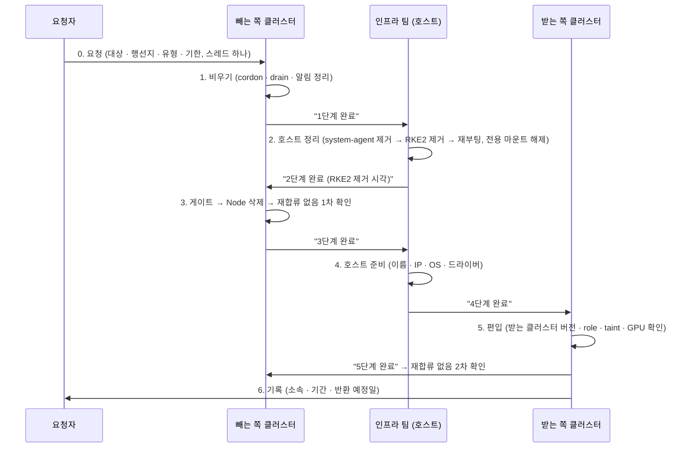

<br>

# TL;DR

- 온프레미스 RKE2 클러스터에서 워커 노드를 다른 팀으로 넘기는 동안, Kubernetes API에 등록된 Node 객체가 말하는 상태와 호스트의 실제 상태가 세 번 어긋났다. 호스트 정리 전에 재부팅된 노드가 IP만 바뀐 채 또는 새 이름으로 다시 붙었고([사례 1](#사례-1-새-이름으로-돌아온-노드)), `NotReady`로만 보이던 노드가 6일 동안 다른 클러스터에 소속돼 있었고([사례 2](#사례-2-notready-뒤의-이중-소속)), "호스트 정리 완료" 회신과 `NotReady`는 서로를 증명하지 못했다([사례 3](#사례-3-정리-회신과-notready의-증명력))
- 세 사례의 공통 원인은 하나다. 클러스터가 노드에 대해 아는 것은 **마지막으로 신호를 받은 시각**뿐이다. 호스트가 꺼졌는지, 네트워크가 끊겼는지, 다른 클러스터로 갔는지는 Node 객체 어디에도 남지 않고, 셋 다 원래 클러스터에서는 같은 모양(`Ready=Unknown`, 멈춘 Lease, 그대로인 bootID)으로 보인다
- 여기에 RKE2의 등록 구조가 겹친다. agent 설정이 호스트에 남아 있으면 재부팅만으로 다시 붙고, `server` 주소만 바꾸면 원래 클러스터의 Node 객체는 남긴 채 다른 클러스터에 등록되며, server 토큰으로 붙은 워커는 `rke2-server`가 켜지는 순간 etcd 멤버가 될 수 있다
- 따라서 노드를 뺄 때 Node 객체 삭제는 `NotReady`가 아니라 호스트 정리의 증거를 보고 결정해야 한다. 이번 작업에서는 정리 완료 회신, RKE2 제거 시각과 Lease 정지 시각의 대조, 기준선 비교, 삭제 직전 객체 보존, 재합류 없음 확인 두 번을 게이트로 두었고, 돌려받은 노드는 Node 객체를 남기고 node-password secret만 지운 뒤 같은 버전으로 재설치했다. 다른 클러스터로의 이탈은 원래 클러스터 쪽에서 감지할 수단이 없어 이 절차로만 막는다
- 어느 층도 호스트의 RKE2를 대신 지우지 않는다. Kubernetes의 `kubectl delete node`는 API 객체와 거기에 딸린 객체만 지우고, RKE2는 거기에 node-password secret을 더할 뿐이며, Rancher도 imported·custom 어느 유형에서든 호스트 정리는 사람 몫이다(2026년 10월, Rancher 2.15 문서 기준)

<br>

# 배경

## 노드 이관 작업

회사에서 RKE2 v1.34 기반의 온프레미스 GPU 클러스터(이하 **클러스터 A**)를 운영하고 있다. 운영 대상인 클러스터는 Rancher 2.15에 기존 클러스터로 등록(import)돼 있고 워커 노드는 `rke2 agent --server https://<cp-vip>:9345 --token …` 형태로 붙어 있다(`<cp-vip>`는 컨트롤 플레인 앞의 가상 IP다). 이 클러스터에는 제품 하드웨어 내구 검증용 워크로드를 띄우기 위해 사용하던 노드 13대가 들어와 있었는데, 검증이 끝나 이 노드들을 세 팀에 재분배하기로 했다. 클러스터 A에서 13대를 깨끗하게 빼는 일이 우리 팀 몫이 됐다. 이 글은 그중 워커 노드를 빼며 겪었던 사례들을 다뤄 보고자 한다.

> etcd 멤버인 서버 노드는 멤버 제거가 먼저라 절차가 다르다.

노드 하나를 다른 클러스터로 옮기려면 네 단계가 순서대로 진행돼야 한다. ① 클러스터 A에서 cordon·drain → ② 호스트 정리(Rancher의 호스트 에이전트 제거 → RKE2 제거 → 재부팅) → ③ 클러스터 A에서 정리 확인 뒤 Node 삭제, 재합류 없음 확인 → ④ 받는 쪽이 이름·IP를 바꿔 편입. 호스트는 인프라 팀 관할이라 ②와 ④는 다른 팀이 맡고, 우리 팀은 SSH 없이 `kubectl`과 모니터링 지표로만 클러스터 쪽을 본다. 즉 ③에서 "호스트 정리가 끝났다"를 우리가 직접 확인할 수단이 없다. 클러스터 쪽에서 보이는 상태로 호스트 상태를 추정해야 했고, 뒤의 세 사례는 모두 이 추정이 실제와 달랐던 경우다.

> 이 글에서 노드 이름은 가명이다. 4080 계열 11대는 `gpu-a01`~`gpu-a11`, 학습 풀에 있던 4090 2대는 `gpu-b01`·`gpu-b02`, 컨트롤 플레인은 `ctl-1`~`ctl-3`, 작업 뒤에도 남는 노드 중 대조군으로 쓴 하나는 `keep-1`로 적는다. 날짜는 착수일을 D+0으로 둔 상대 표기이고 IP는 문서용 대역(RFC 5737)으로 바꿨다. 시각은 KST이며 YAML 발췌에 나오는 `Z`로 끝나는 값은 UTC(KST − 9시간)다. 분 단위 간격은 실측값 그대로다.

실제 진행을 시간순으로 놓으면 다음과 같다.

| 시점 | 일어난 일 |
|---|---|
| D+1 | 13대 cordon·drain 완료. 호스트 정리 단계로 넘김 |
| D+8 | `gpu-a06`의 신호가 멈춤. 이후 복귀 없음 |
| D+9 | `gpu-a07`·`a08`·`a09`·`a11`이 재부팅 뒤 같은 이름으로 `Ready` 복귀 |
| D+15 | `gpu-a03`·`a05`가 같은 이름인 채 IP만 바뀌어 기존 Node 객체에 붙음. 같은 날 `gpu-a07`~`a10` 4대의 Lease가 12초 안에 멈춤 |
| D+17 | 새 이름 `new-01`~`new-03`이 cordon도 role도 없이 새 Node로 합류. 같은 날 옛 이름 5대와 새 이름 3대가 게이트 밖에서 삭제됨 |
| D+19 | 순서를 다시 맞춘 뒤 노드별 게이트 시작. `gpu-a11`은 정리 회신 → 게이트 통과 → 삭제. `gpu-a10`은 정리 회신은 있었으나 시각 대조가 성립하지 않아 사람 판단으로 삭제 |
| D+21 | `gpu-a07`~`a09`가 D+15부터 **클러스터 B**에 붙어 있었음을 확인. 같은 날 `gpu-b01`·`b02`가 Rancher 쪽 작업으로 삭제됨 |
| D+22 | SSH 계정을 받아 `gpu-a07`~`a09` 호스트 점검 → 재설치 → 클러스터 A에 복귀 |

13대의 최종 행방을 먼저 정리하면 다음과 같다. 삭제 전 게이트를 거친 노드는 둘뿐이다.

| 노드 | 어긋남 | 삭제 경로 · 게이트 | 현재 |
|---|---|---|---|
| `gpu-a01`~`a05` | 사례 1 (IP 변경 2대, 새 이름 3대) | 게이트 밖 (D+17) | 받는 쪽 클러스터 |
| `gpu-a06` | D+8부터 응답 없음 | 미삭제 | 원인 불명, 객체·cordon 그대로 |
| `gpu-a07`~`a09` | 사례 2 (클러스터 B 이중 소속) | 미삭제 · secret만 삭제 후 재편입 | 클러스터 A 복귀(cordon 유지) |
| `gpu-a10` | 사례 3 (대조 불가) | 게이트 대조 불가 · 사람 판단 | 받는 쪽 클러스터 |
| `gpu-a11` | 사례 3의 양성 사례 | 게이트 통과 | 받는 쪽 클러스터 |
| `gpu-b01`·`b02` | — | 게이트 밖 (D+21, Rancher 쪽 작업) | 반환 완료, 호스트 정리 여부 미확인 |

## 용어

- **Node 객체**: API server에 있는 `Node` 리소스다. `.spec`은 사람·컨트롤러가 쓰고(cordon, taint, 라벨) `.status`는 주로 그 노드의 kubelet이 쓴다. kubelet이 처음 등록할 때 만들어지는 기록이고 그 뒤 호스트와 객체를 이어 주는 것은 heartbeat뿐이다. 호스트가 꺼져도 객체는 남고 객체를 지워도 호스트는 그대로다(이유는 [기록되지 않는 단절 이유](#기록되지-않는-단절-이유), [kubelet의 단 한 번 등록](#kubelet의-단-한-번-등록) 절)
- **호스트**: 실제 서버다. RKE2가 설치된 리눅스 머신을 가리킨다. Node 이름은 기본으로 호스트 이름과 같다
- **kubelet / rke2-agent**: kubelet은 노드에서 파드를 돌리고 자기 상태를 API server에 보고하는 에이전트다. RKE2에서는 `rke2-agent` systemd 서비스가 kubelet과 containerd를 자식 프로세스로 띄운다
- **supervisor**: RKE2 서버 노드가 9345 포트에 여는 등록 엔드포인트다. agent는 Kubernetes API(6443)보다 먼저 여기에 접속해 인증서와 설정을 받는다([RKE2 에이전트 조인 글]())
- **Lease**: 노드마다 하나씩 있는 경량 heartbeat 객체다(`kube-node-lease/<노드명>`). kubelet이 10초마다 `renewTime`을 갱신한다([kubelet 노드 상태 보고 글]())
- **node-password**: RKE2(k3s 계열)가 노드 이름의 주인을 확인하는 비밀번호다. 호스트의 `/etc/rancher/node/password`와 클러스터의 secret이 짝을 이룬다([node-password](#node-password) 절)
- **bootID / system UUID**: 둘 다 kubelet이 `.status.nodeInfo`에 보고한다. bootID는 커널이 부팅마다 새로 만드는 난수라서 값이 바뀌었다면 재부팅 뒤 이 클러스터에 다시 보고했다는 뜻이다. system UUID는 메인보드 펌웨어에 고정된 값이라 이름·IP가 바뀌어도 같은 호스트인지 알려 준다
- **Rancher**: 여러 Kubernetes 클러스터를 등록해 관리하는 서버다. 자신도 Kubernetes 위에서 돌며 그 클러스터를 local, 관리 대상을 다운스트림이라 부른다. 다운스트림 노드의 호스트에 `rancher-system-agent`라는 보조 에이전트를 둘 수 있다([system-agent와 Plan](#system-agent와-plan) 절)
- **kube-state-metrics**: API 객체의 상태를 Prometheus 지표로 내보내는 컴포넌트다. 객체가 사라지면 다음 수집부터 지표도 사라지지만 Prometheus에는 보존 기간(이 클러스터는 10일) 안의 과거 샘플이 그대로 남아 있다
- **cordon / drain**: cordon은 `spec.unschedulable`을 켜 새 파드가 오지 않게 하는 조작이고 drain은 cordon 뒤 기존 파드를 내보내는 조작이다([스케줄링 글의 cordon 절](#cordon의-기술적-의미))
- **게이트**: 다음 단계로 가기 전에 통과해야 하는 검사 묶음이다. 이 글에서는 "Node 객체를 지워도 되는가"를 판정하는 검사를 가리킨다

## 세 사례의 공통 구조

세 사례를 한 장으로 그리면 다음과 같다. 이유는 [노드 상태의 관찰 구조](#노드-상태의-관찰-구조) 절에 있다.



<br>

# 현상: 세 가지 불일치

## 사례 1: 새 이름으로 돌아온 노드

D+1에 cordon·drain을 마친 `gpu-a01`~`a05`는 cordon과 role 라벨, GPU taint가 붙은 채 `NotReady`로 남아 있었다. 호스트 정리가 끝났다는 회신은 없었다.

### 관찰

D+15에 `gpu-a03`과 `gpu-a05`의 InternalIP가 바뀌었다. 호스트 이름은 그대로였으므로 기존 Node 객체에 붙었고 cordon과 라벨은 유지됐다. 서비스 네트워크 경보가 잠깐 Pending(Prometheus 알림의 대기 상태. 지속 조건을 채우기 전에 풀리면 통보되지 않는다)까지 갔다가 풀렸다.

D+17 낮에는 처음 보는 이름 `new-01`·`new-02`·`new-03`이 Node로 합류했다. 이름과 IP 대역은 이 노드들을 받기로 한 팀의 것이었다. 이 노드들에는 cordon도, role 라벨도, GPU taint도 없었다.

```promql
# 지난 5일 창에서 1분마다 본 unschedulable의 최솟값 → 0이면 cordon 없이 시작한 노드
min_over_time(kube_node_spec_unschedulable{node=~"new-0[1-3]"}[5d:1m])   # 0

# role 라벨 시리즈가 아예 없음
kube_node_role{node=~"new-0[1-3]"}                                          # (no data)
```

노드를 고르는 조건이 느슨한 파드가 즉시 옮겨 갔다. CI 러너의 listener 파드 18개(nodeSelector 없음)가 새 노드로 가서 1시간 40분 동안 각각 85~112회 재생성됐다(재생성의 원인은 확인하지 않았다). GPU Operator와 노드 검사용 DaemonSet 파드도 떴다. 학습 파드는 role 라벨 조건이 있어 가지 않았다. `node-not-ready` 경보는 3분 Pending 뒤 풀렸고 방치 노드 경보는 72시간 조건이라 울리지 않았다([알림의 노드 존재 조인](#알림의-노드-존재-조인) 절). 통보된 알림은 0건이다.

같은 날 오후, 옛 이름 5대와 새 이름 3대가 동시에 사라졌다. 우리 게이트를 거치지 않은 삭제였다. 경위는 이틀 뒤에 확인했다. 이름을 바꿔 재부팅한 호스트가 클러스터 A에 다시 붙은 것을 발견한 쪽에서 Node를 바로 지운 것이었다.

어느 호스트가 어느 새 이름이 됐는지는 system UUID로 맞췄다. kube-state-metrics의 `kube_node_info`에 `system_uuid` 라벨이 있어 지워진 노드도 Prometheus 보존 기간 안에서는 대조할 수 있다.

```promql
# 같은 system_uuid를 가진 옛 이름과 새 이름
kube_node_info{system_uuid="…"}   # node="gpu-a02" 와 node="new-01"
```

### config.yaml과 노드 이름

호스트 정리 전에 이름과 IP가 바뀌고 재부팅됐다. 호스트에는 클러스터 A의 `/etc/rancher/rke2/config.yaml`(server 주소와 토큰)이 남아 있었고 `rke2-agent`는 systemd에 enable돼 있었다. 부팅하자 agent가 클러스터 A의 supervisor에 등록했는데 Node 이름은 호스트 이름이라 새 이름으로 등록됐다. 이름이 바뀐 노드는 클러스터 입장에서 처음 보는 노드다. 옛 Node 객체의 cordon·라벨·taint는 옛 객체에 남고 새 객체는 빈손으로 시작한다. 이름이 그대로였던 `gpu-a03`·`a05`가 cordon을 유지한 것과 대비된다(구조는 [RKE2 agent 등록과 노드의 정체성](#rke2-agent-등록과-노드의-정체성) 절).

## 사례 2: NotReady 뒤의 이중 소속

### 관찰

D+15 오후, `gpu-a07`·`a08`·`a09`·`a10`의 Lease 갱신이 12초 안에 연달아 멈췄다. kubelet(10250 포트)·node-exporter(9100 포트)·dcgm-exporter(GPU 지표)도 같은 분에 끊겼다. 이동 설치를 위한 셧다운이 예고돼 있던 시점이라 당시에는 셧다운으로 해석했다. D+22 재편입 직전의 `gpu-a07` 객체를 보면 다음과 같다(실측 발췌, 이름·UID만 가명).

```yaml
# kubectl get node gpu-a07 -o yaml (발췌)
metadata:
  creationTimestamp: "D-180"            # 반년 전 편입 당시 그대로
  labels:
    node-role.kubernetes.io/burnin: "true"
    plan.cattle.io/cluster-name: c-xxxxx    # Rancher가 찍는 라벨
    plan.cattle.io/machine-kind: Node
    plan.cattle.io/machine-name: machine-xxxxx
spec:
  unschedulable: true
  taints:
  - key: nvidia.com/gpu
    effect: NoSchedule
  - key: node.kubernetes.io/unschedulable
    effect: NoSchedule
    timeAdded: "D+1T…"
  - key: node.kubernetes.io/unreachable
    effect: NoSchedule
    timeAdded: "D+15T05:24:35Z"
  - key: node.kubernetes.io/unreachable
    effect: NoExecute
    timeAdded: "D+15T05:24:45Z"
status:
  conditions:
  - type: MemoryPressure
    status: Unknown
    reason: NodeStatusUnknown
    lastHeartbeatTime: "D+15T05:23:24Z"
  - type: Ready
    status: Unknown
    reason: NodeStatusUnknown
    message: Kubelet stopped posting node status.
    lastHeartbeatTime: "D+15T05:23:24Z"
    lastTransitionTime: "D+15T05:24:35Z"
  - type: NetworkUnavailable
    status: "False"
    reason: FlannelIsUp
    lastHeartbeatTime: "D+9T…"           # 마지막 재부팅 때 값이 그대로
  nodeInfo:
    bootID: b71434d8-…                    # D+9 재부팅 이후 값 그대로
    kubeletVersion: v1.34.3+rke2r3
```

```yaml
# kubectl -n kube-node-lease get lease gpu-a07 -o yaml (발췌)
spec:
  holderIdentity: gpu-a07
  leaseDurationSeconds: 40
  renewTime: "D+15T05:23:42.676430Z"
```

`Ready`가 `NotReady`가 아니라 `Unknown`인 이유, `unreachable` taint가 두 개이고 10초 차이가 나는 이유, bootID의 뜻은 뒤의 [노드 상태의 관찰 구조](#노드-상태의-관찰-구조) 절에서 이어 본다.

`metadata.managedFields`(API server가 필드별 마지막 수정자와 시각을 기록하는 메타데이터)로 D+15 이후 이 객체를 고친 주체를 보면 kubelet(status, 05:23:24Z) → kube-controller-manager(status condition과 taint) → Rancher의 `cattle-cluster-agent`(D+18, 라벨) 순이다. 다른 kubelet이 쓴 흔적은 없다. node-password secret도 반년 전 생성 시각 그대로였다.

여기까지는 **전원이 꺼진 노드와 완전히 같은 모양**이다.

### 호스트 저널

D+21에 `gpu-a07`~`a09`가 클러스터 B에 붙어 있었고 그날 클러스터 B에서 제거됐다는 것을 확인했다. 제거 방식은 rke2-agent를 중지하고 자동 시작을 끈 것이었고 RKE2 설치와 설정은 호스트에 그대로 남아 있었다. D+22에 SSH 계정을 받아 `gpu-a07`의 `journalctl -u rke2-agent`를 보니 이렇다. 클러스터 B는 v1.30 계열이다.

| 시각 (KST) | 호스트에서 일어난 일 |
|---|---|
| D+15 14:23:45 | `rke2-agent` 재시작. server가 `https://<cluster-b-server>:9345`로 바뀌고 바이너리는 v1.36.5(어디서 온 바이너리인지는 모른다) |
| D+15 14:54 ~ 15:25 | 재시작 반복. 원인은 확인하지 않았다 |
| D+15 15:29:38 | v1.30.11로 재설치. `/etc/rancher/rke2`와 `/etc/rancher/node/password`가 이 시각에 다시 생성됨 |
| D+15 16:27 | 클러스터 B의 Rancher 등록 완료 |
| D+21 17:04:11 | `rke2-agent` Stopped(클러스터 B에서 제거) |

클러스터 A의 Lease가 멈춘 시각(위 YAML의 `05:23:42Z` = KST 14:23:42)과 agent가 클러스터 B로 재시작된 시각(14:23:45)이 3초 차이다.

그때 호스트 상태는 다음과 같았다. `config.yaml`의 server는 클러스터 B, agent load balancer 파일의 `ServerAddresses`에는 클러스터 B의 서버 2대, `rke2-agent`는 disabled/failed, `rancher-system-agent`는 enabled/active였다. containerd-shim 13개(컨테이너마다 하나씩 뜨는 중계 프로세스), `cali*` 인터페이스 8개(파드마다 만들어지는 가상 NIC), `/var/lib/kubelet` 아래 파드 볼륨 마운트 17개도 남아 있었다. 클러스터 B의 파드가 호스트에서 아직 돌고 있었다.

### 원 클러스터가 아는 것

클러스터 A에서는 이 6일 동안 `Ready=Unknown`, 멈춘 Lease, 변하지 않는 bootID, 동시에 끊긴 지표만 보였다. 4대의 Lease가 12초 안에 같이 멈춘 "일괄 작업의 모양"이 유일한 힌트였는데 그마저 일괄 셧다운과 구분되지 않는다. 네 번째 노드 `gpu-a10`은 같은 분에 멈췄으므로 같은 일괄 작업으로 추정하지만 클러스터 B에 있었는지는 확인하지 못했다.

이중 소속으로 클러스터 A의 데이터가 꼬였는지도 확인했다. Node 객체는 위 `managedFields`대로 다른 kubelet이 손대지 않았다. 이 노드의 GPU 지표는 7일 최댓값이 0, 로그 수집기에 들어온 줄도 D+15 이후 0이다. 클러스터 B의 kubelet은 클러스터 B의 API server에만 썼으므로 클러스터 A 쪽 객체는 멈춘 채 보존됐다. 어긋난 쪽은 객체가 가리키는 호스트의 소속이었다. server 주소만 바꿔도 왜 이렇게 되는지는 뒤에서 본다([멈춘 agent와 떠난 agent](#멈춘-agent와-떠난-agent) 절).

## 사례 3: 정리 회신과 NotReady의 증명력

D+19부터는 호스트 정리 회신이 오면 노드별로 게이트를 돌렸다. 두 노드가 대비된다.

`gpu-a11`은 양성 사례다. 회신은 "15:09 정리 완료"였고 클러스터 쪽은 마지막 heartbeat 15:05:35, Lease 마지막 갱신 15:07:56, `Ready=Unknown` 전환 15:08:48이었다. Lease가 멈추고 52초 뒤에 `Unknown`이 됐고 회신 시각과 5분 안에 맞는다. 재부팅 뒤 45분 동안 bootID가 바뀌지 않았으니 호스트가 다시 등록한 적도 없다. 게이트를 통과해 삭제했다.

`gpu-a10`은 아니었다. 회신에 정리 시각이 없었고 클러스터 쪽 Lease는 D+15에 멈춰 있었다. 그 시각은 정리 시각이 아니었다. `gpu-a07`~`a09`가 클러스터 B로 재시작된 시각과 같은 분이라 같은 일괄 작업으로 추정할 뿐이다. "회신 시각 ±5분"이라는 대조 자체가 성립하지 않았다. "bootID가 D+15 이후 그대로다 = 그 뒤로 클러스터 A에 한 번도 보고하지 않았다"만 확인할 수 있었다.

이 노드는 추가 확인 없이 삭제했다. 같은 작업 묶음의 `gpu-a11` 회신이 실측과 맞았고 최악의 경우가 "cordon 없는 재합류"라는 것을 알고 그 위험을 받아들인 결정이다. 게이트를 비켜 간 유일한 노드다.

여기서 "셧다운 상태의 `NotReady`는 정리의 증거가 아니다"라는 원칙이 나왔다. Node 객체를 남겨 둔 채 호스트가 정리 전에 재기동하면 cordon된 채로 다시 붙을 뿐이라 무해하다([kubelet의 단 한 번 등록](#kubelet의-단-한-번-등록) 절). 반대로 정리 증거 없이 객체를 지우면 다음 재기동 때 cordon 없는 새 노드가 된다. D+9에 네 노드가 재부팅 뒤 같은 이름으로 `Ready`에 돌아온 것 자체가 "호스트에 RKE2가 남아 있다"는 클러스터 쪽 증거이기도 했다.

<br>

# 노드 상태의 관찰 구조

세 사례의 바탕에는 Node Controller가 노드를 판정하는 방식이 있다. 구조는 [kubelet 노드 상태 보고 글]()에서 다뤘으므로 이 글에 필요한 부분만 적는다.

## heartbeat와 Unknown 판정

kubelet은 두 경로로 살아 있음을 알린다. 10초마다 Lease의 `renewTime`을 갱신하고 변경이 있을 때와 5분마다 Node `.status`를 PATCH한다. kube-controller-manager 안의 node lifecycle controller(이하 Node Controller)는 5초마다 둘 중 하나라도 바뀌었으면 자기 시계로 "마지막 신호 시각"을 갱신한다. 그 시각에서 `nodeMonitorGracePeriod`(v1.32부터 기본 50초)가 지나면 `Ready`를 `Unknown`으로 바꾼다. 판정 기준은 Lease의 만기가 아니라 `renewTime`이 전진했는지다. 전환은 `renewTime` 기준 50~55초 사이에 일어난다(50초 grace period에 5초 순회 주기가 겹친다). `gpu-a11`은 Lease 마지막 갱신(15:07:56)에서 전환(15:08:48)까지 52초, `gpu-a07`은 53초였다. 이 클러스터의 kube-controller-manager에는 관련 플래그가 없어 기본값이 적용된다.

`kubectl get nodes`의 `STATUS` 열은 `Ready`가 `True`가 아니면 모두 `NotReady`로 보여 주지만 condition 값은 셋이다. `False`는 kubelet이 살아 있으면서 런타임·네트워크 문제로 스스로 보고하는 값(reason `KubeletNotReady`)이다. `Unknown`은 신호가 끊겨 Node Controller가 덮어쓴 값(reason `NodeStatusUnknown`)이다. 세 사례의 노드는 모두 `Unknown`이었다. kubelet이 아무것도 보고하지 않아 컨트롤러가 이 값을 썼다. 이때 `MemoryPressure`·`DiskPressure`·`PIDPressure`도 함께 `Unknown`이 되고 `NetworkUnavailable`은 마지막 값이 남는다. 앞의 YAML 발췌가 그 모양이다.

## unreachable taint

`Ready`가 `Unknown`이 되면 Node Controller는 `node.kubernetes.io/unreachable` taint를 붙인다(`False`일 때는 `not-ready`). NoSchedule은 condition 변경 이벤트를 받아 거의 즉시 붙는다. NoExecute는 별도 루프가 zone(토폴로지 라벨로 묶은 노드 그룹. 라벨이 없으면 전체가 한 zone) 단위 rate limiter를 거쳐 붙인다. 기본값은 초당 0.1개(`--node-eviction-rate`)이고 burst가 1이라 첫 노드는 즉시 받고 그 다음부터는 토큰이 10초마다 하나씩 나온다. 12초 안에 4대가 연달아 `Unknown`이 되자 두 번째 노드부터 최대 10초씩 밀렸다. 앞 발췌의 10초 차이(05:24:35 → 05:24:45)가 그것이다. 한 zone에서 `Unknown` 비율이 임계(기본 55%)를 넘으면 limiter가 더 느려지거나 멈추는데 이때는 4/34대라 해당하지 않았다. 작은 클러스터에서 절반 넘게 뺀다면 taint 타이밍이 달라진다.

NoExecute taint가 붙으면 파드에 기본으로 주입된 300초 toleration이 지난 뒤 taint-eviction-controller가 파드를 내보낸다([Taint based Evictions](https://kubernetes.io/docs/concepts/scheduling-eviction/taint-and-toleration/#taint-based-evictions)). 이미 drain된 노드라 내보낼 파드는 없었다.

## 기록되지 않는 단절 이유

Node 객체와 Lease에는 마지막 heartbeat 시각과 `.status.nodeInfo`(bootID, machineID, systemUUID)만 남는다. kubelet에는 "떠난다"고 알리는 경로가 없다(Graceful Node Shutdown을 켠 경우 종료 직전 `Ready=False`에 "node is shutting down"이 잠깐 남지만 기본은 꺼져 있고 grace period 뒤 `Unknown`으로 덮인다). [배경 절의 그림](#세-사례의-공통-구조)이 이것이다. 전원이 꺼져도, 네트워크가 끊겨도, 다른 클러스터로 가도 원래 클러스터에서는 같은 상태로 수렴한다.

이는 cloud provider가 없는 온프레미스 이야기다. 클라우드처럼 인스턴스 소멸을 판정하는 controller가 있는 환경에서는 인스턴스가 사라지면 Node 객체도 지워지므로 모양이 달라진다.

구분할 수 있는 신호는 모두 클러스터 API 밖에 있다. 호스트의 10250 포트나 ping 응답, 호스트의 `config.yaml`과 agent load balancer 파일에 적힌 server 주소, 다른 클러스터에 같은 이름의 Node가 새로 생겼는지, 그리고 Rancher가 있다면 그쪽의 노드 목록이다. 우리 팀은 호스트에 접근할 수 없었고 클러스터 B의 노드 목록도 볼 수 없었으므로 6일 동안 셧다운과 이탈을 가를 수단이 없었다.

bootID 변화는 "재부팅 뒤 같은 클러스터에 다시 등록됐다"를 알려 주지만 다른 클러스터에 등록된 경우에는 원래 클러스터의 bootID가 갱신되지 않는다. 그래서 `gpu-a07`의 bootID는 D+9 값에 머물렀다.

<br>

# RKE2 agent 등록과 노드의 정체성

사례 1(새 이름으로 재합류)과 사례 2(이중 소속)는 RKE2가 노드를 등록하는 방식에서 나온다. upstream Kubernetes의 kubelet 등록 위에 RKE2(k3s 계열)가 얹은 층을 순서대로 본다. 아래 내용은 k3s `release-1.34` 소스와 RKE2 문서를 기준으로 2026년 10월에 확인했다.

## supervisor와 config.yaml

upstream에서 노드 편입은 kubelet이 kube-apiserver(6443)에 bootstrap 토큰으로 접속해 인증서를 발급받고 Node를 등록하는 과정이다([kubeadm join 글]()). RKE2는 그 앞에 supervisor 단계를 둔다. agent는 `/etc/rancher/rke2/config.yaml`의 `server`(포트 9345)와 `token`으로 supervisor의 `/v1-rke2/*` 엔드포인트에 접속해 CA, kubelet 인증서, kube-proxy 인증서, 설정을 받는다. 이때 HTTP 헤더에 노드 이름과 node-password를 함께 보낸다. 받은 kubeconfig로 kubelet이 붙는 곳은 로컬 agent load balancer(`127.0.0.1:6443`)이고 이 LB가 서버들의 6443으로 중계한다([RKE2 조인 글의 load balancer JSON 절](#load-balancer-json)).

```yaml
# /etc/rancher/rke2/config.yaml (워커)
server: https://<cp-vip>:9345
token: K10<CA 해시>::server:<비밀번호>
```

토큰에는 종류가 있다. 서버에 `agent-token`을 따로 두지 않으면 agent도 **server 토큰**을 쓴다(위 형식의 `::server:`가 그 표시다). RKE2에서 토큰은 호스트가 "누구인지"를 증명하는 유일한 자격이라 server 토큰을 가진 호스트가 `rke2 server`로 기동하면 supervisor는 `rke2:server` 역할을 주고 `/v1-rke2/server-bootstrap`을 열어 준다. 그 호스트는 etcd 멤버가 된다. etcd는 서버 노드들이 다수결(quorum)로 운영하는 저장소라 멤버가 하나 늘면 다수결의 기준이 바뀐다([Split Brain 글의 etcd와 Raft 절](#etcd-클러스터와-raft-합의-알고리즘)). 이 클러스터의 워커는 모두 server 토큰으로 붙어 있어서 호스트에 설정이 남은 채 `rke2-server` 서비스가 켜지면 컨트롤 플레인 etcd에 멤버가 하나 늘어나는 경로가 열려 있다. 실제로 몇 주 전 그렇게 들어온 워커를 etcd에서 떼어 낸 적이 있다(절차는 [같은 글의 제거·재조인 절](#올바른-제거재조인-절차)과 같다). `agent-token`을 두면 agent는 `rke2:agent` 역할만 받아 server-bootstrap이 403이 된다.

## node-password

upstream에서 노드의 정체성은 Node 이름과 kubelet 인증서(`system:node:<이름>`)다. RKE2는 여기에 **node-password**를 더한다.

- 호스트: agent가 처음 기동할 때 `/etc/rancher/node/password`에 16바이트 난수를 만든다
- 클러스터: supervisor가 그 값을 scrypt로(단방향으로) 해시해 `kube-system/<노드명>.node-password.rke2` secret(type `rke2.cattle.io/node-password`, 생성 뒤 수정 불가)에 저장한다
- 이후 같은 이름으로 등록 요청이 오면 해시를 대조하고 다르면 거부한다

```text
Node password rejected, duplicate hostname or contents of '/etc/rancher/node/password'
may not match server node-passwd entry, try enabling a unique node name with the --with-node-id flag
```

이 secret은 Node를 `ownerReferences`(부모 객체를 가리키는 메타데이터. 부모가 지워지면 garbage collector가 자식을 지운다)로 가진다. 이 클러스터에서 실측한 값이다.

```bash
kubectl -n kube-system get secret keep-1.node-password.rke2 -o jsonpath='{.metadata.ownerReferences}'
# [{"apiVersion":"v1","kind":"Node","name":"keep-1","uid":"…"}]
```

그래서 Node를 지우면 secret도 함께 지워진다. k3s가 2025년 10월에 node-password를 전용 컨트롤러로 옮기며 ownerReference 방식으로 바꿨다. 그 이전 버전에서는 노드 컨트롤러가 Node 삭제 이벤트에서 secret을 직접 지웠다. 어느 쪽이든 결과는 같다.

> **참고**: 이름이 같은 두 호스트가 번갈아 붙는 것을 막는 장치가 이 password다. 사례 2에서 `gpu-a07`은 클러스터 B로 재설치되며 `/etc/rancher/node/password`가 새로 만들어졌다. 돌아올 때 클러스터 A의 secret 해시와 맞지 않으므로 Node 객체를 지우거나 secret만 지워야 다시 등록된다. 우리는 secret만 지웠다([복귀 노드의 재편입](#복귀-노드의-재편입) 절). 에러 문구의 `--with-node-id`를 쓰는 클러스터라면 이름에 난수가 붙어 재설치가 항상 새 Node가 되므로 이 글의 이름 기반 대조 대신 system UUID가 유일한 추적 수단이다.

## kubelet의 단 한 번 등록

kubelet은 기동 후 처음 한 번만 Node를 등록한다(`registerWithAPIServer`의 `registrationCompleted`). 등록이 끝난 뒤 누군가 Node를 지우면 kubelet은 "node not found"로 status PATCH에 실패할 뿐 다시 만들지 않는다. Lease도 마찬가지다. Lease가 Node와 함께 지워지면 kubelet의 lease controller는 새 Lease를 만들 때 ownerReference를 채우려고 Node를 조회한다. 그 조회가 실패해 만들지 못하고 재시도만 반복한다. Node도 Lease도 kubelet이 재시작하기 전에는 돌아오지 않는다.

재등록의 계기는 프로세스 재시작이다. `rke2-agent.service`는 `Restart=always`라서 어떤 이유로든 프로세스가 끝나면 5초 뒤 다시 뜨고 그때 kubelet이 다시 등록한다. 재부팅은 당연히 포함된다.

같은 이름으로 다시 등록하면 API server가 `AlreadyExists`를 돌려주고 kubelet은 기존 객체를 자기 기준으로 맞춘다(reconcile). 이때 kubelet이 손대는 것은 기본 라벨(hostname, os, arch 등)과 `nvidia.com/gpu` 같은 확장 자원 정도다. `spec.unschedulable`, taint, 사람이 붙인 라벨과 annotation은 그대로 남는다. InternalIP가 바뀌면 `.status.addresses`가 갱신된다. 사례 1에서 `gpu-a03`·`a05`는 이렇게 IP만 바뀐 채 cordon을 유지했다. 사례 3의 "정리 전 재기동은 무해하다"도 이 동작에 근거한다.

다른 이름으로 등록하면 새 객체다. 설정 출처가 있는 것만 돌아온다. `config.yaml`의 `node-label`·`node-taint`, k3s가 찍는 `k3s.io/*` annotation, Rancher가 찍는 `plan.cattle.io/*` 라벨이다. `kubectl`로 붙인 cordon·role 라벨·taint·annotation은 없다. `new-01`~`03`이 빈손으로 시작한 이유다.

## Node 삭제의 연쇄

`kubectl delete node`는 API server의 객체 하나를 지운다. 호스트는 그대로다. 대신 객체 쪽에서는 연쇄가 일어난다.

| 함께 사라지는 것 | 메커니즘 | 소요 |
|---|---|---|
| Lease (`kube-node-lease/<노드>`) | Node ownerReference → garbage collector | 수 초 |
| CSINode (노드별 CSI 드라이버 등록 객체) | Node ownerReference → garbage collector | 수 초 |
| node-password secret | Node ownerReference → garbage collector (RKE2) | 수 초 |
| 그 노드에 바인딩된 파드 (DaemonSet·static 파드 포함) | PodGC(고아 파드를 치우는 컨트롤러): 20초 루프 + 40초 격리 뒤 그 노드의 파드를 한 번에 강제 삭제 | 40~80초 |

`gpu-a11` 삭제 때 실측한 값은 삭제 56초 뒤 관측에서 DaemonSet 파드 14개가 남아 있었고 1분 20초 뒤 관측에서 0개였다. secret·Lease·CSINode는 1분 안에 `NotFound`였다. 이 클러스터에서 노드 수와 node-password secret 수는 항상 같았다(34/34 → 33/33 → 32/32 → 30/30).

static 파드(kubelet이 호스트의 매니페스트 파일에서 직접 띄우는 파드. kube-proxy 등)는 API server에 비친 객체(mirror pod)만 사라지고 호스트의 프로세스는 kubelet이 계속 돌린다. 호스트가 살아 있다면 호스트에는 아무 일도 일어나지 않는다.

## 멈춘 agent와 떠난 agent

"rke2-agent를 멈췄다"는 "클러스터에서 뺐다"와 다르다. `rke2-agent.service`는 `KillMode=process`라 `systemctl stop`이 메인 `rke2` 프로세스만 죽이고 `ExecStopPost`가 cgroup 안에서 이름이 `containerd`·`kubelet`인 프로세스만 골라 죽인다. containerd-shim과 컨테이너는 대상이 아니라서 살아남는다. 결과적으로 재시작이나 업그레이드 중에도 컨테이너는 유지된다.

```ini
# /usr/local/lib/systemd/system/rke2-agent.service (발췌. RPM 설치는 /usr/lib/systemd/system/)
[Service]
Type=notify
KillMode=process
Delegate=yes
TimeoutStartSec=0
Restart=always
RestartSec=5s
ExecStopPost=-/bin/sh -c "systemd-cgls /system.slice/%n | grep -Eo '[0-9]+ (containerd|kubelet)' | awk '{print $1}' | xargs -r kill"
```

이 동작 탓에 사례 2에서 클러스터 B가 agent를 멈춘 뒤에도 shim 13개와 `cali*` 인터페이스 8개, 파드 볼륨 마운트 17개가 남아 있었다. 이것까지 지우는 것이 `rke2-killall.sh`이다. `rke2-uninstall.sh`는 killall 뒤에 `/etc/rancher/rke2`, `/etc/rancher/node`, `/var/lib/rancher/rke2`, `/var/lib/kubelet`, CNI 디렉터리, 로그, 바이너리와 unit까지 지운다. 다시 설치하면 node-password가 새로 생긴다.

두 스크립트가 지우지 않는 것도 있다. kube-proxy를 IPVS 모드로 쓰는 노드에서는 kube-proxy가 커널에 넣어 둔 IPVS 가상 서버 표가 그대로 남는다. killall은 `kube-ipvs0` 인터페이스와 iptables의 `KUBE-` 규칙을 지우지만 이 표를 비우는 단계는 없다. 표는 커널 메모리에 있어 재부팅하면 사라지므로, 절차대로 재부팅하는 호스트에서는 드러나지 않는다. 재부팅 없이 정리한 호스트에서는 다르다. IPVS는 호스트에서 나가는 패킷도 목적지가 표에 있으면 가로채므로, 그 호스트에서 클러스터의 LoadBalancer IP로 보낸 연결이 이미 사라진 파드 IP로 넘어가 시간 초과가 된다. 클러스터 밖의 다른 호스트에서는 같은 IP가 라우터를 거쳐 MetalLB 노드로 정상 도달하므로, 바깥에서 확인한 "닿는다"가 그 호스트의 경로를 보증하지 않는다. 이 글의 노드들과 별개로, Kubernetes 밖의 서비스가 돌고 있어 재부팅할 수 없는 노드 한 대를 뺄 때 겪었다. 정리 직후 그 호스트에서 LoadBalancer IP가 시간 초과였고 `/proc/net/ip_vs`에 가상 서버 208개가 남아 있었다. `ipvsadm -C`로 비우자 바로 응답했다. 재부팅을 생략하는 호스트에서는 이 명령이 재부팅을 대신한다.

멈춘 agent는 `systemctl start` 한 번이면 같은 설정으로 다시 등록한다. agent가 멈춰 있는 것은 "일시 정지"이고 "빠진 상태"로 볼 수 없다.

반대로 `config.yaml`의 `server`만 바꿔 재시작하면 agent는 새 클러스터에 등록한다. 옛 클러스터에는 아무것도 알리지 않는다. agent load balancer 파일(`/var/lib/rancher/rke2/agent/etc/rke2-agent-load-balancer.json`)에 옛 서버 목록이 남아 있지만 기동 시 `ServerURL`이 현재 `server`와 다르면 새 값으로 덮어쓴다. 즉 "옛 클러스터를 기억해 돌아오는" 일은 없다. 이중 소속의 원인은 그 파일이 아니라 server 주소를 바꾼 것 자체다. 옛 클러스터의 Node 객체, node-password secret, cordon과 taint는 손대는 주체가 없어 그대로 남는다.

## upstream Kubernetes와 RKE2의 차이

노드 수명 주기 관점에서 두 층을 나란히 놓으면 다음과 같다(Rancher 층은 다음 절).

| 관점 | upstream Kubernetes (kubeadm 기준) | RKE2 / k3s |
|---|---|---|
| 등록 경로 | kubelet → kube-apiserver 6443 (bootstrap 토큰으로 인증서 발급) | agent → supervisor 9345에서 인증서·설정 수령 → kubelet → 로컬 LB 127.0.0.1:6443 → 서버 6443 |
| 노드 정체성 | Node 이름 + kubelet 인증서 | + node-password (호스트 파일 ↔ secret). 불일치 시 등록 거부 |
| 토큰 | bootstrap 토큰 (인증서 발급용, 기본 24시간 만료) | 정적 server 토큰 또는 agent 토큰 (만료 없음. `rke2 token create`로 만드는 bootstrap 토큰은 기본 24시간 만료). agent 토큰을 따로 두지 않으면 워커도 server 토큰 → etcd 합류 경로 |
| Node 삭제 시 연쇄 | Lease·CSINode (ownerReference), 파드 (PodGC) | + node-password secret |
| 같은 이름 재등록 | `AlreadyExists` → reconcile, spec 유지 | + password 해시 일치 필요. Node(또는 secret)를 지워야 새 password로 등록 가능 |
| 프로세스 정지 | `systemctl stop kubelet` 뒤에도 컨테이너는 containerd가 유지 | `rke2-agent` stop은 kubelet·containerd까지 죽이되 shim·컨테이너는 남김. 전부 지우려면 `rke2-killall.sh` |
| 호스트 정리 | `kubeadm reset` (사람) | `rke2-uninstall.sh` (사람). `/etc/rancher/node`까지 지움 |

upstream에 없는 것은 node-password와 supervisor 층, 그리고 server 토큰으로 워커가 etcd 멤버가 될 수 있다는 점이다. 반대로 "Node를 지워도 호스트는 모른다", "kubelet은 한 번만 등록한다", "Node 객체만으로는 꺼짐과 이탈을 구분할 수 없다"는 upstream과 RKE2가 같다.

<br>

# Rancher의 노드 관리 층

이 클러스터는 Rancher 2.15에 등록돼 있다. Rancher가 노드 수명 주기에 어디까지 관여하는지는 클러스터를 Rancher에 어떻게 넣었느냐에 따라 다르다. 아래는 Rancher 2.15 문서와 소스를 2026년 10월 기준으로 확인한 내용이고 2.14 이전과는 다른 부분이 있다.

## imported 클러스터와 custom 클러스터

| 구분 | imported(registered) 클러스터 | custom 클러스터 |
|---|---|---|
| 만드는 방법 | 이미 있는 RKE2/k3s 클러스터에 `cattle-cluster-agent`를 배포해 등록 | Rancher UI에서 클러스터를 만들고, 호스트에서 등록 명령을 실행하면 `rancher-system-agent`가 RKE2를 설치 |
| 노드의 상위 객체 (Rancher local 클러스터에 있음) | `management.cattle.io/v3 Node` (`machine-xxxxx`) — 다운스트림 Node를 거울처럼 비춤 | Cluster API(CAPI)의 `Machine` (`custom-xxxxx`) |
| 다운스트림 Node에 찍는 라벨 | `plan.cattle.io/machine-kind: Node`, `machine-name: machine-xxxxx`, `cluster-name: c-xxxxx` | `plan.cattle.io/machine-kind: Machine`, `machine-name: custom-xxxxx` |
| UI에서 노드 삭제 | 메뉴 없음. `kubectl delete node`뿐 | Machine 삭제 → drain(설정 시) → etcd 멤버 제거 → 다운스트림 Node 삭제까지 자동 |
| 호스트 정리 | 사람 | **사람** (`rancher-system-agent-uninstall.sh` → `rke2-uninstall.sh`) |

사례 2 발췌의 `plan.cattle.io/machine-kind: Node` 라벨이 이 클러스터가 imported임을 말해 준다. 이 라벨 조합은 Rancher 2.15가 imported RKE2/k3s 클러스터의 노드에 찍는 것이고 custom이었다면 `Machine`이 찍힌다. 다운스트림 클러스터에는 어느 경우에도 `Machine` 객체가 없다.

## 호스트 정리의 책임

custom 클러스터라면 Rancher가 호스트까지 치워 줄 것이라고 기대하기 쉽다. 실제로는 Machine 삭제의 연쇄가 다운스트림 Node 객체 삭제에서 끝난다. 호스트의 RKE2와 `rancher-system-agent` 제거는 문서(Clean Cluster Nodes)의 RKE2 절이 두 스크립트(호스트에 설치되는 `/usr/local/bin/rancher-system-agent-uninstall.sh`와 `rke2-uninstall.sh`. 문서는 전자를 GitHub의 `system-agent-uninstall.sh`로 안내한다)의 수동 실행을 요구한다. 같은 문서 서두에 "Active 상태 노드를 지우면 자동으로 정리된다"는 문장이 있지만 어느 배포판을 말하는지 특정하지 않고, RKE2/k3s 절은 수동 스크립트를 요구한다. imported 클러스터는 애초에 UI에 노드 삭제가 없다. 어느 종류든 호스트 정리는 운영자 몫이다. 이 글의 세 사례는 모두 그 정리가 Node 삭제보다 늦거나 빠지면서 생겼다. custom 클러스터라면 뒤에 나오는 삭제 전 게이트를 Machine 삭제 앞에 두어야 한다.

## system-agent와 Plan

`rancher-system-agent`는 호스트에서 systemd 서비스로 돌며 Rancher 서버가 내려 주는 plan(호스트에서 실행할 작업 정의)을 실행한다. 연결 정보는 `/var/lib/rancher/agent`에, 설정은 `/etc/rancher/agent`에 있다. 2.14까지는 custom 클러스터에만 설치됐는데 2.15부터는 imported RKE2/k3s 클러스터에도 `cattle-system` 네임스페이스의 `system-agent-upgrader` Plan(system-upgrade-controller가 노드마다 Job으로 실행하는 작업 정의)이 배포되어 노드마다 system-agent를 설치·갱신한다(암호화 키 회전·etcd 스냅샷 같은 운영 작업용, 기본 활성화).

이 Plan이 노드마다 띄우는 `apply-system-agent-upgrader-on-<노드>-with-<해시>` Job은 의도치 않게 호스트 상태의 간접 지표가 됐다.

- `new-01`~`03`이 붙자 Job 3개가 바로 성공했다. 호스트에 system-agent가 이미 있었다고 추정하는 근거다(신규 설치도 빠르므로 확정은 아니다)
- `NotReady` 노드에서는 Job 파드가 Pending인 채 17시간 넘게 남았다
- 돌아온 `gpu-a07`~`a09`에는 클러스터 B 시절에 실패한 Job 3개가 Failed로 남아 Plan이 다시 적용되지 않았다. 그래서 재편입 직후 호스트에 system-agent가 없었다. Failed Job을 지워야 Plan이 다시 돈다

호스트를 다른 클러스터로 옮길 때 system-agent를 먼저 지우는 목적은 옛 클러스터의 plan이 적용되는 창을 없애고 그 뒤 `rke2-uninstall.sh`로 `/etc/rancher/node`와 데이터 디렉터리를 비워 node-password와 클러스터 상태를 초기화하는 것이다. 다른 클러스터의 등록 명령이 기존 서비스를 멈추고 연결 정보를 덮어쓰므로 지우지 않아도 등록은 된다.

## 두 개의 관리 평면

이 작업에서 우리 게이트를 거치지 않고 Node가 지워진 일이 두 번 있다. D+17의 8대와 D+21의 `gpu-b01`·`b02`다. 둘 다 우리 팀의 kubeconfig가 아닌 경로였고, imported 클러스터에는 UI의 노드 삭제가 없으므로 남는 경로는 `kubectl`(Rancher의 kubectl 셸 포함)뿐이다. 어느 계정으로 지웠는지는 확인하지 못했다.

Rancher가 있으면 클러스터에 손을 대는 평면이 둘이 된다. 우리 팀의 kubeconfig와 Rancher의 권한 체계다. 삭제 전 게이트는 스크립트라 어느 평면에서도 강제되지 않는다. 다른 평면에서 지워진 노드는 게이트 없이 사라진다. 그 뒤로는 사후 확인(재합류 없음, 알림 변화)만 남는다. 강제 수단 후보는 [아직 못 하는 것](#아직-못-하는-것) 절에 적었다.

<br>

# 대처

## 삭제 전 게이트

`NotReady`만 보고 지우지 않기로 하면서 노드별로 다음 다섯 항목을 두었다. (a)·(b)는 사람이, (c)~(e)는 스크립트가 본다.

| 항목 | 내용 | 걸러 내는 것 |
|---|---|---|
| (a) 대상 확인 | 회신의 호스트 이름이 대상 목록에 있고 워커 노드임 | 비대상 노드 오삭제 |
| (b) 정리 완료 회신 | 호스트 정리(system-agent 제거 → RKE2 제거 → 재부팅)가 끝났다는 담당자 회신. **RKE2를 제거한 시각**(또는 agent를 멈춘 시각)을 함께 받는다 | 셧다운만 된 노드 |
| (c) 시각 대조 | `Ready != True`이고 Lease `renewTime`이 (b)의 제거 시각 ±5분 안에 멈춤 | 정리와 무관한 시점에 멈춘 노드 (사례 3의 `gpu-a10`) |
| (d) 기준선 비교 | etcd 멤버 ID 집합(etcd static 파드에 `kubectl exec`로 `etcdctl member list`), 대상 밖 노드의 `Ready`·`unschedulable`, MetalLB(LoadBalancer IP를 광고하는 노드) 배치가 작업 전 기준선과 같음 | 작업 중 다른 노드에 번진 영향, etcd 멤버 유입 |
| (e) 재등록 없음 | `rke2.io/node-args` annotation(agent 기동 인자 기록)과 role 라벨이 기준선과 같고, `Ready`로 돌아온 적 없음 | 정리 뒤 다시 붙은 노드 |

(c)의 기준 시각을 재부팅 완료 시각으로 받으면 Lease 정지와 10분 넘게 벌어져 늘 "대조 불가"가 된다. Lease는 agent가 죽는 순간 멈추므로 RKE2 제거(또는 `systemctl stop rke2-agent`) 시각을 받아야 한다. 사람이 볼 값은 다음 셋이다.

```bash
# Lease 마지막 갱신 시각 — (c)의 대조 기준
kubectl -n kube-node-lease get lease <노드> -o jsonpath='{.spec.renewTime}'
# kubelet이 마지막으로 status를 쓴 시각
kubectl get node <노드> -o jsonpath='{.status.conditions[?(@.type=="Ready")].lastHeartbeatTime}'
# 재부팅 뒤 다시 보고했는지 — 기준선과 값이 다르면 재등록된 것
kubectl get node <노드> -o jsonpath='{.status.nodeInfo.bootID}'
```

통과하면 Node와 Lease의 JSON을 저장한 뒤 `kubectl delete node`를 실행하고 secret·Lease·CSINode·파드가 모두 `NotFound`인지 확인한다.



(c)의 "±5분"은 사람이 본다. 스크립트는 `Ready != True`만 확인하고 heartbeat와 Lease 시각을 출력한다. `gpu-a10`처럼 대조가 성립하지 않는 경우는 스크립트가 통과시키지 않고 사람 판단으로 넘어간다.

## 판정의 신뢰 조건

게이트 스크립트를 만들며 "통과"가 거짓이 되는 경우를 먼저 막았다.

- **부재는 `NotFound`만 인정한다.** API 호출이 실패하면 "없음"이 아니라 `ERROR`다. 수집 단계에서 rc가 0이 아니거나 JSON이 깨지면 판정 전체를 무효로 한다
- **양성 대조군을 둔다.** 남는 노드 `keep-1`의 Node, 그 위 파드, node-password secret이 있어야 판정이 유효하다. 대조군이 없으면 "대조군 실패 — 이 실행의 판정은 전부 무효"로 끝난다. 빈 입력과 rc=1 입력으로 실제 무효 처리되는지 시험했다
- **절대값 대신 기준선과 비교한다.** DaemonSet 수, GPU 합계, MetalLB 광고 노드, etcd 멤버 ID는 작업 전 기준선을 저장해 두고 "기준선 − 대상 몫"과 비교한다. etcd 멤버가 바뀌면 기준선을 다시 뜬다(실제로 작업 중 죽은 멤버 하나를 떼어 내서 기준선을 다시 만들었다)
- **삭제 직전 객체를 보존한다.** `-o json`으로 Node와 Lease를 저장한다. 삭제는 되돌릴 수 없다. 나중에 "그때 무슨 상태였나"를 물을 때 남는 유일한 자료다. 첫 노드(`gpu-a11`)에서 이걸 빼먹어 두 번째부터 넣었다

## 재합류 없음 확인

Node를 지운 뒤 호스트가 다시 붙는지는 두 번 본다. 다음 날, 그리고 수령 팀이 편입을 마친 뒤다. 보는 것은 기준선 시각(`BASELINE_TS`, 기준선을 뜬 시각) 이후 생성된 Node와 node-password secret이 0개인지, 대상 IP나 수령 팀 명명 규칙(`^new-`)을 가진 Node가 0개인지, etcd 멤버가 그대로인지, 남은 대상 노드의 heartbeat·bootID·Lease가 변하지 않았는지다.

```bash
# 기준선 시각 이후 생성된 Node (0이어야 함)
kubectl get nodes -o jsonpath='{range .items[*]}{.metadata.creationTimestamp}{" "}{.metadata.name}{"\n"}{end}' \
  | awk -v t="$BASELINE_TS" '$1 > t'
# 같은 식으로 node-password secret
kubectl -n kube-system get secrets --field-selector type=rke2.cattle.io/node-password \
  -o jsonpath='{range .items[*]}{.metadata.creationTimestamp}{" "}{.metadata.name}{"\n"}{end}' \
  | awk -v t="$BASELINE_TS" '$1 > t'
```

이 식에도 양성 대조를 붙였다. 임계 시각을 두 달 전으로 바꾸면 그 사이 편입된 노드 3대가 잡혀야 하고 IP 패턴에 남아 있는 대상 노드를 넣으면 그 노드가 잡혀야 한다. 둘 다 잡히는 것을 확인한 뒤에야 "0건"을 믿었다.

사례 1에서 보듯 이름이 바뀐 호스트는 같은 이름을 기준으로 한 검사를 빠져나간다. 그래서 같은 이름 대신 "기준선 이후 생긴 것"과 IP·이름 패턴으로 본다. 그래도 완전하지는 않다. IP도 이름 규칙도 바뀌면 잡지 못한다. 그리고 사후 확인은 재합류를 발견할 뿐 사례 1 같은 피해를 막지는 못한다.

## 복귀 노드의 재편입

클러스터 B에서 돌아온 `gpu-a07`~`a09`는 처음에 `config.yaml`의 `server`만 클러스터 A로 되돌리면 될 것으로 봤다. 호스트를 열어 보니 두 가지가 막았다.

- **버전 skew**: 클러스터 B가 v1.30.11로 재설치해 두었다. 클러스터 A의 API server는 v1.34.3이고 kubelet은 API server보다 최대 3 마이너 버전까지만 낮을 수 있다. 4 마이너 차이는 정책 밖이다. RKE2는 kubelet이 바이너리에 묶여 있으므로 RKE2 자체를 다시 설치해야 한다
- **node-password 불일치**: 재설치 때 `/etc/rancher/node/password`가 새로 생겼다. 클러스터 A의 secret 해시와 다르므로 등록이 거부된다

Node 객체는 지우지 않기로 했다. 지우면 cordon·role 라벨·GPU taint·podCIDR이 사라지고 남기면 재등록 때 그대로 유지된다. 대신 node-password secret만 지웠다. 순서는 다음과 같다.

1. 호스트에서 `rancher-system-agent-uninstall.sh` → `rke2-uninstall.sh`. 게이트 (b)는 재부팅을 요구하지만 여기서는 같은 팀이 바로 재설치하므로 재부팅 대신 RKE2 인터페이스·파드 마운트·unit이 모두 사라진 것을 직접 확인하고 진행했다. 바로 재설치하면 kube-proxy가 IPVS 표를 다시 쓰므로 괜찮지만, 재설치 없이 둘 호스트라면 [남은 IPVS 표](#멈춘-agent와-떠난-agent)를 먼저 비워야 한다
2. 클러스터 A에서 `kubectl -n kube-system delete secret gpu-a07.node-password.rke2` (삭제 전 백업)
3. 호스트에 클러스터 A와 같은 버전(v1.34.3+rke2r3)으로 RKE2 agent 설치, `config.yaml`에 클러스터 A의 server·token
4. `Ready` 복귀 확인, 새 secret 생성 확인, `unreachable` taint 소멸과 cordon 유지 확인
5. `cattle-system`에 남은 Failed `apply-system-agent-upgrader-*` Job 삭제 → 새 Job 성공과 호스트의 system-agent 설치 확인
6. 노드 정합 점검([GPU 노드 생애주기 글의 편입 게이트](#편입-게이트-편입-스킬과-정합-점검)) 통과 후 uncordon은 별도 결정

돌아온 호스트가 "그 호스트"인지는 Node의 `systemUUID`, 커널 버전, GPU 수를 기준선과 대조했다.

<br>

# 재발 방지와 이관 절차

## 알림의 노드 존재 조인

방치 노드 알림(72시간 내내 cordon이거나 72시간 내내 `NotReady`)은 노드가 지금 존재하는지를 보지 않았다. Prometheus 보존 기간(10일)이 72시간보다 길어서 지운 노드도 창 안에 샘플이 남아 있는 동안 계속 울린다. `kube_node_info`는 kube-state-metrics가 현재 객체만 내보내므로 Node가 사라지면 다음 수집에서 시리즈가 끊긴다. 이걸 존재 조건으로 조인했다.

```promql
# 수정 전
(min_over_time(kube_node_spec_unschedulable[72h]) == 1)
  or (max_over_time(kube_node_status_condition{condition="Ready",status="true"}[72h]) == 0)

# 수정 후 — kube_node_info에 지금 있는 node 라벨만 남긴다
(
  (min_over_time(kube_node_spec_unschedulable[72h]) == 1)
  or (max_over_time(kube_node_status_condition{condition="Ready",status="true"}[72h]) == 0)
)
and on (node) group by (node) (kube_node_info)
```

`gpu-a11`과 `gpu-a10`을 지운 뒤 각각 2분과 1분 안에 이 알림이 `MissingSeries`(Grafana 알림에서 데이터가 사라진 상태)로 꺼졌다. 수정 전 식이었다면 삭제 뒤 72시간 동안 더 울렸을 것이다.

## 노드 이관 6단계

이번 일을 바탕으로 클러스터 간 워커 이동 절차를 제안서로 썼다(아직 제안 단계다). 워커 노드 한정이다. 서버 노드는 etcd 멤버 제거가 선행하고 Rancher custom 클러스터에서는 3단계 게이트를 Machine 삭제 앞에 둔다. 역할은 넷이다. 요청자, 빼는 쪽 클러스터, 인프라 팀(호스트), 받는 쪽 클러스터.



단계 자체보다 "하지 말 것"이 더 중요하다. 세 사례가 각각 하나씩 어겼다.

| 하지 말 것 | 이유 | 해당 사례 |
|---|---|---|
| 2단계 전에 이름·IP를 바꾸거나 재부팅하지 않는다 | 재부팅만으로 재합류하고, 이름이 바뀌면 cordon 없는 새 노드가 된다 | 사례 1 |
| agent를 멈춘 것을 "뺐다"로 치지 않는다 | `KillMode=process`라 컨테이너가 남고, 누가 켜면 다시 붙는다 | 사례 2 (돌려받을 때) |
| 3단계 전에 다른 클러스터에 편입하지 않는다 | 빼는 쪽은 "꺼짐"과 "딴 데 붙음"을 구분하지 못한다 | 사례 2 |
| server 주소만 바꿔 옮기지 않는다 | 원래 클러스터의 Node 객체·컨테이너·네트워크 설정이 남고 버전도 안 맞는다 | 사례 2 |
| `NotReady`를 정리 완료로 읽지 않는다 | 셧다운도 이탈도 같은 모양이다. 회신과 시각 대조가 필요하다 | 사례 3 |
| 편입 완료를 빼는 쪽 클러스터에 알린다 | 빼는 쪽은 편입 사실을 6일 뒤에 알았다 | 사례 2 |
| 재부팅을 생략한 호스트를 IPVS 표를 비우지 않은 채 두지 않는다 | killall은 커널 IPVS 표를 지우지 않아, 그 호스트에서 클러스터 LoadBalancer IP로 나가는 연결이 막힌다 | 이 글 뒤의 다른 노드 |

## 아직 못 하는 것

- **다른 클러스터로의 이탈 감지.** 빼는 쪽 클러스터의 API 객체만으로는 불가능하다. 절차("3단계 전 편입 금지")로만 막는다. 같은 Rancher 서버에 두 클러스터가 다 등록돼 있다면 Rancher 쪽에서 같은 호스트가 두 곳에 보이는지 확인할 수 있을지 모르지만 확인하지 못했다
- **다른 평면의 삭제 경로.** 게이트 밖에서 Node를 지운 두 경로가 어떤 권한이었는지 확인하지 못했다. 게이트는 우리 스크립트에서만 강제된다. 후보는 `nodes` delete 권한을 운영 그룹으로 좁히는 것과, 게이트 통과 annotation이 없는 Node 삭제를 ValidatingAdmissionPolicy(API server가 CEL 식으로 요청을 검사해 거부하는 admission 정책)로 거부하는 것이다. 아직 넣지 않았다
- **모르는 이름의 노드 합류 알림.** 사례 1의 `new-01`~`03`은 어떤 알림에도 잡히지 않았다. role 라벨이 없고 생성 시각이 최근인 Node를 경보로 올리는 식을 후보로 두었고 아직 넣지 않았다
- **알림 silence.** silence는 Alertmanager에서 조건에 맞는 알림을 정해진 시간 동안 묵음 처리하는 설정이다. 작업 중 걸어 둔 silence 하나가 만료 전에 사라졌다(원인 미상). 알림 라우팅이 `group_by [alertname]`(같은 알림 이름을 한 통으로 묶는 설정)에 6시간 반복이라 대상 8대를 silence해도 범위 밖 노드 때문에 같은 메시지가 계속 왔다. silence는 "걸었다"는 기록과 별개로 존재를 다시 읽어야 한다. 묶음 알림에서는 효과가 없다

<br>

# 정리

- Node 객체는 마지막 보고의 기록이고 호스트를 그대로 비추지 않는다. 보고가 멈춘 이유는 기록되지 않는다. `Ready=Unknown`, 멈춘 Lease, 변하지 않는 bootID는 호스트 꺼짐·네트워크 단절·다른 클러스터 이탈에서 모두 같다
- RKE2 agent는 `config.yaml`의 server와 token, 호스트의 node-password로 등록한다. 설정이 남아 있으면 재부팅만으로 재합류한다. 이름이 바뀌면 새 노드가 되고 server만 바꾸면 원래 클러스터 객체는 남긴 채 다른 클러스터에 등록된다. Node를 지우면 Lease·CSINode·node-password secret·파드가 함께 사라지지만 호스트는 모른다
- Rancher는 노드 위에 관리 객체를 하나 더 두지만(imported는 management Node, custom은 CAPI Machine) 어느 쪽도 호스트의 RKE2를 대신 지우지 않는다
- 그래서 Node 삭제는 "정리 완료 회신 + RKE2 제거 시각과 Lease 정지 시각 대조 + 기준선 비교 + 객체 보존 + 재합류 없음 확인(2회)"을 거친다. 돌려받은 노드는 Node 객체를 남기고 node-password secret만 지운 뒤 같은 버전으로 재설치한다
- 이름이 바뀐 재합류는 `system_uuid`로 역추적하고 사라진 노드의 알림은 `kube_node_info` 존재 조인으로 끈다. 이탈 감지는 아직 없다

<br>

# 참고 링크

- [kubelet의 노드 상태 보고 구조]() — heartbeat·Lease·Node Controller 판정
- [RKE2 에이전트 노드 조인]() — supervisor 9345와 config.yaml, load balancer JSON
- [kubeadm join]() — upstream의 노드 편입
- [K3s Split Brain 트러블슈팅]() — etcd 멤버십과 `kubectl delete node`
- [GPU 클러스터 노드 생애주기 자동화]() — 편입 게이트와 정합 점검
- [Nodes — Kubernetes 공식 문서](https://kubernetes.io/docs/concepts/architecture/nodes/)
- [Version Skew Policy — Kubernetes 공식 문서](https://kubernetes.io/releases/version-skew-policy/)
- [Taint based Evictions — Kubernetes 공식 문서](https://kubernetes.io/docs/concepts/scheduling-eviction/taint-and-toleration/#taint-based-evictions)
- [K3s Architecture — Node password 절](https://docs.k3s.io/architecture)
- [RKE2 Token](https://docs.rke2.io/security/token)
- [RKE2 Uninstall](https://docs.rke2.io/install/uninstall)
- [rke2-agent.service (rancher/rke2)](https://github.com/rancher/rke2/blob/master/bundle/lib/systemd/system/rke2-agent.service)
- [Rancher 2.15: Registering Existing Clusters](https://documentation.suse.com/cloudnative/rancher-manager/v2.15/en/cluster-deployment/register-existing-clusters.html)
- [Rancher 2.15: Clean Cluster Nodes](https://documentation.suse.com/cloudnative/rancher-manager/v2.15/en/cluster-admin/manage-clusters/clean-cluster-nodes.html)
- [Rancher 2.15: Nodes and Machine Pools](https://documentation.suse.com/cloudnative/rancher-manager/v2.15/en/cluster-admin/manage-clusters/nodes-and-machine-pools.html)
- [Cluster API: Machine deletion process](https://cluster-api.sigs.k8s.io/tasks/automated-machine-management/machine_deletions)
- [kube-state-metrics: Node metrics](https://github.com/kubernetes/kube-state-metrics/blob/main/docs/metrics/cluster/node-metrics.md)

<br>
