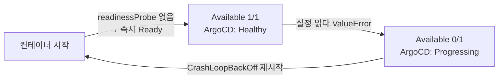
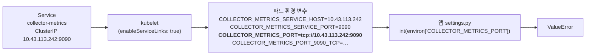

<br>

# TL;DR

- kubelet은 같은 네임스페이스의 Service마다 `{SVC}_PORT=tcp://IP:포트`, `{SVC}_SERVICE_HOST` 같은 환경 변수를 파드에 자동으로 넣는다. 매니페스트에 적지 않은 변수라도 이름이 겹치면 앱은 그 값을 자기 설정으로 읽는다
- 앱 설정 변수 접두어(`COLLECTOR_*`)와 Service 이름(`collector-metrics`)이 같은 단어에서 출발하면 `COLLECTOR_METRICS_PORT`처럼 정확히 겹치는 이름이 하나쯤 생긴다. 이번에는 수집기가 `tcp://…`를 `int()`로 읽다 죽어 1시간 반 동안 재시작을 반복했다. 로컬 시험과 CI는 kubelet이 없는 환경이라 이 충돌을 잡지 못한다
- 파드 spec에 `enableServiceLinks: false`를 두면 같은 네임스페이스 Service의 변수만 빠진다. apiserver 주소 `KUBERNETES_SERVICE_HOST`/`_PORT`, DNS, ServiceAccount 토큰은 그대로 남는다
- 직접 만드는 앱은 설정 변수 이름을 `_SERVICE_HOST`·`_SERVICE_PORT`(`_SERVICE_PORT_{포트이름}` 포함)·`_PORT`·`_PORT_{번호}_{프로토콜}*`로 끝나지 않게 짓는다. 남의 이미지는 이름을 바꿀 수 없으니 `enableServiceLinks: false`가 유일한 손잡이다

<br>

# 들어가며

사내 학습 플랫폼에서 GPU 작업 기록을 남기는 수집기를 만들고 있다. 학습이 끝나면 클러스터에서 그 학습의 오브젝트와 이벤트가 정리되어 사라지므로, 누가 언제 어떤 GPU로 무엇을 돌렸는지는 돌고 있는 동안 읽어 두지 않으면 나중에 얻을 수 없다. 그래서 클러스터를 주기적으로 읽어 DB에 쌓는 수집기를 두기로 했고 그 첫 버전을 dev 클러스터에 배포했다.

로컬 시험과 CI를 다 통과한 이미지였는데 클러스터에 올리자마자 파드가 죽고 또 죽었다. 로그 끝은 이랬다.

```python
    metrics_port=int(os.environ.get("COLLECTOR_METRICS_PORT", "9090")),
                 ^^^^^^^^^^^^^^^^^^^^^^^^^^^^^^^^^^^^^^^^^^^^^^^^^^^^^
ValueError: invalid literal for int() with base 10: 'tcp://10.43.113.242:9090'
```

죽은 줄은 환경 변수 `COLLECTOR_METRICS_PORT`를 읽어 `int()`로 바꾸는 곳이다. 이름대로 지표 서버가 열 포트 번호를 기대하는 설정이고 없으면 기본값 `"9090"`을 쓴다. 그런데 `int()`에 들어온 값은 `tcp://10.43.113.242:9090`, 숫자가 아니라 URI였다. 이 환경 변수가 비어 있지 않았고 누군가 거기에 URI를 넣었다. 매니페스트 어디에도 이 변수를 적은 적이 없었다. 값을 준 사람이 없는 변수에 값이 들어 있었다.

범인은 kubelet이었다. [컨테이너 환경 변수 글]()에서 파드 안 환경 변수의 출처를 이미지의 `ENV`, kubelet이 항상 넣는 것, kubelet이 Service마다 넣는 것, 파드 매니페스트의 `env` 네 가지로 나눈 적이 있는데 그중 세 번째가 실제로 앱을 죽였다.

같은 메커니즘으로 vLLM이 기동에 실패한 사례는 [vLLM 기동 실패 글](#예상치-못한-장애--vllm_port-env-충돌)에서 다룬 적이 있다. 그때도 매니페스트는 `VLLM_PORT`를 주지 않았다. vLLM 이미지가 읽는 변수 `VLLM_PORT`를 Service 이름 `vllm`이 채운 것이고, 변수 이름은 남이 정한 것이라 바꿀 수 없었다.

이번에는 앱도 우리가 만들었고 설정 변수 접두어 `COLLECTOR_`와 Service 이름 `collector-metrics`도 우리가 지었다. 양쪽 이름이 모두 우리 손에 있었는데도 겹쳤고 **매니페스트 어디에도 값을 주지 않은, 아무도 쓰지 않는 설정 변수 하나**가 채워져 앱은 그것을 정수로 읽으려다 죽었다. "매니페스트에 없는 변수는 비어 있다"는 직관이 여기서 깨진다.

이 글은 이 문제 상황과 트러블슈팅을 계기로 kubelet이 그 변수를 어떻게 만드는지, 끄면 무엇이 남는지, 왜 로컬과 CI에서 잡히지 않았는지를 다룬다.

<br>

# 사례 환경

수집기는 Deployment 하나다. 학습 네임스페이스의 파드·Job·이벤트와 클러스터의 노드를 30초마다 목록으로 읽어 앱 DB에 쌓는다. ArgoCD가 Git의 매니페스트를 dev 클러스터에 반영하고, 수집기는 ServiceAccount 토큰으로 apiserver를 읽고 DNS 이름으로 DB에 붙는다. Prometheus가 지표를 긁어 가도록 ClusterIP Service를 하나 붙여 두었다.

```yaml
apiVersion: apps/v1
kind: Deployment
metadata:
  name: collector
  namespace: app-dev
spec:
  replicas: 1
  template:
    metadata:
      labels:
        app.kubernetes.io/component: collector
    spec:
      serviceAccountName: collector
      containers:
        - name: collector
          image: registry.example.com/myorg/collector@sha256:…
          args: ["collect"]
          env:
            - name: COLLECTOR_TARGETS
              value: '[{"namespace": "train-dev", "resources": ["pods", "jobs", "events"]}, …]'
            - name: COLLECTOR_INTERVAL_SECONDS
              value: "30"
            - name: COLLECTOR_HEARTBEAT_FILE
              value: /tmp/collector-heartbeat
            - name: PGHOST
              value: app-postgres
            - name: PGPORT
              value: "5432"
            # PGUSER·PGPASSWORD·PGSSLMODE … 생략
          ports:
            - name: metrics
              containerPort: 9090
---
apiVersion: v1
kind: Service
metadata:
  name: collector-metrics
  namespace: app-dev
spec:
  type: ClusterIP
  selector:
    app.kubernetes.io/component: collector
  ports:
    - name: metrics
      port: 9090
      targetPort: metrics
```

수집기 앱은 설정을 환경 변수에서 읽도록 구현해 두었다. 읽는 환경 변수의 접두어는 `COLLECTOR_`다.

```python
@classmethod
def from_env(cls) -> CollectorSettings:
    # apiserver 주소. 매니페스트가 아니라 kubelet이 모든 파드에 넣어 주는 변수다 — 뒤에서 다시 나온다
    host = os.environ.get("KUBERNETES_SERVICE_HOST")
    port = os.environ.get("KUBERNETES_SERVICE_PORT", "443")
    if not host:
        raise SettingsError("KUBERNETES_SERVICE_HOST 가 없다 — 클러스터 안에서만 돈다")
    return cls(
        # 아래 COLLECTOR_* 는 매니페스트의 env 로 준다 (위 Deployment 의 env 목록)
        targets=parse_targets(os.environ.get("COLLECTOR_TARGETS", "")),
        interval_seconds=int(os.environ.get("COLLECTOR_INTERVAL_SECONDS", "30")),
        # 지표 서버 포트. 매니페스트가 값을 주지 않아 기본값 9090 으로만 쓰인다.
        # containerPort·Service 포트도 9090 고정이고, 시험은 env 대신 생성자로 metrics_port=0 을 넘긴다
        metrics_port=int(os.environ.get("COLLECTOR_METRICS_PORT", "9090")),
        heartbeat_file=os.environ.get("COLLECTOR_HEARTBEAT_FILE", "/tmp/collector-heartbeat"),
        …
    )
```

`COLLECTOR_METRICS_PORT`를 눈여겨보자. 이 변수는 꼭 줘야 하는 설정이 아니다. 주면 그 값으로, 안 주면 9090으로 지표 서버를 열도록 해 둔 선택적 손잡이다. 다른 설정처럼 env로 덮어쓸 수 있게 해 두자는 습관으로 만들었는데, 정작 포트는 `containerPort`·Service·Dockerfile에서 모두 9090으로 고정이라 바꿀 일이 없었다. 그래서 위 Deployment의 `env` 목록에도, 시험 코드에도 이 변수에 값을 주는 곳이 없다. 기본값으로만 쓰이는, 있을 이유가 없는 설정이었다.

<br>

# 증상

인프라 PR이 머지되고 ArgoCD가 앱 DB → 마이그레이션 → 수집기 순으로 반영을 마쳤다. 반영 직후 ArgoCD Application은 `Synced` / `Healthy`였다. 그런데 수집기 파드가 재시작을 반복했다.

```bash
$ kubectl -n app-dev get pod -l app.kubernetes.io/component=collector
NAME                         READY   STATUS             RESTARTS      AGE
collector-bd7c99fc6-7bgrk    0/1     CrashLoopBackOff   5 (30s ago)   4m

$ kubectl -n app-dev logs deploy/collector --tail=5
    metrics_port=int(os.environ.get("COLLECTOR_METRICS_PORT", "9090")),
                 ^^^^^^^^^^^^^^^^^^^^^^^^^^^^^^^^^^^^^^^^^^^^^^^^^^^^^
ValueError: invalid literal for int() with base 10: 'tcp://10.43.113.242:9090'
```

`int()`에 들어간 값이 `tcp://10.43.113.242:9090`이다. 매니페스트가 주지 않은 변수에 값이 들어 있는데 심지어 그 값이 URI다.

파드는 죽고 있는데, 아이러니하게 ArgoCD에서 본 Application 배포 상태는 `Healthy`였다. 모순처럼 보이지만 ArgoCD가 Deployment를 어떻게 판정하는지 따라가면 설명이 된다.

ArgoCD는 Deployment의 `Available` 레플리카가 기대 수만큼 있으면 `Healthy`, 모자라면 `Progressing`으로 본다. `Available`은 파드가 Ready일 때 세고 Ready는 readinessProbe가 있으면 프로브가 통과한 뒤에, 없으면 컨테이너가 뜨는 즉시 된다. 이 수집기에는 readinessProbe가 없다. 그래서 컨테이너가 뜨는 순간 Ready → `Available` → `Healthy`가 되고, 몇 초 뒤 설정을 읽다 죽으면 `Progressing`으로 떨어지며, 다음 재시작에서 다시 `Healthy`가 된다.



반영 직후 조회는 이 순환에서 `Healthy`인 순간을, 2분 뒤 조회는 `Progressing`인 순간을 봤다. ArgoCD 상태는 "컨테이너가 떴다"까지만 말해 준다. 이 수집기의 기동 성공은 로그의 "수집 시작" 줄과 DB의 대상 상태 표로 판정해야 했다.

<br>

# 진단

풀어야 할 질문은 두 가지다.
1. 매니페스트가 주지 않은 `COLLECTOR_METRICS_PORT`에 누가 값을 넣었나
2. 왜 하필 URI인가.

단서는 값의 꼴 `tcp://IP:포트`다. 어딘가 낯이 익다. kubelet은 파드와 같은 네임스페이스에 Service가 있으면 그 이름을 딴 환경 변수를 파드에 넣어 주는데, 그중 `{SVC}_PORT`라는 변수의 값이 정확히 `tcp://ClusterIP:포트` 꼴이다. 환경 변수의 다른 출처(이미지 `ENV`, 매니페스트 `env`)는 사람이 적은 값만 넣으니, 적은 적 없는 URI를 만들어 낼 수 있는 곳은 여기뿐이다.

그렇다면 Service 이름 `collector-metrics`가 `COLLECTOR_METRICS_PORT`를 만들었다는 가설이 선다. 이 가설이 맞다면 세 가지가 들어맞아야 한다.

1. 값의 IP·포트와 일치하는 Service가 같은 네임스페이스에 있다
2. 그 변수를 넣을지 정하는 파드 spec 필드 `enableServiceLinks`가 켜져 있다(기본값 `true`)
3. 컨테이너 env 목록에는 `COLLECTOR_METRICS_PORT`가 없다(있었다면 그쪽이 이겼을 것이다)

차례로 확인했다.

```bash
# 1. 같은 네임스페이스의 Service collector-metrics 의 ClusterIP·포트가 오류 값 tcp://10.43.113.242:9090 과 같은가
$ kubectl -n app-dev get svc collector-metrics -o jsonpath='clusterIP={.spec.clusterIP} port={.spec.ports[0].port}{"\n"}'
clusterIP=10.43.113.242 port=9090

# 2. 파드 spec 의 enableServiceLinks 가 꺼져 있지 않은가 (비어 있으면 기본값 true)
$ kubectl -n app-dev get deploy collector -o jsonpath='enableServiceLinks={.spec.template.spec.enableServiceLinks}{"\n"}'
enableServiceLinks=

# 3. 컨테이너 env 목록에 COLLECTOR_METRICS_PORT 가 없는가 (있으면 그 값이 Service 변수를 덮었을 것)
$ kubectl -n app-dev get deploy collector -o jsonpath='{.spec.template.spec.containers[0].env[*].name}{"\n"}'
COLLECTOR_TARGETS COLLECTOR_INTERVAL_SECONDS COLLECTOR_HEARTBEAT_FILE PGHOST PGPORT PGDATABASE PGUSER PGPASSWORD PGSSLMODE PGCONNECT_TIMEOUT PGOPTIONS
```

- 오류 값 `tcp://10.43.113.242:9090`은 Service `collector-metrics`의 ClusterIP와 포트다
- `enableServiceLinks`는 비어 있다. 비어 있으면 켜진 것이다. 기본값 `true`는 Deployment 템플릿이 아니라 Pod 객체를 만들 때 붙기 때문에 템플릿 조회에는 찍히지 않는다([defaults.go#L204-L207](https://github.com/kubernetes/kubernetes/blob/release-1.33/pkg/apis/core/v1/defaults.go#L204-L207), 기본값은 [types.go#L4437](https://github.com/kubernetes/kubernetes/blob/release-1.33/staging/src/k8s.io/api/core/v1/types.go#L4437))
- 컨테이너 env 목록에 `COLLECTOR_METRICS_PORT`는 없다

죽는 파드라 `exec`가 안 될 때는 같은 네임스페이스에 임시 파드를 띄워 어떤 서비스 링크 변수가 들어오는지 직접 볼 수 있다.

```bash
kubectl -n app-dev run tmp --rm -it --restart=Never --image=busybox -- env | grep '_PORT='
```

확인 결과를 합쳐 보면 kubelet이 Service 이름 `collector-metrics`를 대문자와 밑줄로 바꿔 `COLLECTOR_METRICS_PORT=tcp://10.43.113.242:9090`을 넣었고 앱은 그 이름을 자기 설정으로 읽었다.



<br>

# 원인

원인은 두 단계로 나눠 적었다. [요약](#요약)에는 kubelet이 무엇을 하는지 결과만 적었고 그 근거를 소스에서 확인한 과정은 [kubelet 소스로 따라가기](#kubelet-소스로-따라가기)에 따로 뒀다. 소스까지 볼 생각이 없다면 [이름이 겹친 이유](#이름이-겹친-이유)까지만 읽고 [해결](#해결)로 넘어가도 이 글을 따라가는 데 지장이 없다.

## 요약

kubelet은 파드의 컨테이너를 만들 때 환경 변수를 두 묶음으로 조립한다. 컨테이너 spec의 `env`를 먼저 넣고 Service에서 만든 변수는 그 이름이 아직 없을 때만 덧붙인다. 그래서 같은 이름이면 `env`가 이긴다. [컨테이너 환경 변수 글]()의 "파드 매니페스트가 우선순위가 가장 높다"가 이 순서다.

Service에서 만드는 변수는 다시 두 묶음으로 나뉜다.

| 묶음 | 대상 | `enableServiceLinks`의 영향 |
|---|---|---|
| apiserver | `default` 네임스페이스의 `kubernetes` Service → `KUBERNETES_SERVICE_HOST`, `KUBERNETES_SERVICE_PORT`, `KUBERNETES_PORT*` | 없음. 항상 넣는다 |
| 서비스 링크 | 파드와 같은 네임스페이스의 모든 Service → `{SVC}_SERVICE_HOST`, `{SVC}_SERVICE_PORT`, `{SVC}_PORT`, `{SVC}_PORT_{n}_{proto}*` | `true`(기본값)일 때만 넣는다 |

둘째 묶음에서 보는 것은 네임스페이스와 플래그뿐이다. Service가 이 파드를 selector로 가리키든 말든 상관없다. 같은 네임스페이스에 있기만 하면 변수가 들어간다. 두 묶음 모두 ClusterIP가 있는 Service만 대상이라 headless Service(`clusterIP: None`)는 변수를 만들지 않는다.

변수 이름은 Service 이름을 대문자로 바꾸고 `-`를 `_`로 바꿔 만든다. `collector-metrics`는 `COLLECTOR_METRICS`가 된다. 이 접두어에 `_PORT`가 붙은 변수의 값이 `tcp://ClusterIP:포트`다. Docker의 레거시 컨테이너 링크(`docker run --link`)가 만들던 변수 꼴을 그대로 따른 것이라 값이 URI다. `{SVC}_PORT`는 Service의 첫 포트에만 생기고 포트마다 `{SVC}_PORT_{번호}_{프로토콜}`과 그 뒤에 `_PROTO`·`_PORT`·`_ADDR`가 붙은 변수가 따로 생긴다.

이번 사례에서 매니페스트의 `env`에는 `COLLECTOR_METRICS_PORT`가 없었다. 그래서 덮어쓸 것이 없었고 서비스 링크가 만든 값이 그대로 앱에 도달했다. 반대로 매니페스트에 `COLLECTOR_METRICS_PORT: "9090"`을 명시했다면 그쪽이 이겨서 문제가 드러나지 않았을 것이다. 쓰는 곳이 없는 설정이라 아무도 값을 주지 않았고 그 탓에 수집기가 죽었다.

## 이름이 겹친 이유

접두어만 같아서는 겹치지 않는다. 두 이름을 나란히 놓으면 어디서 맞아떨어졌는지 보인다.

```text
앱 설정:   COLLECTOR_ + METRICS_PORT
Service:   collector-metrics → COLLECTOR_METRICS + _PORT
```

앱 설정 접두어 `COLLECTOR_`가 Service 이름의 첫 단어와 같고, 설정 이름 `METRICS_PORT`가 Service 이름의 나머지 `metrics`에 `_PORT`를 붙인 것과 같다. 둘 다 맞아야 한 글자도 안 틀리고 겹친다. 이번에 그렇게 된 것은 우연이라기보다 둘이 같은 것을 가리키는 이름이기 때문이다. 수집기의 지표 포트 설정은 `METRICS_PORT`라 짓고, 수집기의 지표 Service는 `collector-metrics`라 짓는 것이 각각 자연스러운 작명인데, kubelet의 변환을 거치면 이 둘이 같은 자리에서 만난다.

이 네임스페이스의 다른 Service(앱 DB의 `app-postgres*`, 화면의 `web`)가 만드는 접두어 `APP_POSTGRES_`, `WEB_`은 앱이 읽는 어떤 변수와도 겹치지 않았다. 겹치는 것은 `COLLECTOR_METRICS_PORT` 하나였다. DB 접속에 쓰는 PostgreSQL 클라이언트(libpq) 변수 `PGHOST`, `PGPORT`는 `PG` 뒤에 밑줄이 없어 어떤 Service 이름으로도 만들어질 수 없다.

같은 꼴의 충돌은 다른 곳에서도 보고된다. Service 이름이 `redis`면 `REDIS_PORT=tcp://…`가 들어가는데 `REDIS_PORT`를 포트 번호로 읽는 클라이언트 라이브러리가 많다. vLLM의 `VLLM_PORT`도 같은 경우다.

## kubelet 소스로 따라가기

[요약](#요약)의 세 가지 사실을 kubelet 소스에서 확인한다. 2026년 10월 release-1.33 기준이고 어느 파일의 어느 함수를 봐야 하는지는 AI의 도움을 받아 찾아 따라갔다. 아래 발췌와 줄 링크는 그 결과를 소스와 대조한 것이다.

**조립 순서.** `makeEnvironmentVariables`의 끝부분이다. 컨테이너 `env`(`tmpEnv`)를 먼저 결과에 넣고, Service 변수(`serviceEnv`)는 같은 이름이 없을 때만 덧붙인다([kubelet_pods.go#L905-L919](https://github.com/kubernetes/kubernetes/blob/release-1.33/pkg/kubelet/kubelet_pods.go#L905-L919)).

<details markdown="1">
<summary><b>kubelet 소스 — makeEnvironmentVariables: 컨테이너 env 먼저, Service 변수는 이름이 없을 때만</b></summary>

```go
// pkg/kubelet/kubelet_pods.go — makeEnvironmentVariables
	// Append the env vars
	for k, v := range tmpEnv {            // tmpEnv = 컨테이너 spec의 env·envFrom
		result = append(result, kubecontainer.EnvVar{Name: k, Value: v})
	}

	// Append remaining service env vars.
	for k, v := range serviceEnv {        // serviceEnv = Service에서 만든 변수
		…
		if _, present := tmpEnv[k]; !present {   // 같은 이름이 이미 있으면 건너뛴다
			result = append(result, kubecontainer.EnvVar{Name: k, Value: v})
		}
	}
```

</details>

**두 묶음.** `serviceEnv`는 같은 파일의 `getServiceEnvVarMap`이 만든다. `if` 분기가 첫 묶음(`default` 네임스페이스의 `kubernetes` Service, 플래그와 무관), `else if` 분기가 둘째 묶음(같은 네임스페이스의 Service, `enableServiceLinks`가 켜졌을 때만)이다. 앞머리의 `IsServiceIPSet` 검사가 headless Service를 거른다([kubelet_pods.go#L656-L696](https://github.com/kubernetes/kubernetes/blob/release-1.33/pkg/kubelet/kubelet_pods.go#L656-L696)).

<details markdown="1">
<summary><b>kubelet 소스 — getServiceEnvVarMap: 두 묶음을 가르는 if / else if</b></summary>

```go
// pkg/kubelet/kubelet_pods.go — getServiceEnvVarMap
var masterServices = sets.New[string]("kubernetes")

func (kl *Kubelet) getServiceEnvVarMap(ns string, enableServiceLinks bool) (map[string]string, error) {
	…
	for i := range services {
		service := services[i]
		// ignore services where ClusterIP is "None" or empty
		if !v1helper.IsServiceIPSet(service) {
			continue
		}
		serviceName := service.Name

		// We always want to add environment variabled for master services
		// from the default namespace, even if enableServiceLinks is false.
		// We also add environment variables for other services in the same
		// namespace, if enableServiceLinks is true.
		if service.Namespace == metav1.NamespaceDefault && masterServices.Has(serviceName) {
			if _, exists := serviceMap[serviceName]; !exists {
				serviceMap[serviceName] = service
			}
		} else if service.Namespace == ns && enableServiceLinks {
			serviceMap[serviceName] = service
		}
	}
```

</details>

**이름과 값.** `pkg/kubelet/envvars/envvars.go`의 `makeEnvVariableName`이 이름을 변환하고([envvars.go#L64-L70](https://github.com/kubernetes/kubernetes/blob/release-1.33/pkg/kubelet/envvars/envvars.go#L64-L70)), `makeLinkVariables`가 `_PORT`를 붙여 `tcp://ClusterIP:포트` 값을 만든다([envvars.go#L72-L110](https://github.com/kubernetes/kubernetes/blob/release-1.33/pkg/kubelet/envvars/envvars.go#L72-L110)). 주석의 "Docker special-cases the first port"에 따라 `{SVC}_PORT`는 첫 포트에만 생긴다.

<details markdown="1">
<summary><b>kubelet 소스 — makeEnvVariableName · makeLinkVariables: 이름 변환과 tcp://… 값 조립</b></summary>

```go
// pkg/kubelet/envvars/envvars.go
func makeEnvVariableName(str string) string {
	…
	return strings.ToUpper(strings.Replace(str, "-", "_", -1))   // collector-metrics → COLLECTOR_METRICS
}

func makeLinkVariables(service *v1.Service) []v1.EnvVar {
	prefix := makeEnvVariableName(service.Name)
	all := []v1.EnvVar{}
	for i := range service.Spec.Ports {
		sp := &service.Spec.Ports[i]
		…
		hostPort := net.JoinHostPort(service.Spec.ClusterIP, strconv.Itoa(int(sp.Port)))

		if i == 0 {
			// Docker special-cases the first port.
			all = append(all, v1.EnvVar{
				Name:  prefix + "_PORT",                                          // COLLECTOR_METRICS_PORT
				Value: fmt.Sprintf("%s://%s", strings.ToLower(protocol), hostPort), // tcp://10.43.113.242:9090
			})
		}
		portPrefix := fmt.Sprintf("%s_PORT_%d_%s", prefix, sp.Port, strings.ToUpper(protocol))
		all = append(all, []v1.EnvVar{
			{Name: portPrefix, Value: fmt.Sprintf("%s://%s", strings.ToLower(protocol), hostPort)},
			{Name: portPrefix + "_PROTO", Value: strings.ToLower(protocol)},
			{Name: portPrefix + "_PORT", Value: strconv.Itoa(int(sp.Port))},
			{Name: portPrefix + "_ADDR", Value: service.Spec.ClusterIP},
		}...)
	}
	return all
}
```

</details>

> **참고**: Docker 레거시 컨테이너 링크
>
> 사용자 정의 네트워크와 내장 DNS가 생기기 전(Docker 1.9, 2015년 이전) 기본 브리지 네트워크에서 컨테이너끼리 서로를 찾는 방법이었다. `docker run --link <컨테이너>:<별칭>`으로 띄우면 Docker가 받는 쪽 컨테이너에 두 가지를 해 준다. `/etc/hosts`에 별칭을 등록하고 상대 컨테이너의 IP·포트를 환경 변수로 넣어 준다.
>
> ```bash
> docker run -d --name redis redis
> docker run --link redis:redis app      # app 컨테이너 안에 다음 변수가 생긴다
> ```
>
> ```bash
> REDIS_PORT=tcp://172.17.0.2:6379
> REDIS_PORT_6379_TCP=tcp://172.17.0.2:6379
> REDIS_PORT_6379_TCP_PROTO=tcp
> REDIS_PORT_6379_TCP_PORT=6379
> REDIS_PORT_6379_TCP_ADDR=172.17.0.2
> ```
>
> 별칭을 대문자로 바꾼 접두어, 첫 포트만 받는 `_PORT`, `tcp://IP:포트` 값, 포트마다 붙는 `_PROTO`·`_PORT`·`_ADDR`. 위 `makeLinkVariables`가 만드는 것과 같은 꼴이다(차이는 "첫 포트"의 기준뿐이다. Docker는 노출 포트 중 번호가 가장 낮은 것, Kubernetes는 Service 포트 목록의 첫 항목이다). Kubernetes는 초기부터 이 변수를 읽도록 짜인 앱이 그대로 돌게 하려고 같은 이름과 값을 넣기로 했고, 거기에 자기 몫으로 `_SERVICE_HOST`·`_SERVICE_PORT`를 더했다. Docker 쪽에서는 사용자 정의 네트워크의 DNS로 대체되어 "legacy"라 부르며 제거 예정으로 두었고, Kubernetes 쪽에서도 DNS가 표준이 된 뒤 이 변수는 호환용으로만 남았다. 그 호환용 변수가 10년 뒤 이름 충돌을 냈다.

<br>

# 해결

## 대안

고칠 수 있는 자리는 인프라 매니페스트와 앱 코드 두 곳이다.

| 방법 | 어디서 | 막는 범위 | 반영까지 |
|---|---|---|---|
| ① 서비스 링크 끄기(`enableServiceLinks: false`) | 인프라 매니페스트 한 줄 | 이 파드에 들어오는 서비스 링크 변수 전부. 앞으로 Service를 더해도 겹칠 일이 없다 | 머지 즉시 |
| ② 앱 변수 이름 바꾸기 | 앱 PR → 이미지 빌드 → 매니페스트의 이미지 digest(`@sha256:…`) 갱신 PR | 이 이름 하나. `_PORT`로 끝나는 다른 이름은 여전히 겹칠 수 있다 | 이미지 한 바퀴 |
| ③ 앱에서 그 변수를 없애고 9090 고정 | ②와 같은 경로 | 이 이름 자체가 사라진다(쓰지 않는 설정 제거) | 이미지 한 바퀴 |

①은 당장 수집기를 살리는 데 가장 빠르고 ②·③은 앱 이미지를 다시 빌드해 배포하는 한 바퀴가 필요하다. ②는 이름만 바꾸는 것이라 `_PORT`로 끝나는 다른 설정이 생기면 같은 일이 반복되고, ③은 쓰지 않는 설정을 지우는 것이라 이 이름이 아예 사라진다.

## 서비스 링크 해제 시 남는 변수

①을 고르려면 먼저 확인할 것이 있었다. 수집기는 apiserver 주소를 `KUBERNETES_SERVICE_HOST`/`_PORT`에서 읽는다. 서비스 링크를 끄면 이것까지 빠지는가.

| 수집기가 찾는 것 | 찾는 방법 | 끈 뒤 |
|---|---|---|
| 앱 DB | `PGHOST=app-postgres`(DNS 이름) | 영향 없음. DNS는 이 설정과 별개다 |
| apiserver | `KUBERNETES_SERVICE_HOST`/`_PORT` | 남는다. kubelet은 `default/kubernetes` Service 변수를 이 설정과 상관없이 넣는다 |
| ServiceAccount 토큰·CA | 마운트된 파일 | 영향 없음 |
| 지표 포트 | 자기 설정(기본 9090) | ③ 없이 끄기만 해도 기본값 9090이 제대로 읽힌다 |

리뷰 셋 모두 "apiserver 변수는 남는다"고 답했지만 kubelet 소스를 대조하지는 못했다. 기억에 기댄 판단이었다. 같은 클러스터에서 `enableServiceLinks: false`로 도는 파드들(cert-manager, NFD)이 방증이지만 셸도 `printenv`도 없는 최소 이미지라 그 자리에서 확인하지는 않았다(`kubectl debug`로 임시 컨테이너를 붙여 `/proc/1/environ`을 읽는 방법은 있다). 그래서 수정 뒤 수집기 파드 안에서 직접 찍었다. 값 셋만 찍은 것은 env 전체를 찍으면 `PGPASSWORD`가 같이 나오기 때문이다.

```bash
$ kubectl -n app-dev exec deploy/collector -- python -c \
    'import os; print([os.environ.get(k) for k in ("KUBERNETES_SERVICE_HOST","KUBERNETES_SERVICE_PORT","COLLECTOR_METRICS_PORT")])'
['10.43.0.1', '443', None]

$ kubectl -n app-dev logs deploy/collector --tail=1
… INFO collector.run 수집 시작 run=1 대상 7개 주기 30s
```

`KUBERNETES_SERVICE_HOST`/`_PORT`는 남고 겹치던 `COLLECTOR_METRICS_PORT`는 없다. 수집기가 apiserver 목록 읽기와 DB 접속을 포함한 시작 점검을 통과해 첫 주기를 돌았다.

> **참고**: 끄는 범위
>
> `enableServiceLinks: false`는 "같은 네임스페이스 Service의 변수"만 뺀다. `kubernetes` Service 변수, DNS, ServiceAccount 토큰은 이 필드와 무관하다. [kubelet 소스로 따라가기](#kubelet-소스로-따라가기)의 `getServiceEnvVarMap`에서 `if` 분기가 `enableServiceLinks`를 보지 않는 것이 그 근거다. 지금은 "Service마다 환경 변수가 자동으로 들어가고, 끄면 같은 네임스페이스 것만 빠진다"까지만 알면 충분하다.
>
> 하나 더. 서비스 링크 변수는 파드가 만들어지는 시점에 있던 Service의 스냅샷이다. 공식 문서는 이 방식으로 Service를 찾으려면 클라이언트 파드보다 Service를 먼저 만들어야 하고 DNS를 쓰면 순서를 신경 쓸 필요가 없다고 적는다. Service가 나중에 바뀌어도 컨테이너는 재시작되지 않으니 이 변수를 읽어 다른 Service를 찾는 앱은 오래된 주소를 들고 있을 수 있다. 끄는 쪽이 기본인 이유가 하나 더 있다.

## 선택과 적용

①과 ③을 둘 다 했다. ①만 있으면 나중에 누가 이 줄을 빼거나 새 Deployment에 빠뜨렸을 때 다시 겹친다. ③만으로는 이미지가 한 바퀴 도는 동안 수집기가 계속 죽어 있다. ③은 코드를 줄이는 변경이라 비용이 거의 없다. 그래서 ①로 먼저 살리고 이미 계획된 다음 앱 PR에 ③을 넣었다.

인프라 쪽은 파드 spec에 한 줄과 주석이다.

```yaml
    spec:
      serviceAccountName: collector
      # Service 마다 kubelet 이 넣는 <이름>_PORT 등의 env 를 끈다 — Service collector-metrics 가 만드는
      # COLLECTOR_METRICS_PORT=tcp://… 가 수집기 설정 env 와 이름이 겹쳐 기동이 실패한다. DB 는 PGHOST(DNS)로 찾고,
      # apiserver 주소 KUBERNETES_SERVICE_HOST/_PORT(수집기가 쓴다)는 이 설정과 무관하게 들어간다
      enableServiceLinks: false
```

앱 쪽은 `from_env`의 해당 줄에서 env 읽기를 지우고 고정값으로 바꿨다. 시험이 생성자로 `metrics_port=0`을 넘기므로 `CollectorSettings`의 `metrics_port` 필드는 남겨 두었다.

```python
        # containerPort·Service 와 같은 고정 값 — env 로 두면 Service collector-metrics 의
        # 서비스 링크 env(COLLECTOR_METRICS_PORT=tcp://…)와 겹친다
        metrics_port=9090,
```

## 한계

둘 다 해도 이번 수집기 하나만 고쳤다. 남는 구멍이 셋 있다.

- ①은 파드 spec마다 넣어야 한다. 네임스페이스나 클러스터 기본값이 없어서 새 Deployment에 빠뜨리면 그 파드에서 다시 겹친다
- ③은 `COLLECTOR_METRICS_PORT` 하나를 지운 것이다. 다음 설정 이름이 또 `_PORT`로 끝나면 같은 일이 생긴다
- 둘 다 기동 실패를 더 빨리 알아채게 해 주지는 않는다. readinessProbe가 없는 한 ArgoCD는 다음 실패도 `Healthy`로 보인다

이 셋을 메우는 것이 다음 절이다.

<br>

# 재발 방지

## 사전 검출 실패 경위

수집기는 머지 전에 로컬 시험, CI의 이미지 검사, 리뷰 세 번을 거쳤다. 전부 통과했다.

| 단계 | 환경 | 서비스 링크 변수 |
|---|---|---|
| 로컬 pytest | 개발 머신 | 없음 |
| CI 이미지 검사 | `docker run` | 없음. kubelet이 아니라 Docker가 띄운다 |
| 코드 리뷰 | 코드와 매니페스트만 | 읽는 사람이 Service 이름과 env 접두어를 나란히 놓지 않으면 보이지 않는다 |

서비스 링크 변수는 kubelet이 파드를 만들 때 넣는다. kubelet이 없는 환경에서는 어떤 시험도 이 충돌을 재현하지 못한다. 처음 클러스터에 올라간 순간이 첫 시험이었다.

시간순으로 보면 이렇다. 수집기가 죽어 있던 1시간 반 동안 DB에는 아무것도 쓰이지 않았다. 설정을 읽다 죽어 접속까지 가지 못했기 때문이다. 알림 규칙 둘 중 "수집기 지표 없음"(지표가 10분간 없음)이 울려 장애를 잡았다. "CrashLoopBackOff"(15분 안 재시작 5회 초과가 15분 지속)는 울리지 않았다. 재시작 간격이 10초에서 두 배씩 늘어 5분 상한에 닿으면 15분에 3회라 임계에 못 미친다. 처음 15분만 조건이 참이었고 지속 시간을 채우기 전에 풀렸다.

| 시각(KST) | 일 |
|---|---|
| 14:33 | 인프라 PR 머지, ArgoCD 반영 |
| 14:34 | 수집기 첫 기동 실패, 재시작 시작 |
| 14:44 | "수집기 지표 없음" 알림 |
| 16:00 | `enableServiceLinks: false` PR 머지 |
| 16:01 | 새 파드 첫 수집, 재시작 0 |
| 16:02 | 알림 해제 |

머지 시각은 14:33이지만 수집 시작 시각은 DB에 남은 첫 수집 주기 16:01이다. 그 사이 끝나고 정리된 오브젝트와 1시간이 지난 이벤트는 다시 얻지 못한다.

로컬·CI·리뷰 어디에서도 잡히지 않는 부류이니, 막으려면 앱의 이름 규칙과 인프라의 기본 설정, 그리고 기동 실패 감지 세 층에서 막아야 한다. [해결](#해결)의 한계 셋에 하나씩 대응한다.

## 앱: 설정 변수 이름 규칙

서비스 링크 변수의 꼴은 `_SERVICE_HOST`, `_SERVICE_PORT`, `_SERVICE_PORT_{포트이름}`, `_PORT`, `_PORT_{번호}_{프로토콜}`(과 그 뒤에 `_PROTO`·`_PORT`·`_ADDR`가 붙은 것)로 정해져 있다. 설정 변수 이름을 이 꼴로 끝나지 않게 지으면 어떤 Service 이름과도 겹치지 않는다. 앱 README에 한 줄을 두고 소스에서 `environ`으로 읽는 이름을 훑는 정적 시험을 하나 더했다.

```python
def test_no_service_link_shaped_env_names():
    # kubelet 이 같은 네임스페이스 Service 마다 넣는 <이름>_PORT·_SERVICE_HOST·_SERVICE_PORT* 와 겹치는 이름을 설정에 쓰지 않는다
    read = re.compile(r'environ(?:\.get)?[(\[]\s*"([A-Z0-9_]+)"')
    link = re.compile(r"_(PORT|SERVICE_HOST|SERVICE_PORT)(_|$)")
    hits = [n for p in SRC.rglob("*.py") for n in read.findall(p.read_text())
            if link.search(n) and n not in ("KUBERNETES_SERVICE_HOST", "KUBERNETES_SERVICE_PORT")]
    assert hits == []
```

이 시험은 `os.environ.get("…")` 꼴만 본다. pydantic-settings처럼 필드 이름에서 env 이름을 만드는 방식을 쓰면 잡지 못한다. 이름 규칙은 직접 만드는 앱에만 적용할 수 있다. vLLM이나 Redis 클라이언트처럼 남의 이미지가 읽는 변수 이름은 바꿀 수 없으니 그쪽은 아래 인프라 설정으로만 막을 수 있다.

## 인프라: enableServiceLinks 기본 적용

이 네임스페이스의 파드는 모두 DNS로 서로를 찾는다. 서비스 링크 변수를 읽는 곳이 없으니 앱 파드에 `enableServiceLinks: false`를 기본으로 둔다. [vLLM 기동 실패 글](#운영-함정-3가지)에서도 같은 결론을 냈다.

그런데 이게 원래 권장되는 방법인지, 권장이라면 Kubernetes는 왜 아직 기본으로 넣어 주는지가 궁금해서 찾아봤다(2026년 10월 기준).

- **공식 문서의 권고는 "DNS를 써라"까지다.** [Service 문서](https://kubernetes.io/docs/concepts/services-networking/service/#discovering-services)는 서비스를 찾는 방법으로 환경 변수와 DNS 둘을 소개하고 DNS 애드온은 "almost always should" 설치하라고 적는다. 환경 변수 방식에는 Service를 클라이언트 파드보다 먼저 만들어야 한다는 제약을 적어 두었다. 끄라는 말은 없다.
- **끄는 옵션 자체가 "DNS를 쓰라"는 뜻으로 만들어졌다.** `enableServiceLinks`를 도입한 [PR #68754](https://github.com/kubernetes/kubernetes/pull/68754)(1.13)의 설명은 "Services should be accessed by DNS, not by environment variables"로 시작한다. 이 변수가 Docker의 deprecated `--link`에서 온 것이라는 점도 함께 적었다.
- **기본값을 `false`로 바꾸자는 요청은 두 번 있었고 기본값은 그대로다.** 2020년 [#92226](https://github.com/kubernetes/kubernetes/issues/92226)에 메인테이너 liggitt은 "changing defaults in an existing API is not backwards compatible", "changing this particular default would break many existing users"라고 답하고 닫았다. 2023년 [#121787](https://github.com/kubernetes/kubernetes/issues/121787)에서는 Service가 많은 네임스페이스에서 변수가 수천 개로 불어 Java 컨테이너가 죽은 사례까지 붙었고, thockin도 "the 'I want a different default' case is THE motivation"이라고 인정했지만 결론은 같았다. "Changing defaults is a breaking change." 기본값을 바꾸려면 core API를 v2로 올려야 한다는 얘기까지 나왔다.
- **그래서 메인테이너가 가리킨 방법이 정책 엔진이다.** 같은 이슈에서 thockin은 "Using gatekeeper or kyverno is something that can work NOW"라고 적었다. 기본값은 못 바꾸니 클러스터 운영자가 admission 단계에서 `false`를 넣으라는 것이다.

정리하면 이렇다. 이 변수는 Docker `--link` 호환용으로 처음부터 있었고 프로젝트는 DNS로 옮겨 가라고 말하면서도 core/v1 API의 하위 호환 약속 때문에 기본값은 손대지 못한다. "주입하지 않는 쪽으로 바뀌어 왔어야 하지 않나"는 질문에 답하자면, 그 변화는 API 기본값 대신 **운영자의 정책 층**에서 일어나야 한다. 이 필드는 파드 spec에만 있고 네임스페이스나 클러스터 수준 기본값이 없다. 그래서 Helm 공통 차트나 Kustomize base에 심어 두거나, Kyverno 같은 정책 엔진의 mutate 규칙으로 필드가 없을 때만 `false`를 넣는 식으로 강제한다. 이 변수를 실제로 읽는 앱이 네임스페이스에 있는지만 먼저 확인하면 된다.

## 인프라: 기동 실패 감지

이 수집기에는 readinessProbe가 없어 ArgoCD가 기동 실패를 보지 못했다. heartbeat 파일을 확인하는 readinessProbe나 `minReadySeconds`를 두면 설정을 읽다 죽는 파드는 `Available`로 잡히지 않고, `progressDeadlineSeconds`가 지나면 ArgoCD가 `Degraded`로 알린다. 이 수집기에는 아직 두지 않았다.

<br>

# 정리

- kubelet은 파드와 같은 네임스페이스의 Service마다 `{SVC}_PORT=tcp://IP:포트` 꼴의 환경 변수를 넣는다. 매니페스트에 없는 변수라도 앱이 그 이름을 읽으면 그 값이 들어간다
- 앱 설정 접두어와 Service 이름이 같은 단어에서 출발하면 `_PORT`로 끝나는 이름 하나가 정확히 겹친다. 이번에는 아무도 쓰지 않는 설정이 그 하나였다
- kubelet이 없는 로컬·CI 환경에서는 재현되지 않아 클러스터에 처음 올린 뒤에야 드러난다. readinessProbe가 없으면 ArgoCD `Healthy`도 판정 근거가 아니다
- `enableServiceLinks: false`는 같은 네임스페이스 Service의 변수만 뺀다. `KUBERNETES_SERVICE_HOST`/`_PORT`, DNS, ServiceAccount 토큰은 남는다. 리뷰가 기억으로 답한 것은 파드 안에서 값을 찍어 확인한다
- 인프라는 `enableServiceLinks: false`를 앱 파드의 기본으로 둔다. 직접 만드는 앱은 설정 변수 이름을 `_PORT`·`_SERVICE_HOST`·`_SERVICE_PORT`로 끝나지 않게 짓고 쓰지 않는 설정은 지운다. 남의 이미지는 이름을 바꿀 수 없으니 끄는 수밖에 없다

<br>
