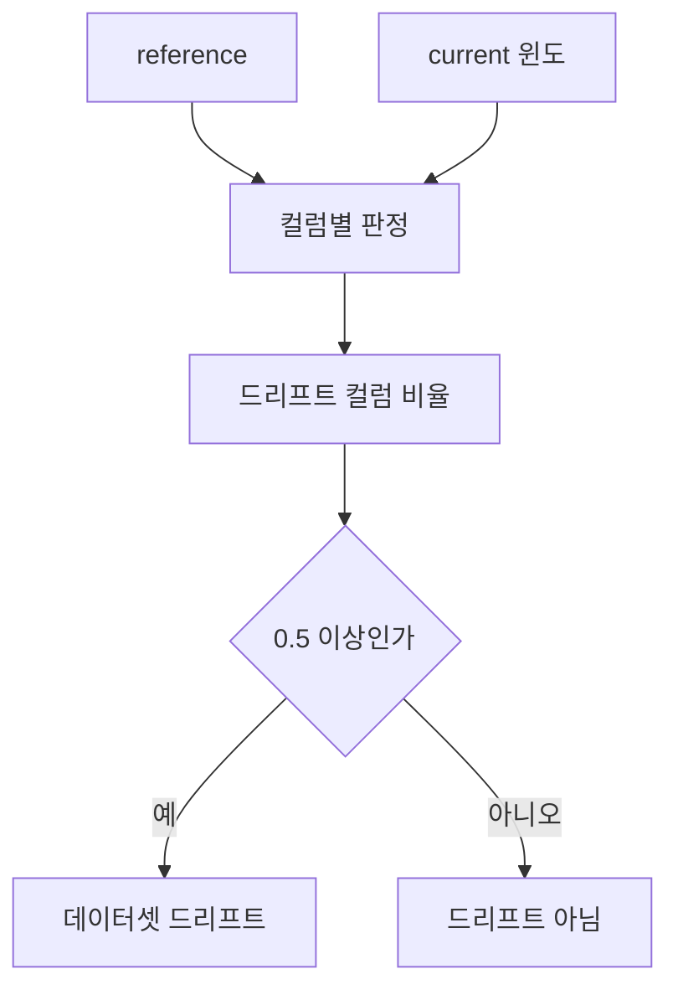

*[서종호(가시다)](https://www.linkedin.com/in/gasida99/)님의 Machine Learning Platform Engineering Study 3주차 학습 내용을 기반으로 합니다.*

<br>

# TL;DR

- 데이터 드리프트는 모델에 들어오는 입력의 분포가 학습 때와 달라지는 현상이다. Evidently는 학습 데이터와 최근 요청을 비교해 드리프트를 판정한다
- 책의 실습은 학습 데이터에 있던 사용자의 값을 다시 모델에 넣는다. 입력이 달라지지 않았으니 드리프트가 없어야 하는데 컬럼의 절반 이상이 드리프트로 판정됐다
- 원인은 표본 오차다. 최근 요청 50건이나 100건만 모으면 범주 비율이 학습 데이터와 우연히 달라진다. Evidently의 기본 판정은 분포 차이가 고정된 기준을 넘는지만 보므로 이 우연한 차이와 실제 변화를 구분하지 않는다
- 같은 데이터에서 윈도(비교에 쓰는 최근 요청 묶음)를 5000번씩 뽑아 판정했다. 드리프트 판정 비율은 윈도 50에서 98%, 100에서 57%, 200에서 1%였다
- 윈도 크기는 범주 수와 허용할 오경보(변화가 없는데 드리프트로 나온 판정) 비율로 정할 수 있다. 윈도를 키우기 어려우면 판정 방법을 chi-square 검정으로 바꾸는 방법이 있고, 표본이 아주 크면 반대로 작은 변화까지 판정되는 문제가 생긴다

<br>

# 들어가며

**데이터 드리프트(data drift)**는 모델에 들어오는 입력의 분포가 학습 때와 달라지는 현상이다. 학습 데이터에는 30대가 많았는데 서비스 요청에는 60대가 많아지면 모델 성능이 떨어질 수 있다. 그래서 성능이 떨어지기 전에 점검이나 재학습으로 연결하기 위해 드리프트를 감시한다. [2주차 글]()에서 학습 트리거 구간을 이야기하며 드리프트 신호는 뒤의 모니터링 장에 미뤄 두었다. 모니터링 장은 책 6장이고 드리프트는 그중 6.2절에서 다룬다.

3주차에 읽은 책 [머신러닝 플랫폼 엔지니어링](https://www.onlybook.co.kr/entry/mlops) 6장의 실습은 소득 분류기를 BentoML로 배포한다. 서비스는 최근 요청 N건을 **윈도(window)**에 모아 학습 데이터와 비교한다. 요청 하나가 표의 한 행이므로 윈도 크기 50은 50행이다. 실습의 요청은 학습 데이터에 있는 사용자의 ID를 보내고 서비스는 피처 저장소에서 그 사용자의 값을 읽어 윈도에 넣는다. 윈도의 값이 모두 학습 데이터에서 왔으니 입력이 달라진 것이 없고 **드리프트가 나오지 않아야 한다.**

그런데 책은 윈도 크기가 50일 때의 대시보드(그림 6.21)에서 드리프트 컬럼 비율이 0.875에 가깝다고 적는다. 범주형 컬럼 8개 중 드리프트로 판정된 컬럼의 비율이다. 0.875면 8개 중 7개다. 책은 이 수치가 다소 이상하다며 윈도 크기 때문일 수 있으니 임곗값을 재검토하고 더 큰 윈도를 시도해 보라고 권한다. 스터디 실습의 대시보드 캡처는 윈도 100에서 0.5였다. 표본이 작으면 거리 기반 판정의 값이 크게 나오기 쉽다는 설명도 함께 있었다.

*그 값은 얼마나 크게 나올까. 왜 8개 중 4개, 7개가 기준을 넘었을까. 윈도를 얼마나 키워야 같은 분포에서 드리프트 판정이 나오지 않을까.*

드리프트 판정은 Evidently 라이브러리 안에서 끝나므로 Python 가상환경에서 돌렸다. 실험 코드를 돌리고 통계량의 해석과 식을 살펴보는 데 AI의 도움을 받았다. 코드와 데이터, 실행 출력은 [실험 폴더](https://github.com/sirzzang/sirzzang.github.io/tree/master/assets/data/mlpe-ch06-drift)에 두었다.

<br>

# Evidently의 드리프트 판정

Evidently는 기준이 되는 **reference** 데이터와 새로 들어온 **current** 데이터를 비교한다. 실습에서는 학습 데이터가 reference이고 윈도가 current다. 판정은 두 단계로 이뤄지고 기준도 둘이다. 컬럼마다 드리프트를 판정한 뒤 드리프트 컬럼 비율이 0.5 이상이면 데이터셋 드리프트로 본다.



<center><sup>AI를 이용해 직접 그린 도식</sup></center>

앞 단계는 컬럼마다 판정하고 뒤 단계는 그 결과를 세어 데이터셋을 판정한다. 컬럼 판정의 방법은 컬럼 타입과 reference 크기에 따라 달라지고 데이터셋 기준은 기본값 0.5다. 컬럼 8개 중 4개면 비율이 0.5이고 이 경우도 드리프트다([소스](https://github.com/evidentlyai/evidently/blob/v0.5.0/src/evidently/calculations/data_drift.py#L401-L404)).

컬럼별 판정 방법은 reference의 행 수와 컬럼 타입으로 정해진다. 책이 쓰는 버전 0.5.0의 기본 규칙은 다음과 같다. 2026년 11월의 [Evidently 문서](https://docs.evidentlyai.com/metrics/explainer_drift)에 적힌 규칙도 같다. 여기서는 범주형 칸만 쓴다.

| reference 행 수 | 범주형 | 수치형 |
|---|---|---|
| 1000 이하 | chi-square, 값이 2개면 Z 검정 | KS 검정, 값이 5개 이하면 chi-square나 Z 검정 |
| 1000 초과 | Jensen-Shannon 거리 | Wasserstein 거리, 값이 5개 이하면 Jensen-Shannon 거리 |

## 거리와 가설 검정

표의 방법은 거리와 가설 검정 두 종류이고 **답하는 질문이 다르다.** 어떤 컬럼의 범주 비율이 학습 데이터에서 A 60%, B 30%, C 10%이고 새 데이터에서 A 50%, B 35%, C 15%라고 하자.

**거리(distance)**는 두 분포가 얼마나 다른지에 답한다. 값이 클수록 많이 달라졌다는 뜻이다. 통계에서 효과 크기(effect size)라고 부르는 쪽의 값이고 **계산식에 표본 크기가 없다.** **Jensen-Shannon 거리**는 세 단계로 구한다. 먼저 두 분포의 범주별 비율을 평균해 중간 분포를 만든다. 위 예시의 중간 분포는 A 55%, B 32.5%, C 12.5%다. 다음으로 두 분포가 중간 분포에서 벗어난 정도를 각각 KL 발산(Kullback-Leibler divergence)으로 재서 평균한다. 이 값이 Jensen-Shannon 발산이다. 마지막으로 제곱근을 씌우면 거리가 된다. 비율이 같으면 0이고 겹치는 범주가 없으면 최댓값 약 0.833이다. 위 예시의 거리는 0.076이다. Evidently는 이 거리가 0.1 이상이면 드리프트로 판정한다. 범주 2개로 보면 50:50과 64:36의 거리가 0.100이다.

{: width="560"}{: .align-center}

<center><sup>출처: <a href="https://commons.wikimedia.org/wiki/File:Kullback%E2%80%93Leibler_distributions_example_1.svg">K687 ypo, Kullback–Leibler distributions example 1</a>, Wikimedia Commons, <a href="https://creativecommons.org/licenses/by-sa/4.0/">CC BY-SA 4.0</a></sup></center>

왼쪽은 세 값의 비율이 36%, 48%, 16%인 분포이고 오른쪽은 세 값이 3분의 1씩인 분포다. 거리는 이렇게 막대 높이가 다른 정도를 숫자 하나로 줄인 값이고 두 분포의 Jensen-Shannon 거리는 0.150이다.

**가설 검정(hypothesis test)**은 그 차이를 우연으로 설명할 수 있는지 따진다. 두 분포가 같다고 가정했을 때 이만한 차이나 그보다 큰 차이가 나올 확률이 **p값**이다. p값이 작을수록 우연으로 설명하기 어렵다. p값이 **유의수준** 0.05보다 작은 결과를 유의하다고 말하고 Evidently는 이때 드리프트로 판정한다. p값은 변화의 크기를 알려 주지 않는다. 차이가 우연일 확률이나 판정이 틀릴 확률도 뜻하지 않는다.

{: width="520"}{: .align-center}

<center><sup>출처: <a href="https://commons.wikimedia.org/wiki/File:P-value_in_statistical_significance_testing.svg">Repapetilto, Chen-Pan Liao, P-value in statistical significance testing</a>, Wikimedia Commons, <a href="https://creativecommons.org/licenses/by-sa/3.0/">CC BY-SA 3.0</a></sup></center>

곡선은 가설이 참일 때 결과가 나오는 분포이고 초록색 넓이가 p값이다. 그림 위쪽 상자의 식은 가설이 참일 때 이 결과가 나올 확률과 이 결과를 봤을 때 가설이 참일 확률이 다르다는 뜻이다.

<details markdown="1">
<summary><b>p값을 읽는 법</b></summary>

**p값 0.05는 판정이 틀릴 확률 5%가 아니다.** p값은 차이가 없다고 가정했을 때 지금만큼 또는 그보다 큰 차이가 나올 확률이다. 차이가 없을 때 이런 결과가 나올 확률이고, 이런 결과가 나왔을 때 차이가 없을 확률이 아니다. 판정이 틀릴 확률로 읽으면 이 조건을 뒤집게 된다.

공평한 동전을 10번 던져 앞면이 9번 이상이거나 1번 이하로 나올 확률은 약 2%다. 공평한 동전이면 이런 결과가 드물다는 뜻이다. 이 동전이 공평할 확률이 2%라는 뜻은 아니다.

판정이 틀릴 확률을 구하려면 실제 변화가 얼마나 흔한지도 알아야 한다. 판정 1,000번 중 900번은 실제 변화가 없고 100번은 있다고 가정하자. 유의수준은 0.05이고 실제 변화를 잡을 확률은 80%다.

| 실제 상황 | 횟수 | 드리프트 판정 |
|---|---|---|
| 변화 없음 | 900 | 45(900의 5%) |
| 변화 있음 | 100 | 80(100의 80%) |

드리프트 판정 125번 중 45번은 변화가 없는데 나온 판정이므로 **틀린 비율은 36%**다. 5%는 변화가 없는 900번 안에서 잘못 판정하는 비율이고 유의수준으로 미리 정하는 값이다.

p값이 0.03이면 차이가 없을 때 이만한 차이나 그보다 큰 차이가 100번에 3번쯤 나온다는 뜻이다. 차이가 없다는 가정이 데이터와 잘 맞지 않는다고 읽는다. p값이 0.4면 차이가 없다는 증거로 읽지 않고 이 데이터로는 구분하지 못한다고 읽는다.

</details>

**chi-square 검정**은 범주마다 기대 개수와 실제 개수를 비교한다. 기대 개수는 학습 데이터의 비율에 새 데이터 건수를 곱한 값이다. 새 데이터가 100건이면 기대 개수는 A 60, B 30, C 10이고 실제 개수는 50, 35, 15다. 범주마다 차이를 제곱하고 기대 개수로 나눠 더한 값이 **chi-square 통계량**이다. 이 예시에서는 100÷60 + 25÷30 + 25÷10 = 5.0이다. 통계량을 자유도(범주 수에서 1을 뺀 값)에 맞는 chi-square 분포와 대조하면 p값이 나온다. 통계량이 클수록 p값이 작다. 이 검정은 행이 서로 독립이라고 가정한다. 한 행의 값을 알아도 다른 행의 값을 짐작할 수 없다는 뜻이다. 유의수준이 0.05면 같은 분포에서도 약 5%는 드리프트로 나오는 것이 정상이다. 기대 개수가 5보다 작은 범주가 많으면 이 비율이 5%에서 벗어난다.

{: width="560"}{: .align-center}

<center><sup>출처: <a href="https://commons.wikimedia.org/wiki/File:Chi-square_pdf.svg">Geek3, Chi-square pdf</a>, Wikimedia Commons, <a href="https://creativecommons.org/licenses/by/3.0/">CC BY 3.0</a></sup></center>

그림의 k가 자유도다. 범주가 3개인 예시는 자유도가 2이므로 k=2 곡선을 쓰고 통계량 5.0 오른쪽의 넓이가 p값 0.082다.

쉽게 말해 거리는 비율이 얼마나 벌어졌는지를 숫자 하나로 적은 값이다. 비율이 같으면 0이고 많이 벌어질수록 커진다. p값은 분포가 그대로일 때 그만큼 벌어지는 일이 얼마나 자주 나오는지를 적은 값이다. 예시에서 A의 비율은 60%에서 50%로 내려갔다. 거리는 **비율만** 보므로 건수와 상관없이 0.076이고 기준 0.1보다 작다. p값은 **건수까지** 본다. 분포가 그대로여도 100건을 뽑으면 이만한 차이나 그보다 큰 차이가 열두 번에 한 번꼴로 나오므로 우연으로도 나올 수 있는 차이로 읽는다. 1,000건을 뽑으면 이만한 차이가 거의 나오지 않으므로 우연으로 보기 어렵다.

같은 비율 차이에서 표본 크기만 바꾸면 둘의 차이가 보인다.

| 새 데이터 건수 | Jensen-Shannon 거리 | 기준 0.1로 판정 | chi-square 통계량 | p값 | 유의수준 0.05로 판정 |
|---|---|---|---|---|---|
| 100 | 0.076 | 드리프트 아님 | 5.0 | 0.082 | 드리프트 아님 |
| 1,000 | 0.076 | 드리프트 아님 | 50.0 | 1.4e-11 | 드리프트 |

이 표는 표본 비율이 정확히 50:35:15로 나왔다고 둔 계산이다. 비율이 그대로이면 거리는 건수가 늘어도 같고 p값은 건수가 늘면 작아진다. 실제 표본의 비율은 뽑을 때마다 달라지고 건수가 적을수록 많이 흔들린다. 이 흔들림은 뒤의 [원인 절](#원인-표본-오차)에서 다룬다.

분석할 때는 거리와 p값을 함께 읽는다. 여기서 거리는 앞에서 구한 Jensen-Shannon 거리다. 거리가 크다는 것은 두 분포의 비율이 많이 벌어졌다는 뜻이고 p값이 크다는 것은 그만한 차이가 우연으로도 자주 나온다는 뜻이다. 거리는 기준 0.1, p값은 유의수준 0.05로 크고 작음을 나눈다.

| 거리(변화의 크기) | p값 | 읽는 법 |
|---|---|---|
| 크다 | 작다 | 변화가 크고 우연으로 설명하기 어렵다. 점검 대상이다 |
| 작다 | 작다 | 변화는 있어 보이지만 작다. 표본이 클 때 흔하다. 앞 표의 1,000건이 이 경우다 |
| 크다 | 크다 | 거리는 커도 표본 오차로 설명할 수 있다. 작은 윈도에서 기준을 넘은 컬럼 대부분이 이 경우다 |
| 작다 | 크다 | 변화가 없거나 표본이 모자라 알 수 없다. 앞 표의 100건이 이 경우다 |

## 기본 규칙의 소스

[선택 함수](https://github.com/evidentlyai/evidently/blob/v0.5.0/src/evidently/calculations/stattests/registry.py#L137-L160)에서 범주형 부분만 추리면 **조건문에 `reference_data`의 크기만 있다.** 학습 데이터 3만 행을 reference로 두면 윈도가 50이든 5000이든 같은 방법을 쓴다.

```python
# evidently/calculations/stattests/registry.py (v0.5.0, 발췌)
elif reference_data.shape[0] <= 1000:
    ...
    elif feature_type == ColumnType.Categorical:
        return stattests.chi_stat_test if n_values > 2 else stattests.z_stat_test
elif reference_data.shape[0] > 1000:
    ...
    elif feature_type == ColumnType.Categorical:
        return stattests.jensenshannon_stat_test
```

Evidently의 [판정](https://github.com/evidentlyai/evidently/blob/v0.5.0/src/evidently/calculations/stattests/jensenshannon.py#L59-L60)은 이 거리를 기본 임곗값 0.1과 비교한다.

```python
# evidently/calculations/stattests/jensenshannon.py (v0.5.0, 발췌)
jensenshannon_value = distance.jensenshannon(reference_percents, current_percents, base)
return jensenshannon_value, jensenshannon_value >= threshold
```

> **참고**: 책은 그림 6.16의 보고서를 바서슈타인(Wasserstein) 거리로 설명한다. 수치형 컬럼의 기본 방법이고 기본 임곗값은 역시 0.1이다. 여기서는 범주형 8개 컬럼만 비교한다.

<br>

# 실습 재현

책 저장소의 mock 요청 CSV는 100행이고 사용자 ID와 `Workclass`, `Education`, `Occupation` 세 컬럼이 있다. 소득 분류기의 학습 데이터는 UCI Adult다. 이 세 컬럼을 대조하니 결측 행을 뺀 Adult의 앞 100행과 100행 모두 일치했다. 이 100행을 current로 두고 결측 제외 전체 30,162행을 reference로 두었다.

```python
clean = df[~df.isin([" ?"]).any(axis=1)].reset_index(drop=True)  # Adult의 결측 표기는 " ?"다
ref = clean[cats]  # 범주형 8개 컬럼, 30,162행
report = Report(metrics=[DatasetDriftMetric()] + [ColumnDriftMetric(column_name=c) for c in cats])
report.run(reference_data=ref, current_data=ref.head(100))
```

전체 코드는 [exact_window2.py](https://github.com/sirzzang/sirzzang.github.io/blob/master/assets/data/mlpe-ch06-drift/code/exact_window2.py)에 있다. 결과는 **스터디 캡처와 같은 0.5**다.

```text
mock vs no-missing head, identical rows: 100 of 100
ref=no-missing all, window=mock's 100 rows: share 0.5 dataset_drift True
  Education        Jensen-Shannon distance score=0.1670 drifted=True
  Marital-Status   Jensen-Shannon distance score=0.1194 drifted=True
  Native_country   Jensen-Shannon distance score=0.1761 drifted=True
  Occupation       Jensen-Shannon distance score=0.1157 drifted=True
  Race             Jensen-Shannon distance score=0.0648 drifted=False
  Relationship     Jensen-Shannon distance score=0.0695 drifted=False
  Sex              Jensen-Shannon distance score=0.0420 drifted=False
  Workclass        Jensen-Shannon distance score=0.0531 drifted=False
window 50 sliding over those rows: [0.875, 0.75, 0.75, 0.75, 0.625, 0.75]
```

마지막 줄은 윈도를 50으로 줄여 10행씩 밀어 본 결과다. 앞 50행의 값이 **책과 같은 0.875**다. 값이 같다고 설정이 같다고 말할 수는 없다. 0.5는 무작위 윈도의 약 35%에서 나오는 값이다. 책 그림에는 1.0도 보이는데 이 100행에서는 나오지 않았다.

Evidently는 판정을 HTML 보고서로도 내보낸다. 이 윈도의 [보고서]({{site.url}}/assets/data/mlpe-ch06-drift/reports/report_adult_window100.html)를 열면 컬럼별 분포와 판정을 볼 수 있다.


<center><sup>직접 생성한 Evidently 보고서. 컬럼 8개 중 4개가 드리프트로 판정됐다</sup></center>

<br>

# 원인: 표본 오차

분포 변화가 없는데 드리프트로 나온 판정이 **오경보(false alarm)**다. 같은 분포에서 뽑아도 표본의 비율은 전체 비율과 조금씩 다르다. 오차는 양쪽으로 나지만 **거리는 0 아래로 내려가지 않으므로 그대로 양수 값으로 남는다.** 윈도가 작을수록 오차가 크니 거리도 크다.

범주가 많을수록 오차가 쌓이는 곳이 많아 거리가 더 커진다. 크기를 어림하는 식은 다음과 같다. $k$는 범주 수이고 $n$은 윈도 크기다.

$$
d \approx \sqrt{\frac{k-1}{8n}}
$$

범주 16개에 윈도 100이면 0.137이라 기준 0.1을 넘는다. 거리를 절반으로 줄이려면 윈도를 네 배로 키워야 한다.

<details markdown="1">
<summary><b>식이 나오는 과정</b></summary>

reference가 윈도보다 훨씬 크면 reference의 비율을 참값으로 볼 수 있다. reference의 범주 비율을 $p_i$, 윈도의 비율을 $q_i$라 하자. Jensen-Shannon 거리 $d$는 Jensen-Shannon 발산의 제곱근이다. 차이가 작을 때 자연로그 기준 발산은 다음과 같이 근사된다(유도는 테일러 전개이고 여기서는 생략한다).

$$
d^2 \approx \frac{1}{8}\sum_{i=1}^{k}\frac{(q_i - p_i)^2}{p_i}
$$

합에 $n$을 곱한 값은 chi-square 적합도 통계량이다. 이 통계량은 같은 분포에서 자유도 $k-1$인 chi-square 분포를 근사적으로 따른다. 평균이 $k-1$이므로 본문의 식이 나온다. 평균 제곱의 제곱근이라 실제 평균보다 조금 크다.

판정 확률도 같은 식에서 나온다. 거리가 0.1 이상이라는 말은 통계량이 $8n(0.1)^2$ 이상이라는 말이다.

$$
P(d \ge 0.1) \approx P(\chi^2_{k-1} \ge 0.08n)
$$

</details>

아래 표는 윈도 크기별로 컬럼이 기준을 넘은 비율이다. 범주가 적은 순으로 정렬했다. 측정은 컬럼의 실제 분포에서 표본을 4000번 뽑아 잰 값이다. 식 열은 범주 수와 윈도 크기만으로 어림한 판정 비율이고 위 접힌 블록의 판정 확률 식으로 계산했다. 범주 수는 `adult.data` 원본 기준이다.

| 컬럼 | 범주 수 | 윈도 50 측정 | 식 | 윈도 100 측정 | 식 | 윈도 200 측정 | 식 |
|---|---|---|---|---|---|---|---|
| Sex | 2 | 5% | 5% | 1% | 0% | 0% | 0% |
| Race | 5 | 48% | 41% | 13% | 9% | 1% | 0% |
| Relationship | 6 | 61% | 55% | 20% | 16% | 1% | 1% |
| Marital-Status | 7 | 70% | 68% | 24% | 24% | 2% | 1% |
| Workclass | 9 | 77% | 86% | 32% | 43% | 3% | 4% |
| Occupation | 15 | 100% | 100% | 89% | 89% | 32% | 31% |
| Education | 16 | 100% | 100% | 97% | 92% | 50% | 38% |
| Native_country | 42 | 100% | 100% | 100% | 100% | 100% | 100% |

식은 범주 비율이 한쪽으로 크게 쏠린 컬럼에서 어긋난다. 42개 범주 중 39개가 1% 미만인 Native_country는 평균 거리가 윈도 50에서 식 0.320, 측정 0.201이다. 드문 범주가 윈도에 한 건만 나타나도 근사식은 그 범주의 기여를 실제 거리보다 훨씬 크게 계산하기 때문이다. 정확히 재려면 범주별 비율을 넣어야 하고 드문 범주가 적으면 $k$로 어림할 수 있다.

이 표로 0.5와 0.875를 설명할 수 있다. 윈도 100에서 범주가 많은 세 컬럼은 거의 늘 기준을 넘는다. 나머지 컬럼은 1~32% 확률로 넘는다. 셋에 하나가 더해지면 8개 중 4개, 0.5다. 이번 윈도에서는 Marital-Status가 더해졌다. 윈도 50에서는 Sex를 뺀 일곱 컬럼이 48~100% 확률로 넘는다. 일곱이 모두 넘으면 0.875다.

**두 값은 드문 값이 아니다.** 결측 제외 reference로 무작위 윈도를 5000번 뽑으면 윈도 100의 비율 중 0.5가 35%이고 윈도 50의 비율 중 0.875가 16%다. 윈도 50의 평균은 0.69다. 0.875는 분포의 위쪽 값이다.

데이터셋 판정은 `adult.data` 32,561행을 reference로 두고 같은 데이터에서 윈도를 크기별로 5000번 뽑아 셌다. 셋째 열은 윈도 5000개의 드리프트 컬럼 비율을 작은 순으로 세웠을 때 아래 5%와 위 5%를 뺀 범위다. Evidently와 같은 식을 직접 계산했고 80번 대조해 차이가 없었다([결과](https://github.com/sirzzang/sirzzang.github.io/blob/master/assets/data/mlpe-ch06-drift/results/08_adult_sweep_direct.txt)).

| 윈도 크기 | 드리프트 컬럼 비율 평균 | 5~95% 범위 | 데이터셋 드리프트 판정 비율 |
|---|---|---|---|
| 50 | 0.703 | 0.5~0.875 | 98.4% |
| 100 | 0.468 | 0.25~0.625 | 56.8% |
| 200 | 0.234 | 0.125~0.375 | 1.3% |
| 500 | 0.099 | 0~0.125 | 0% |
| 1000 이상 | 0 | 0 | 0% |

윈도 200이면 데이터셋 판정은 거의 사라지지만 컬럼 판정은 남는다. 윈도 500의 평균 0.099는 Native_country 한 컬럼이 윈도의 79%에서 넘은 값이다(0.79÷8).

<br>

# 윈도 크기 선택

허용할 오경보 비율을 정하면 필요한 윈도 크기를 구할 수 있다. 아래 표는 오경보 5%, 임곗값 0.1인 경우다. 측정은 컬럼 판정 비율이 5% 이하가 되는 가장 작은 윈도이고 윈도를 10~25행 간격으로 올리며 찾았다.

<details markdown="1">
<summary><b>윈도 크기를 구하는 식</b></summary>

허용할 오경보 비율을 $\alpha$, 거리 임곗값을 $t$라 하자. $\chi^2_{k-1,\,1-\alpha}$는 자유도 $k-1$인 chi-square 분포의 상위 $\alpha$ 지점이다.

$$
n \ge \frac{\chi^2_{k-1,\,1-\alpha}}{8t^2}
$$

</details>

| 컬럼 | 범주 수 | 식 | 측정 |
|---|---|---|---|
| Sex | 2 | 48 | 50 |
| Race | 5 | 119 | 140 |
| Marital-Status | 7 | 157 | 170 |
| Workclass | 9 | 194 | 180 |
| Education | 16 | 312 | 350 |
| Native_country | 42 | 712 | 825 |

식과 측정의 차이는 측정값의 15% 안쪽이었다. 어느 판정을 줄일지에 따라 필요한 크기는 다르다. 이 데이터에서 데이터셋 판정은 윈도 200이면 1%다. 모든 컬럼의 판정을 5%로 두려면 800행이 넘는다. 윈도를 키우면 변화를 늦게 알게 된다. 요청이 하루 1000건이면 윈도 500은 반나절 치다. **얼마나 빨리 알아야 하는지와 오경보를 얼마나 견딜지를 먼저 정해야 크기를 고를 수 있다.**

윈도를 키우지 못하면 다른 설정을 쓸 수 있다.

- **컬럼별 임곗값:** 범주가 많은 컬럼의 임곗값을 올린다. `DatasetDriftMetric(per_column_stattest_threshold={...})`로 주어야 드리프트 컬럼 비율이 바뀐다. 실습 윈도에서 세 컬럼을 0.3으로 주면 0.5가 0.125로 내려갔다. `ColumnDriftMetric`의 `stattest_threshold`는 그 컬럼의 판정만 바꾸고 비율은 0.5 그대로였다. 거리는 임곗값을 올리면 덜 민감해진다. p값 방식은 임곗값을 올리면 오히려 더 민감해진다.
- **범주 묶기:** 드문 범주를 묶어 $k$를 줄인다.
- **데이터셋 기준:** `DatasetDriftMetric(drift_share=...)`로 [앞의 0.5](#evidently의-드리프트-판정)를 올린다. 컬럼 몇 개만 실제로 바뀐 경우를 놓치기 쉽다.
- **연속 판정:** 연속 몇 회 넘을 때만 알린다. 겹치지 않는 윈도일 때 효과가 있다. 책의 서비스는 요청마다 윈도를 한 행씩 밀기 때문에 이웃 윈도가 99행을 공유한다. 윈도 100에서 한 행씩 밀면 오경보 55%가 3회 연속 50%, 10회 연속 38%였다. 겹치지 않게 자르면 행 순서 300개 평균으로 3회 연속 18%, 5회 연속 6%였다([결과](https://github.com/sirzzang/sirzzang.github.io/blob/master/assets/data/mlpe-ch06-drift/results/08b_consecutive_alarms.txt)).

<br>

# 판정 방법과 reference 크기

거리 대신 chi-square를 쓰면 어떨까. 판정 방법은 `stattest` 인자로 고를 수 있으므로 reference를 유지한 채 방법만 바꿀 수 있다. reference를 1000행으로 줄이면 기본 규칙이 값이 3개 이상인 컬럼에 chi-square를 고르고 값이 2개인 Sex에 Z 검정을 고른다. 아래는 두 경우의 데이터셋 드리프트 판정 비율이다. 첫 열은 [앞 표](#원인-표본-오차)의 값이고 나머지 두 열은 Evidently로 윈도를 300번 판정한 값이다([결과](https://github.com/sirzzang/sirzzang.github.io/blob/master/assets/data/mlpe-ch06-drift/results/09b_evidently_knobs.txt)).

| 윈도 크기 | 기본값(거리, reference 전체) | `stattest="chisquare"`, reference 전체 | 기본값, reference 1000행 |
|---|---|---|---|
| 50 | 98% | 0.7% | 1.7% |
| 100 | 57% | 0.7% | 5.7% |
| 200 | 1% | 0% | 9.0% |

reference를 유지하고 방법만 바꾸면 **데이터셋 오경보는 1% 아래**다. 컬럼 판정은 대체로 4~11%였고 Native_country만 14~23%로 높았다. 이 컬럼은 범주 대부분의 기대 개수가 5보다 작다. reference를 줄이면 윈도가 커질수록 오경보가 늘었다. [기대 개수를 만드는 방식](https://github.com/evidentlyai/evidently/blob/v0.5.0/src/evidently/calculations/stattests/chisquare_stattest.py#L43-L46) 때문이다.

```python
# evidently/calculations/stattests/chisquare_stattest.py (v0.5.0, 발췌)
k_norm = current_data.shape[0] / reference_data.shape[0]
f_exp = [ref_feature_dict[key] * k_norm for key in keys]
f_obs = [current_feature_dict[key] for key in keys]
p_value = chisquare(f_obs, f_exp)[1]
```

기대 개수는 current의 행 수로 환산한 reference의 개수다. 그런데 reference도 표본이다. 이 코드는 reference 비율을 오차 없는 참값으로 두므로 윈도가 reference 크기에 가까워질수록 통계량이 커진다. 드문 범주가 없는 Relationship도 reference 1000행에서 윈도 50일 때 8%, 200일 때 11%, 500일 때 21%, 1000일 때 35%였다([결과](https://github.com/sirzzang/sirzzang.github.io/blob/master/assets/data/mlpe-ch06-drift/results/09_chi_reference_noise.txt)).

reference를 줄이면 current에는 있는데 reference 1000행에는 없는 범주가 나올 수 있다. 이때는 기대 개수가 0이 되어 통계량이 무한대로 가고 p값이 0이 된다. Native_country는 윈도 200에서 84%의 시행에 이런 범주가 나왔고 그때의 판정은 모두 드리프트였다([결과](https://github.com/sirzzang/sirzzang.github.io/blob/master/assets/data/mlpe-ch06-drift/results/07_small_reference_why.txt)).

reference는 판정 비용 때문에 줄인다. 책의 보고서 구성으로 잰 `report.run`의 중앙값은 reference 전체일 때 약 400ms, 1000행일 때 약 40ms였다. 비용 때문에 줄이더라도 방법은 `stattest`로 따로 고른다. 줄인 reference의 표본 오차가 판정에 영향을 준다는 점도 감안하는 편이 낫다.

<br>

# 큰 표본의 판정

행이 독립이고 reference가 크면 거리 판정의 오경보는 윈도가 작을 때 생긴다. 표본이 커지면 가설 검정 쪽에서 다른 문제가 나타난다. [앞의 예시](#거리와-가설-검정)처럼 p값은 표본이 커질수록 작아지기 때문이다. 범주 5개 분포에서 45%를 45.5%로, 5%를 4.5%로 옮긴 표본을 원래 분포의 표본과 비교했다. 두 표본의 크기는 같다. 검정은 두 표본 chi-square다. 두 표본의 개수를 합친 비율로 기대 개수를 만들어 양쪽의 오차를 함께 본다. 표는 1000번 실행의 값이다.

| 표본 크기 | p값 중앙값 | p<0.05 비율 | 거리 평균 |
|---|---|---|---|
| 1만 | 0.21 | 22% | 0.0123 |
| 10만 | 1.9e-6 | 99.5% | 0.0090 |
| 100만 | 2.3e-62 | 100% | 0.0086 |

100만 건이면 chi-square는 이 변화를 확실하게 판정한다. 분포를 실제로 바꿨으니 판정이 틀린 것은 아니다. 변화 없는 표본을 주면 100만 건에서도 4.1%였다. 그런데 chi-square는 대응할 필요가 없는 작은 변화까지 유의하다고 답한다. 거리는 실제 차이 0.0085로 수렴해 기준 0.1에 한참 못 미친다. 그래서 **표본이 크면 얼마만큼의 변화에 대응할지를 따로 정해야 한다.**

Evidently의 기본 규칙은 reference 크기로 방법을 고른다. 이번 측정에서는 윈도 크기에 따라 판정이 갈렸다.

<br>

# 정리

왜 8개 중 4개, 7개가 넘었나. **고정 기준 0.1이 윈도 크기를 반영하지 않아서다.** 윈도 100에서 범주가 많은 세 컬럼은 표본 오차만으로 거의 늘 기준을 넘고 나머지가 확률적으로 더해진다. 0.5와 0.875는 무작위 윈도의 드리프트 컬럼 비율 분포 안의 값이다.

윈도를 얼마나 키워야 하나. 이 데이터의 데이터셋 판정은 윈도 200이면 1%다. 컬럼 판정까지 정하려면 **허용할 오경보 비율을 먼저 정하고** [윈도 크기 식](#윈도-크기-선택)으로 구한다. 범주가 많으면 윈도를 키우기보다 판정 방법이나 임곗값을 바꾸는 쪽이 낫다.

Adult는 행 하나가 사람 한 명인 표 데이터라 행끼리 독립이라고 볼 수 있고 표본 수는 행 수다. [다음 글]()에서는 공개 주행 영상 데이터로 옮겨 행이 프레임일 때 표본 수가 무엇이 되는지 본다.

<br>

# 참고 링크

- [실험 코드, 데이터, 결과](https://github.com/sirzzang/sirzzang.github.io/tree/master/assets/data/mlpe-ch06-drift)
- [책 6장 실습 저장소](https://github.com/practical-mlops/chapter-6)
- [Evidently: Data drift algorithm](https://docs.evidentlyai.com/metrics/explainer_drift)
- [Evidently v0.5.0 기본 검정 선택 소스](https://github.com/evidentlyai/evidently/blob/v0.5.0/src/evidently/calculations/stattests/registry.py)
- [SciPy `jensenshannon`](https://docs.scipy.org/doc/scipy/reference/generated/scipy.spatial.distance.jensenshannon.html)
- [UCI Adult](https://archive.ics.uci.edu/dataset/2/adult)

<br>
