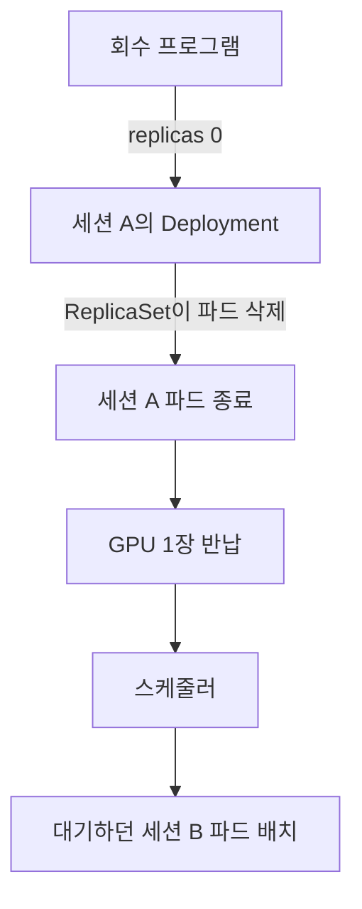
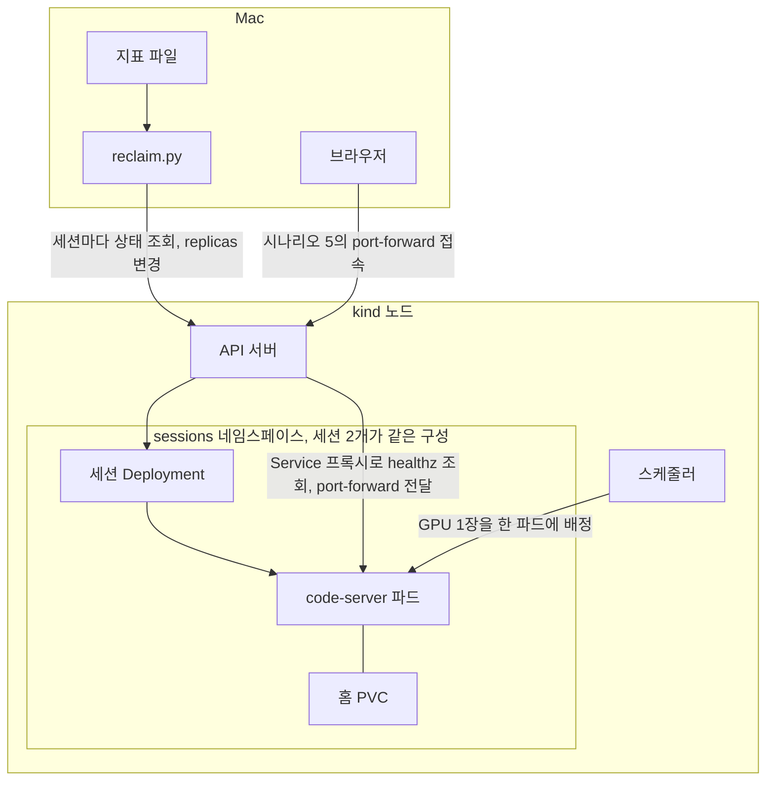

*[서종호(가시다)](https://www.linkedin.com/in/gasida99/)님의 Machine Learning Platform Engineering Study 3주차 학습 내용을 기반으로 합니다.*

<br>

# TL;DR

- GPU를 받은 개발 환경(이하 세션)은 사람이 쓰지 않는 동안에도 GPU를 잡고 있다. 책은 이런 노트북에 유휴 시 파드를 종료하는 규칙을 두라고 짚는다. 그 규칙이 쿠버네티스에서 어떤 구조로 도는지 로컬에서 시험했다
- 장치째 배정된 GPU는 파드가 살아 있는 동안 다른 파드가 쓰지 못한다. GPU를 돌려받으려면 파드를 없애야 한다
- 세션은 Deployment의 `replicas`(유지할 파드 수)를 0으로 내려 정지할 수 있다. 로컬 클러스터에 가짜 GPU 1장을 등록해 시험하니 세션을 정지하자 기다리던 세션이 GPU를 받았다. 홈의 파일은 남고 `/tmp`는 사라졌으며 다시 켠 세션은 GPU가 빌 때까지 기다렸다
- 파드만 지우면 Deployment가 새 파드를 만들어 GPU를 다시 요구한다. 기다리던 세션이 먼저 받는다는 보장도 없다
- 개발 환경 도구는 입력, 터미널, 커널 같은 활동으로 유휴를 판단하고 GPU를 직접 보지 않는다. 브라우저로 접속만 해 둬도 접속 신호는 살아 있었다
- Kubeflow의 컬링(유휴 노트북 정지 기능)도 `replicas`를 0으로 만드는 구조이고 판정 신호는 Jupyter 커널 상태뿐이다

<br>

# 들어가며

3주차에 읽은 책 [머신러닝 플랫폼 엔지니어링](https://www.onlybook.co.kr/entry/mlops) 7.1.1절은 노트북 생성 화면의 GPU 항목을 설명하며 GPU를 쓰는 노트북에는 유휴 상태일 때 파드를 종료하는 수명주기 규칙을 두라고 적는다.

학습 플랫폼을 운영하면서 SSH나 VS Code로 원격 접속해 쓰는 세션을 제공하다 보니 이 대목에 눈이 갔다. 학습 플랫폼에서 GPU는 비싸고 모자라기 쉬운 자원이다. **세션이 GPU를 잡은 채 쉬는 시간은 다른 학습이 쓰지 못하는 시간이다.** 쓰지 않는 세션을 돌려받는 일은 GPU 자원을 효율적으로 쓰는 일과 직결된다.

이 규칙을 두려면 세션을 어떻게 정지할지부터 알아야 한다. 정지한 세션에 무엇이 남는지와 무엇을 활동으로 볼지도 함께 따라온다. 이를 계기로 이 주제를 네 편에 걸쳐 정리해 보고자 한다.

| 번호 | 다루는 것 |
|---|---|
| 7.1.1(이 글) | 세션을 정지하는 구조와 쿠버네티스에서의 동작 |
| [7.1.2]() | 오픈소스 개발 환경 도구로 같은 동작을 시험한 결과 |
| [7.1.3]() | 무엇을 보고 유휴로 판정할까 |
| [7.1.4]() | 데이터 보존, 판정 기준, 의도 표시를 정책으로 정하는 문제 |

실험 코드 작성과 실행에는 AI의 도움을 받았고 코드와 로그는 [실험 폴더](https://github.com/sirzzang/sirzzang.github.io/tree/master/assets/data/mlpe-ch07-session-reclaim)에 두었다.

<br>

# 배경

## 워크로드의 성격

[쿠버네티스 문서](https://kubernetes.io/docs/concepts/workloads/)는 워크로드를 쿠버네티스에서 도는 애플리케이션이라고 정의한다.

> A workload is an application running on Kubernetes.

ML 플랫폼의 GPU 워크로드는 보통 개발, 학습, 서빙으로 나뉜다. 셋 다 워크로드이고 **일이 어디서 오고 언제 끝나는지가 다르다.**

| 워크로드 | 일반 용어 | 하는 일 | 일을 주는 쪽 | GPU를 쓰는 모습 | 파드가 끝나는 때 |
|---|---|---|---|---|---|
| 개발 | 대화형 | 사람이 접속해 코드를 고치고 돌려 본다 | 접속한 사람 | 드문드문 쓴다 | 사람이 끌 때 |
| 학습 | 배치 | 정해진 작업을 끝까지 돌린다 | 제출한 작업 | 작업 내내 쓴다 | 작업이 끝날 때 |
| 서빙 | 서비스 | 요청을 받아 모델을 실행한다 | 들어오는 요청 | 요청량에 따라 쓴다 | 서비스를 내릴 때 |

클러스터 운영에서 오래 써 온 구분은 서비스와 배치다. Google의 [Borg 논문](https://research.google/pubs/large-scale-cluster-management-at-google-with-borg/)은 클러스터의 워크로드를 이 둘로 나눈다.

> The first is long-running services that should “never” go down, and handle short-lived latency-sensitive requests (a few µs to a few hundred ms). [...] The second is batch jobs that take from a few seconds to a few days to complete; these are much less sensitive to short-term performance fluctuations.

**서비스(service) 워크로드**는 요청을 받으려고 계속 떠 있는 워크로드이고 **배치(batch) 워크로드**는 제출해 두면 끝날 때까지 혼자 도는 워크로드다. 서빙은 서비스 워크로드이고 학습은 배치 워크로드다. 쿠버네티스에서 배치를 표현하는 객체가 [Job](https://kubernetes.io/docs/concepts/workloads/controllers/job/)이다.

> Jobs represent one-off tasks that run to completion and then stop.

개발은 둘 중 어디에도 맞지 않는다. 사람이 들어가 쓰는 **대화형(interactive) 워크로드**다. 이 구분은 연구용 클러스터에서 널리 쓰는 스케줄러 [Slurm](https://slurm.schedmd.com/quickstart.html)의 명령에서 볼 수 있다. 나중에 실행할 잡을 제출하는 명령과 자원을 바로 받아 셸을 여는 명령이 따로 있다.

> sbatch is used to submit a job script for later execution.
>
> salloc is used to allocate resources for a job in real time. Typically this is used to allocate resources and spawn a shell.

세 워크로드는 쉬는 시간을 다루는 방식이 다르다. 배치는 일이 끝나면 파드가 끝나 GPU가 스스로 돌아온다. 서비스는 일감이 요청으로 보이므로 요청량을 보고 복제본 수를 늘리거나 줄일 수 있다. 대화형은 일이 끝나는 시점도 없고 일감이 밖에서 보이지도 않는다. **사람이 끄지 않으면 쉬고 있어도 GPU가 돌아오지 않는다.**

## 개발 환경과 Kubeflow Notebooks

ML 개발은 데이터를 훑고 코드를 고쳐 결과를 바로 보는 일을 반복한다. 이런 탐색에는 코드를 조금씩 돌려 보는 노트북이나 IDE가 편하다. 다만 개인 PC에는 GPU나 학습 데이터가 없는 경우가 많고 사람마다 환경도 달라진다. 이때 ML 플랫폼은 개발 환경을 클러스터에 띄워 사용자에게 제공할 수 있다.

[Kubeflow Notebooks](https://www.kubeflow.org/docs/components/notebooks/overview/)는 쿠버네티스 위에 Jupyter 같은 개발 환경을 파드로 띄워 주는 기능이다. JupyterLab, RStudio, VS Code(code-server)를 지원한다. 관리자가 필요한 패키지를 넣은 표준 이미지를 준비해 두면 사용자는 자기 PC 대신 클러스터에서 그 환경을 띄운다. 데이터를 살펴보거나 모델을 작게 돌려 볼 때 주로 쓰고 오래 걸리는 학습은 파이프라인이나 학습 잡으로 넘기는 경우가 많다.

이런 개발 환경에 GPU를 붙이면 [앞의 표](#워크로드의-성격)에서 본 차이가 드러난다. 개발은 GPU를 드문드문 쓰는데 파드는 사람이 끌 때까지 남아 있어서 **쓰지 않는 동안에도 GPU를 잡고 있다.**

## Kubeflow의 컬링

책이 말한 규칙에 해당하는 Kubeflow 기능이 **컬링(culling)**이다. 유휴 노트북을 정지시키는 기능이고 컨트롤러(리소스를 지켜보며 상태를 맞추는 프로그램) 설정으로 켠다. 

스터디 실습 매니페스트의 설정은 이렇다. 시간 단위는 분이다.

```yaml
# notebook-controller ConfigMap (발췌)
CULL_IDLE_TIME: "1440"
ENABLE_CULLING: "false"
IDLENESS_CHECK_PERIOD: "1"
```

스터디 실습은 GPU 없이 CPU와 메모리만 요청하는 경량 구성이고 `ENABLE_CULLING`은 기본값 `false`다. 그래서 규칙이 실제로 어떻게 도는지는 이 실습으로 볼 수 없다.

## 용어

- **세션:** 사람이 SSH나 브라우저 IDE로 접속해 쓰는 대화형 개발 환경이다. 여기서는 GPU를 받은 파드 하나다.
- **정지:** 세션의 GPU 요구를 없애는 일이다. 뒤의 [회수 구조](#회수-구조)에서 파드 삭제와 구분한다.
- **회수(reclaim):** 쓰지 않는 세션을 정지해 GPU를 돌려받는 일이다. Kueue나 Volcano의 reclaim은 큐 사이에서 자원을 되찾는 기능으로 다른 말이다.

<br>

# 세션의 구성

[KodeKloud](https://kodekloud.com/)의 [MLOps 100 Day Challenge](https://kodekloud.com/100-days-of-mlops) 같은 실습 환경을 떠올리면 세션의 모습이 쉽게 잡힌다. 준비된 환경에 브라우저로 들어가 터미널과 편집기를 쓴다. 조직이나 연구실의 GPU 세션은 일을 계속하도록 파일이 남아야 하고 여러 사람이 나눠 쓰는 GPU를 받아야 한다. 어떤 세션에 어느 GPU를 줄지는 스케줄러가 정하고 GPU가 모자라면 세션은 기다린다.

쿠버네티스에서는 세션을 이런 객체로 만든다.

| 구성 요소 | 쿠버네티스에서 | 내용 |
|---|---|---|
| 실행 환경 | Deployment | 지정한 수(`replicas`)만큼 파드를 유지한다. 세션은 파드 1개다 |
| 영속 홈 | PersistentVolumeClaim(PVC) | 파드와 별개로 남는 저장 공간. 코드, 설정, 결과 파일 |
| 임시 공간 | `emptyDir` | 파드가 사라지면 함께 사라지는 공간. `/tmp` |
| 접속 경로 | Service | 파드로 들어가는 고정 주소. 브라우저 IDE, SSH |
| GPU | 컨테이너의 `nvidia.com/gpu` limit | 여기 적은 수만큼 파드에 배정된다 |

실험에 쓴 세션은 브라우저에서 VS Code를 쓰는 [code-server](https://github.com/coder/code-server)다. 전체는 [session.yaml](https://github.com/sirzzang/sirzzang.github.io/blob/master/assets/data/mlpe-ch07-session-reclaim/session.yaml)이고 정지와 관련된 부분만 추리면 이렇다.

```yaml
# session.yaml (발췌)
spec:
  replicas: 1
  strategy:
    type: Recreate   # 템플릿 변경으로 교체할 때 옛 파드를 먼저 내린다
  template:
    spec:
      containers:
        - name: ide
          image: codercom/code-server:4.144.0
          resources:
            limits:
              nvidia.com/gpu: 1
          volumeMounts:
            - name: home
              mountPath: /home/coder
            - name: tmp
              mountPath: /tmp
      volumes:
        - name: home
          persistentVolumeClaim:
            claimName: __NAME__-home
        - name: tmp
          emptyDir: {}
```

`strategy`는 파드를 교체할 때의 순서를 정한다. 기본값 `RollingUpdate`는 `maxSurge`(더 띄울 수 있는 파드 수)와 `maxUnavailable`(먼저 내릴 수 있는 파드 수)로 순서를 조절하고 두 값의 기본값은 25%다. `maxSurge`는 올림, `maxUnavailable`은 내림으로 계산하므로 `replicas`가 1이면 각각 1과 0이 된다. 새 파드를 먼저 띄우고 옛 파드는 새 파드가 준비된 뒤에 내린다는 뜻이다. 세션의 GPU는 옛 파드가 잡고 있으니 남는 GPU가 없으면 **새 파드는 Pending에 머물고 옛 파드도 내려가지 않아 교체가 멈춘다.** 이 상황은 [Deployment 재배포 실패 글](#rollingupdate)에서 두 값의 조합별 동작과 [해결 방법](#채택)을 다룬 적이 있다.

그 글의 [배포 전략 기준](#배포-전략)으로 보면 세션은 교체 중에 잠시 끊겨도 되고 같은 파드를 둘 띄울 GPU가 없는 경우다. 그래서 옛 파드를 먼저 내리는 `Recreate`로 두었다. `maxSurge: 0`, `maxUnavailable: 1`인 `RollingUpdate`도 옛 파드를 먼저 내리지만 세션은 파드가 1개뿐이라 단계적으로 교체할 일이 없다. `Recreate`는 템플릿을 바꿔 파드를 교체할 때만 옛 파드를 먼저 내리도록 보장하니 파드를 직접 지우는 경로에는 적용되지 않는다.

<br>

# 유휴 세션과 GPU 배정

세션이 쉬는 동안 GPU도 함께 쉬는 이유는 쿠버네티스가 GPU를 배정하는 방식에 있다. 쿠버네티스에서 `nvidia.com/gpu`는 **확장 리소스(extended resource)**다. CPU나 메모리처럼 쿠버네티스가 원래 아는 자원이 아니라 장치 플러그인이 노드에 등록하는 자원이다. [공식 문서](https://kubernetes.io/docs/concepts/configuration/manage-resources-containers/#consuming-extended-resources)는 확장 리소스의 수량이 정수로 제한되고 노드에 있는 양보다 많이 배정하는 오버커밋도 할 수 없다고 적는다. 장치 플러그인이 GPU를 노드에 보고하고 파드에 배정하는 흐름은 [NVIDIA Device Plugin 글]()에 적었고, 정수만 허용하고 request와 limit이 같아야 하는 규칙은 같은 글의 [Extended Resource 절](#extended-resource로서의-gpu)과 [GPU 자원 글](#gpu-requestlimit-동작--cpu메모리와-다른-점)에 정리해 두었다.

스케줄러(파드를 놓을 노드를 고르는 컴포넌트)는 CPU든 GPU든 요청량으로 계산한다. 실제 사용량은 보지 않는다. 실행 단계에서는 같은 노드의 다른 컨테이너가 CPU의 빈 시간을 쓸 수 있지만 **GPU는 장치째 배정되면 빈 시간을 아무도 쓰지 못한다.** 사람이 자리를 떠도 파드는 그대로 있으므로 세션을 켜 둔 시간과 GPU가 일한 시간의 차이가 벌어지기 쉽다.

> **참고**: 여기서는 device plugin이 등록한 `nvidia.com/gpu`를 한 장 통째로 받는 세션을 다룬다. [time-slicing]()이나 [MIG]()는 GPU 한 장을 여러 개로 보이게 해서 배정 단위를 나누는 방식이다. 개요는 [GPU Utilization 글]()에서 다룬 적이 있다.

그래서 쉬는 GPU를 다른 사람이 쓰게 하려면 세션을 정지해 GPU를 돌려받아야 한다. 이 일이 [회수](#용어)다. 다만 정지하기 전에 누군가 이 세션을 쓰지 않는다고 판정해야 한다. **판정이 틀리면 방향에 따라 비용이 다르다.** 쓰지 않는 세션을 놓치면 GPU 시간을 잃고 반대로 틀리면 쓰는 세션을 정지해 사람의 작업을 끊는다. 판정 기준은 [7.1.3편]()과 [7.1.4편](#판정-기준)에서 다룬다.

이 판정을 개발 환경 제품들은 어떻게 할까. 유휴 시 정지하는 기능이 있는 제품들은 각자 보는 신호가 다르다. 아래 표의 기준 시간은 2026년 11월에 각 문서에서 확인한 기본값이다.

| 제품 | 유휴를 보는 신호 | 기준 시간 |
|---|---|---|
| [GitHub Codespaces](https://docs.github.com/en/codespaces/setting-your-user-preferences/setting-your-timeout-period-for-github-codespaces) | 키보드와 마우스 입력, 터미널 입출력 | 30분(5~240분), 최대 수명 12시간 |
| [JupyterHub 차트](https://z2jh.jupyter.org/en/stable/jupyterhub/customizing/user-management.html#culling-user-pods) | [서버가 보고한 활동과 프록시의 네트워크 활동](https://github.com/jupyterhub/jupyterhub-idle-culler#how-it-works) | 3600초, 기본으로 켜짐 |
| [Eclipse Che](https://eclipse.dev/che/docs/stable/administration-guide/checluster-custom-resource-fields-reference/) | 편집기 활동. [긴 CLI 명령을 세는 설정](https://eclipse.dev/che/docs/stable/develop/proc_preventing-workspace-idling-for-long-running-commands/)도 있다 | 1800초, 실행 시간 제한 없음 |
| Kubeflow Notebooks | Jupyter 커널 상태 | 1440분, 기본으로 꺼짐 |

표의 신호는 개발 환경 도구가 자기 범위에서 보는 활동이다. 입력, 터미널, 커널까지이고 **어느 제품도 GPU를 직접 보지 않는다.** 그래서 출력 없이 도는 프로세스나 도구 밖에서 도는 일은 활동으로 잡히지 않을 수 있다. GPU 세션은 사람이 없어도 일할 수 있으므로 개발 환경 도구가 보는 활동과 세션에서 도는 일의 차이가 커진다.

<br>

# 회수 구조

**쓰지 않는 세션에서 GPU를 돌려받으려면 파드를 없애야 한다.** Deployment로 만든 세션에서 파드를 없애는 동작은 세 가지다. 표의 GPU 요구는 GPU를 달라는 파드가 남거나 다시 만들어지는지를 뜻한다. `replicas`가 0이면 Deployment 명세에 GPU가 적혀 있어도 파드를 만들지 않으므로 요구가 없다.

| 동작 | 파드 | 홈 PVC | GPU 요구 | 다시 시작하는 방법 |
|---|---|---|---|---|
| `replicas`를 0으로 내림 | 사라진다 | 남는다 | 없어진다 | `replicas`를 1로 올린다 |
| Deployment 삭제 | 사라진다 | 남는다 | 없어진다 | 매니페스트로 다시 만든다 |
| 파드만 삭제 | 사라지고 새 파드가 생긴다 | 남는다 | 그대로다 | 필요 없다 |

**앞의 두 동작이 정지다.** PVC는 Deployment와 별개 객체라 어느 쪽이든 남는다. 실험은 첫 번째 동작을 썼고 두 번째는 [다음 글]()의 도구가 쓰는 방식이다. 정지의 흐름은 다음과 같다.



<center><sup>AI를 이용해 직접 그린 도식</sup></center>

회수 프로그램은 실험용으로 만든 [reclaim.py](https://github.com/sirzzang/sirzzang.github.io/blob/master/assets/data/mlpe-ch07-session-reclaim/reclaim.py)이고 파드를 내리는 데까지만 맡는다. `replicas`가 0이 되면 Deployment 아래의 ReplicaSet이 파드를 지우고, 파드가 사라지면 스케줄러의 계산에서 GPU 1장이 빈다. GPU가 모자란 파드는 배치되지 못한 채 Pending 상태로 기다리고 GPU가 비면 스케줄러가 다시 시도해 배치한다. 스케줄러가 이런 파드를 대기열에서 다루는 방식은 [Deployment 재배포 실패 글](#unschedulable-queue로의-이동)에서 다룬 적이 있다. GPU 1장을 세션 1개가 기다리는 경우가 가장 단순하다. 대기열에 다른 파드가 있으면 돌려받은 GPU가 그쪽으로 갈 수 있다.

파드가 종료될 때 쿠버네티스는 컨테이너의 첫 프로세스에 SIGTERM을 보내고 기본 30초 뒤 SIGKILL을 보낸다. GPU는 파드가 사라진 뒤에 돌아오므로 이 유예 시간이 회수 지연이 될 수 있다. 셸이나 tmux 아래의 학습 프로세스는 첫 프로세스가 신호를 넘기지 않으면 저장할 기회를 받지 못한다.

정지하면 남는 것과 사라지는 것이 나뉜다. 아래 표의 처음 두 행은 실험으로 봤고 나머지는 쿠버네티스 동작으로 따졌다.

| 대상 | 정지 뒤 |
|---|---|
| 홈(PVC)의 파일 | 남는다 |
| `/tmp`(`emptyDir`) | 사라진다 |
| 사용자 프로세스, 터미널 | 사라진다 |
| GPU 메모리에 올린 모델 | 사라진다 |
| 세션 안에서 홈 밖에 설치한 패키지 | 사라진다 |

<br>

# 로컬 실험

이 구조를 로컬에서 돌려 봤다. 시나리오마다 한 번 돌렸다. 전체 로그는 [stage1.txt](https://github.com/sirzzang/sirzzang.github.io/blob/master/assets/data/mlpe-ch07-session-reclaim/results/stage1.txt)에 있고 재현 방법은 [README](https://github.com/sirzzang/sirzzang.github.io/blob/master/assets/data/mlpe-ch07-session-reclaim/README.md)에 있다.

## 실험 구성

Mac에서 kind(도커 컨테이너를 쿠버네티스 노드로 쓰는 로컬 클러스터 도구) v0.33.0과 쿠버네티스 v1.37.0을 썼고 실제 GPU는 없다. 클러스터는 노드 1개이고 [kind.yaml](https://github.com/sirzzang/sirzzang.github.io/blob/master/assets/data/mlpe-ch07-session-reclaim/kind.yaml)에는 이름과 노드 역할만 적었다.

```bash
kind create cluster --config kind.yaml --kubeconfig ./kubeconfig
```

쿠버네티스는 확장 리소스의 내용을 모르고 [노드에 등록된 수만 센다](https://kubernetes.io/docs/tasks/administer-cluster/extended-resource-node/). 노드 `status`에 값을 패치하면 스케줄러는 그 수만큼 GPU가 있는 것으로 계산한다. 이것을 광고(advertise)라고 한다.

```bash
# 노드에 GPU 1장을 광고한다. ~1은 경로 안의 /를 뜻한다
kubectl patch node/session-lab-control-plane --subresource=status --type=json \
  -p '[{"op":"add","path":"/status/capacity/nvidia.com~1gpu","value":"1"}]'
```

이렇게 하면 스케줄러는 실제와 같은 계산으로 GPU 수를 세고 파드를 배치한다. 실제 장치를 컨테이너에 연결하는 단계와 프로세스가 끝나 해제되는 단계는 일어나지 않는다.

세션은 `session-a`, `session-b` 두 개다. 같은 [session.yaml](https://github.com/sirzzang/sirzzang.github.io/blob/master/assets/data/mlpe-ch07-session-reclaim/session.yaml)의 이름만 바꿔 `sessions` 네임스페이스에 만들었다. 회수 프로그램은 클러스터 밖의 Mac에서 돌고, 실행할 때마다 세션 Deployment를 모두 훑어 파드가 떠 있는 세션마다 판정한다. 접속 신호는 API 서버의 Service 프록시를 거쳐 읽으므로 세션 포트를 밖으로 열지 않아도 된다. 두 세션의 구성이 같아 그림에는 하나로 그렸다.



<center><sup>AI를 이용해 직접 그린 도식</sup></center>

구성은 클러스터 밖과 안으로 나뉜다. Mac에는 회수 프로그램과 지표 파일, 시나리오 5에서 쓴 브라우저가 있고 kind 노드에는 쿠버네티스 컴포넌트와 세션이 있다. 둘 사이의 통신은 모두 API 서버를 거친다. 회수 프로그램은 API 서버로 세션을 조회하고 `replicas`를 바꾸며 `healthz`도 API 서버의 프록시로 읽는다. 스케줄러는 GPU 1장을 한 파드에만 배정하므로 다른 세션의 파드는 Pending으로 남는다.

[`reclaim.py`](https://github.com/sirzzang/sirzzang.github.io/blob/master/assets/data/mlpe-ch07-session-reclaim/reclaim.py)는 세션마다 접속 여부와 GPU 지표를 읽어 판정한다. GPU 지표는 나오지 않으므로 파일로 값을 넣었다. 세션 하나를 판정하는 부분은 이렇다.

```python
# reclaim.py (발췌)
beat = heartbeat(name)  # code-server의 /healthz에서 접속 여부와 마지막 heartbeat 시각을 읽는다
if beat is None:  # 신호를 못 읽었다. 활동이 없다는 뜻은 아니므로 회수하지 않고 넘어간다
    print(f"{name:<11} no-signal    skip")
    continue
connected, last_beat = beat
idle = time.time() - max(last_beat, started)  # 마지막 접속 흔적과 파드 시작 중 늦은 쪽부터 지난 시간
signals = Signals(connected=connected, idle_seconds=idle, **metrics(name))
state, action = decide(signals, args.idle_limit)
print(f"{name:<11} connected={connected!s:<5} idle={idle:6.0f}s state={state:<17} action={action}")
if action == "reclaim" and not args.dry_run:
    kubectl("annotate", "deploy", name, "--overwrite", f"session.reclaim/reason={state}", f"session.reclaim/at={int(time.time())}")
    kubectl("scale", "deploy", name, "--replicas=0")
```

`heartbeat()`는 접속 신호를 읽어 접속 여부와 마지막 heartbeat 시각을 돌려주고, 읽지 못하면 `None`을 돌려준다. `None`은 서버의 응답을 받지 못했다는 뜻일 뿐 사람이 쓰지 않는다는 뜻이 아니므로 회수하지 않고 넘어간다. 신호를 읽은 세션만 판정으로 넘긴다.

판정은 [`decide.py`](https://github.com/sirzzang/sirzzang.github.io/blob/master/assets/data/mlpe-ch07-session-reclaim/decide.py)가 맡는다.

```python
# decide.py (발췌)
def computing(s: Signals) -> bool:
    """메모리가 비어 있으면 사용률이 높아도 연산으로 세지 않는다."""
    return s.fb_mib >= MEM_MIB and s.gpu_util > 0


def decide(s: Signals, idle_limit: float = IDLE_LIMIT) -> tuple:
    """(상태, 조치)를 돌려준다. 조치는 keep, reclaim 중 하나다."""
    if computing(s):
        return "computing", "keep"
    if s.connected:
        return "coding", "keep"
    if s.idle_seconds < idle_limit:
        return "grace", "keep"
    return "unused", "reclaim"
```

연산 중이면 `computing`, 접속이 있으면 `coding`, 기준 시간 전이면 `grace`로 두고 그 밖은 `unused`로 회수한다. 기준 시간은 90초로 두었다. 로그의 `idle`은 마지막 접속 흔적과 파드 시작 중 늦은 쪽부터 지난 시간이다. `state`는 판정 코드가 붙이는 이름이고 `action`은 조치다. 회수할 때는 사유를 Deployment의 애너테이션(객체에 붙이는 메모)에 남긴 뒤 `kubectl scale --replicas=0`을 부른다.

시나리오는 [run_stage1.sh](https://github.com/sirzzang/sirzzang.github.io/blob/master/assets/data/mlpe-ch07-session-reclaim/run_stage1.sh)가 차례로 돌린다. 아래 `get pods` 출력은 이름, READY, STATUS 열만 남긴 것이다.

| 시나리오 | 조작 | 볼 것 | 다룬 절 |
|---|---|---|---|
| 1, 2 | A가 GPU를 잡은 뒤 B를 만들고 A를 회수한다 | B가 기다리다 뜨는가 | [대기 세션과 회수](#대기-세션과-회수) |
| 3 | 회수된 A를 다시 올리고 B를 회수한다 | A가 대기하는가, 파일이 남는가 | [회수된 세션의 재개](#회수된-세션의-재개) |
| 4 | A의 파드만 지운다 | GPU 요구가 남는가 | [파드 삭제](#파드-삭제) |
| 5 | 브라우저로 접속했다가 닫는다 | 접속 신호가 어떻게 바뀌는가 | [접속 신호](#접속-신호) |

## 대기 세션과 회수

세션 A가 GPU를 잡은 뒤 세션 B를 만들면 B는 배치되지 못한다.

```text
$ kubectl -n sessions get pods
session-a-6fb4844bf5-c8cf7 1/1 Running
session-b-59f8657697-nfcmf 0/1 Pending
```

이벤트에는 GPU가 모자라다는 이유가 남았다. 뒤 문장은 같은 우선순위라 밀어낼 파드도 없다는 뜻이다.

```text
0/1 nodes are available: 1 Insufficient nvidia.com/gpu. preemption: 0/1 nodes are available: 1 No preemption victims found for incoming pod.
```

A에 접속이 없고 지표가 0인 상태로 기준 시간을 넘긴 뒤 판정을 돌렸다.

```text
$ python3 reclaim.py --idle-limit 90
session-a   connected=False idle=   103s state=unused            action=reclaim
session-a   reclaimed
session-b   not-running  skip
회수부터 세션 B Ready까지 5초
$ kubectl -n sessions get pods
session-b-59f8657697-nfcmf 1/1 Running
```

판정 명령을 시작한 때부터 B가 준비 상태가 되기까지 5초였다. 이미지가 노드에 있고 code-server가 바로 끝나는 조건에서 한 번 잰 값이다. 실제 GPU라면 장치 연결과 CUDA 초기화가 더해진다.

## 회수된 세션의 재개

회수된 A를 다시 올리면 **이번에는 A가 대기한다.** GPU는 B에게 넘어가 있기 때문이다.

```text
$ kubectl -n sessions scale deploy/session-a --replicas=1
deployment.apps/session-a scaled
$ kubectl -n sessions get pods
session-a-6fb4844bf5-f52kt 0/1 Pending
session-b-59f8657697-nfcmf 1/1 Running
```

B에는 사용률만 100%이고 메모리는 빈 지표를 넣어 회수했다. 이 값의 뜻은 [7.1.3편](#phantom-상태)에서 다룬다. B가 정지하자 A가 2초 만에 떴다. A를 처음 만들 때 홈과 `/tmp`에 파일을 하나씩 써 두었는데 세션 안에서 읽어 보니 결과가 갈렸다.

```text
$ cat /home/coder/keep.txt; cat /tmp/gone.txt
keep
cat: /tmp/gone.txt: No such file or directory
```

**쿠버네티스는 회수 뒤에 사용자가 돌아왔을 때 GPU가 있다고 보장하지 않는다.** 다른 파드가 쓰는 중이면 빈자리가 날 때까지 기다리게 된다. 이 실험은 단일 노드의 로컬 볼륨 조건에서 돌렸지만 노드가 여럿이면 볼륨이 있는 곳에 따라 재개할 수 있는 노드가 제한될 수도 있다.

## 파드 삭제

회수를 `kubectl delete pod`로 하면 어떻게 될까. 대기 세션이 없으면 Deployment가 새 파드를 만들고 새 파드가 GPU를 다시 잡아서 **파드 이름만 바뀐 채 GPU는 그대로 잡혀 있다.**

대기 세션이 있을 때도 시험했다. A가 GPU를 잡고 B가 기다리는 상태에서 A의 파드를 지웠고 아래 마지막 출력은 30초 뒤 상태다.

```text
$ kubectl -n sessions get pods
session-a-6fb4844bf5-hvc22 1/1 Running
session-b-59f8657697-dgq7b 0/1 Pending
$ kubectl -n sessions delete pod -l app=session-a --wait=true
pod "session-a-6fb4844bf5-hvc22" deleted from sessions namespace
$ kubectl -n sessions get pods
session-a-6fb4844bf5-dhrpr 0/1 Pending
session-b-59f8657697-dgq7b 1/1 Running
```

로그에는 전후 상태만 있고 그 사이는 [Deployment 문서](https://kubernetes.io/docs/concepts/workloads/controllers/deployment/#recreate-deployment)를 따라 재구성하면 이렇다.

1. 삭제 요청으로 A의 파드가 Terminating이 된다. GPU는 아직 이 파드의 몫으로 계산된다.
2. A의 새 파드가 바로 만들어진다. 새 파드와 B가 함께 Pending이다.
3. A의 옛 파드가 사라져 GPU가 빈다.
4. 스케줄러가 대기 파드를 다시 시도한다. 이번 실행에서는 B가 먼저 배치됐다.

어느 쪽이 먼저 배치되는지는 보장되지 않는다. 대기열은 [우선순위](https://kubernetes.io/docs/concepts/scheduling-eviction/pod-priority-preemption/)로 정렬되고 같은 우선순위에서는 구현상 큐로 돌아온 시각을 본다. **어느 쪽이 받아도 A의 GPU 요구는 남는다.** A의 파드가 Pending이면 B가 끝날 때 사용자가 없어도 GPU를 다시 잡는다. 선점이나 노드 drain으로 파드가 사라져도 같은 경로로 간다. `replicas`를 내린 [앞의 시나리오](#대기-세션과-회수)에서는 A의 파드가 대기열에 남지 않았다.

이 실험은 기본 스케줄러, 같은 우선순위, 큐 없음 조건에서 돌렸다. Kueue 같은 큐를 쓰면 다음 파드를 올리는 주체가 달라진다.

## 접속 신호

세션에 브라우저로 접속해 두고 아무것도 하지 않으면 접속 신호는 어떻게 될까. code-server는 [브라우저 연결이 살아 있는 동안 1분에 한 번 heartbeat 파일을 갱신하고](https://coder.com/docs/code-server/FAQ) `/healthz`는 인증 없이 마지막 갱신 시각(밀리초)을 돌려준다. `/healthz` 조회는 heartbeat를 올리지 않는다. 판정 프로그램의 조회가 활동으로 잡히면 세션이 늘 접속 중으로 보일 텐데 그 문제를 피할 수 있다. 같은 이유로 세션의 readiness 검사도 HTTP 대신 `tcpSocket`으로 두었다.

브라우저로 접속해 둔 상태의 로그다. `{...}` 줄은 `/healthz` 응답이고 `--dry-run`은 판정만 하고 정지는 하지 않는다.

```text
{"status":"alive","lastHeartbeat":1793773740659}
$ python3 reclaim.py --idle-limit 90 --dry-run
session-a   connected=True  idle=    32s state=coding            action=keep
{"status":"alive","lastHeartbeat":1793773800979}
$ python3 reclaim.py --idle-limit 90 --dry-run
session-a   connected=True  idle=    32s state=coding            action=keep
```

입력이 없어도 `lastHeartbeat`는 약 60초마다 올랐다. 이 판정 규칙은 접속이 있으면 세션을 유지하므로 `keep`이 나왔다. 접속이 있으면 판정 코드가 `coding`이라는 이름을 붙이지만 실제로 코드를 고치는지는 모른다.

브라우저를 닫은 뒤의 로그다.

```text
{"status":"alive","lastHeartbeat":1793773920992}
$ python3 reclaim.py --idle-limit 90 --dry-run
session-a   connected=True  idle=    43s state=coding            action=keep
{"status":"expired","lastHeartbeat":1793773920992}
$ python3 reclaim.py --idle-limit 90
session-a   connected=False idle=   133s state=unused            action=reclaim
session-a   reclaimed
```

닫고 약 70초 뒤에는 아직 `alive`였고 약 160초 뒤 조회에서 `expired`였다. 접속 신호는 서버에 연결이 남아 있다는 사실까지 알려 줄 뿐 **연결 뒤의 사람이 일하는지는 가르지 못한다.**

<br>

# Kubeflow 컬링 코드와 비교

책의 규칙을 켜면 어떻게 돌아가는지 [notebook-controller 소스](https://github.com/kubeflow/notebooks/blob/v1.11.0/components/notebook-controller/controllers/culling_controller.go)로 확인했다. 스터디 매니페스트의 컨트롤러 이미지와 같은 v1.11.0이다.

Kubeflow는 노트북을 Notebook이라는 커스텀 리소스로 표현하고 파드는 StatefulSet이 관리한다. 컨트롤러는 Notebook의 애너테이션에 활동 시각을 주기적으로 갱신한다. 기준을 넘으면 정지 표시를 달고 그 표시를 보고 StatefulSet의 `replicas`를 0으로 맞춘다. 활동 시각은 Jupyter 커널의 상태에서 온다. Jupyter 커널은 노트북 셀의 코드를 실행하는 프로세스다.

<details markdown="1">
<summary><b>활동 시각을 갱신하는 코드</b></summary>

[`updateNotebookLastActivityAnnotation`](https://github.com/kubeflow/notebooks/blob/v1.11.0/components/notebook-controller/controllers/culling_controller.go#L258-L272)은 Jupyter의 `/api/kernels`를 부른다.

```go
// culling_controller.go (v1.11.0, 발췌)
kernels := getNotebookApiKernels(nm, ns, log)
if kernels == nil {
	log.Info("Could not GET the kernels status. Will not update last-activity.")
	return
} else if len(kernels) == 0 {
	log.Info("Notebook has no kernels. Will not update last-activity")
	return
}

updateTimestampFromKernelsActivity(meta, kernels, log)
```

[`updateTimestampFromKernelsActivity`](https://github.com/kubeflow/notebooks/blob/v1.11.0/components/notebook-controller/controllers/culling_controller.go#L274-L308)는 `idle`이 아닌 커널이 하나라도 있으면 지금 시각을 쓴다. 모두 `idle`이면 커널들의 마지막 활동 시각 중 가장 늦은 값을 쓴다.

```go
// culling_controller.go (v1.11.0, 발췌)
if !allKernelsAreIdle(kernels, log) {
	// At least on kernel is "busy" so the last-activity annotation should
	// should be the current time.
	t := createTimestamp()
	log.Info(fmt.Sprintf("Found a busy kernel. Updating the last-activity to %s", t))

	meta.Annotations[LAST_ACTIVITY_ANNOTATION] = t
	return
}
```

</details>

<details markdown="1">
<summary><b>정지를 표시하고 파드를 내리는 코드</b></summary>

[`notebookIsIdle`](https://github.com/kubeflow/notebooks/blob/v1.11.0/components/notebook-controller/controllers/culling_controller.go#L179-L200)은 마지막 활동 시각에 `CULL_IDLE_TIME`을 더한 시각이 지났는지 본다. 지났으면 `kubeflow-resource-stopped` 애너테이션을 달고 [`generateStatefulSet`](https://github.com/kubeflow/notebooks/blob/v1.11.0/components/notebook-controller/controllers/notebook_controller.go#L361-L365)이 이 애너테이션을 보고 `replicas`를 0으로 만든다.

```go
// notebook_controller.go (v1.11.0, 발췌)
replicas := int32(1)
if metav1.HasAnnotation(instance.ObjectMeta, "kubeflow-resource-stopped") {
	replicas = 0
}
```

</details>

Kubeflow 컬링도 [앞의 실험](#로컬-실험)처럼 `replicas`를 0으로 내려 파드를 없애지만 그렇게 되는 경로가 다르다.

| 항목 | Kubeflow 컬링 | 실험 코드 |
|---|---|---|
| 판정 신호 | `/api/kernels`의 커널 상태. 브라우저 접속은 보지 않는다 | code-server 접속, 파일로 넣은 지표 |
| 기준 시간과 주기 | 1440분, 1분 주기(기본으로 꺼짐) | 실험 90초, 수동 실행 |
| 정지 방식 | Notebook에 표시를 달면 컨트롤러가 StatefulSet `replicas`를 0으로 맞춘다 | `kubectl scale`로 직접 내린다. 애너테이션은 기록이다 |
| 접속 신호를 못 읽을 때 | 활동 시각을 갱신하지 않는다 | 판정을 건너뛴다 |

코드대로라면 몇 가지 경우가 나온다.

- 커널이 없거나 모두 `idle`이면 활동 시각이 앞으로 가지 않으므로 터미널에서 돌린 학습은 시작 시각부터 `CULL_IDLE_TIME` 뒤에 유휴로 처리될 수 있다.
- 끝나지 않는 셀 하나가 `busy`로 남으면 GPU를 쓰지 않아도 세션이 유지된다.
- 호출이 실패해도 활동 시각은 갱신되지 않는다. `/api/kernels`가 없는 code-server나 RStudio 이미지도 생성 화면의 선택지에 포함돼 있어서 이런 노트북은 평상시에 이 경로로 갈 수 있다.

실험 코드는 접속 신호를 못 읽으면 판정을 건너뛰게 했다. 활동이 없는 것과 신호가 없는 것을 다른 상태로 두기 위해서다.

<br>

# 정리

세션은 `replicas`를 0으로 내려 정지할 수 있고 대기 파드는 스케줄러가 올린다. `replicas`를 맡은 컨트롤러가 따로 있으면 그쪽을 바꿔야 한다. **파드만 지우면 Deployment가 새 파드를 만들어 GPU 요구가 남는다.**

정지하면 홈의 파일은 남고 프로세스와 `/tmp`, GPU 메모리의 상태는 사라진다. **다시 시작할 때 GPU가 있다는 보장은 없어서** 다른 파드가 쓰는 중이면 기다리게 된다.

**규칙을 켜면 무엇을 활동으로 볼지가 함께 정해진다.** Kubeflow 컬링을 켜면 Jupyter 커널의 상태를 활동으로 본다. [다음 글]()에서는 직접 만든 Deployment 대신 오픈소스 개발 환경 도구로 같은 동작을 시험하고 [7.1.3편]()에서 판정 신호를 다룬다.

<br>

# 참고 링크

- [실험 코드와 로그](https://github.com/sirzzang/sirzzang.github.io/tree/master/assets/data/mlpe-ch07-session-reclaim)
- [쿠버네티스: 확장 리소스 사용](https://kubernetes.io/docs/concepts/configuration/manage-resources-containers/#consuming-extended-resources)
- [쿠버네티스: 노드에 확장 리소스 광고](https://kubernetes.io/docs/tasks/administer-cluster/extended-resource-node/)
- [쿠버네티스: Deployment의 Recreate](https://kubernetes.io/docs/concepts/workloads/controllers/deployment/#recreate-deployment)
- [Kubeflow notebook-controller 컬링 소스 (v1.11.0)](https://github.com/kubeflow/notebooks/blob/v1.11.0/components/notebook-controller/controllers/culling_controller.go)
- [code-server FAQ: heartbeat, healthz](https://coder.com/docs/code-server/FAQ)
- [GitHub Codespaces 유휴 시간](https://docs.github.com/en/codespaces/setting-your-user-preferences/setting-your-timeout-period-for-github-codespaces)

<br>
