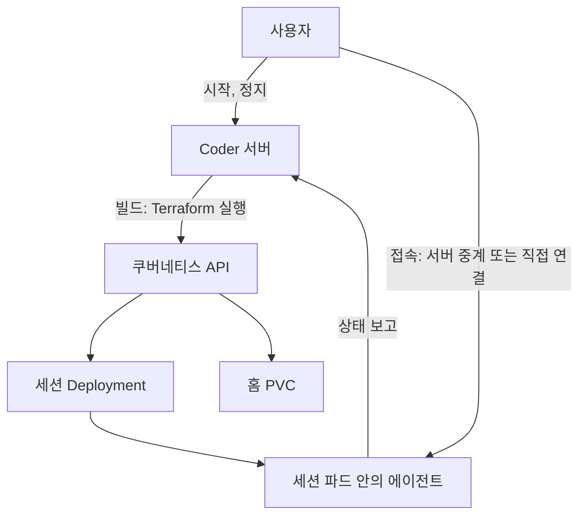
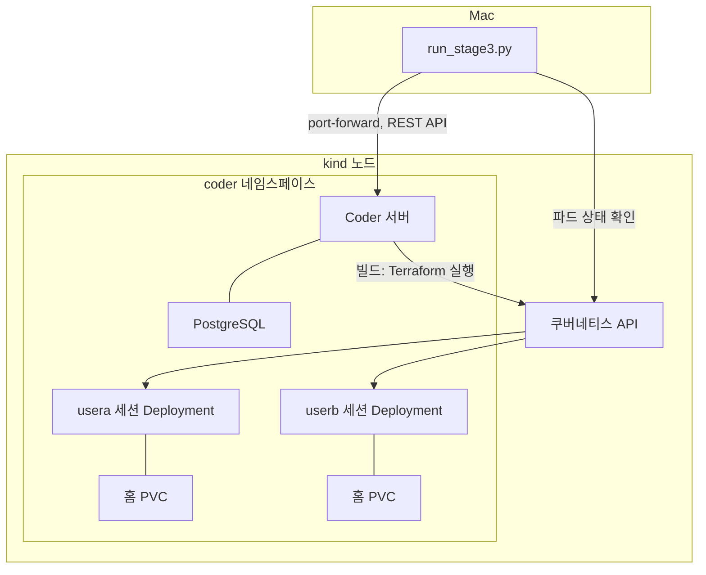

*[서종호(가시다)](https://www.linkedin.com/in/gasida99/)님의 Machine Learning Platform Engineering Study 3주차 학습 내용을 기반으로 합니다.*

<br>

# TL;DR

- Coder는 개발 환경을 Terraform 템플릿으로 정의해 띄우는 오픈소스 서버다. [앞 글]()의 회수 실험을 Coder로 옮겨 돌렸다
- 세션을 정지하면 파드가 사라져 GPU가 넘어가고 홈의 파일은 남는다. [앞 글](#로컬-실험)과 같은 결과다
- 남의 세션을 정지하려면 관리자 토큰이 필요했다. 일반 사용자 토큰은 `404`로 거부됐다
- 공식 예제와 같은 설정의 템플릿에서는 GPU가 없어 파드가 대기 중이어도 Coder의 빌드 상태는 `running`이다. 빌드 상태만 보면 GPU를 받지 못한 세션도 켜진 세션으로 보인다
- 접속 기록 `last_used_at`은 연결이 있는 동안 약 60초마다 갱신되고 연결을 끊으면 세션 안에서 프로세스가 돌아도 멈춘다
- 템플릿의 자동 정지 시간은 기존 세션에 적용되지 않았고 새 세션은 사용자가 연장하거나 끌 수 있었다(오픈소스 기능 범위)

<br>

# 개발 환경 도구의 역할

[앞 글]()에서는 Deployment를 직접 만들어 GPU를 받은 세션을 시험했다. 세션을 정지하면 GPU 요구가 없어져 대기 세션이 뜬다. 파드만 지우면 요구가 남는다. 이렇게 쓰지 않는 세션을 정지해 GPU를 돌려받는 일을 [회수](#용어)라고 불렀다. 가짜 GPU는 kind 노드에 광고한 숫자다. 스케줄러의 계산만 실제와 같다.

세션을 여럿에게 나눠 주려면 그 위에 사용자, 세션 생성 화면, 접속 경로, 기록이 필요하다. 이 부분은 개발 환경 도구가 맡을 수 있다. [앞 글 표](#유휴-세션과-gpu-배정)의 JupyterHub, Eclipse Che, Kubeflow Notebooks가 그렇다. 오픈소스 개발 환경 도구로는 [Coder](https://github.com/coder/coder)도 있어서 Coder로 구현해 봤다. 세션 정의가 Terraform 파일이라 [앞 글의 Deployment와 PVC](#세션의-구성)를 옮기기 쉬웠다. 같은 구조는 앞 글 표의 다른 도구로도 구현해 볼 수 있다.

*도구가 끼면 세션의 상태를 어디서 어떻게 읽어야 할까.* 남의 세션을 멈출 권한, 세션 상태와 파드 상태, 접속 기록, 자동 정지를 봤다.

<br>

# Coder의 구성 요소

Coder에서는 세션을 **워크스페이스(workspace)**라고 부른다. 여기서는 [앞 글](#용어)과 맞춰 세션이라고 쓴다. 구성 요소는 셋이다.

- **템플릿(template):** 세션에 무엇을 만들지 적은 Terraform 파일이다. Terraform은 인프라를 파일로 적어 두면 실제 상태를 그대로 맞춰 주는 도구다.
- **빌드(build):** 세션을 시작하거나 정지할 때 서버가 Terraform을 한 번 실행하는 일이다. 시작과 정지가 각각 빌드 하나다. 이미지 빌드와는 다른 말이다.
- **에이전트(agent):** 세션 파드 안에서 도는 Coder 프로세스다. 사용자의 접속을 받고 상태를 서버에 보고한다.



<center><sup>AI를 이용해 직접 그린 도식</sup></center>

사용자의 시작과 정지 요청은 서버로 가고 서버가 Terraform을 돌려 쿠버네티스 객체를 만들거나 지운다. 세션 파드가 뜨면 안의 에이전트가 서버에 붙어 상태를 보고한다. 접속은 [문서](https://github.com/coder/coder/blob/v2.36.0/docs/admin/networking/index.md)대로라면 가능하면 사용자와 세션을 직접 연결하고 안 되면 서버가 중계하며, 브라우저 접속은 직접 연결을 지원하지 않는다. 서버가 세션을 아는 경로는 빌드 결과와 에이전트의 보고라서 파드 상태와 어긋날 수 있다. 이 어긋남은 [세션 상태와 파드 상태](#세션-상태와-파드-상태)에서 본다.

**정지하면 Deployment만 지워진다.** [템플릿](https://github.com/sirzzang/sirzzang.github.io/blob/master/assets/data/mlpe-ch07-session-reclaim/coder/template/main.tf)에 그렇게 적혀 있다.

```ruby
# main.tf (발췌)
resource "kubernetes_persistent_volume_claim" "home" {   # count가 없어 정지해도 남는다
  ...
}

resource "kubernetes_deployment" "main" {
  count            = data.coder_workspace.me.start_count   # 시작이면 1, 정지면 0
  wait_for_rollout = false # GPU가 없으면 파드가 대기하므로 빌드는 기다리지 않는다
  ...
}
```

`count`는 Terraform에서 그 리소스를 몇 개 만들지 정하는 값이다. `start_count`는 시작 빌드에서 1, 정지 빌드에서 0이므로 정지 빌드는 Deployment를 지운다. [앞 글의 표](#회수-구조)로 보면 `replicas` 0이 아니라 Deployment 삭제에 해당한다. 다시 시작할 때는 템플릿으로 다시 만든다.

<br>

# Coder 회수 시험

[앞 글](#로컬-실험)처럼 Mac의 kind 클러스터에 가짜 GPU 1장을 광고했고 서버 버전은 v2.36.0이다. 코드는 AGPL-3.0이고 `enterprise/` 디렉터리만 별도 라이선스다. 문서 인용도 같은 태그에서 확인했다. 시험 스크립트가 정지 API를 직접 불렀고 판정 프로그램을 붙이지는 않았다. 시나리오마다 한 번 돌렸다. 실험 코드 작성과 실행에는 AI의 도움을 받았다. 코드는 [coder 폴더](https://github.com/sirzzang/sirzzang.github.io/tree/master/assets/data/mlpe-ch07-session-reclaim/coder), 로그는 [stage3_part1.txt](https://github.com/sirzzang/sirzzang.github.io/blob/master/assets/data/mlpe-ch07-session-reclaim/results/stage3_part1.txt)와 [stage3_part2.txt](https://github.com/sirzzang/sirzzang.github.io/blob/master/assets/data/mlpe-ch07-session-reclaim/results/stage3_part2.txt)에 있다.

## 실험 구성

PostgreSQL을 `coder` 네임스페이스에 띄운 뒤 공식 Helm 차트로 서버를 올렸다.

```bash
# install.sh (발췌)
kubectl -n coder apply -f postgres.yaml
helm install coder coder --repo https://helm.coder.com/v2 --version 2.36.0 \
  --namespace coder --values values.yaml --wait --timeout 5m
```

[values.yaml](https://github.com/sirzzang/sirzzang.github.io/blob/master/assets/data/mlpe-ch07-session-reclaim/coder/values.yaml)에는 이미지 태그, 데이터베이스 주소, 서버 주소만 적었다. 서버는 `ClusterIP` 서비스로 두고 Mac에서 `kubectl port-forward`로 붙었다. 시험 스크립트 [run_stage3.py](https://github.com/sirzzang/sirzzang.github.io/blob/master/assets/data/mlpe-ch07-session-reclaim/coder/run_stage3.py)는 표준 라이브러리로 REST API를 부른다. 관리자 계정 `owner`와 일반 사용자 `usera`, `userb`를 만들고 템플릿 `gpu-session`을 올린 뒤 시나리오를 차례로 돌린다. 세션은 서버와 같은 `coder` 네임스페이스에 Deployment와 PVC로 만들어진다.



<center><sup>AI를 이용해 직접 그린 도식</sup></center>

시험 스크립트는 두 경로를 쓴다. 세션을 시작하고 멈추는 요청은 Coder 서버의 REST API로 보내고 파드 상태는 쿠버네티스 API에서 직접 읽는다. 서버가 보는 상태와 클러스터의 상태를 따로 읽어 비교하기 위해서다. 서버는 빌드 때 Terraform으로 쿠버네티스 API를 불러 세션의 Deployment와 PVC를 만들고 자기 상태는 PostgreSQL에 저장한다.

템플릿은 앞 글의 [session.yaml](https://github.com/sirzzang/sirzzang.github.io/blob/master/assets/data/mlpe-ch07-session-reclaim/session.yaml)을 Terraform으로 옮긴 것이다. Deployment와 PVC 구성이 같고 GPU 요청도 `nvidia.com/gpu` 1장이다. 세션 이미지는 Coder 에이전트를 띄우는 `codercom/enterprise-base:ubuntu`다. 리소스 이름은 소유자와 세션 이름으로 만들어서 로그의 파드 이름이 `coder-usera-ws-a-...`로 나온다.

| 시나리오 | 조작 | 다룬 절 |
|---|---|---|
| 1 | 사용자 A가 GPU를 잡은 뒤 사용자 B가 세션을 시작한다 | [세션 상태와 파드 상태](#세션-상태와-파드-상태) |
| 2, 3 | 사용자 B와 owner가 A의 세션을 멈추고 A를 다시 시작한다 | [정지 권한](#정지-권한) |
| 4 | `kubectl`로 파드를 지운다 | [세션 상태와 파드 상태](#세션-상태와-파드-상태) |
| 5, 6 | 접속을 열어 두고, 작업을 남기고 끊는다 | [접속 기록](#접속-기록) |
| 7 | 템플릿의 자동 정지 시간을 바꾼다 | [자동 정지](#자동-정지) |

## 정지 권한

세션 정지는 [빌드 생성 API](https://github.com/coder/coder/blob/v2.36.0/docs/reference/api/builds.md)로 한다. 정지도 빌드 하나를 새로 만드는 일이라 성공 응답이 `201 Created`다.

```bash
# 세션을 정지하는 요청. 토큰은 API를 부를 때 쓰는 로그인 키다
curl -X POST "$CODER_URL/api/v2/workspaces/$WORKSPACE_ID/builds" \
  -H "Coder-Session-Token: $TOKEN" \
  -H 'Content-Type: application/json' \
  -d '{"transition":"stop"}'
```

회수에서는 다른 사람의 세션을 멈춰야 한다. 사용자 A의 세션이 GPU를 배정받았고 사용자 B의 세션이 기다리는 상태였다. A의 세션을 멈추는 같은 요청을 사용자 B의 토큰과 관리자의 토큰으로 보냈다.

```python
# run_stage3.py (발췌)
status, body = build(tokens["userb"], ws_a, "stop")
print("  사용자 B의 stop:", status, str(body.get("message"))[:80])
start = time.time()
status, body = build(owner, ws_a, "stop")
print("  owner의 stop:", status, "initiator:", body.get("initiator_name"), "reason:", body.get("reason"))
```

결과는 이렇다.

```text
  사용자 B의 stop: 404 Resource not found or you do not have access to this resource
  owner의 stop: 201 initiator: owner reason: initiator
  stop 요청부터 B 파드 Ready까지 136초
  pod coder-userb-ws-b-698fcf4fb7-llhtr Running true
  PVC: coder-usera-ws-a-home   Bound | coder-userb-ws-b-home   Bound
```

**owner**는 Coder의 최상위 관리자 역할이다. **일반 사용자에게는 남의 세션이 없는 것처럼 `404`가 나왔다.** 관리자 요청은 빌드를 만들었다. [역할 문서](https://github.com/coder/coder/blob/v2.36.0/docs/admin/users/groups-roles.md)의 표에서 모든 세션을 변경할 수 있는 사이트 역할은 Owner뿐이고 Template Admin은 조회까지다.

**요청은 한 번이지만 완료는 빌드 결과와 파드 소멸로 확인해야 한다.** `201`은 빌드가 만들어졌다는 응답이다. GPU는 빌드가 끝나 Deployment가 사라진 뒤에 돌아온다. 위 136초는 [앞 글의 5초](#대기-세션과-회수)와 비교할 값이 아니고 회수 지연의 기준값으로도 쓸 수 없다. 정지가 Terraform 실행을 거치고 이 로컬 환경의 다른 빌드도 약 135~143초 걸렸다. 이 템플릿에는 readiness 검사가 없어 Ready는 컨테이너가 시작됐다는 뜻이다.

정지 뒤에 A의 PVC는 남았고 B 파드가 GPU를 받았다. A를 다시 시작하자 [앞 글](#회수된-세션의-재개)처럼 홈 파일은 남고 `/tmp` 파일은 사라졌다.

정지가 끝 상태가 아닐 수 있다. [문서](https://github.com/coder/coder/blob/v2.36.0/docs/user-guides/workspace-lifecycle.md)는 사용자 접속으로 세션이 시작될 수 있다고 적는다.

## 세션 상태와 파드 상태

GPU가 없는 상태에서 사용자 B가 세션을 시작한 결과다. 로그의 워크스페이스 상태는 API의 `latest_build.status`이다. 파드 줄의 값은 이름, 상태, 준비 여부다.

```text
  B 빌드: start succeeded / 워크스페이스 상태: running
  pod coder-usera-ws-a-689b78747d-dw548 Running true
  pod coder-userb-ws-b-698fcf4fb7-llhtr Pending <none>
```

**파드는 Pending인데 빌드 상태는 `running`이다.** 이 값은 마지막 시작 빌드가 성공했다는 뜻이다. 템플릿의 `wait_for_rollout = false` 때문에 Terraform은 Deployment를 만든 시점에 끝나고 파드가 뜨기를 기다리지 않는다. 이 설정은 [공식 쿠버네티스 예제 템플릿](https://github.com/coder/coder/blob/v2.36.0/examples/templates/kubernetes/main.tf#L229)과 같다. 켜면 Terraform이 파드를 기다리고 프로바이더 기본 제한 10분 안에 GPU가 비지 않으면 빌드가 실패할 것으로 본다.

Coder에도 이 상황을 나타내는 값이 있다. [문서](https://github.com/coder/coder/blob/v2.36.0/docs/user-guides/workspace-lifecycle.md)는 리소스는 만들어졌지만 에이전트가 연결하지 못한 세션을 Unhealthy라고 부른다. API 응답에는 `health`와 에이전트 `status`가 따로 있다. 소스대로라면 에이전트가 연결되지 않은 세션은 unhealthy로 나온다.

빌드 상태로 세면 GPU를 받지 못한 세션도 켜진 세션으로 센다. `health`는 접속할 수 있는지를 알려 준다. **GPU를 배정받았는지는 파드 쪽을 봐야 한다.**

회수를 Coder 대신 `kubectl`의 파드 삭제로 하면 이 어긋남이 더 커진다. [앞 글의 대기 세션 시나리오](#파드-삭제)를 Coder에서 돌린 결과다. 위 두 줄이 삭제 전, 아래 두 줄이 삭제 30초 뒤다.

```text
  pod coder-usera-ws-a-6d44b84b97-tkbb9 Running true
  pod coder-userb-ws-b-866746c7cd-xmlzg Pending <none>
  pod coder-usera-ws-a-6d44b84b97-rc4k4 Pending <none>
  pod coder-userb-ws-b-866746c7cd-xmlzg Running true
  A 상태: running / B 상태: running
```

이번 실행에서 대기하던 B가 GPU를 받았고 A의 새 파드는 Pending이다. 빌드 상태는 둘 다 `running`이다. `kubectl`로 파드를 지운 일은 Coder의 빌드 기록에 남지 않는다. Deployment가 남아 있으니 [앞 글](#파드-삭제)처럼 GPU 요구도 남는다. **회수는 정지 API로 해야 Coder의 기록과 쿠버네티스의 상태가 맞는다.**

## 접속 기록

세션의 활동을 볼 값으로 Coder는 `last_used_at`을 준다. 연결 활동을 서버가 약 60초 단위로 모아 기록한 시각이다. 필드의 정의는 문서에 없고 소스에서 확인했다. 스크립트로 돌리기 쉬운 SSH 경로로 시험했다. 30초마다 현재 시각과의 차이를 읽었다.

먼저 SSH 연결이 있는 구간을 봤다.

```text
  접속 전 last_used_at 경과 406 초
  접속 중 last_used_at 경과 16 초
  접속 중 last_used_at 경과 46 초
  접속 중 last_used_at 경과 16 초
  접속 중 last_used_at 경과 46 초
  접속 중 last_used_at 경과 16 초
```

차이가 16초와 46초를 오갔다. 30초마다 읽었으니 약 60초마다 갱신된 것이다. 다음은 세션 안에 `sleep 600`을 백그라운드로 남기고 연결을 끊은 뒤다.

```text
  세션 안 sleep 프로세스 수: 1
  접속 끊긴 뒤 last_used_at 경과 11 초
  접속 끊긴 뒤 last_used_at 경과 42 초
  접속 끊긴 뒤 last_used_at 경과 12 초
  접속 끊긴 뒤 last_used_at 경과 42 초
  접속 끊긴 뒤 last_used_at 경과 72 초
  접속 끊긴 뒤 last_used_at 경과 102 초
  ...
  접속 끊긴 뒤 last_used_at 경과 222 초
```

끊은 뒤에도 두 번 더 갱신됐고 마지막 갱신은 약 80초 뒤였다. **그 뒤로는 끝까지 차이가 늘기만 했다.** 끊은 직후 세션 안의 `sleep` 프로세스 1개를 확인했다. 소스상 갱신 조건이 세션과 연결뿐이라 학습도 같을 것으로 본다. [앞 글의 code-server heartbeat](#접속-신호)와 같은 종류의 신호다.

## 자동 정지

Coder에는 템플릿 단위의 자동 정지 기능이 있다. [Default autostop](https://github.com/coder/coder/blob/v2.36.0/docs/admin/templates/managing-templates/schedule.md)은 활동 없이 세션이 도는 시간의 상한이다. 활동이 감지되면 마감을 미룬다. 이 설정이 어떤 세션에 적용되고 사용자가 바꿀 수 있는지 시험했다. 세션이 떠 있는 상태에서 템플릿 값을 1시간으로 바꿨다. 로그의 `ttl_ms`는 세션에 저장된 자동 정지 시간(밀리초)이고 `deadline`은 이번 실행의 마감이다.

```text
  템플릿 변경 직후 기존 세션: ttl_ms=None deadline=없음
  재시작 뒤 기존 세션: ttl_ms=None deadline=없음
  템플릿 변경 뒤 만든 세션: ttl_ms=3600000 deadline=60분 뒤
  사용자의 연장(3시간 뒤로): 200 Deadline updated to 2026-11-04T09:10:31Z.
  연장 뒤: ttl_ms=3600000 deadline=180분 뒤
  사용자의 자동 정지 끄기: 204 None
  끈 뒤: ttl_ms=None deadline=없음
```

기존 세션은 재시작한 뒤에도 값이 비어 있었다. [문서](https://github.com/coder/coder/blob/v2.36.0/docs/user-guides/workspace-scheduling.md)는 기존의 실행 중 세션에 적용되지 않는다고 적고 재시작한 경우는 적지 않는다. 새 세션에는 적용됐지만 **사용자가 마감을 연장할 수도, 끌 수도 있었다.**

사용자가 TTL을 바꾸지 못하게 [`--allow-user-autostop`을 끄거나](https://github.com/coder/coder/blob/v2.36.0/docs/reference/cli/templates_edit.md) [Autostop requirement](https://github.com/coder/coder/blob/v2.36.0/docs/admin/templates/managing-templates/schedule.md)를 쓰려면 Premium 라이선스가 필요하다고 문서는 적는다. Autostop requirement는 활동과 무관하게 세션을 멈춘다. **두 기능도 유휴를 판정하지는 않는다.**

문서 기준으로 자동 정지는 연결을 활동으로 본다.

<br>

# 정리

세션을 멈추는 요청은 한 번이고 GPU가 넘어가는 동작은 [앞 글](#대기-세션과-회수)과 같았다. 상태를 읽는 곳이 달라졌다.

| 시험 | 결과 | 볼 점 |
|---|---|---|
| 남의 세션 정지 | 일반 사용자 `404`, owner `201` | 관리자 토큰이 필요하다 |
| GPU 대기 중인 세션 | 빌드 상태 `running`, 파드 Pending | 파드와 에이전트 상태를 함께 본다 |
| `kubectl`로 파드 삭제 | GPU 요구가 남고 빌드 상태는 `running` | 정지 API를 쓴다 |
| 연결과 `last_used_at` | 연결이 있으면 갱신되고 끊으면 멈춘다 | 세션 안의 일은 이 값에 나타나지 않는다 |
| 자동 정지 설정 | 기존 세션 미적용, 사용자가 끌 수 있음 | 설정의 적용 범위를 확인한다 |

`running`은 빌드의 결과이고 `last_used_at`은 연결의 시각이다. **둘 다 GPU를 쓰는지는 알려 주지 않는다.** [다음 글]()에서는 GPU 쪽 신호를 재 본다.

<br>

# 참고 링크

- [실험 코드와 로그](https://github.com/sirzzang/sirzzang.github.io/tree/master/assets/data/mlpe-ch07-session-reclaim)
- [Coder 저장소](https://github.com/coder/coder)
- [Coder v2.36.0: 템플릿 스케줄 설정](https://github.com/coder/coder/blob/v2.36.0/docs/admin/templates/managing-templates/schedule.md)
- [Coder v2.36.0: 워크스페이스 스케줄](https://github.com/coder/coder/blob/v2.36.0/docs/user-guides/workspace-scheduling.md)
- [Coder v2.36.0: 워크스페이스 수명주기](https://github.com/coder/coder/blob/v2.36.0/docs/user-guides/workspace-lifecycle.md)
- [Coder v2.36.0: 빌드 API](https://github.com/coder/coder/blob/v2.36.0/docs/reference/api/builds.md)

<br>
