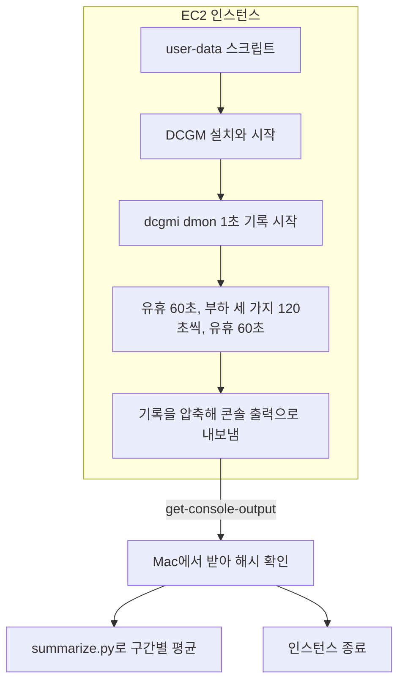

*[서종호(가시다)](https://www.linkedin.com/in/gasida99/)님의 Machine Learning Platform Engineering Study 3주차 학습 내용을 기반으로 합니다.*

<br>

# TL;DR

- 쓰지 않는 세션을 찾으려면 신호가 필요한데 신호마다 틀리는 방향이 다르다. 하나만 쓰면 쓰는 세션을 정지하거나 쓰지 않는 세션을 놓친다
- AWS EC2 `g5.xlarge`의 A10G에 인공 부하 세 가지를 걸고 DCGM(NVIDIA의 GPU 관측 도구) 지표를 쟀다. 스레드 하나짜리 커널과 큰 행렬곱은 사용률이 똑같이 100%였고 커널을 실행하는 단위(SM)의 활동을 평균한 `SM_ACTIVE`로는 0.012와 0.984로 갈렸다
- 메모리만 잡은 프로세스는 사용률 0%에 메모리 19,376MiB였다. 사용률만 보면 쉬는 세션으로 보인다
- phantom(프로세스가 없는데 사용률이 100%로 나오는 상태)은 메모리가 비어 있다. 메모리를 함께 보면 이 상태를 활동으로 세지 않을 수 있다
- 접속 신호는 서버에 연결이 남아 있다는 것만 알려 주므로 창만 열린 세션과 코드를 고치는 사람을 가르지 못한다

<br>

# 접속 신호의 한계

쓰지 않는 세션(사람이 SSH나 브라우저 IDE로 접속해 쓰는 GPU 개발 환경)을 정지해 GPU를 돌려받으려면 쓰지 않는다는 판정이 먼저 있어야 한다. [7.1.1편](#접속-신호)과 [7.1.2편](#접속-기록)에서 본 code-server의 heartbeat와 Coder의 `last_used_at`은 연결이 살아 있는지만 알려 줬다. 창을 열어 둔 채 자리를 비운 세션도 접속 중으로 보이고, 연결을 끊고 작업을 돌려 둔 세션은 쉬는 것으로 보인다. 접속 신호만으로는 세션이 쓰이는지 가르기 어렵다. 돌려받으려는 자원이 GPU이니 다음 후보는 GPU 지표다. *그러면 GPU 지표를 보면 될까.*

GPU 사용률이 0이면 정지하는 규칙을 생각해 볼 수 있다. 코드를 고치는 사람의 세션은 GPU가 대부분 0이다. 세션이 쓰이는 중이어도 GPU는 놀 수 있으므로 **세션의 유휴와 GPU의 유휴는 나눠 봐야 한다.** 사용률이 높으면 두는 규칙도 있다. 사용률이 일의 양을 뜻하지 않는다는 것은 [GPU Utilization 글]()에서 정의로 적은 적이 있다. 그 글에서 작은 커널이 쉬지 않고 돌면 사용률이 100%로 나온다고 썼다.

여기서 **커널(kernel)**은 GPU에서 실행되는 함수다. PyTorch 연산 하나가 커널 하나 이상으로 실행된다. [7.1.1편의 Jupyter 커널](#kubeflow-컬링-코드와-비교)과는 다른 말이다.

[7.1.1편](#로컬-실험)과 [7.1.2편](#coder-회수-시험)은 가짜 GPU로 시험했다. 이번에는 실제 GPU에 부하를 걸어 지표가 어떻게 나오는지 잰다. 측정은 AI의 도움을 받아 돌렸다. 1초 단위 값은 [gpu 폴더](https://github.com/sirzzang/sirzzang.github.io/tree/master/assets/data/mlpe-ch07-session-reclaim/gpu)에 있다.

<br>

# GPU 지표 측정

## 측정 구성

AWS EC2 `g5.xlarge`의 NVIDIA A10G 한 장에 부하를 120초씩 걸고 `dcgmi dmon`으로 1초마다 기록했다. 이 GPU는 SM이 80개이고 전력 상한은 300W다. 드라이버는 580.126.09, DCGM은 4.7.1, PyTorch는 2.7.0이다. DCGM은 NVIDIA의 GPU 관측 도구다. 쿠버네티스에서는 dcgm-exporter가 이 지표를 Prometheus로 내보낸다. GPU 한 장에서 한 번 돌린 값이고 부하 순서는 고정이다. 값은 부하의 시작과 끝 5초를 뺀 평균이다. GPU 프로세스 수는 부하마다 한 번 읽었다.

측정은 인스턴스 안에서 끝나게 했다. SSH와 포트를 열지 않고 부팅 때 도는 user-data 스크립트가 DCGM을 설치하고 부하를 차례로 건 뒤 기록을 압축해 콘솔 출력으로 내보낸다. Mac에서는 `get-console-output`으로 결과를 받았다. 스크립트가 멈추더라도 2시간 뒤에 인스턴스가 스스로 없어지도록 `shutdown -h +120`과 종료 동작 `terminate`를 함께 걸었다.



<center><sup>AI를 이용해 직접 그린 도식</sup></center>

`dcgmi dmon`은 부하가 도는 내내 1초마다 기록하고 스크립트는 구간마다 시작과 끝 시각을 따로 남긴다. `summarize.py`는 이 시각으로 1초 기록을 구간별로 잘라 평균을 낸다. 결과를 받은 뒤에는 인스턴스를 바로 종료했다.

<details markdown="1">
<summary><b>측정 환경과 명령</b></summary>

서울 리전의 `g5.xlarge`를 AMI `Deep Learning OSS Nvidia Driver AMI GPU PyTorch 2.7 (Ubuntu 22.04)`로 띄웠다. 드라이버와 PyTorch는 AMI에 포함돼 있고 DCGM은 NVIDIA 저장소에서 설치했다. 측정이 끝나면 인스턴스가 스스로 종료되도록 걸어 두었다. 측정은 약 15분 걸렸다.

```bash
# 인스턴스 시작 (발췌)
aws ec2 run-instances --region ap-northeast-2 \
  --image-id ami-05bfd36e7686b161f --instance-type g5.xlarge \
  --instance-initiated-shutdown-behavior terminate \
  --user-data file://userdata.sh

# DCGM 설치와 시작
sudo apt-get install -y datacenter-gpu-manager-4-cuda12
sudo systemctl start nvidia-dcgm

# 사용률(203), 메모리(252), 전력(155), GR_ENGINE_ACTIVE(1001), SM_ACTIVE(1002)를 1초 간격으로 기록한다
dcgmi dmon -i 0 -e 203,252,155,1001,1002 -d 1000
```

요약에 쓴 코드는 [summarize.py](https://github.com/sirzzang/sirzzang.github.io/blob/master/assets/data/mlpe-ch07-session-reclaim/gpu/summarize.py)다.

</details>

부하는 지표의 차이를 보려고 만든 인공 부하다.

| 부하 | 하는 일 |
|---|---|
| `held` | 메모리 약 20GB를 잡고 커널을 돌리지 않는다 |
| `one_thread` | 스레드 하나짜리 커널을 쉬지 않고 돌린다. 사용률의 정의를 시험하려고 만든 극단값이다 |
| `matmul` | 8192×8192 행렬곱을 쉬지 않고 돌린다 |

부하 스크립트는 공개 자료에 넣지 않았다. `dcgmi dmon`의 출력은 이런 모양이고 아래는 부하마다 시작 30초 뒤의 한 줄을 옮긴 것이다. 열은 차례로 사용률, 메모리, 전력, `GR_ENGINE_ACTIVE`, `SM_ACTIVE`다.

```text
#Entity         GPUTL             FBUSD             POWER             GRACT        SMACT
ID                                                   W
GPU 0           0                 19376             88.591            0.000        0.000
GPU 0           100               302               89.978            1.000        0.012
GPU 0           100               850               298.430           1.000        0.983
```

## 측정 결과

아래 표에서 사용률은 %이고 두 지표는 0에서 1 사이의 비율이다.

| 부하 | 사용률 | 메모리(MiB) | 전력(W) | `GR_ENGINE_ACTIVE` | `SM_ACTIVE` | GPU 프로세스 |
|---|---|---|---|---|---|---|
| 없음 | 0% | 0 | 24.3 | 0.000 | 0.000 | - |
| `held` | 0% | 19,376 | 89.1 | 0.000 | 0.000 | 1 |
| `one_thread` | 100% | 302 | 90.0 | 1.000 | 0.012 | 1 |
| `matmul` | 100% | 850 | 299.2 | 1.000 | 0.984 | 1 |

`one_thread`의 메모리 302MiB는 텐서를 거의 잡지 않아도 나오는 값이다. 프로세스가 GPU를 쓰려고 만드는 **CUDA 컨텍스트(context)**가 메모리를 쓰기 때문이다.

## 사용률

`DCGM_FI_DEV_GPU_UTIL`로 읽는 **사용률**은 `nvidia-smi`의 GPU-Util과 같은 값이다. [NVIDIA 문서](https://docs.nvidia.com/deploy/nvidia-smi/index.html)의 정의는 지난 샘플 구간 중 커널이 하나 이상 돈 시간의 비율이다. 스레드 하나짜리 커널과 큰 행렬곱이 같은 100%로 나온 것은 이 정의와 맞다. **이 지표는 GPU가 얼마나 찼는지를 재지 않는다.**

## GR_ENGINE_ACTIVE와 SM_ACTIVE

두 값은 DCGM의 **프로파일링 지표**다. 이름에 `PROF`가 붙고 사용률보다 GPU 내부에 가까운 값을 잰다. [DCGM 문서](https://docs.nvidia.com/datacenter/dcgm/latest/user-guide/feature-overview.html)는 두 값을 이렇게 정의한다.

| 지표 | 정의 |
|---|---|
| `DCGM_FI_PROF_GR_ENGINE_ACTIVE` | 그래픽이나 연산 엔진의 어느 부분이든 활성이었던 시간의 비율 |
| `DCGM_FI_PROF_SM_ACTIVE` | SM(Streaming Multiprocessor)에 warp가 하나 이상 활성이었던 시간의 비율을 모든 SM에 대해 평균한 값. 메모리 요청을 기다리는 warp도 활성으로 센다 |

SM은 GPU에서 커널을 실제로 실행하는 단위다. warp는 함께 실행되는 스레드 묶음이다. `GR_ENGINE_ACTIVE`는 엔진의 어디든 일하면 활성이라 스레드 하나로 1.000이 된다. 이름은 다르지만 이 측정에서는 사용률 이상의 정보를 주지 않았다. `SM_ACTIVE`는 SM마다의 값을 평균하므로 SM 몇 개만 일하면 값도 그만큼만 오른다. 그래서 **스레드 하나짜리 커널에서 0.012였고 큰 행렬곱에서 0.984였다.** 0.012는 SM 80개 중 한 개의 몫인 0.0125에 가깝다.

[Phantom GPU Utilization 글]()에서는 `GR_ENGINE_ACTIVE`를 가설과 가장 가까운 지표로 적었다. 이번 측정에서는 정상 부하에서도 1.000이어서 이 지표만으로는 가를 수 없다.

DCGM 문서는 `SM_ACTIVE` 0.8 이상이 효과적인 사용의 필요조건이지만 충분조건은 아니라고 적는다. 성능을 볼 때의 기준이다. 세션 판정은 GPU에 일이 올라 있는지를 보는 일이라 기준이 다르다.

## 메모리와 전력

메모리는 지금 CUDA 컨텍스트가 열려 있는 세션을 가른다. `held`처럼 모델을 올려 둔 세션은 사용률이 0이어도 메모리가 남는다. 프로세스가 끝나면 메모리도 0으로 돌아가므로 일을 마친 세션과 시작 전 세션은 메모리로 구분되지 않는다. 메모리가 많다고 지금 쓰는 중인 것도 아니다. **올려 두고 자리를 뜬 세션과 올려 두고 결과를 보는 세션은 지표가 같다.**

전력은 이 GPU에서 2분 동안 `held`가 유휴의 약 3.7배였다. 연산이 없어도 프로세스가 GPU를 잡고 있는 동안에는 유휴보다 높았다. `one_thread`도 90.0W로 `held`와 비슷해 전력으로는 둘을 가르지 못했다. `matmul`은 전력 상한 가까이 올랐다. 부하를 끝낸 뒤의 유휴 구간은 27.7W로 부하 전보다 조금 높았다.

<br>

# phantom 상태

사용률이 실제 상태와 어긋나는 경우는 프로세스가 없을 때도 있다. [Phantom GPU Utilization 글]()에서 다룬 상태다. 학습이 비정상 종료된 뒤 일부 GPU가 사용률 100%, 메모리 0MiB, 프로세스 없음으로 관측됐다. 사용률의 정의대로라면 프로세스가 없으니 돌 커널도 없어야 한다. 원인은 그 글에서도 가설로 남겼다.

| | 정상 유휴 | 정상 사용 | phantom |
|---|---|---|---|
| 사용률 | 0% | 커널이 돈 시간만큼 | 100% |
| 메모리 | 거의 0 | 수백 MiB 이상 | 거의 0 |
| GPU 프로세스 | 없음 | 있음 | 없음 |

이런 GPU가 세션에 배정되면 **사용률로만 판정하는 규칙은 phantom이 풀리기 전까지 세션을 쓰는 중으로 본다.** [그 글]()에서 `nvidia-smi dmon`의 `sm` 값도 100%였다. 그래서 [7.1.1편의 실험 코드](https://github.com/sirzzang/sirzzang.github.io/blob/master/assets/data/mlpe-ch07-session-reclaim/decide.py)는 사용률이 높아도 메모리가 비어 있으면 연산으로 세지 않게 했다.

메모리 기준을 쓸 때 조심할 점은 [그 글]()에 적어 두었다. 메모리를 적게 쓰는 정상 워크로드를 phantom으로 잘못 볼 수 있다. 이번 측정에서는 텐서를 거의 잡지 않아도 CUDA 컨텍스트만으로 302MiB였다. 이 GPU에서 쓰는 프로세스가 100MiB 아래로 내려가기는 어려워 보인다.

<br>

# 신호별 오판 방향

아래 표는 각 신호를 단독으로 쓸 때 틀리는 방향이다. **왼쪽 오판은 쓰는 세션을 정지한다. 오른쪽 오판은 쓰지 않는 세션을 놓친다.** 측정으로 확인한 칸은 사용률, 메모리, `GR_ENGINE_ACTIVE`, 전력의 오른쪽 칸과 접속 칸이다. 나머지는 지표 정의에서 따라 나온 일반론이다.

| 신호 | 재는 것 | 쓰는 중인데 유휴로 판정 | 유휴인데 쓰는 중으로 판정 | 판정에서 맡는 일 |
|---|---|---|---|---|
| 사용률 | 커널이 돈 시간 비율 | 코드 편집, 데이터 로딩, 아주 짧은 커널 | phantom, 일이 거의 없는 커널 | 프로파일링 지표가 없을 때의 대체 신호 |
| 메모리 | GPU 메모리 사용량 | 아직 CPU 전처리 단계 | 모델을 올려 두고 자리를 뜸 | CUDA 컨텍스트가 열려 있는지 가른다 |
| `SM_ACTIVE` | SM에 warp가 올라 있던 비율 | SM을 아주 적게 쓰는 작업 | warp만 떠서 대기하는 커널(재 보지 못했다) | GPU에 일이 올라 있는지 가른다 |
| `GR_ENGINE_ACTIVE` | 엔진이 활성인 시간 비율 | GPU 연산이 없는 단계 | 일이 거의 없는 커널 | 사용률의 약점을 메우지 못한다 |
| 전력 | 소비 전력 | 기준을 높게 잡으면 일이 적은 작업 | 메모리만 잡은 프로세스, phantom | 교차 확인. 단독으로 쓰지 않는다 |
| GPU 프로세스 | 장치를 쓰는 프로세스 | 학습이 아직 시작 전 | 프로세스는 있는데 대기만 한다 | phantom을 가른다. 측정은 호스트에서 했다 |
| 접속 | SSH, IDE 연결 | 접속을 끊고 돌린 학습 | 창만 열린 세션 | 연결이 살아 있는지 |
| CPU | 컨테이너 CPU 사용량 | GPU만 쓰는 작업, 입출력 대기 작업 | 백그라운드 데몬 | GPU 없이 일하는 세션을 가른다 |
| 시간 | 시작 뒤 경과, 마지막 사용 | 기준이 짧으면 잠시 자리를 비운 사람 | 기준이 길면 그만큼 늦게 돌려받는다 | 판정의 기준 시각 |

**왼쪽 오판은 다른 신호가 메운다.** 접속을 끊고 돌린 학습은 접속으로는 유휴이지만 `SM_ACTIVE`가 높다. 코드를 고치는 사람은 GPU 지표로는 유휴이지만 접속이 살아 있다. **오른쪽 오판은 이렇게 메워지지 않는다.** 창만 열린 세션은 접속 신호가 살아 있다. 다른 신호로도 코드를 고치는 사람과 구분되지 않는다.

<br>

# 지표가 없는 기종

`SM_ACTIVE`는 기종이나 설정에 따라 나오지 않을 수 있다. [DCGM 문서](https://docs.nvidia.com/datacenter/dcgm/latest/user-guide/feature-overview.html)는 프로파일링 지표를 Volta 아키텍처 이후의 데이터센터 제품에서 지원한다고 적는다. 그 밖의 GPU에서는 나오지 않을 수 있다.

지원 기종이라도 수집 설정을 봐야 한다. dcgm-exporter의 [기본 카운터 파일](https://github.com/NVIDIA/dcgm-exporter/blob/main/etc/default-counters.csv)에서 `GR_ENGINE_ACTIVE`는 켜져 있고 `SM_ACTIVE`는 주석 처리되어 있다(2026년 11월 main 브랜치 기준). 같은 DCGM 문서는 프로파일링 지표 수집이 Nsight Systems, Nsight Compute와 충돌한다고 적으므로 프로파일러를 돌리는 세션에서는 값이 비는 구간이 생길 수 있다. 판정에 쓰기 전에 **서버마다 실제로 나오는지** `dcgmi profile --list`나 수집된 값으로 확인해야 한다.

나오지 않는 기종에서는 다른 신호로 대신하게 되고 그만큼 가를 수 있는 범위가 줄어든다.

<br>

# 정리

GPU 지표를 보면 될까. **지표만으로는 안 된다.** 사용률과 `GR_ENGINE_ACTIVE`는 일의 양을 말하지 않았다. `SM_ACTIVE`는 값이 갈렸지만 나오는 환경이 정해져 있다. 메모리는 컨텍스트가 열려 있다는 표시이고 접속은 연결이 남아 있다는 표시다. 그래서 판정은 신호를 묶어서 하게 된다.

**신호를 묶어도 신호가 같은 상태는 가르지 못한다.** 올려 두고 떠난 세션과 결과를 내일 볼 예정인 세션은 신호로는 같다. 어떤 상태를 사용으로 볼지, 정지할 때 무엇을 지켜 줄지는 측정으로 정해지지 않는다. [다음 글]()에서 이 문제를 다룬다.

<br>

# 참고 링크

- [1초 단위 값](https://github.com/sirzzang/sirzzang.github.io/tree/master/assets/data/mlpe-ch07-session-reclaim/gpu)
- [DCGM Feature Overview: Profiling Metrics](https://docs.nvidia.com/datacenter/dcgm/latest/user-guide/feature-overview.html)
- [nvidia-smi 문서](https://docs.nvidia.com/deploy/nvidia-smi/index.html)
- [dcgm-exporter](https://github.com/NVIDIA/dcgm-exporter)

<br>
