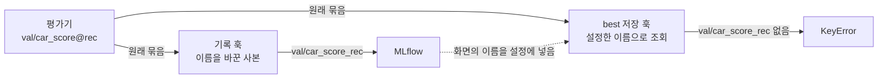

*[서종호(가시다)](https://www.linkedin.com/in/gasida99/)님의 Machine Learning Platform Engineering Study 4주차 학습 내용을 기반으로 합니다.*

<br>

# TL;DR

- 학습 루프 안에서 epoch마다 도는 검증(epoch별 검증)은 best 체크포인트와 조기 종료를 정하는 근거지만 학습이 쓰지 않는 코드와 조건으로 돈다. 그래서 이 검증에서만 생기는 문제는 검증이 처음 도는 epoch까지 학습을 돌린 뒤에야 드러난다. 학습 플랫폼을 운영하며 겪은 이런 문제는 결과 수집, 검증 경로의 의존성, 지표 이름의 세 가지 양상으로 나타났다([들어가며](#들어가며))
- rank(학습 프로세스)마다 파드를 따로 띄우는 플랫폼에서 학습 프레임워크 MMEngine의 기본 결과 수집이 실패했다. rank마다 결과를 파일로 쓰고 rank 0이 모아 읽는 방식은 모든 rank가 같은 파일시스템을 볼 때만 동작해서 다른 파드의 파일을 찾지 못했고, GPU 통신으로 모으게 바꿔 해결했다([사례 1](#사례-1-다른-파드에-있는-결과-파일))
- 평가 지표 계산이 GPU 전용 코드라 CPU 점검으로는 학습 경로만 확인할 수 있었다. 학습 경로가 쓰지 않는 라이브러리의 버전이 바뀌어 첫 epoch 뒤 지표 계산에서 실패한 일도 있었다([사례 2](#사례-2-cpu-점검과-gpu-전용-평가-경로), [사례 3](#사례-3-첫-epoch-뒤에-드러난-라이브러리-버전))
- MLflow가 받지 않는 문자가 지표 이름에 있어 검증 지표가 통째로 빠졌고, 고친 이름을 best 기준으로 쓰자 첫 검증에서 `KeyError`가 났다. 클래스 평균 지표로 조기 종료를 정한 학습은 작은 물체 클래스가 개선되는 중에 멈췄다([사례 4](#사례-4-mlflow가-받지-않는-지표-이름), [사례 5](#사례-5-감시-지표에-따라-갈린-best와-조기-종료))
- 검증 경로의 문제는 학습 경로 점검으로는 보이지 않으니, 검증이 거치는 코드를 학습 초반에 한 번 실행해 봐야 일찍 드러난다. Kubeflow Pipelines(KFP)에서 최종 검증을 별도 단계로 두면 실패한 검증만 다시 돌릴 수 있지만 epoch별 검증은 학습 단계에 그대로 남고, 학습 시작 직후 검증 몇 배치를 돌리는 점검은 아직 넣지 않았다([앞당기는 방법](#검증-문제를-학습-시작-직후로-당기는-방법))

<br>

# 들어가며

학습 플랫폼을 운영하면서, 학습 경로는 문제없이 돌던 분산 학습이 검증에 들어가는 순간 멈추는 일을 여러 번 겪었다. 대부분은 첫 epoch를 마치고 검증이 처음 돌 때였다. 모두 학습 루프 안에서 epoch마다 검증 데이터로 모델을 평가하는 검증에서 난 일이다. 이 검증은 가장 좋은 체크포인트(best)를 고르고, 개선이 멈추면 학습을 일찍 끝내는 조기 종료(early stopping)를 판단하는 근거다. 이 글에서는 이것을 epoch별 검증이라고 부른다. 플랫폼은 [8.1.1편의 학습 플랫폼 구성](#학습-플랫폼의-구성)대로 분산 학습의 rank(학습 프로세스 하나)마다 파드를 따로 띄운다. 사례의 학습 코드는 OpenMMLab의 학습 프레임워크 MMEngine 0.10.5 위에서 돌았다.

epoch별 검증은 학습과 다른 조건에서 돈다. 검증 데이터를 rank마다 나눠 추론한 결과를 한곳에 모아야 하고, 학습이 부르지 않는 라이브러리를 쓰며, 지표 이름으로 best와 조기 종료를 정한다. 게다가 검증은 설정한 시작 시점과 주기에 맞는 epoch가 끝날 때만 돌기 때문에, 이 조건의 문제는 검증이 처음 도는 epoch까지 학습을 돌린 뒤에야 보인다.

4주차 스터디 범위 가운데 책 [머신러닝 플랫폼 엔지니어링](https://www.onlybook.co.kr/entry/mlops)의 8.1.4절은 학습이 끝난 모델을 검증하는 컴포넌트를 따로 만든다. 책은 이 컴포넌트가 성능 저하를 일찍 잡고 배포 결정을 돕는다고 설명한다. 결과는 Kubeflow Pipelines(KFP)의 `Output[Metrics]`로 기록하고, 의존성은 버전이 서로 얽히기 쉬운 머신러닝 라이브러리를 고려해 미리 패키징된 이미지로 해결하라고 권한다. 이 컴포넌트처럼 파이프라인에서 학습 단계 뒤에 따로 두는 단계를 검증 단계라고 부른다([단계 구성 가정](#학습-플랫폼의-구성)). 다만 검증 단계가 학습에서 떼어 내는 것은 학습이 끝난 뒤의 최종 검증뿐이다. 책의 학습 컴포넌트 안에서도 YOLO 학습 라이브러리 Ultralytics가 epoch마다 모델을 평가해 `best.pt`를 고르고 조기 종료를 판단하므로, 검증 단계를 따로 두어도 epoch별 검증은 학습 단계 안에 남는다. 운영 중에 겪은 실패는 모두 이 epoch별 검증에서 났다. *학습은 잘 도는데 epoch별 검증에서만 실패하는 이유는 무엇일까. 검증을 별도 단계로 떼어 내면 무엇이 달라지고 무엇이 그대로일까.*

<br>

# 프로세스 사이의 결과 수집

## 사례 1: 다른 파드에 있는 결과 파일

MMEngine의 기본 결과 수집은 모든 rank가 같은 파일시스템을 본다고 전제하는데, rank를 파드로 나누면 그 전제가 깨진다. 검증을 매 epoch 돌리도록 설정한 분산 학습이 첫 epoch를 끝내고 검증에 들어갔고, 아래 오류와 함께 학습 전체가 실패했다. 학습 경로의 순전파·역전파와 그래디언트 동기화, 체크포인트 저장과 업로드, MLflow 기록은 모두 정상으로 끝난 뒤였다.

```text
# 분산 검증 실패 로그(경로 일부 일반화)
File ".../mmengine/dist/dist.py", line 1022, in collect_results_cpu
    raise FileNotFoundError(
FileNotFoundError: <수집 디렉터리> is not an shared directory for rank 1,
please make sure <수집 디렉터리> is a shared directory for all ranks!
```

메시지의 `rank 1`은 rank 0이 결과 파일을 찾지 못한 상대 rank이고, 메시지가 요구하는 공유 디렉터리는 파드 사이에 없었다. 학습이 끝날 때만 설정 파일과 best 모델을 MLflow에 올리던 코드도 이 실패로 돌지 않았는데, 이 산출물 문제는 [9.1.2편의 체크포인트 절](#사례-6-체크포인트와-best의-위치)이 다룬다.

MMEngine 0.10.5의 결과 수집 코드([소스](https://github.com/open-mmlab/mmengine/blob/v0.10.5/mmengine/dist/dist.py#L952-L1062))는 결과를 **디스크로 건네는 방식과 통신으로 건네는 방식 두 가지**를 둔다. 통신 쪽이 쓰는 PyTorch의 `all_gather_object`는 모든 rank가 서로의 데이터를 전부 받는 집합 통신(all_gather)이다. GPU 사이에서 이런 집합 통신을 맡는 것은 NVIDIA의 NCCL 라이브러리다([분산 학습 배경 글](#nccl-통신-계층)).

| `collect_device` | 모으는 방법                                                                                                               | 파일시스템                            |
| ------------------ | ------------------------------------------------------------------------------------------------------------------------- | ------------------------------------- |
| `'cpu'`(기본값)  | rank마다 결과를 `{collect_dir}/part_{rank}.pkl` 파일로 쓰고, 모든 rank가 쓰기를 마치면 rank 0이 그 파일들을 읽어 합친다 | 모든 rank가 같은 디렉터리를 봐야 한다 |
| `'gpu'`          | `torch.distributed.all_gather_object`로 결과 객체를 프로세스 사이에서 직접 모은다                                       | 필요 없다                             |

학습 코드의 데이터셋 클래스는 검증 지표를 계산하는 평가기 역할도 겸했고, 수집 방식은 MMEngine 기본값([소스](https://github.com/open-mmlab/mmengine/blob/v0.10.5/mmengine/evaluator/metric.py#L44-L49))인 `'cpu'`였다. 수집 디렉터리도 작업 디렉터리 아래 상대 경로였으니, rank 0은 `part_1.pkl`을 자기 파드에서 찾았지만 그 파일은 rank 1의 파드 안에 있었다.

```text
# 흐름을 풀어 쓴 것(실제 로그는 위 블록)
rank 0 (파드 A): <수집 디렉터리>/part_0.pkl 쓰기 성공
rank 1 (파드 B): <수집 디렉터리>/part_1.pkl 쓰기 성공
rank 0 (파드 A): <수집 디렉터리>/part_1.pkl 읽기 시도 → FileNotFoundError
```

<details markdown="1">
<summary><b>CPU 수집 코드</b></summary>

```python
# mmengine/dist/dist.py collect_results_cpu (v0.10.5)
    # dump the part result to the dir
    with open(osp.join(tmpdir, f'part_{rank}.pkl'), 'wb') as f:  # type: ignore
        pickle.dump(result_part, f, protocol=2)

    barrier()

    # collect all parts
    if rank != 0:
        return None
    else:
        # load results of all parts from tmp dir
        part_list = []
        for i in range(world_size):
            path = osp.join(tmpdir, f'part_{i}.pkl')  # type: ignore
            if not osp.exists(path):
                raise FileNotFoundError(
                    f'{tmpdir} is not an shared directory for '
                    f'rank {i}, please make sure {tmpdir} is a shared '
                    'directory for all ranks!')
            with open(path, 'rb') as f:
                part_list.append(pickle.load(f))
```

rank마다 자기 결과를 `part_{rank}.pkl`로 쓰고 `barrier()`로 모두 쓸 때까지 기다린 뒤, rank 0만 남아 0번부터 차례로 파일을 연다. 파일이 없으면 수집 디렉터리를 공유하지 않는다고 보고 예외를 낸다. GPU 수집(`_collect_results_device`)은 이 자리에서 `all_gather_object(result_part)` 한 줄로 모든 rank의 결과를 받는다([소스](https://github.com/open-mmlab/mmengine/blob/v0.10.5/mmengine/dist/dist.py#L1041-L1062)).

</details>

이 실패를 가르는 조건은 쿠버네티스를 쓰느냐나 파드가 어느 노드에 뜨느냐가 아니라, **모든 rank가 수집 디렉터리를 같은 파일시스템에서 보느냐**다. 서버 한 대에서 PyTorch의 분산 실행 도구 `torchrun`으로 GPU마다 학습 프로세스를 띄우면([분산 학습 배경 글](#torchrun)) 모든 rank가 한 파일시스템에 있으니, 작업 디렉터리 아래의 상대 경로가 그대로 공유 디렉터리가 된다. 쿠버네티스에서도 파드 하나에 GPU를 모두 주고 그 안에서 `torchrun`을 돌리면 rank들이 한 컨테이너 안에 있어 마찬가지다. 반대로 rank마다 파드를 띄우면 같은 노드에 모아 띄워도 파드마다 컨테이너 파일시스템이 따로라 수집 디렉터리가 공유되지 않고, 모든 파드에 같은 쓰기 볼륨을 붙여 그 아래를 수집 디렉터리로 써야 다시 공유된다. **이 학습 코드는 서버 한 대에서 돌 때 이 조건을 저절로 갖췄고, 코드는 그대로인 채 rank마다 파드를 띄우는 환경으로 옮기자 조건이 깨졌다.** 실행 환경과 검증 설정에 따라 결과는 다음처럼 갈렸다.

| 실행 방식                                          | rank 사이 파일시스템 | 검증                                                 |
| -------------------------------------------------- | -------------------- | ---------------------------------------------------- |
| 서버 한 대나 파드 하나에서 여러 GPU(`torchrun`)  | 같은 파일시스템      | 정상                                                 |
| rank마다 파드, 검증 주기가 최대 epoch보다 김       | 파드마다 따로        | 마지막 epoch 뒤 한 번 실행 → 학습을 다 돌린 뒤 실패 |
| rank마다 파드, 검증 시작 epoch가 최대 epoch보다 큼 | 파드마다 따로        | 실행되지 않음                                        |
| rank마다 파드, 매 epoch 검증                       | 파드마다 따로        | 첫 epoch 뒤 실패                                     |

표의 둘째와 셋째 행은 매 epoch 검증을 켜기 전까지 쓰던 설정이다. 기존 설정은 검증 주기(`val_interval`)를 최대 epoch보다 길게 잡아(둘째 행) 학습 도중에는 검증을 돌리지 않았다. 그래도 MMEngine의 학습 루프([소스](https://github.com/open-mmlab/mmengine/blob/v0.10.5/mmengine/runner/loops.py#L101-L105))는 마지막 epoch 뒤에 검증을 한 번 돌리므로, 서버 한 대에서는 같은 파일시스템에서 정상으로 돌던 이 검증이 rank마다 파드를 띄우자 학습을 다 돌린 뒤에 실패하게 됐다. 그래서 플랫폼에서는 검증 시작 epoch(`val_begin`)를 최대 epoch보다 크게 잡아(셋째 행) 검증을 임시로 막아 두었고, 매 epoch 검증을 켜기 전까지 이 실패는 다시 드러나지 않았다. 실패는 피했지만 검증 지표로 best를 고르는 기능도 함께 꺼진 상태였다.

임시로 막아 둔 검증을 다시 켜려면, 모든 rank가 수집 디렉터리를 같은 파일시스템에서 보게 하거나 파일 대신 통신으로 결과를 모아야 했다. 그때 비교한 방법은 세 가지다.

| 방법                                                                   | 장점                                                                                   | 한계                                                                                                                                                                                                                                                                                                                                 |
| ---------------------------------------------------------------------- | -------------------------------------------------------------------------------------- | ------------------------------------------------------------------------------------------------------------------------------------------------------------------------------------------------------------------------------------------------------------------------------------------------------------------------------------ |
| 모든 파드에 이미 붙어 있던 hostPath 볼륨 아래를 수집 디렉터리로 지정   | 설정의 경로 하나만 바꾸면 된다                                                         | hostPath는 노드의 디렉터리라 같은 노드의 파드끼리만 공유된다. rank가 여러 노드에 흩어지면 그대로 실패한다                                                                                                                                                                                                                            |
| 모든 파드가 함께 쓰는 NFS 볼륨을 붙이고 그 아래를 수집 디렉터리로 지정 | 학습 코드의 수집 방식을 그대로 쓰고 GPU 메모리를 더 쓰지 않는다                        | 학습 데이터를 읽는 공유 스토리지는 학습 파드에 읽기 전용으로만 붙어 있어([읽기 전용 마운트의 색인 캐시 사례](#사례-3-읽기-전용-마운트에-쓰는-색인-캐시)), 쓰기 가능한 공유 볼륨을 새로 마련해 노드마다 붙여야 했다. 그때까지는 검증을 켤 수 없다 |
| 평가기의 수집 방식을 GPU 통신(`collect_device='gpu'`)으로 전환       | 파일시스템이 필요 없고, 학습이 이미 쓰는 NCCL을 그대로 쓴다. 평가기 인자만 바꾸면 된다 | MMEngine은 결과를 `all_gather_object`로 모으므로([소스](https://github.com/open-mmlab/mmengine/blob/v0.10.5/mmengine/dist/dist.py#L1041-L1062)) rank 0만 쓸 결과를 모든 rank가 GPU 메모리로 받는다. 결과가 크면 부담이 된다                                                                                                         |

>  이 셋 말고도 두 방법을 적어 두었다가 비교에서 뺐다. 하나는 분산 학습 잡의 실행 프레임워크가 제공하는 보고 기능으로 각 rank가 결과를 드라이버 프로세스에 보내고, 드라이버에서 합치는 방법이다. 파일시스템도 GPU 메모리도 쓰지 않지만, 결과를 모아 지표를 계산하는 일이 MMEngine의 검증 루프 안에 있어서 그 루프를 크게 고쳐야 했다. 다른 하나는 검증 루프의 예외를 잡아 경고만 남기고 학습을 이어 가는 방법이다. 검증이 실패해도 학습과 체크포인트는 살아남지만, 결과를 모으는 방법이 아니라 실패를 다루는 방법이라 검증 자체는 여전히 돌지 않는다. MMEngine 코어를 고치거나 실행 중에 덮어써야 하고, 실패를 삼키면 검증 지표가 빠진 채 학습이 끝나도 드러나지 않는다.

위 대안 중 GPU 수집을 택했다. 모을 결과는 rank마다 맡은 검증 샘플의 예측 정도라 통신 부담이 작다고 봤고, NCCL은 학습이 이미 쓰는 경로라 인프라를 새로 둘 필요가 없었다. 쓰기 가능한 공유 볼륨은 체크포인트나 데이터처럼 다른 이유로 필요해질 때 들이는 편이 맞고, 검증 결과를 모으려고 NFS부터 마련하는 것은 과하다고 판단했다. 평가기의 수집 방식은 학습 코드 안의 설정이라 원래는 플랫폼이 손대는 곳이 아니다. 이 학습은 플랫폼을 만들며 제출부터 기록까지 전 과정을 시험하려고 직접 돌린 학습이었고, 그래서 ML 엔지니어 역할을 맡아 학습 코드를 직접 고쳤다. 수집 디렉터리는 CPU 수집에서만 받는 인자라 GPU 수집과 함께 주면 `BaseMetric`이 `ValueError`를 내므로([소스](https://github.com/open-mmlab/mmengine/blob/v0.10.5/mmengine/evaluator/metric.py#L47-L49)) 이 인자도 함께 뺐다. 전환 뒤에는 여러 노드에 흩어진 rank의 결과가 rank 0에 모였고 검증 지표가 매 epoch MLflow에 기록됐다.

GPU로 모으면 통신 때문에 검증이 느려지고 파일로 주고받는 편이 더 빠르리라는 걱정도 있었지만, 전환 뒤 잰 검증 시간에서 가장 큰 몫은 수집이 아니라 데이터 로딩이었다. 검증 한 번에 약 4분이 걸렸는데, MMEngine 로그로 보면 검증 step 하나가 4.26초(`time`)였고 그중 3.9초(92%)가 데이터 로딩(`data_time`)이었다. step을 모두 돈 뒤 결과 수집과 지표 계산에 1분 남짓이 더 걸렸고, 수집 시간만 따로 재지는 않았다. 파일로 주고받는 쪽도 rank가 여러 노드에 흩어지면 더 빠르다고 보기 어렵다. NFS로 모으는 방식은 재 보지 않았지만, rank마다 결과 파일을 네트워크 너머의 NFS에 쓰고 rank 0이 다시 읽으므로 네트워크를 지나기는 마찬가지다. 서버 한 대에서 로컬 파일로 주고받던 빠르기는 rank가 여러 노드에 흩어진 뒤에는 어느 방식으로도 얻을 수 없다. GPU 메모리 사용량은 따로 재지 않았다.

모으는 것은 각 rank가 검증 샘플마다 쌓아 둔 결과(`BaseMetric.results`)이고 지표는 rank 0이 계산한다. MMEngine의 소스 주석([소스](https://github.com/open-mmlab/mmengine/blob/v0.10.5/mmengine/dist/dist.py#L1047-L1049))은 NCCL이 한 rank로만 모으는 gather를 지원하지 않아 all_gather를 쓴다고 적는다. PyTorch는 1.11부터 NCCL에서도 gather를 지원하지만([2.15 문서의 백엔드 표](https://docs.pytorch.org/docs/2.15/distributed.html#backends)) MMEngine 0.10.5는 여전히 `all_gather_object`를 쓰므로, 모든 rank가 전체 결과를 받는다. PyTorch 2.15의 이 함수([문서](https://docs.pytorch.org/docs/2.15/distributed.html#torch.distributed.all_gather_object), [소스](https://github.com/pytorch/pytorch/blob/v2.15.0/torch/distributed/distributed_c10d.py#L4461-L4486))는 NCCL에서 객체를 pickle 바이트 텐서로 바꿔 GPU로 옮긴 뒤, 가장 큰 rank의 크기에 맞춰 주고받는다. 그래서 rank마다 (가장 큰 rank의 직렬화 크기 × rank 수)만큼의 GPU 버퍼가 잠깐 필요하고, 모든 rank가 전체 결과를 CPU 메모리로 역직렬화한다. 이 학습에서는 메모리 문제가 없었지만, PyTorch 문서도 경고하듯([Object collectives](https://docs.pytorch.org/docs/2.15/distributed.html#object-collectives)) 샘플별 결과가 큰 작업에서는 모자랄 수 있다.

KFP에서도 단계마다 파드가 따로 뜨므로 파일시스템을 공유한다는 전제는 성립하지 않는다. 책 7.2절은 KFP 컴포넌트가 각자 별도의 파드에서 실행되므로 데이터를 주고받을 수단이 따로 필요하다는 데서 출발한다. KFP는 넘길 데이터를 아티팩트로 선언해 객체 저장소를 거치게 하거나, 책 9.1절처럼 여러 단계에 PVC(PersistentVolumeClaim, 쿠버네티스의 볼륨 요청) 하나를 함께 붙인다([9.1.1편의 단계 사이 전달 방식](#단계-사이에-넘기는-것)). MMEngine의 CPU 수집은 이런 수단 없이 같은 파일시스템을 기대한 셈이다. 최종 검증을 파드 하나에서 돌리면 모을 일이 없지만, KFP의 한 단계는 파드 하나라서 여러 파드에 걸친 분산 학습은 그 단계가 분산 학습 작업을 다시 띄워야 한다. 그 안의 epoch별 검증과 결과 수집은 여전히 학습 프레임워크의 몫이다.

그래서 KFP 같은 파이프라인 엔진으로 옮기더라도 학습 프레임워크가 파드 사이에 공유 파일시스템이 없다는 전제로 짜여 있는지는 따로 봐야 한다. 또 검증 step의 데이터 로딩(`data_time` 3.9초)은 학습 step의 데이터 로딩(0.03초 안팎)보다 훨씬 길어서, 검증 데이터로더 설정은 손볼 곳으로 남아 있다.

<br>

# 검증 경로만의 의존성

## 사례 2: CPU 점검과 GPU 전용 평가 경로

학습을 GPU 클러스터에 제출하기 전에 CPU로 몇 iteration만 돌려 보는 점검 절차를 만들었는데, 이 점검은 검증 경로까지 확인해 주지 못했다. 제출 경로로는 매번 십수 분이 걸리던 판정을 몇 분 안에 내려는 절차였다. 같은 이미지를 검증을 켜고 돌리자 학습 경로는 통과했지만 검증에서 `CudaSupportError`가 났다.

평가 지표 계산이 GPU를 요구했기 때문이다. numba는 파이썬 함수를 실행 시점에 기계어나 GPU 커널로 컴파일(JIT)하는 라이브러리다. 학습 코드는 박스가 겹치는 정도(IoU)를 계산하는 함수를 numba로 CUDA 커널로 컴파일했다. numba는 커널을 컴파일할 때([numba 0.60.0 소스](https://github.com/numba/numba/blob/0.60.0/numba/cuda/codegen.py#L120-L128)) 현재 GPU의 연산 능력(compute capability)을 읽어 그 GPU용 코드를 만든다. GPU가 없으면 이 단계에서 드라이버를 찾지 못해 멈춘다. **이 학습 코드에서는 평가 경로가 GPU 없이는 돌 수 없었다.**

그래서 CPU 점검은 검증을 끄고 학습 경로만 확인하게 했고, 평가 경로의 확인은 GPU 실행에 맡겼다. 실제 제출에서 실패했던 이미지와 고친 이미지로 대조하자 점검은 제출 경로와 같은 결론을 같은 지점에서 냈다.

> **참고**: 점검 파드는 GPU가 없어 처음에는 분산 초기화에서 `Found no NVIDIA driver`로 멈췄다. MMEngine의 분산 초기화는 통신 백엔드와 관계없이 `torch.cuda.set_device`를 부르는데([소스](https://github.com/open-mmlab/mmengine/blob/v0.10.5/mmengine/dist/utils.py#L129-L133)), 제출 경로에서는 분산 실행기가 프로세스 그룹을 먼저 만들어 MMEngine이 이 초기화를 건너뛰므로([소스](https://github.com/open-mmlab/mmengine/blob/v0.10.5/mmengine/runner/runner.py#L672-L675)) 점검도 같은 방식으로 맞췄다.

파이프라인에 검증 단계를 따로 두면 평가에 GPU가 필요하다는 이 제약을 그 단계의 이미지가 그대로 받는다. 책의 검증 컴포넌트는 `ultralytics/ultralytics:8.0.194-cpu` 이미지를 쓴다. 평가가 GPU 전용인 코드라면 검증 단계에도 GPU용 이미지와 GPU를 배정해야 한다. 대신 검증을 별도 단계로 두면 그 단계만 GPU에서 따로 시험할 수 있다.

점검 절차로 학습 경로의 문제는 몇 분 만에 잡히게 됐지만 평가 경로의 문제는 여전히 GPU 실행에서만 드러난다. numba를 import하기 전에 `NUMBA_ENABLE_CUDASIM=1`을 설정하면 CUDA 커널을 파이썬으로 흉내 내는 시뮬레이터가 켜진다고 [numba 문서](https://numba.readthedocs.io/en/stable/cuda/simulator.html)는 설명한다. 다만 시뮬레이터는 커널을 컴파일하지 않으므로([소스](https://github.com/numba/numba/blob/0.60.0/numba/cuda/simulator/api.py#L83-L104)) [다음 사례](#사례-3-첫-epoch-뒤에-드러난-라이브러리-버전)처럼 커널 컴파일에서 나는 오류는 잡지 못하고 평가 로직만 CPU에서 태워 볼 수 있다. 이 학습 코드에서는 시뮬레이터를 시험하지 않았다.

## 사례 3: 첫 epoch 뒤에 드러난 라이브러리 버전

빌드 뒤 import 검사(빌드 마지막에 학습 패키지를 import해 보는 검사)를 통과한 이미지라면 검증 경로의 모듈도 문제없을 것이라는 전제는, 검증 경로만 쓰는 라이브러리의 버전이 바뀌자 깨졌다. 학습 이미지를 정규 빌드 경로로 다시 만들어 제출한 학습이 첫 epoch와 체크포인트 업로드, 검증 추론까지 마치고 지표 계산에 들어가는 순간 실패했다. 실패 지점은 [CPU 점검 사례](#사례-2-cpu-점검과-gpu-전용-평가-경로)와 같은 IoU 계산 모듈이었고, 모듈을 불러오는 시점에 numba가 커널을 컴파일하다 `TypeError`를 냈다.

다행히 원인을 클러스터에 접속하지 않고도 찾을 수 있었다. 학습 플랫폼이 실패한 run의 traceback 전문을 MLflow 아티팩트로 남기는데, 그 파일에 실패 지점과 예외가 그대로 남았던 것이다. 학습 지표는 epoch 집계까지 기록돼 있고 오류 파일은 그 뒤로 검증 추론 시간만큼 지나 생겼으니, 실패가 검증의 지표 계산에서 났다는 순서도 MLflow 기록만으로 맞출 수 있었다.

예전 이미지에서는 같은 코드와 설정으로 검증 경로를 끝까지 돌았으니 차이는 numba 버전이었다. numba는 학습 코드의 requirements에 없고 다른 패키지를 따라 설치되는 의존성이었다. 다시 빌드하며 `pip install -e .`가 의존성을 새로 풀면서([8.1.1편의 설치 순서 절](#설치-순서와-의존성-해석)) 더 높은 버전을 끌어왔다. 빌드 뒤 import 검사도 이 변화를 잡지 못했다. IoU 모듈은 평가 함수 안에서 처음 불릴 때 import되도록 짜여 있어, 학습 패키지를 import하는 검사의 범위 밖이었다. **빌드 뒤 import 검사가 통과해도 검증 경로가 쓰는 모듈은 첫 epoch가 끝날 때까지 한 번도 불리지 않았다.**

원인을 확인하려고 학습을 다시 제출하는 대신 GPU 한 장을 붙인 점검 파드를 띄웠다. [CPU 점검](#사례-2-cpu-점검과-gpu-전용-평가-경로)이 학습 경로를 몇 iteration 돌려 보는 것이라면, 이 GPU 점검은 빌드한 이미지 안의 모듈이 GPU가 있는 환경에서 불러지고 커널이 컴파일되는지를 본다. 이 파드에서 새 버전으로 IoU 모듈을 불러 같은 실패를 몇 분 만에 재현했고, numba와 llvmlite(numba가 쓰는 컴파일러 라이브러리) 버전을 고정하자 통과했다. 이 고정을 넣은 이미지로 다시 제출한 학습은 검증까지 끝까지 돌았다.

이 장애에서 학습 코드는 한 줄도 바뀌지 않았다. **바뀐 것은 다시 빌드한 이미지 안의 간접 의존성 버전이었으니, 재발을 막을 자리도 ML 코드가 아니라 플랫폼이 맡은 빌드와 점검이라고 봤다.** 빌드에는 검증을 마친 이미지의 패키지 버전을 모두 적은 constraints 파일(pip가 의존성을 풀 때 따를 버전만 적은 파일)을 두어, 누가 일부러 바꾸지 않는 한 다시 빌드해도 버전이 그대로 남게 했다([NCCL 사례](#사례-4-의존성-메타데이터로-되돌아간-nccl)). 또 이미지 구성이 바뀌면 학습을 제출하기 전에 이 GPU 점검을 거치게 하고, 여기에 패키지의 모든 모듈을 차례로 불러 보는 단계를 넣었다. 어떤 모듈이 언제 import되는지와 관계없이 모든 모듈을 직접 불러 보므로, 평가 함수 안에서야 불리던 IoU 모듈도 이 단계에서 불린다. 두 장치 모두 학습 코드를 읽지 않고 걸 수 있다.

ML 엔지니어에게 코드를 맞춰 달라고 하는 방법도 생각했지만 과하다고 봤다. import 위치를 파일 맨 위로 옮겨 달라는 것은 필요가 없었다. 무거운 의존성을 쓰는 함수 안에서 늦게 import하는 것은 흔한 방식이고, 모든 모듈을 불러 보는 점검이 그 차이를 없앤다. requirements를 빠짐없이 맞춰 달라는 것도 사람이 일일이 확인할 일은 아니었다. 학습 코드는 IoU 모듈을 비롯한 여러 모듈에서 numba를 직접 import하므로 numba를 선언해 달라고 할 수는 있다. 그러나 직접 import하면서 선언하지 않은 패키지는 deptry 같은 도구의 규칙(DEP003)으로 찾을 수 있고(이 학습 코드에 돌려 보지는 않았다), 선언하더라도 버전을 고정하지 않으면 다시 빌드할 때 그대로 바뀐다. 버전을 붙잡는 일은 결국 빌드의 constraints가 맡는다.

남은 빈틈은 두 가지다. 하나는 불러오기만 해서는 드러나지 않는 실패다. numba([numba 0.60.0 소스](https://github.com/numba/numba/blob/0.60.0/numba/cuda/decorators.py#L101-L136))는 타입 시그니처를 적은 커널은 불러오는 순간 컴파일하지만 시그니처가 없는 커널은 처음 호출될 때 컴파일하므로, 그런 커널의 문제는 모든 모듈을 불러 보는 점검을 통과한다. 평가 함수를 골라 작은 입력으로 불러 보려면 다시 코드마다 들여다봐야 하니, 남은 대응은 학습을 시작할 때 MMEngine의 검증 루프를 몇 배치만 돌려 보는 점검이다([앞당기는 방법](#검증-문제를-학습-시작-직후로-당기는-방법)). 이 점검은 아직 넣지 않았다.

다른 하나는 constraints 파일이 덮는 범위다. constraints는 적힌 패키지의 버전만 묶으므로, 학습 코드에 새 패키지가 추가되면 그 패키지와 그것이 새로 끌어오는 의존성은 그때 받아들일 수 있는 최신 버전으로 풀린다. 대응은 새 이미지가 점검을 통과하면 그 이미지에서 constraints를 다시 뽑는 갱신이다. 다만 다시 뽑은 목록에는 NCCL처럼 메타데이터와 일부러 어긋나게 둔 버전이 섞여 해석이 실패할 수 있으니, 넣기 전에 해석이 되는지 확인해야 한다. 지금은 constraints를 고칠 때 이 확인을 손으로 하고 있고, 빌드 전에 자동으로 확인하는 단계는 아직 두지 않았다.

책 8.1.4절은 이런 충돌을 피하려고 검증 단계에 미리 패키징된 Ultralytics 이미지를 쓴다. 책의 검증 컴포넌트 시그니처는 이렇다.

```python
# 책 8.1.4절의 검증 컴포넌트(시그니처만)
@dsl.component(
   base_image="ultralytics/ultralytics:8.0.194-cpu",
   packages_to_install=["minio", "tqdm"]
)
def validate_model(
   data_yaml: Input[Artifact],         # 학습 설정 파일
   model: Input[Model],                # 학습된 가중치
   validation_dataset: Input[Dataset], # 검증 데이터
   metrics: Output[Metrics]            # 평가 결과
):
   ...
```

설정 파일과 모델은 학습 단계에서, 검증 데이터는 데이터 분할 단계에서 받고 결과는 Metrics 아티팩트로 남긴다. 검증을 별도 단계로 두면 검증 경로의 의존성이 그 단계의 이미지에 드러나고, 검증 단계만 따로 시험할 수도 있다. KFP의 launcher는 단계 파드 안에서 사용자 코드를 감싸 실행하는 프로그램이다. launcher는 단계가 성공했을 때만 출력 아티팩트를 등록하므로([소스](https://github.com/kubeflow/pipelines/blob/2.17.3/backend/src/v2/component/launcher_v2.go#L778-L790), [9.1.2편의 체크포인트 절](#사례-6-체크포인트와-best의-위치)) 검증이 실패해도 학습 단계의 모델은 이미 등록돼 있다. 검증 단계의 이미지를 고쳐 다시 돌리면 학습 단계는 입력과 이미지가 그대로라 캐시가 적중하고 검증 단계만 다시 돈다([9.1.1편의 캐시 키](#kfp-실행-캐시의-키)).

다만 이 이득은 epoch별 검증을 끈다는 전제에서 나온다. 학습 단계가 best와 조기 종료를 위해 epoch마다 검증을 계속 돈다면 같은 지표 계산 코드가 학습 이미지에도 있어야 하고, 이 사례의 numba 문제도 학습 단계에서 그대로 난다. 검증만 다시 돌리려면 epoch별 검증을 끄고 best와 조기 종료를 포기해야 한다.

단계를 나누면 두 이미지의 버전이 어긋날 수도 있다. 공유된 실습 기록에서도 학습 이미지의 Ultralytics는 8.4.207, 검증 이미지는 8.0.194였다. 같은 검증 데이터에서 epoch별 검증과 검증 단계의 값이 조금 달랐는데, 이유는 확인하지 못했다. 버전 차이 말고도 8.4.207은 epoch별 검증을 FP32 가중치로 돌리지만 `best.pt`에는 FP16으로 바꿔 저장하므로([검증](https://github.com/ultralytics/ultralytics/blob/v8.4.207/ultralytics/engine/validator.py#L240-L242), [저장](https://github.com/ultralytics/ultralytics/blob/v8.4.207/ultralytics/engine/trainer.py#L798)) 가중치 정밀도도 후보로 남는다.

<br>

# 지표 이름과 best 선택

## 사례 4: MLflow가 받지 않는 지표 이름

평가기가 만든 지표 이름을 MLflow가 그대로 받을 것이라는 전제는, 이름에 MLflow가 받지 않는 문자가 들어 있을 때 깨졌다. 검증은 정상으로 돌고 지표도 계산됐는데 MLflow run에는 학습 손실과 시스템 지표만 있고 검증 지표가 하나도 없었다. 평가기는 재현율(recall)을 정해진 값에 맞춘 운영점에서 값을 재고 지표 이름에 `@rec`을 붙여 `val/car_score@rec` 같은 이름을 만들었는데, MLflow([3.18.0 소스](https://github.com/mlflow/mlflow/blob/v3.18.0/mlflow/utils/validation.py#L324-L332))는 지표 이름에 영숫자, `_`, `-`, `.`, 공백, `/`, `:`만 받는다. 규칙을 어긴 것은 일부 이름인데 검증 지표가 모두 사라진 것은 지표를 MLflow로 보내는 방식 때문이었다.

검증 지표는 MMEngine의 훅을 거쳐 MLflow로 갔다. MMEngine은 학습 루프에 끼워 넣는 부가 기능을 훅으로 붙이는데, 훅은 학습 루프를 돌리는 Runner가 iteration 끝, epoch 끝, 검증 끝 같은 정해진 시점마다 불러 주는 함수 묶음이다. 검증이 끝나면 Runner는 평가기가 만든 지표 묶음(dict) 하나를 등록된 모든 훅의 `after_val_epoch`에 우선순위 순서대로 넘긴다([ValLoop 소스](https://github.com/open-mmlab/mmengine/blob/v0.10.5/mmengine/runner/loops.py#L380-L389), [Runner 소스](https://github.com/open-mmlab/mmengine/blob/v0.10.5/mmengine/runner/runner.py#L1827-L1841)). best 저장 훅(`CheckpointHook`)과 조기 종료 훅(`EarlyStoppingHook`)은 MMEngine이 제공하는 훅이고, MLflow 기록은 플랫폼이 학습 실행에 붙인 기록 훅이 맡았다. 이 기록 훅이 검증 지표 묶음을 `mlflow.log_metrics` 한 번으로 보냈기 때문에, 이름 하나가 규칙을 어기자 묶음이 통째로 거부돼 다른 지표까지 사라졌다.

그래서 기록 훅이 허용되지 않는 문자를 `_`로 바꿔 보내게 고쳤다. 평가기가 넘긴 원래 묶음은 그대로 두고, 이름을 바꾼 사본만 MLflow로 보낸다.

```python
# 기록 훅의 after_val_epoch(일반화)
def after_val_epoch(self, runner, metrics=None):
    safe = {
        re.sub(r'[^0-9A-Za-z_\-./ :]', '_', k): v  # val/car_score@rec -> val/car_score_rec
        for k, v in metrics.items()
        if isinstance(v, (int, float)) and math.isfinite(v)
    }
    mlflow.log_metrics(safe, step=runner.epoch)
```

이렇게 고치자 검증 지표가 모두 기록됐지만, 이번에는 MLflow에 남은 이름과 학습 안에서 지표를 찾는 이름이 같다는 전제가 깨졌다. best 저장과 조기 종료의 기준 지표를 바꾼 학습이 첫 epoch와 체크포인트 저장을 마치고 첫 검증에서 실패했다.

```text
# best 저장 훅 실패 로그(지표 이름은 일반화)
File ".../mmengine/hooks/checkpoint_hook.py", line 505, in _save_best_checkpoint
    key_score = metrics[key_indicator]
KeyError: 'val/car_score_rec'
```

기준 지표를 바꿀 때 MLflow 화면에 보이던 이름, 곧 기록 훅이 바꾼 이름(`val/car_score_rec`)을 설정에 넣었다. 그런데 MMEngine의 best 저장 훅([소스](https://github.com/open-mmlab/mmengine/blob/v0.10.5/mmengine/hooks/checkpoint_hook.py#L478-L505))은 설정한 이름 그대로 평가기가 만든 지표 묶음에서 값을 꺼낸다. 그 묶음의 이름은 평가기가 만든 원래 이름(`val/car_score@rec`)이다. **기록 훅이 바꾼 이름은 MLflow에만 있었고, best 저장 훅은 평가기의 원래 이름으로 값을 찾았다.** 그전까지 기준으로 쓰던 지표는 이름에 `@`가 없어 두 이름이 같았기에 이때 처음 드러났다.



<center><sup>AI를 이용해 직접 그린 도식. 평가기가 만든 지표 묶음은 기록 훅과 best 저장 훅에 똑같이 넘어가고, 이름이 바뀌는 것은 MLflow로 가는 사본뿐이다</sup></center>

기록 훅의 치환은 그대로 두고 기준 설정을 원래 이름으로 되돌리자 다시 제출한 학습은 끝까지 돌았다.

당시에는 이 `KeyError`를 설정 오류가 제대로 드러난 결과로 보고 그대로 두었다. 설정한 기준 이름이 지표 묶음에 있는지를 플랫폼이 학습 전에 대신 확인하려면 학습 코드마다 다른 지표 이름 구조를 플랫폼이 알아야 해서 넣지 않았다. 대신 감시 지표는 평가기의 원래 이름으로 쓴다는 규약을 실험 설계에 남겼다.

기준 이름을 찾지 못하면 camelCase, snake_case처럼 있을 법한 변형을 모두 만들어 실제 이름과 맞춰 보면 어떨까 하는 생각도 들었다. 그러나 이 경로에서 두 이름을 갈라놓은 것은 기록 훅의 정규식 하나뿐이고 표기법 변형은 생기지 않으니, 조합을 추측하면 실제 원인보다 넓게 맞추게 된다. 치환은 여러 이름을 하나로 모으기도 한다. `@rec`, `#rec`, `_rec`가 모두 `_rec`가 되므로 거꾸로 맞추면 다른 지표를 조용히 고를 수 있다. best가 엉뚱한 지표로 조용히 골라지는 것은 첫 검증에서 `KeyError`로 멈추는 것보다 나쁘고, 설정 오류를 드러내는 대신 덮는다는 점에서 당시의 판단과도 반대다.

추측하는 대신 치환 함수를 그대로 쓰는 방법이 있다. 치환은 정해진 함수라 원래 이름에 같은 함수를 적용하면 MLflow 이름과 원래 이름의 대응을 정확히 만들 수 있으므로, 기록 훅이 이름을 바꾼 지표의 대응표를 MLflow에 한 번 남기면 사람들이 실제로 보는 MLflow 화면에서 원래 이름을 찾을 수 있고 플랫폼이 지표 이름 구조를 알 필요도 없다. 설정한 기준 이름이 지표 묶음에 없을 때도 이 대응표로 원래 이름을 찾을 수 있지만, 찾은 이름을 자동으로 바꿔 넣으면 설정 오류를 덮게 되므로 오류 메시지에 힌트로 보여 주는 데서 그친다. 대응표와 힌트는 아직 넣지 않았다. 두 이름이 처음부터 갈리지 않게 하려면 평가기가 어디서나 받아들여지는 이름을 쓰면 되지만, 이름을 바꾸면 과거 run과 비교하기 어려워지므로 모델 쪽에서 정할 일이다.

KFP에서도 지표를 기록하는 쪽과 그 지표를 찾는 쪽이 나뉘면 이름이 어긋날 수 있다. 검증 단계가 `Output[Metrics]`에 지표를 기록하고 뒤 단계가 그 이름으로 값을 찾아 모델의 통과 여부를 정한다면, 기록하는 이름과 찾는 이름이 같은 규칙을 따라야 한다. 학습 단계 안의 best 저장과 조기 종료는 그와 별개로 평가기의 원래 이름을 쓴다. 이 부분은 KFP에서 시험하지 않았다.

조기 종료 쪽이었다면 더 조용했을 것이다. MMEngine의 조기 종료 훅([소스](https://github.com/open-mmlab/mmengine/blob/v0.10.5/mmengine/hooks/early_stopping_hook.py#L141-L152))은 기준 지표가 없으면 기본값(`strict=False`)에서 경고만 남기고 조기 종료를 건너뛴다. 이번에는 best 저장 훅이 먼저 돌아 실패로 드러났지만, 조기 종료 기준만 잘못 넣었다면 학습은 오류 없이 끝까지 돌고 조기 종료만 일어나지 않았을 것이다. 이 경우는 겪지 않았고 코드로만 확인했다.

## 사례 5: 감시 지표에 따라 갈린 best와 조기 종료

지표 하나로 best와 조기 종료를 정하면 모델이 나아지는 시점을 잡을 수 있다는 전제는, 클래스마다 개선 속도가 다를 때 깨졌다. 조기 종료는 감시 지표가 정해진 횟수(patience)의 검증 동안 개선되지 않으면 학습을 멈춘다. MMEngine의 조기 종료 훅([소스](https://github.com/open-mmlab/mmengine/blob/v0.10.5/mmengine/hooks/early_stopping_hook.py#L108-L119))은 지금까지 가장 좋았던 값(`best_score`)보다 일정 폭(min_delta) 이상 나아져야 개선으로 치고, 개선이 아니면 `best_score`도 갱신하지 않는다. min_delta의 기본값은 MMEngine 0.10.5 코드([소스](https://github.com/open-mmlab/mmengine/blob/v0.10.5/mmengine/hooks/early_stopping_hook.py#L47))에서 0.1인데, docstring([소스](https://github.com/open-mmlab/mmengine/blob/v0.10.5/mmengine/hooks/early_stopping_hook.py#L20-L21))에는 0.01로 적혀 있다. best 저장 훅은 이와 별개로 그 지표가 가장 좋았던 체크포인트를 best로 따로 남기므로, 두 기능의 결과는 어떤 지표를 감시하느냐에 달려 있다.

같은 학습 코드에서 감시 지표를 바꿔 두 번 학습했고, 최대 epoch와 학습률 스케줄도 조금 달랐다.

- 클래스 평균 지표 A로 감시한 학습은 A가 정점을 찍은 epoch의 체크포인트를 best로 남기고 그 뒤 patience만큼 개선이 없자 조기 종료했다. 물체가 작은 클래스의 세부 지표들은 그 뒤로도 몇 epoch 더 개선됐다. 자동으로 남은 best는 그 세부 지표 기준으로 가장 좋은 체크포인트가 아니었다
- 클래스 평균 지표 B로 감시한 학습은 B가 학습 초반에 정점을 찍은 뒤 흔들리며 평탄해져 조기 종료가 일찍 발화했다. 그 시점에도 지표 A와 작은 클래스의 세부 지표는 개선 중이었다

두 학습 모두 조기 종료는 설정대로, 정점 뒤 patience만큼 개선이 없자 발화했다. 클래스 평균은 일찍 정점을 찍고 내려가는 클래스와 늦게 올라오는 클래스를 함께 더한다. 지표 B에서는 큰 물체 클래스가 내려가는 동안 작은 클래스가 늦게 올라와 두 흐름이 평균 안에서 상쇄되며 평탄해졌다. 흔들리는 구간에서 높게 튄 값이 조기 종료 훅의 `best_score`로 잡히자, 그 뒤 patience 동안 그 값보다 min_delta 이상 높은 값이 나오지 않았다. 왜 지표 B가 일찍 정점을 찍었는지, min_delta를 얼마로 잡아야 하는지는 모델 쪽에서 분석할 문제로 남겼고, 작은 클래스의 세부 지표 하나를 감시 지표로 삼은 학습을 따로 돌렸다. 결국 남는 체크포인트와 학습이 끝나는 시점은 감시 지표를 무엇으로 고르느냐에 따라 달라졌고, 끝나는 시점이 달라지니 GPU를 점유하는 기간도 함께 달라졌다. 어떤 지표를 고를지는 모델이 무엇을 잘해야 하는지에 대한 판단이라 모델 쪽에서 정할 일이다.

그렇다면 플랫폼이 best 저장과 조기 종료를 기능으로 제공할 수 있을까. 기능 자체는 학습 프레임워크마다 이미 있다. MMEngine의 best 저장 훅은 기준 지표를 목록으로 받아 지표마다 best를 따로 남길 수 있고([소스](https://github.com/open-mmlab/mmengine/blob/v0.10.5/mmengine/hooks/checkpoint_hook.py#L504-L514)) 조기 종료 훅은 지표 하나를 감시한다. PyTorch Lightning은 `ModelCheckpoint`와 `EarlyStopping` 콜백으로, Hugging Face Transformers는 `metric_for_best_model` 학습 인자와 `EarlyStoppingCallback`으로 같은 일을 하지만 설정 이름도 지표를 받는 방식도 다르다. 플랫폼이 이를 하나의 기능으로 감싸려면 프레임워크마다 연결 코드를 두어 플랫폼을 각 프레임워크에 묶거나, 검증 지표를 플랫폼으로 보내게 하고 판단을 플랫폼이 대신해야 한다. 뒤의 방법은 프레임워크가 학습 루프 안에서 이미 하는 일을 밖에서 다시 만드는 셈이다.

프레임워크가 하는 일을 플랫폼이 기능으로 감싸면 플랫폼이 그 프레임워크에 묶인다는 문제는 MLflow 기록에서 먼저 겪었다. 학습을 감싸 띄우는 실행 래퍼를 학습 레포에서 플랫폼 라이브러리로 옮겨 온 뒤에도 MLflow 기록은 플랫폼이 MMEngine 훅 안에서만 하고 있어서, ML 코드가 자기 지표나 산출물을 남기려면 플랫폼에 요청해야 했다. 그래서 기록을 ML 코드가 직접 부르는 플랫폼 라이브러리의 공개 함수로 떼어 냈고, 같은 코드가 플랫폼에 제출한 실행과 로컬 실행에서 고치지 않고 돌게 했다. 명령 하나를 실행하는 워크로드의 진입점은 프레임워크를 import하지 않고 ML 명령을 그대로 실행하며, 실행 기록을 만들고 종료 상태를 정리하는 일만 맡는다. 분산 학습 경로에는 아직 MMEngine에 맞춘 부분이 남아 있는데, best 저장 훅이 로컬 디스크에만 남기는 best 파일을 객체 저장소로 옮겨 남기는 일이 그렇다([9.1.2편의 체크포인트 사례](#사례-6-체크포인트와-best의-위치)). 그래도 무엇을 감시하고 언제 멈출지는 학습 설정이 정한다.

파이프라인의 검증 단계를 엔지니어가 직접 짜듯, best 저장과 조기 종료의 기준도 학습 코드와 그 설정의 몫으로 두는 편이 맞다고 본다. 플랫폼이 맡을 일은 그 결과로 남은 체크포인트를 보존하고, 어떤 지표로 감시했는지를 run에 남겨 감시 지표가 다른 학습끼리 비교할 수 있게 하는 데까지다.

## 검증 단계로 만든 게이트

KFP가 검증 기능을 따로 제공하지는 않는다. 검증 단계도 사용자가 만든 컴포넌트이고, KFP가 주는 것은 지표를 기록하는 `Output[Metrics]` 같은 아티팩트 타입과 실패한 단계에 의존하는 뒤 단계를 실행하지 않는 실행 규칙이다. 그래서 검증 단계의 코드가 지표를 기준과 비교해 못 미칠 때 예외를 던지면, 그 단계는 기준 미달인 모델이 뒤 단계로 넘어가지 못하게 막는 검사, 곧 게이트가 된다.

스터디에서 공유된 실습은 책 8.1.4절의 검증 컴포넌트를 고쳐 이런 게이트를 만들었다. mAP50, mAP50-95, precision, 평균 신뢰도, 비정상 박스 수, 검출 없는 이미지 수의 여섯 기준 가운데 하나라도 못 미치면 `AssertionError`로 단계가 실패하고, 앞의 네 기준값은 파이프라인 파라미터로 받는다.

```python
# 공유된 실습의 게이트 파이프라인(발췌)
@dsl.pipeline(name="YOLO Object Detection Pipeline (gate)")
def gate_pipeline(..., min_map50: float = 0.90, min_map50_95: float = 0.60,
                  min_precision: float = 0.90, min_mean_conf: float = 0.50, ...):
    ...
    g = validate_model_gate(
        data_yaml=train_op.outputs["data_yaml"],
        model=train_op.outputs["model_output"],
        validation_dataset=va.output,
        min_map50=min_map50, min_map50_95=min_map50_95,
        min_precision=min_precision, min_mean_conf=min_mean_conf,
    )
```

mAP50과 precision의 기준을 0.999로 올려 돌린 run은 이렇게 실패했다. 기준 미달 게이트가 실제로 동작한 것이다.

```text
AssertionError: validation gate failed: mAP50, precision
```

다만 **기준 미달을 단계의 실패로 나타내는 방식에는 대가가 따른다.** 먼저 모델이 기준에 못 미친 것과 검증 자체가 돌지 못한 것이 같은 실패로 보인다. 공유된 실습에서 학습 단계의 산출물을 가져와 게이트만 따로 돌린 첫 시도는, 학습 단계가 만든 설정 파일에 학습 시점의 검증 데이터 경로가 담겨 있어 다른 경로에서 가져온 검증 데이터를 찾지 못하고 `FileNotFoundError`로 끝났다. run의 상태만으로는 이 실패와 기준 미달이 구분되지 않는다. 또 [라이브러리 버전 사례](#사례-3-첫-epoch-뒤에-드러난-라이브러리-버전)에서 본 대로 launcher는 단계가 성공했을 때만 출력 아티팩트를 등록하므로, 게이트가 기준 미달로 멈추면 그 단계의 Metrics도 남지 않는다. 어느 기준이 못 미쳤는지는 예외 메시지에만 남는다.

기준 미달을 실패가 아닌 분기로 나타내는 방법도 있다. 게이트가 판정 결과를 출력 파라미터로 내고 모델 등록 같은 뒤 단계를 `dsl.If`([SDK 소스](https://github.com/kubeflow/pipelines/blob/2.17.3/sdk/python/kfp/dsl/tasks_group.py#L204-L235))로 감싸면, 검증 단계는 성공으로 끝나 지표가 남고 기준 미달은 건너뛴 단계로 드러난다. `dsl.If`는 SDK 2.2.0부터 있어 공유된 실습의 SDK 2.9.0에서도 쓸 수 있지만, 이 방식은 시험하지 않았다.

게이트에 어떤 지표를 걸지 고를 때도 [감시 지표 사례](#사례-5-감시-지표에-따라-갈린-best와-조기-종료)에서 본 평균의 문제가 그대로 따라온다. 공유된 실습의 게이트는 여섯 기준 가운데 넷(mAP50, mAP50-95, precision, 평균 신뢰도)을 전체 집계 지표로 걸었고, 신분증 한 종류를 찾는 실습 과제에서는 이것으로 충분하다. 클래스가 여럿이고 개선 속도가 클래스마다 다른 모델이라면 평균이 작은 클래스의 변화를 가리므로 게이트도 클래스별로 걸어야 한다. 다만 게이트는 학습이 남긴 모델을 통과시킬지만 정하고, 무엇을 감시해 best를 고를지는 여전히 학습 설정에서 정해진다.

게이트를 통과한 수치가 실제 성능을 말해 주는지도 따로 따져야 한다. 공유된 실습은 `best.pt`가 검증 데이터로 고른 것이라 같은 데이터로 잰 수치가 낙관적일 수 있다고 보고, 학습에 쓰지 않은 테스트 데이터 562장으로 다시 평가했다. 이렇게 best를 고르는 데이터와 성능을 보고하는 데이터를 나누는 일은 파이프라인에 평가 단계를 하나 더 두어 할 수 있다. 이 재평가에서는 신뢰도 0.25 기준으로 검출이 하나도 없는 이미지가 15장 나왔다. 게이트의 검출 없는 이미지 수 기준은 검증 데이터에서 통과했지만, 장 수로 정한 상한은 평가하는 이미지가 많아질수록 넘기 쉬워서 크기가 다른 데이터에 같은 값을 그대로 쓰기 어렵다.

<br>

# 검증 문제를 학습 시작 직후로 당기는 방법

다섯 사례 가운데 결과 수집, 평가 모듈의 컴파일, 기준 지표 이름의 실패는 모두 첫 epoch가 끝나고 검증이 처음 돌 때 드러났다. 검증을 파이프라인의 별도 단계로 떼는 것은 최종 검증을 학습 뒤로 옮기는 일이라 epoch별 검증이 처음 도는 시점은 그대로다. 그 시점을 앞당기려면 학습을 시작하자마자 검증을 몇 배치만 돌려 보는 점검이 필요하다. PyTorch Lightning은 이 점검을 `num_sanity_val_steps` 옵션([2.6.6 문서](https://lightning.ai/docs/pytorch/2.6.6/common/trainer.html#num-sanity-val-steps))으로 두고, 기본으로 학습 전에 검증 배치 2개를 돌린다. 다만 Lightning 2.6.6의 체크포인트와 조기 종료 콜백([ModelCheckpoint 소스](https://github.com/Lightning-AI/pytorch-lightning/blob/2.6.6/src/lightning/pytorch/callbacks/model_checkpoint.py#L624-L632), [EarlyStopping 소스](https://github.com/Lightning-AI/pytorch-lightning/blob/2.6.6/src/lightning/pytorch/callbacks/early_stopping.py#L208-L223))은 이 점검 동안 동작하지 않는다. 그래서 기준 지표 이름의 `KeyError` 같은 문제는 이 점검으로 드러나지 않는다. MMEngine 0.10.5 소스에서는 같은 옵션을 찾지 못했다.

이 학습에 같은 점검을 건다면, 검증 배치 몇 개를 실제로 돌려 평가기까지 부르는 것만으로 결과 수집과 평가 모듈의 컴파일이 첫 epoch 전에 한 번 실행되고, 사례 1과 사례 3의 실패는 그때 드러난다. 두 실패가 모두 결과를 모으고 지표를 계산하는 경로에서 났기 때문이다. 반면 기준 지표 이름의 조회는 검증이 끝난 뒤 best 저장 훅이 하는 일이라, 거기까지 거치려면 점검에서 나온 지표 묶음으로 그 조회를 따로 불러야 한다. 이 점검은 아직 걸지 않았다.

두 방법은 다루는 검증이 다르다. 학습 시작 직후의 점검은 epoch별 검증의 경로를 첫 epoch 전에 한 번 실행해 보고, 실패하면 학습을 처음부터 다시 돌려야 하지만 잃는 시간이 적다. KFP 파이프라인에 둔 검증 단계는 학습이 끝난 뒤 최종 검증을 돌리고, 실패하면 학습 단계를 캐시로 재사용한 채 검증 단계만 다시 돈다. 몇 배치만 도는 점검은 나머지 데이터에서만 나는 문제를 놓칠 수 있고, 감시 지표의 선택은 어느 쪽도 확인해 주지 않는다.

<br>

# 정리

책 8.1.4절의 검증 컴포넌트를 읽으며 운영 중에 겪은 실패를 다시 보니, 실패는 모두 파이프라인의 검증 단계가 떼어 내는 최종 검증이 아니라 학습 안의 epoch별 검증에서 났다.

| 사례                     | 드러난 때             | 원인                                                 | 대처                                              | KFP에서 최종 검증을 별도 단계로 두면                                                             |
| ------------------------ | --------------------- | ---------------------------------------------------- | ------------------------------------------------- | ------------------------------------------------------------------------------------------------ |
| 결과 수집                | 첫 epoch 뒤 검증      | rank마다 파드가 다른데 같은 파일시스템을 전제한 수집 | GPU 통신으로 수집                                 | 검증 단계는 파드 하나라 수집이 없음                                                              |
| CPU 점검과 GPU 전용 평가 | CPU 점검 중           | 평가 지표 계산이 GPU 전용                            | 점검은 학습 경로만, 평가는 GPU 실행에서           | 검증 단계에만 GPU를 주고 따로 시험. 책의 CPU 이미지는 그대로 못 씀                               |
| 검증 경로의 라이브러리   | 첫 epoch 뒤 지표 계산 | 학습 경로가 쓰지 않는 모듈의 의존성 버전 변화        | 버전 고정, constraints, 전 모듈 import 점검       | epoch별 검증을 끄면 검증만 다시 실행하고 학습은 캐시로 재사용. 이미지 사이 버전 차이가 새로 생김 |
| 지표 이름                | 기록 시점, 첫 검증    | 기록용 이름과 원래 이름의 불일치                     | 기록 시 문자 치환, 기준은 원래 이름으로           | 기록 이름과 조회 이름의 규칙을 맞춰야 함                                                         |
| 감시 지표                | 학습 종료 뒤 비교     | 평균 지표가 클래스별 개선을 가림                     | 작은 클래스의 세부 지표로 감시한 학습을 따로 돌림 | 게이트를 클래스별로, best 선택과 성능 보고 데이터를 나눔                                         |

결과 수집, 검증 경로의 라이브러리, 지표 이름의 세 사례는 학습 경로에서 실행되지 않던 코드가 첫 검증에서 처음 실행되며 드러났고, CPU 점검과 감시 지표 사례도 학습 경로 점검으로는 보이지 않는 검증 쪽 조건이었다.

이 가운데 수집 디렉터리와 지표 이름 사례는 [8.1.1편](#들어가며)에서 이름과 내용의 어긋남이라고 부른 일, 곧 경로나 이름으로 가리킨 것과 그 아래의 실제 내용이 어긋나는 일이 검증에서 나타난 경우이기도 하다. 수집 디렉터리는 rank마다 같은 경로였지만 파드마다 다른 파일시스템을 가리켰고, 기록 훅이 바꾼 지표 이름은 MLflow에만 있고 평가기의 지표 묶음에는 없었다.

KFP로 최종 검증을 떼어 내면 실패한 검증만 다시 돌릴 수 있지만, best와 조기 종료를 정하는 epoch별 검증은 학습 단계에 남는다. 그래서 분산 학습에서 epoch별 검증을 켤 때 먼저 볼 것은 파이프라인 단계를 나눌지보다, 파드 사이에 공유 파일시스템이 없다는 전제와 감시 지표의 선택과 지표 이름의 규칙이 학습 코드와 설정에서 맞춰져 있는지라고 본다.

네 편의 사례를 실패를 언제 드러내는가와, 실패가 났을 때 플랫폼이 학습 코드 대신 어디까지 받아 처리하는가(흡수)의 두 질문으로 다시 묶은 내용은 [9.1.3편]()에서 다룬다.

<br>

# 참고 링크

- [8.1.1편: 컴포넌트 이미지와 의존성 사례]()
- [9.1.1편: 이름으로 가리킨 데이터와 캐시]()
- [9.1.2편: 학습 데이터 참조와 산출물 저장의 장애 사례]()
- [MMEngine: 분산 결과 수집 소스(v0.10.5)](https://github.com/open-mmlab/mmengine/blob/v0.10.5/mmengine/dist/dist.py#L952-L1062)
- [MMEngine: epoch 학습 루프의 검증 조건(v0.10.5)](https://github.com/open-mmlab/mmengine/blob/v0.10.5/mmengine/runner/loops.py#L101-L105)
- [MMEngine: best 체크포인트 저장 소스(v0.10.5)](https://github.com/open-mmlab/mmengine/blob/v0.10.5/mmengine/hooks/checkpoint_hook.py#L478-L505)
- [MMEngine: 조기 종료 훅 소스(v0.10.5)](https://github.com/open-mmlab/mmengine/blob/v0.10.5/mmengine/hooks/early_stopping_hook.py#L108-L152)
- [MLflow: 지표·파라미터 이름 검증 소스(3.18.0)](https://github.com/mlflow/mlflow/blob/v3.18.0/mlflow/utils/validation.py#L324-L332)
- [Kubeflow Pipelines: 출력 아티팩트 등록(2.17.3)](https://github.com/kubeflow/pipelines/blob/2.17.3/backend/src/v2/component/launcher_v2.go#L778-L790)
- [PyTorch 2.15: torch.distributed.all_gather_object](https://docs.pytorch.org/docs/2.15/distributed.html#torch.distributed.all_gather_object)
- [PyTorch Lightning 2.6.6: Trainer의 num_sanity_val_steps](https://lightning.ai/docs/pytorch/2.6.6/common/trainer.html)
- [Numba: CUDA 시뮬레이터](https://numba.readthedocs.io/en/stable/cuda/simulator.html)

<br>
