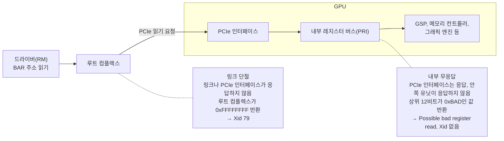

<br>

# TL;DR

- Xid는 NVIDIA 드라이버가 GPU에서 감지한 오류 사건에 붙이는 번호로, 커널 로그에 `NVRM: Xid (PCI:<주소>): <번호>, …` 한 줄로 찍힌다. 번호마다 원인과 필요한 조치가 다르다.
- 이 글에서는 Xid를 하드웨어 장애, 앱 오류, 상세, 기록, 지시의 다섯 가지 성격으로 나눠 읽는다. 실제 고장을 뜻하는 것은 하드웨어 장애 Xid이고, 63은 드라이버가 한 조치의 기록, 171은 앞 Xid의 위치 정보, 154는 드라이버가 요구하는 복구 조치다([Xid의 성격](#xid의-성격-분류)).
- 하드웨어 장애 Xid는 고장 난 위치에 따라 PCIe 링크(79), GPU 안의 펌웨어 프로세서인 GSP와 FSP(119, 120, 143), 메모리(48과 ECC 계열), NVLink로 나뉜다. Meta의 Llama 3 학습 기록에서는 예정에 없던 학습 중단의 원인 가운데 GPU 문제가 가장 컸다. NCSA Delta 시스템의 GPU 오류를 분석한 논문은 GSP를 가장 취약한 GPU 하드웨어 부품으로 꼽았는데, GSP 오류의 99% 이상이 그 GPU를 쓰던 잡의 실패로 이어졌기 때문이다.
- 앱 오류 Xid(13, 31, 43, 45 등)는 GPU가 정상인 채 프로세스만 종료된 경우라, Kubernetes에 GPU를 광고하는 NVIDIA device plugin은 이들을 헬스 체크에서 기본으로 뺀다. 그런데 그 무시 목록에 든 109는 NVIDIA 카탈로그가 GPU 리셋을 즉시 조치로 안내하는 Xid라서, 무시 목록은 카탈로그의 조치 열과 비교한 뒤 써야 한다([109](#device-plugin의-무시-목록과-xid-109)).
- GPU 문제가 늘 Xid로 남지는 않는다. PCIe 링크는 살아 있는데 GPU 안쪽 유닛이 응답하지 않는 내부 무응답에서는 Xid 번호 없이 `Possible bad register read`만 찍히고, 유령 사용률·드라이버 버전 불일치·발열도 Xid 없이 나타나므로 Xid 경보가 울리지 않았다는 것이 GPU가 정상이라는 뜻은 아니다([Xid로 잡히지 않는 문제](#xid로-잡히지-않는-gpu-문제)).

<br>

# Xid 에러

GPU 클러스터를 운영하면서 장애 알림을 받을 때마다 커널 로그의 Xid 번호부터 찾아보게 됐는데, 번호의 뜻을 그때그때 찾아 읽기만 하고 정리는 계속 미뤄 왔다. 그러다 같은 사건에서 Xid가 여러 개 찍히고 그중 일부만 실제 고장을 가리킨다는 점이 반복해서 눈에 들어와서, 번호 하나하나보다 번호들이 어떤 성격으로 나뉘는지를 먼저 정리해 보기로 했다.

Xid는 NVIDIA 드라이버가 GPU에서 감지한 오류 사건을 종류별로 구분하려고 붙이는 번호다. 드라이버에서 GPU를 관리하는 부분(RM, Resource Manager)이 오류를 감지하면 커널 메시지로 `NVRM: Xid` 줄을 남기기 때문에, Xid는 `dmesg`나 `journalctl -k`로 읽는 커널 링버퍼와 저널에 쌓인다. 커널 메시지가 어디에 쓰이고 두 명령이 무엇을 읽는지는 [커널 메시지 시리즈]()에서 정리했다.

## 로그 한 줄의 구조

Xid 줄은 형식이 정해져 있는데, 대개 앞부분만 읽어도 어느 카드에서 무슨 종류의 사건이 났는지 알 수 있다. 아래는 PCIe 링크가 끊긴 GPU에서 찍힌 두 줄이다.

```text
# Xid 79와 그 뒤의 Xid 154 (pid는 익명화)
NVRM: Xid (PCI:0000:21:00): 79, pid=XXX, name=nvidia-smi, GPU has fallen off the bus.
NVRM: Xid (PCI:0000:21:00): 154, GPU recovery action changed from 0x0 (None) to 0x1 (GPU Reset Required)
```

- `PCI:0000:21:00`은 GPU의 PCI 버스 주소다. `nvidia-smi`가 보여 주는 GPU 번호(0, 1, …)가 아니라서, 어느 카드인지 알려면 `nvidia-smi --query-gpu=index,pci.bus_id --format=csv`로 번호와 주소를 대응시켜야 한다
- `79`가 Xid 번호이고, 쉼표 뒤의 문장은 번호마다 형식이 다른 상세 메시지다
- `pid=XXX, name=nvidia-smi`는 Xid가 기록될 때 그 GPU에 접근하던 프로세스다. 위 줄은 `nvidia-smi`가 GPU를 조회하다가 링크 단절이 드러났다는 뜻이지, `nvidia-smi`가 원인이라는 뜻은 아니다

Xid를 찾을 때는 `sudo journalctl -k | grep 'NVRM: Xid'`처럼 권한을 올려서 본다. `journalctl`은 root나 `adm`, `systemd-journal` 같은 그룹에 속하지 않은 사용자에게 시스템 저널을 보여 주지 않고, 그런 계정으로 `journalctl -k`를 치면 다른 사용자와 시스템의 메시지가 보이지 않는다는 Hint 문구만 내고 커널 메시지는 0건으로 나온다. 운영하는 클러스터에서도 일반 권한으로 Xid를 찾다가 0건이 나온 적이 있는데, Xid가 없어서가 아니라 커널 메시지를 볼 권한이 없어서였다.

## Xid가 전달되는 경로

같은 사건은 커널 로그 말고도 다른 경로로 전달된다. 드라이버는 Xid를 NVML(NVIDIA Management Library) 이벤트로도 내보내서, 커널 로그를 읽지 않는 구성 요소들도 Xid에 반응한다.

- 커널 로그: `dmesg`, `journalctl -k`로 읽는 `NVRM: Xid` 줄. 상세 메시지까지 모두 남는 유일한 경로다
- NVIDIA device plugin: Kubernetes에 GPU를 광고하는 device plugin은 NVML의 Xid 이벤트를 받아 해당 GPU를 unhealthy로 표시한다. 일부 Xid는 기본으로 무시한다([아래](#device-plugin의-무시-목록과-xid-109))
- DCGM: dcgm-exporter의 `DCGM_FI_DEV_XID_ERRORS`는 마지막으로 관측된 Xid 번호를 담는 게이지다. 카운터가 아니라서 `increase()`로 경보를 걸면 울리지 않는데, 이 함정은 [GPU 노드 생애주기 글의 감지 절](#감지-gpu-경보와-xid-게이지-판정식)에서 다룬 적이 있다

## NVIDIA Xid 카탈로그의 조치 열

번호의 뜻은 NVIDIA가 공개한 [Xid 카탈로그](https://docs.nvidia.com/deploy/xid-errors/analyzing-xid-catalog.html)에서 찾는다. 카탈로그는 Xid마다 이름과 설명 외에 두 가지 조치를 적어 두는데, 즉시 조치(Immediate Action)는 사건 직후 무엇을 해야 하는지, 조사 조치(Investigatory Action)는 재발하거나 원인을 찾을 때 무엇을 해야 하는지다. 즉시 조치는 몇 개의 값으로 정해져 있다.

| 즉시 조치                  | 뜻                                                |
| -------------------------- | ------------------------------------------------- |
| `IGNORE`                 | 조치 없음. 다른 Xid를 보충하거나 기록만 하는 경우 |
| `RESTART_APP`            | 앱을 다시 시작한다. GPU는 계속 쓸 수 있다         |
| `RESET_GPU`              | GPU를 리셋해야 다시 쓸 수 있다                    |
| `RESTART_BM`             | 노드(bare metal)를 다시 시작해야 한다             |
| `WORKFLOW_XID_<번호>` 등 | Xid별로 정해진 별도 절차를 따른다                 |

조사 조치에는 `CONTACT_SUPPORT`(벤더 문의), `INVESTIGATE_SW`(소프트웨어 조사), `CHECK_APP/CUDA`(앱과 CUDA 점검) 같은 값이 들어간다. 이 글에서 Xid마다 적는 조치는 모두 이 카탈로그의 값이다.

<br>

# Xid의 성격 분류

결론부터 말하면 Xid 가운데 실제 고장을 뜻하는 것은 일부이고, 나머지는 사용자 코드의 오류이거나 다른 Xid를 보충하는 줄이다. 카탈로그의 즉시 조치와 설명을 기준으로 Xid를 나누면 다섯 가지 정도로 분류할 수 있다. 이 글에서는 이 다섯 분류를 **Xid의 성격**이라고 부른다.

| 성격          | 뜻                                                   | 대표 Xid              |
| ------------- | ---------------------------------------------------- | --------------------- |
| 하드웨어 장애 | GPU, PCIe 링크, 펌웨어, 메모리가 실제로 고장 났다    | 79, 119, 120, 143, 48 |
| 앱 오류       | 사용자 코드나 라이브러리의 오류다. GPU는 정상이다    | 13, 31, 43            |
| 상세          | 앞 Xid에 위치나 종류를 덧붙인다                      | 171, 172              |
| 기록          | 드라이버가 한 조치를 남긴다. 그 자체는 고장이 아니다 | 63                    |
| 지시          | 드라이버가 사람에게 복구 조치를 요구한다             | 154                   |

성격이 다른 Xid는 한 사건 안에서 함께 찍힌다. GPU 메모리에서 ECC로 정정할 수 없는 2비트 오류(DBE, double bit error)가 났을 때 찍힌 아래 네 줄이 그 예인데, 줄은 넷이지만 고장은 메모리 한 곳이다.

```text
# 메모리 DBE 한 건에 찍힌 Xid 네 줄 (pid는 익명화, 같은 시각의 반복 줄은 생략)
NVRM: Xid (PCI:0000:55:00): 48, An uncorrectable double bit error (DBE) has been detected on GPU in the framebuffer at physAddr 0xe9b9107e0 partition 3, subpartition 0.
NVRM: Xid (PCI:0000:55:00): 171, GDDR, Uncorrectable DRAM error in FBPA 3 subpartition 0 physAddr 0xe9b9107e0
NVRM: Xid (PCI:0000:55:00): 63, pid=XXX, name=python, Row Remapper: New row (0x0000000e9b9107e0) marked for remapping, reset gpu to activate.
NVRM: Xid (PCI:0000:55:00): 154, GPU recovery action changed from 0x0 (None) to 0x4 (Drain and Reset)
```

48이 하드웨어 장애이고, 171은 그 오류가 어느 메모리 파티션의 어느 주소인지 알려 주는 상세, 63은 고장 난 행을 예비 행으로 바꾸도록 기록했다는 기록, 154는 드레인 뒤 리셋하라는 지시다. 그래서 무엇이 고장 났는지는 사건을 연 하드웨어 장애 Xid 하나로 판단하고, 나머지 줄은 그 고장의 위치와 드라이버가 한 조치, 필요한 복구 수준을 읽는 데 쓴다. 이 사건의 전체 경과와 Xid 연쇄 분석은 [ECC 장애 사례 글](#xid-연쇄-읽기)에 있다.

## 지시: Xid 154와 복구 조치 코드

성격 가운데 지시는 154 하나라서 따로 볼 만하다. Xid 154(GPU Recovery Action Changed)는 다른 Xid와 함께 찍혀서 그 사건이 요구하는 복구 수준을 알려 주는 Xid로, 카탈로그도 조사 조치 칸에 "다른 Xid에 대한 정보일 뿐"이라고 적는다. 메시지는 `from <이전 코드> to <새 코드>` 형식이라서 GPU에 필요한 복구 조치가 무엇에서 무엇으로 바뀌었는지를 보여 준다.

| 코드    | 이름                 | 뜻                                                            |
| ------- | -------------------- | ------------------------------------------------------------- |
| `0x0` | None                 | 조치 필요 없음                                                |
| `0x1` | GPU Reset Required   | 해당 GPU만 리셋한다                                           |
| `0x2` | Node Reboot Required | 노드 전체를 재부팅한다                                        |
| `0x3` | Drain P2P            | 이 GPU와의 GPU 간 직접 통신(P2P)을 먼저 멈춘 뒤 다시 판단한다 |
| `0x4` | Drain and Reset      | 새 작업을 막고 기존 작업이 빠진 뒤 리셋한다                   |

운영하는 클러스터에서 찍힌 154는 앞 Xid에 따라 코드가 달랐고, 같은 Xid 79 뒤에서도 사건마다 달랐다. 79는 GPU가 PCIe 버스에서 떨어진 사건으로, [PCIe 링크 단절 절](#pcie-링크-단절-xid-79)에서 자세히 다룬다.

```text
# 운영하는 클러스터에서 찍힌 Xid 154 (pid는 익명화, 119 메시지는 일부 생략)
# ① 메모리 DBE(48) 뒤: 같은 GPU에 0x4
NVRM: Xid (PCI:0000:55:00): 48, An uncorrectable double bit error (DBE) has been detected on GPU in the framebuffer at physAddr 0xe9b9107e0 partition 3, subpartition 0.
NVRM: Xid (PCI:0000:55:00): 154, GPU recovery action changed from 0x0 (None) to 0x4 (Drain and Reset)

# ② GSP 응답 시간 초과(119) 뒤: 같은 GPU에 0x1
NVRM: Xid (PCI:0000:63:00): 119, Timeout after 45s of waiting for RPC response from GPU2 GSP! …
NVRM: Xid (PCI:0000:63:00): 154, GPU recovery action changed from 0x0 (None) to 0x1 (GPU Reset Required)

# ③ PCIe 링크 단절(79) 뒤: 떨어진 GPU에만 0x1
NVRM: Xid (PCI:0000:21:00): 79, pid=XXX, name=nvidia-smi, GPU has fallen off the bus.
NVRM: Xid (PCI:0000:21:00): 154, GPU recovery action changed from 0x0 (None) to 0x1 (GPU Reset Required)

# ④ PCIe 링크 단절(79) 뒤: 같은 초에 노드의 GPU 전부에 0x2 (그중 한 줄 발췌)
NVRM: Xid (PCI:0000:3d:00): 79, GPU has fallen off the bus.
NVRM: Xid (PCI:0000:17:00): 154, GPU recovery action changed from 0x0 (None) to 0x2 (Node Reboot Required)

# ⑤ ④와 같은 노드에서 다른 GPU(99:00)가 떨어지자, 이미 떨어져 있던 3d:00의 154가 0x1에서 0x2로 바뀜
NVRM: Xid (PCI:0000:99:00): 79, pid=XXX, name=nvidia-smi, GPU has fallen off the bus.
NVRM: Xid (PCI:0000:3d:00): 154, GPU recovery action changed from 0x1 (GPU Reset Required) to 0x2 (Node Reboot Required)
```

①과 ②는 고장 난 GPU 하나에 복구 수준이 붙은 경우인데, 79는 그렇지 않았다. ③에서는 떨어진 GPU에만 `0x1`이 찍혔지만, ④에서는 떨어진 GPU(`3d:00`)가 아니라 다른 GPU(`17:00`)의 PCI 주소로 `0x2`가 찍혔고 같은 초에 그 노드의 GPU 전부가 같은 줄을 남겼다. 노드 재부팅처럼 노드 전체에 걸리는 조치는 고장 나지 않은 GPU의 154로도 나타난다는 뜻이다. ⑤에서는 이미 떨어져 `0x1` 상태였던 GPU의 154가 다른 GPU의 79와 같은 초에 `0x2`로 올라갔다. 그래서 154는 그 줄의 PCI 주소만 볼 것이 아니라 같은 시각 노드 전체의 줄을 모아 읽어야 하고, 한 GPU의 코드가 나중에 올라갈 수 있으니 마지막 줄을 기준으로 삼아야 한다. 반대로 앱 오류 Xid인 13 → 43 뒤에는 154가 찍히지 않았는데, GPU 상태가 바뀌지 않아 복구 조치가 None에 머물렀기 때문이다.

## Xid를 사건으로 묶는 기준

Xid를 읽는 것과 별개로, 장애가 몇 번 났는지나 같은 카드에서 재발했는지를 따지려면 Xid 줄을 사건으로 묶어야 한다. 재발 횟수는 카드 점검이나 교체를 요청할지 정하는 근거가 되는데, 줄을 그대로 세면 수가 부풀려진다. 앞의 DBE처럼 한 사건이 성격이 다른 Xid를 여러 줄 남기고, 위 ④처럼 노드 단위 조치는 GPU마다 154 줄을 남기며, 리셋으로 돌아오지 않은 카드는 [뒤의 143 사례](#gpu-펌웨어-xid-119-120-143)처럼 같은 Xid를 십여 초 간격으로 계속 남기기도 하기 때문이다. 묶는 기준은 세 가지다.

- 사건을 여는 것은 하드웨어 장애나 앱 오류 Xid다. 상세(171, 172)와 기록(63)은 같은 GPU에서 앞에 찍힌 그 Xid에 붙이고, 지시(154)는 ④처럼 다른 GPU의 PCI 주소로도 찍히므로 같은 시각 같은 노드의 Xid에 붙인다. 카탈로그도 171과 172를 48의 보충으로, 154를 다른 Xid에 대한 정보로, 다른 Xid와 함께 찍힌 45를 그 Xid를 따르는 것으로 적는다
- 같은 카드에서 복구 조치(GPU 리셋, 재부팅, 전원 사이클) 전까지 반복되는 Xid는 한 사건이다. GPU가 복구되지 않은 같은 상태에서 찍힌 줄이기 때문이다. 복구한 뒤 같은 카드에서 다시 나면 새 사건, 곧 재발로 센다
- 카드는 PCI 주소가 아니라 GPU UUID로 식별한다. PCI 주소는 슬롯을 가리켜서 카드를 다른 슬롯이나 노드로 옮기면 이력이 끊기기 때문이다. 운영하는 클러스터의 [장애 원장](#복구-증거-수집과-판정)도 사건마다 UUID와 PCI 주소를 함께 남기고, 같은 카드의 재발은 UUID로, 같은 슬롯의 재발은 PCI 주소로 센다

앱 오류는 묶는 단위가 다르다. 13 → 43은 GPU가 아니라 그 위의 프로세스가 끝난 사건이라, GPU 여러 장을 쓰는 잡이 실패하면 GPU마다 13 → 43이 찍혀도 잡 하나의 실패로 묶는다. [뒤의 NCCL 사례](#13과-43-커널-코드-오류와-채널-정리)에서도 GPU 두 장 사이 통신 시험 하나가 실패하면서 두 GPU 모두에 13 → 43이 찍혔다. 반대로 [내부 무응답](#레지스터-읽기-오류와-d-상태-프로세스)의 `Possible bad register read`처럼 PCI 주소가 없는 줄은 GPU를 특정할 수 없어서 노드 단위로 묶을 수밖에 없다.

<br>

# 하드웨어 장애 Xid

GPU 하드웨어 장애가 드문 사건이 아니라는 것은 대규모 학습 기록에서 확인할 수 있다. Meta가 공개한 [Llama 3 보고서](https://arxiv.org/abs/2407.21783)의 3.3.4절을 보면, Llama 3 405B를 최대 16K장의 H100으로 사전 학습하는 동안 54일 구간에서 예정에 없던 학습 중단이 419건 있었다. 그중 약 78%가 하드웨어 문제로 확인됐고, GPU 문제가 58.7%로 가장 큰 범주였다. 그 중단 원인 표가 GPU 범주를 GPU 자체 고장, HBM3 메모리, SRAM, GPU System Processor처럼 고장 난 위치로 나누듯이, 하드웨어 장애 Xid도 고장 난 위치로 나눠 보면 각 번호가 무엇을 가리키는지 잡기 쉽다.

## PCIe 링크 단절: Xid 79

Xid 79(GPU has fallen off the bus)는 드라이버가 PCIe 링크로 GPU에 닿지 못하게 된 사건이다. 드라이버는 GPU의 레지스터를 BAR(Base Address Register)로 매핑한 주소를 읽고 쓰는 방식(MMIO)으로 GPU를 제어하는데, 그 읽기 요청이 GPU 안의 유닛에 닿기 전에 실패하는 지점이 둘이고 어디서 실패하느냐에 따라 로그가 달라진다. 요청은 CPU 쪽에서 PCIe 장치 트리를 시작하는 호스트 브리지인 루트 컴플렉스를 거쳐 GPU의 PCIe 인터페이스로 가고, 거기서 GPU 내부 레지스터 버스(PRI)를 타고 해당 유닛까지 간다.



이 글에서는 앞의 경우를 **링크 단절**, 뒤의 경우를 **내부 무응답**이라고 부른다. 링크 단절에서는 PCIe 요청이 완료되지 않아 루트 컴플렉스가 규약대로 모든 비트를 1로 채워 돌려준다. 580.95.05 드라이버 소스를 보면, 드라이버는 32비트 레지스터를 읽은 값이 `0xFFFFFFFF`이면 GPU 식별 레지스터(`NV_PMC_BOOT_0`)를 다시 읽어 GPU가 아직 붙어 있는지 확인하고, 그 값도 무효면 GPU를 잃은 것으로 처리한다. 이때 부르는 `osHandleGpuLost`가 `GPU has fallen off the bus.` 메시지와 함께 Xid 79를 남긴다. 같은 이유로 `lspci`도 그 GPU를 `rev ff`로 보여 주고, 장치마다 ID와 BAR 같은 설정 레지스터를 담는 PCI 설정 공간도 전부 `ff`로 읽는다.

<details markdown="1">
<summary><b>드라이버 소스로 따라가기</b></summary>

드라이버 소스는 AI의 도움을 받아 따라갔다. [`gpu_access.c`의 32비트 읽기 코드](https://github.com/NVIDIA/open-gpu-kernel-modules/blob/580.95.05/src/nvidia/src/kernel/gpu/gpu_access.c#L1732-L1759)는 읽은 값을 두 번 검사한다. 모든 비트가 1이면 GPU 식별 레지스터를 다시 읽어 링크 단절인지 확인하고, 상위 12비트(주석의 upper 3 nibbles)가 `0xBAD`이면 [내부 무응답](#레지스터-읽기-오류와-d-상태-프로세스)을 처리하는 함수로 넘긴다.

```c
// open-gpu-kernel-modules 580.95.05, src/nvidia/src/kernel/gpu/gpu_access.c 발췌
case 32:
    {
        pValue32 = ((NvU32 *) pValue);
        if (*pValue32 == (NvU32) (~0))
        {
            //
            // The result looks suspicious, let's check if the GPU is still attached.
            //
            NvU32 testValue = osGpuReadReg032(pGpu, NV_PMC_BOOT_0);
            if (testValue == GPU_REG_VALUE_INVALID)
            {
                osHandleGpuLost(pGpu);
                *pValue32 = osGpuReadReg032(pGpu, addr);
            }
        }

        value = *((NvU32 *)pValue);

        //
        // HW will return 0xbad in the upper 3 nibbles
        // when there is a possible issue.
        //
        if ((value & GPU_READ_PRI_ERROR_MASK) == GPU_READ_PRI_ERROR_CODE)
        {
            gpuHandleSanityCheckRegReadError_HAL(pGpu, addr, value);
        }
        break;
    }
```

[`osinit.c`의 `osHandleGpuLost`](https://github.com/NVIDIA/open-gpu-kernel-modules/blob/580.95.05/src/nvidia/arch/nvalloc/unix/src/osinit.c#L340-L365)는 식별 레지스터를 한 번 더 읽어 드라이버가 저장해 둔 값과 다르면 오류를 남긴다. 이때 쓰는 오류 코드 `ROBUST_CHANNEL_GPU_HAS_FALLEN_OFF_THE_BUS`가 [`nverror.h`](https://github.com/NVIDIA/open-gpu-kernel-modules/blob/580.95.05/src/common/sdk/nvidia/inc/nverror.h#L85)에서 79로 정의된 Xid 79다.

```c
// open-gpu-kernel-modules 580.95.05, src/nvidia/arch/nvalloc/unix/src/osinit.c 발췌
NV_STATUS
osHandleGpuLost
(
    OBJGPU *pGpu
)
{
    nv_state_t *nv = NV_GET_NV_STATE(pGpu);
    nv_priv_t *nvp = NV_GET_NV_PRIV(nv);
    NvU32 pmc_boot_0;

    // Determine if we've already run the handler
    if (!pGpu->getProperty(pGpu, PDB_PROP_GPU_IS_CONNECTED))
    {
        return NV_OK;
    }

    pmc_boot_0 = NV_PRIV_REG_RD32(nv->regs->map_u, NV_PMC_BOOT_0);
    if (pmc_boot_0 != nvp->pmc_boot_0)
    {
        //
        // This doesn't support PEX Reset and Recovery yet.
        // This will help to prevent accessing registers of a GPU
        // which has fallen off the bus.
        //
        nvErrorLog_va((void *)pGpu, ROBUST_CHANNEL_GPU_HAS_FALLEN_OFF_THE_BUS,
                      "GPU has fallen off the bus.");
```

</details>

카탈로그의 즉시 조치는 `RESTART_BM`(노드 재시작)이다. 운영하는 클러스터에서 9월 10일 RTX 5090 노드의 [GPU 하나가 버스에서 떨어졌을 때](#xid-79와-자동-격리의-계기)도, 설정 공간까지 `ff`로 읽히던 그 GPU에 `nvidia-smi -r`을 실행했지만 리셋되지 않았고 전원을 완전히 껐다 켠 뒤에야 다시 인식됐다. 다만 드라이버의 154는 79마다 같지 않아서, [154 절의 예시](#지시-xid-154와-복구-조치-코드)처럼 떨어진 GPU에만 `0x1`(GPU Reset Required)이 찍힌 경우와 노드의 GPU 전부에 `0x2`(Node Reboot Required)가 찍힌 경우가 모두 있었다. 그 예시 ③에서 `0x1`이 찍힌 GPU(`21:00`)는 두 달 뒤 확인했을 때 설정 공간이 `ff`가 아니라 정상 값으로 응답했는데, 그 사이 리셋도 재부팅도 하지 않아 `0x1`대로 리셋으로 돌아오는지는 확인하지 못했다.

79는 "링크에서 사라졌다"는 사건이지 GPU가 고장 났다는 판정은 아니다. 카탈로그도 원인을 PCIe 링크 하드웨어 고장이 많고 GPU 하드웨어나 드라이버 문제일 수도 있다고 적는데, 링크가 끊기는 지점은 GPU 다이, 카드 전원부, 전원 커넥터, 라이저, 슬롯 어디든 될 수 있다. 상위 루트 포트의 `lspci -vvv` 출력에서 AER(Advanced Error Reporting) 상태에 Surprise Down 오류(`UESta: SDES+`)가 남아 있으면 링크가 예고 없이 끊겼다는 물리 계층 쪽 증거가 되지만, 이 기록이 끊긴 지점까지 알려 주지는 않는다. 앞의 9월 10일 사건에서도 루트 포트에 Surprise Down이 남았지만 카드, 슬롯, 라이저 중 어디인지는 가리지 못했고, 전원 사이클 뒤에는 같은 카드가 부하 검증에서 정상 처리량을 냈다. 그래서 그 사건에서 확정할 수 있었던 것은 "링크가 한 번 끊겼다"까지였다.

PCIe 품질과 엮인 Xid는 79만 있는 것은 아니다. Xid 32(Invalid or corrupted push buffer stream)는 드라이버가 GPU로 보내는 명령 스트림이 손상된 경우인데, 카탈로그는 대부분 PCIe 품질 문제이고 사용자 행동이 원인이 아니라고 적는다. Xid 167(PCIe fatal timeout)은 카탈로그가 H100, B100, GB200에 해당한다고 표시한다.

## GPU 펌웨어: Xid 119, 120, 143

GSP(GPU System Processor)는 드라이버가 CPU에서 하던 GPU 초기화와 관리 작업을 넘겨받아 GPU 안에서 실행하는 프로세서다. NVIDIA 드라이버 [README의 GSP 장](https://download.nvidia.com/XFree86/Linux-x86_64/580.95.05/README/gsp.html)에 따르면, 이 프로세서가 실행하는 펌웨어는 드라이버와 함께 배포되고 Turing 이후 GPU에서는 기본으로 쓴다. 드라이버는 GSP에 RPC로 요청을 보내고 응답을 받아 GPU를 다루기 때문에, **GSP가 응답하지 않으면 드라이버가 GPU에 내리는 관리 요청도 처리되지 않는다**.

Xid 119(GSP RPC Timeout)는 드라이버가 GSP에 보낸 요청의 응답을 기다리다 시간이 초과된 경우이고, Xid 120(GSP Error)은 GSP 쪽 코드가 오류를 낸 경우다. 카탈로그는 두 Xid에 같은 조치를 안내해서, 즉시 조치는 `RESET_GPU`(리셋이나 전원 사이클)이고 재발하면 GPU 디버그 가이드를 따라 소프트웨어를 조사하라고 적는다. 119의 상세 메시지에는 기다린 시간과 응답을 받지 못한 RPC 함수가 함께 찍힌다. 운영하는 클러스터의 서빙 노드에서 vLLM이 쓰던 GPU에 찍힌 119는 다음과 같았다.

```text
# Xid 119: GSP가 RPC에 응답하지 않음 (pid는 익명화, 일부 생략)
NVRM: Xid (PCI:0000:63:00): 119, Timeout after 45s of waiting for RPC response from GPU2 GSP! Expected function 76 (GSP_RM_CONTROL) sequence 4608134 (0x2080a613 0x4214).
NVRM: Xid (PCI:0000:63:00): 119, pid=XXX, name=VLLM::Worker, Timeout after 45s … sequence 4608135 (0x20800a9a 0x8).
NVRM: Xid (PCI:0000:63:00): 154, GPU recovery action changed from 0x0 (None) to 0x1 (GPU Reset Required)
```

119가 연달아 찍힌 뒤 154가 `0x1`로 바뀌었고, 전원을 다시 넣자 카드를 바꾸지 않고 돌아왔다. 반면 다른 노드의 RTX 5090 카드 한 장은 리셋으로도 돌아오지 않았다. 이 카드는 120 뒤에 Xid 143을 십여 초 간격으로 반복해서 남겼다. Xid 143(GPU Initialization Error)은 GPU 초기화가 실패했다는 Xid인데, 그 카드의 상세 메시지는 다음과 같았다.

```text
# Xid 143: 초기화 중 FSP 부팅 완료 대기 실패
NVRM: Xid (PCI:0000:2a:00): 143, Error status 0x65 while polling for FSP boot complete, 0x13, 0x56, 0x0, 0x0, 0x2
```

RTX 5090의 칩은 GB202인데, 드라이버 소스에서 GB202용 구현을 보면 이 메시지는 GPU의 보안 부팅(secure boot)을 맡는 내부 프로세서 FSP가 부팅 완료를 알리기를 최소 5초 동안 기다리다 실패하면 GPU를 리셋 대상으로 표시하고 남기는 줄이다. Hopper용 구현도 대기 시간만 최소 4초로 다르고 같은 메시지를 남긴다. 앞의 `0x65`는 드라이버 상태 코드 `NV_ERR_TIMEOUT`이니, 이 카드는 초기화 중 보안 부팅이 끝나기를 기다리다 시간 초과로 멈춘 것이다.

<details markdown="1">
<summary><b>드라이버 소스로 따라가기</b></summary>

[`kern_fsp_gb202.c`의 `kfspWaitForSecureBoot_GB202`](https://github.com/NVIDIA/open-gpu-kernel-modules/blob/580.95.05/src/nvidia/src/kernel/gpu/fsp/arch/blackwell/kern_fsp_gb202.c#L59-L98)는 FSP의 부팅 완료를 최소 5초(`5000000`마이크로초) 기다린다. 실패하면 GPU를 리셋 대상으로 표시하고, Xid 143(`GPU_INIT_ERROR`)으로 상태 코드와 레지스터 값 다섯 개를 남긴다. 상태 코드 `0x65`는 [`nvstatuscodes.h`](https://github.com/NVIDIA/open-gpu-kernel-modules/blob/580.95.05/src/common/sdk/nvidia/inc/nvstatuscodes.h#L130)에 `NV_ERR_TIMEOUT`으로 정의돼 있다.

```c
// open-gpu-kernel-modules 580.95.05, src/nvidia/src/kernel/gpu/fsp/arch/blackwell/kern_fsp_gb202.c 발췌
NV_STATUS
kfspWaitForSecureBoot_GB202
(
    OBJGPU    *pGpu,
    KernelFsp *pKernelFsp
)
{
    NV_STATUS status  = NV_OK;
    RMTIMEOUT timeout;

    //
    // Polling for FSP boot complete
    // FBFalcon training during devinit alone takes 2 seconds, up to 3 on HBM3,
    // but the default threadstate timeout on windows is 1800 ms. Increase to 4 seconds
    // for this wait to match MODS GetGFWBootTimeoutMs.
    // For flags, we must not use the GPU TMR since it is inaccessible.
    // Increase to 5 seconds for WS SKUs especially needed for SKU's with larger VRAM.
    //
    gpuSetTimeout(pGpu, NV_MAX(gpuScaleTimeout(pGpu, 5000000), pGpu->timeoutData.defaultus),
                  &timeout, GPU_TIMEOUT_FLAGS_OSTIMER | GPU_TIMEOUT_FLAGS_BYPASS_THREAD_STATE);

    status = gpuTimeoutCondWait(pGpu, _kfspWaitBootCond_GB202, NULL, &timeout);

    if (status != NV_OK)
    {
        NV_ASSERT_OK(gpuMarkDeviceForReset(pGpu));
        NV_ERROR_LOG((void*) pGpu, GPU_INIT_ERROR, "Error status 0x%x while polling for FSP boot complete, "
                     "0x%x, 0x%x, 0x%x, 0x%x, 0x%x",
                     status,
                     GPU_REG_RD32(pGpu, NV_THERM_I2CS_SCRATCH_FSP_BOOT_COMPLETE),
                     GPU_REG_RD32(pGpu, NV_PFSP_FALCON_COMMON_SCRATCH_GROUP_2(0)),
                     GPU_REG_RD32(pGpu, NV_PFSP_FALCON_COMMON_SCRATCH_GROUP_2(1)),
                     GPU_REG_RD32(pGpu, NV_PFSP_FALCON_COMMON_SCRATCH_GROUP_2(2)),
                     GPU_REG_RD32(pGpu, NV_PFSP_FALCON_COMMON_SCRATCH_GROUP_2(3)));

        kfspDumpDebugState_HAL(pGpu, pKernelFsp);
    }

    return status;
}
```

</details>

GSP가 취약한 부품이라는 점은 공개 연구에서도 확인된다. NCSA의 Delta는 A40, A100, H100 GPU 1,168장을 갖춘 AI·HPC 시스템인데, 이 시스템의 2.5년치 GPU 오류를 분석한 [논문](https://arxiv.org/abs/2503.11901v2)은 GPU 하드웨어 부품 가운데 GSP를 가장 취약한 부품으로 꼽았다. 논문에 따르면 GSP 오류는 99% 이상이 GPU를 오류 상태로 만들었고, 그 GPU를 쓰던 사용자 잡은 실패했다. 같은 논문에서 GPU 메모리는 MTBE(mean time between errors) 기준으로 GPU 하드웨어 부품보다 30배 넘게 안정적이었다. 앞의 Llama 3 중단 원인 표에도 GPU System Processor가 17건(4.1%)으로 따로 올라 있다.

## 메모리: Xid 48과 ECC 계열

메모리 쪽 Xid는 ECC(Error Correcting Code)가 오류를 잡아낸 결과로 찍힌다. ECC가 1비트 오류는 고치고 2비트 오류는 검출만 하는 원리, GPU에서 SRAM과 DRAM 카운터가 나뉘는 이유는 [GPU ECC 글]()에서 정리했고, 여기서는 그 결과가 어떤 Xid로 이어지는지만 본다.

정정할 수 없는 2비트 오류(DBE)가 나면 Xid 48이 찍히고, 그 오류가 DRAM인지 SRAM인지를 Xid 171과 172가 상세로 덧붙인다. Ampere 이후 GPU는 고장 난 메모리 행을 예비 행으로 바꾸는 row remapping으로 대응하는데, 바꾸기로 기록한 것이 Xid 63이고 기록에 실패하면 Xid 64다. NVIDIA의 [row remapping 문서](https://docs.nvidia.com/deploy/a100-gpu-mem-error-mgmt/row-remapping.html)는 행 교체가 GPU 리셋 뒤에야 적용된다고 적으므로, 63이 찍혔다는 것은 고장 난 행이 아직 쓰이고 있으니 리셋이 필요하다는 뜻이기도 하다. 그래서 이 조합 뒤의 154가 `0x4`(Drain and Reset)가 된다. 정정할 수 없는 오류인데 행 교체도 페이지 격리도 하지 못한 경우는 Xid 140(ECC Unrecovered Error)으로, 즉시 조치가 `RESET_GPU`다.

Ampere 이후에는 정정할 수 없는 오류의 영향을 그 오류를 만난 앱으로 한정하는 [error containment](https://docs.nvidia.com/deploy/a100-gpu-mem-error-mgmt/error-containment.html)가 들어가서, 오류가 한 앱에 갇혔는지에 따라 Xid가 갈린다. Xid 94(Contained memory error)는 오류를 만난 앱만 다시 시작하면 되고 다른 앱은 영향이 없는 경우로, 카탈로그는 GPU 리셋을 편할 때 하라고 적는다. Xid 95(Uncontained memory error)는 여러 앱에 영향을 줘서 GPU를 리셋해야 앱을 다시 띄울 수 있는 경우다. 둘 다 정리 단계의 Xid 45가 함께 찍힌다.

1비트 오류(SBE)는 ECC가 고쳐서 돌려주기 때문에 건마다 Xid를 남기지 않고 카운터에만 쌓인다. `nvidia-smi -q -d ECC`의 Correctable 칸과 DCGM의 `DCGM_FI_DEV_ECC_SBE_VOL_TOTAL`, `DCGM_FI_DEV_ECC_SBE_AGG_TOTAL`이 그 카운터이고, SBE 비율이 높아지면 Xid 92(High single-bit ECC error rate)가 찍힌다. 92의 즉시 조치는 `IGNORE`, 조사 조치는 `CONTACT_SUPPORT`라서 당장 멈출 일은 아니지만 추세를 봐야 한다는 뜻이다. SBE가 같은 위치에서 반복되면 DBE의 전조일 수 있는데, Turing 이전 GPU의 [page retirement](https://docs.nvidia.com/deploy/dynamic-page-retirement/implementation.html)는 같은 주소에서 SBE가 두 번 나면 그 페이지를 퇴역시켜 DBE가 나기 전에 막으려 했다. Ampere 이후의 row remapping도 정정 가능한 오류로 행을 바꾸는 경로가 있지만, 문서는 정정 가능한 오류로 인한 교체가 나중에 정정 불가 오류로 인한 교체로 대체될 수 있다고만 적고 어떤 조건에서 교체하는지는 밝히지 않는다.

이 모든 신호는 ECC를 지원하고 켜 둔 GPU에서만 나온다. RTX 5090 같은 GeForce 카드는 [GPU ECC 글](#지원하지-않는-노드-rtx-5090)에서 확인한 것처럼 `nvidia-smi`가 ECC를 `N/A`로 보여 주고, 드라이버가 SBE도 DBE도 보고하지 않는다. 그래서 그런 카드에서 비트가 뒤집히면 Xid 없이 지나가거나, 앱 오류나 잘못된 결과로만 드러난다. ECC가 있는 HBM3에서도 Llama 3 중단 원인 표에는 HBM3 메모리가 72건(17.2%), 검출되지 않은 데이터 손상(Silent Data Corruption)이 6건(1.4%) 올라 있다.

## NVLink: 장비 구성이 정하는 Xid

어떤 Xid를 볼 수 있는지는 장비 구성이 정한다. NVLink Xid가 그 예인데, NVLink는 GPU끼리 PCIe를 거치지 않고 직접 잇는 링크라서 NVLink 없이 PCIe 카드만 꽂은 서버에서는 이 계열의 Xid가 날 수 없다. 반대로 HGX처럼 NVLink와 NVSwitch로 GPU를 묶은 장비에서는 흔하다. Delta 논문은 NVLink 오류가 시스템 전체에서 MTBE 6.9시간으로 발생했고, 한 번 발생하면 66% 확률로 잡 실패로 이어졌다고 보고했다.

| Xid     | 이름                                                      | 카탈로그 비고                                                                 |
| ------- | --------------------------------------------------------- | ----------------------------------------------------------------------------- |
| 74      | NVLINK Error                                              | GPU 간 또는 NVSwitch 링크 문제. 리셋이나 재부팅이 필요하고 반복되면 벤더 문의 |
| 136     | Link Training Failed                                      | H100 해당                                                                     |
| 137     | NVLink Privilege Error                                    | 잘못된 NVLink P2P 접근. 대개 앱 버그                                          |
| 144~150 | NVLink5 오류(SAW, RLW, TLW, TREX, NVLPW_CTRL, NETIR, MSE) | B100, GB200 해당                                                              |
| 155     | NVLINK: SW Defined Error                                  | 의도된 것으로 표시된 링크 다운(SLEEP 전환 포함)                               |

## 그 밖의 하드웨어 Xid

위치로 묶이지 않는 하드웨어 Xid도 있다. 카탈로그 기준으로 Xid 62(Internal micro-controller halt)와 158(GPU Fatal Timeout)은 즉시 조치가 `RESET_GPU`이고, 38(Driver firmware error)은 `IGNORE` 뒤 벤더 문의다. Xid 8(GPU stopped processing)은 즉시 조치가 `RESTART_APP`이지만 조사 조치가 `CONTACT_SUPPORT`라서 앱 오류인지 하드웨어인지는 상황을 봐야 한다. 카탈로그에는 자원 퇴역(156, 157), 채널 퇴역(160, 161), 전력 평활화 회로(Power Smoothing HW Circuitry)의 상태와 수명(162~165)을 알리는 Xid도 있고, 그중 160, 161, 162는 B100과 GB200 전용으로 표시돼 있다. 수리할 자원이 없어 퇴역에 실패했다는 157을 빼면, 이들은 고장 자체보다 드라이버가 한 조치나 부품 상태를 알리는 기록에 가깝다.

<br>

# 앱 오류 Xid

하드웨어 장애 Xid와 달리 앱 오류 Xid는 GPU가 정상인 채 그 위에서 돌던 프로세스가 잘못된 경우다. 카탈로그의 즉시 조치는 대부분 `RESTART_APP`이고, 앱을 고치거나 다시 띄우면 같은 GPU를 계속 쓸 수 있다.

## 13과 43: 커널 코드 오류와 채널 정리

앱 오류 Xid의 대표적인 조합은 13 → 43이다. Xid 13(Graphics Engine Exception)은 GPU의 연산 유닛인 SM(Streaming Multiprocessor)이 범위 밖 주소에 접근하는 것처럼 GPU에서 돈 커널 코드가 오류를 낸 경우이고, 카탈로그도 대개 앱 오류이며 드물게 하드웨어나 시스템 소프트웨어 버그라고 적는다. Xid 43은 그 오류로 프로세스가 끝날 때 드라이버가 해당 채널을 정리했다는 줄이라서, 즉시 조치가 `IGNORE`이고 GPU는 정상으로 남는다.

```text
# Xid 13 → 43: SM의 범위 밖 주소 접근 뒤 채널 정리 (같은 시험의 서로 다른 GPU에서 발췌, pid는 익명화)
NVRM: Xid (PCI:0000:63:00): 13, Graphics SM Warp Exception on (GPC 0, TPC 0, SM 1): Out Of Range Address
NVRM: Xid (PCI:0000:3d:00): 13, Graphics Exception: ESR 0x506730=0xe10000e 0x506734=0x20 0x506728=0x1c81fb60 0x50672c=0x1174
NVRM: Xid (PCI:0000:3d:00): 43, pid=XXX, name=python3, channel 0x00000002
```

13의 상세 메시지는 오류가 난 SM의 위치를 SM을 묶는 단위인 GPC(Graphics Processing Cluster)와 TPC(Texture Processing Cluster)까지 포함해 알려 주고, 오류 종류(`Out Of Range Address`)도 함께 적는다. 위 로그는 사용자 코드가 아니라 라이브러리 버전에서 왔는데, RTX 5090과 RTX PRO 6000 같은 Blackwell(sm_120)용 커널이 들어 있지 않은 NCCL 2.26.2 이미지로 GPU 두 장 사이 NCCL 통신을 하자 `illegal memory access`로 실패하면서 호스트에 13 → 43이 찍혔다. 같은 PyTorch에 NCCL만 2.29.7로 바꾸자 같은 노드에서 정상으로 돌았으니, GPU가 아니라 NCCL 버전이 원인이었다. NCCL 바이너리에 어떤 GPU 아키텍처용 코드가 들어 있는지 확인하는 방법은 [NCCL 호환성 게이트 글]()에서 다뤘다. 13 → 43 뒤에 GPU 사용률이 100%에 고정된 채 남는 경우도 있는데, 그 사례는 [Phantom GPU Utilization 글]()에 있다.

13과 43 말고도 앱 오류로 분류되는 Xid가 몇 개 더 있다.

- 31(GPU memory page fault): MMU가 잘못된 주소 접근을 보고한 경우다. 대개 앱 오류지만 드라이버나 하드웨어일 수도 있다
- 45(Preemptive cleanup, due to previous errors): Ctrl-C, SIGKILL, GPU 리셋 같은 중단 뒤 드라이버가 앱을 정리한 기록이다. 카탈로그는 다른 Xid와 함께 찍히면 그 Xid를 따르고, 단독으로 찍히면 별도 절차를 따르라고 적는다
- 68(NVDEC0 Exception): 영상 디코더 NVDEC의 예외다
- 69(Graphics Engine class error): 앱이 잘못된 데이터나 메서드를 넘긴 경우다
- 137(NVLink Privilege Error): 잘못된 NVLink P2P 접근이다. NVLink 장비에서만 난다

## device plugin의 무시 목록과 Xid 109

앱 오류 Xid는 GPU가 정상이라는 전제 위에 있어서, 이를 헬스 체크에서 빼는 것이 일반적이다. NVIDIA device plugin은 Xid 이벤트를 받으면 해당 GPU를 unhealthy로 표시해 Kubernetes가 그 GPU를 더 배정하지 않게 하는데, [소스](https://github.com/NVIDIA/k8s-device-plugin/blob/v0.18.1/internal/rm/health.go#L233-L240)에는 "Application errors: the GPU should still be healthy"라는 주석과 함께 기본으로 무시하는 Xid 목록이 들어 있다.

```go
// NVIDIA k8s-device-plugin v0.18.1, internal/rm/health.go 발췌
// Application errors: the GPU should still be healthy
ignoredXids := []uint64{
	13,  // Graphics Engine Exception
	31,  // GPU memory page fault
	43,  // GPU stopped processing
	45,  // Preemptive cleanup, due to previous errors
	68,  // Video processor exception
	109, // Context Switch Timeout Error
}
```

그런데 이 목록의 109(Context Switch Timeout Error)는 카탈로그에서 즉시 조치가 `RESET_GPU`, 조사 조치가 `CONTACT_SUPPORT`다. device plugin은 109가 찍혀도 GPU가 정상이라고 보고 계속 광고하지만, 카탈로그 기준으로는 리셋해야 다시 쓸 수 있는 상태다. device plugin은 `DP_DISABLE_HEALTHCHECKS`로 무시할 Xid를 더하고 `DP_ENABLE_HEALTHCHECKS`로 특정 Xid를 다시 켤 수 있게 해 두었으니, 기본 목록을 그대로 둘지는 109처럼 두 기준이 갈리는 Xid를 하나씩 확인한 뒤 정할 일이다.

같은 목록을 경보 규칙으로 옮길 때도 마찬가지다. 운영하는 클러스터의 [Xid 경보 식](#감지-gpu-경보와-xid-게이지-판정식)도 device plugin과 같은 목록을 빼는데, 그렇게 하면 109도 함께 빠진다. 게다가 DCGM의 Xid 지표는 마지막 값만 담는 게이지라서, 하드웨어 Xid 뒤에 무시 목록의 45가 찍히면 마지막 값이 45로 덮여 하드웨어 Xid를 놓칠 수 있다.

<br>

# Xid로 잡히지 않는 GPU 문제

Xid는 드라이버가 오류 사건으로 분류해 번호를 붙인 것만 남는다. 그래서 드라이버가 사건으로 분류하지 않는 오류나 드라이버 바깥에서 생긴 문제는 Xid 경보에 걸리지 않고, 운영하는 클러스터에서도 Xid가 한 줄도 남지 않은 GPU 문제를 겪었다.

## 레지스터 읽기 오류와 D 상태 프로세스

[Xid 79 절의 도식](#pcie-링크-단절-xid-79)에서 내부 무응답으로 부른 경로가 여기에 해당한다. PCIe 링크와 GPU의 PCIe 인터페이스는 응답하는데 그 안쪽 유닛이 내부 레지스터 버스(PRI) 요청에 응답하지 않으면, GPU는 상위 12비트가 `0xBAD`인 값을 데이터로 돌려준다. 드라이버는 링크 단절을 검사하는 바로 그 레지스터 읽기 코드에서, 읽은 값의 상위 12비트가 `0xBAD`이면 오류 처리 함수를 부른다. 이 경로는 Xid 번호를 남기지 않는다.

```text
# 내부 무응답: Xid 번호도 PCI 주소도 없는 줄
NVRM: gpuHandleSanityCheckRegReadError_GH100: Possible bad register read: addr: 0xb830b0,  regvalue: 0xbadf3200,  error code: Unknown SYS_PRI_ERROR_CODE
```

이 줄에는 PCI 주소가 없어서 노드의 어느 GPU에서 났는지도 알 수 없다. 함수 이름 끝의 `_GH100`은 Hopper용으로 작성된 구현을 쓴다는 뜻이지 GPU 모델이 아니라서, 이 줄은 RTX 5090 노드에서 찍혔다. 이 줄이 대량으로 찍힌 뒤 그 노드에서는 GPU를 조회하는 프로세스가 끝나지 않고 쌓였는데, `nvidia-smi`가 출력까지는 내고도 종료하지 못한 채 D 상태(uninterruptible sleep)에 머물렀다. D 상태는 커널 안에서 무언가를 기다리며 시그널로 깨지 않는 상태라서 SIGKILL로도 끝낼 수 없었고, 모니터링이 주기적으로 `nvidia-smi`를 부를 때마다 멈춘 프로세스가 하나씩 늘었다. 리눅스의 load average는 실행 중이거나 실행을 기다리는 프로세스뿐 아니라 D 상태 프로세스도 세기 때문에, 멈춘 프로세스가 늘 때마다 load average가 계단처럼 올라갔고 재부팅해야 풀렸다. Xid 경보는 이 사이 한 번도 울리지 않았다.

## 유령 사용률

분산 학습이 비정상으로 끝난 뒤 GPU 사용률이 100%로 남는데 메모리 사용량은 0이고 프로세스도 없는 상태가 있다. 이 상태에서도 Xid는 찍히지 않았고, 유력한 가설과 대응은 [Phantom GPU Utilization 글]()에서 다뤘다.

## 드라이버와 라이브러리 버전 불일치

OS 자동 업데이트(unattended-upgrades)가 NVIDIA 사용자 공간 라이브러리만 올리고 커널 모듈은 그대로 두면, `nvidia-smi`가 `Failed to initialize NVML: Driver/library version mismatch`로 실패한다. GPU 하드웨어에는 아무 일도 없어서 Xid가 없고 노드도 Ready로 남는데, 그 경위는 [unattended-upgrades 글]()에 있다.

## 온도와 전원

온도가 높다는 사실 자체는 Xid가 아니다. GPU는 온도가 오르면 먼저 클럭을 낮추고, 이 상태는 `nvidia-smi -q -d PERFORMANCE`의 클럭 제한 사유(Clocks Event Reasons) 항목에서 `SW Thermal Slowdown`이나 `HW Thermal Slowdown`이 `Active`로 바뀌는 것으로 나타나며, 그 아래 `Clocks Event Reasons Counters`에는 사유별 누적 시간이 쌓인다. 온도 값에 건 경보는 정상 부하에서도 임계치를 넘겨 울릴 수 있고, 온도 값만으로는 GPU가 실제로 클럭을 낮췄는지 알 수 없다. 공개 기록에서도 온도는 고장보다 성능 쪽으로 드러나는데, Llama 3 학습에서는 한낮 기온이 GPU의 동적 전압·주파수 조절(DVFS)에 영향을 줘 처리량이 하루 주기로 1~2% 오르내렸고, 중단 원인 표의 GPU 열 인터페이스와 센서는 6건(1.4%)이었다.

전원 쪽 문제는 GPU 쪽에 남는 기록이 더 적다. 랙 전원 분배 장치(PDU)의 차단기가 내려가면 노드 전체의 전원이 한꺼번에 꺼져서 GPU 드라이버가 기록을 남기지 못하고, Kubernetes에서는 노드가 NotReady가 되는 것으로만 보인다.

<br>

# 정리

Xid 번호의 뜻은 카탈로그에서 바로 찾을 수 있지만, 장애 알림을 받은 순간에 필요했던 것은 그 번호가 고장을 뜻하는지, 그래서 무엇을 해야 하는지였다. 번호를 성격으로 나눠 놓고 나니 로그를 읽는 순서가 정해졌다.

- 먼저 하드웨어 장애 Xid가 있는지 본다. 앱 오류 Xid만 있다면 GPU보다 코드와 라이브러리 버전을 먼저 의심한다
- 하드웨어 장애 Xid가 있으면 같은 시각 노드 전체의 154를 모아 복구 수준을 정한다. 154는 고장 나지 않은 GPU의 줄로도 찍히고 한 GPU의 코드가 나중에 올라가기도 해서, 마지막 줄을 기준으로 본다
- 고장 위치는 Xid 번호가 알려 준다. 79는 링크, 119·120·143은 GSP와 부팅 펌웨어, 48과 ECC 계열은 메모리다. 79는 링크가 끊겼다는 사건이지 GPU 고장 판정이 아니다
- Xid가 없다고 끝내지 않는다. 내부 무응답의 `Possible bad register read`, D 상태 프로세스, 버전 불일치는 Xid 경보 밖에 있다

이 순서대로라면 Xid 경보도 하드웨어 장애 Xid와 154를 중심에 두고, 앱 오류로 빼는 Xid는 device plugin의 기본 목록을 옮겨 오기보다 카탈로그가 리셋을 요구하는지 확인하며 고르는 방향이 맞다고 본다. 다만 154를 기준으로 한 경보는 아직 만들어 시험해 보지 않았다. 그리고 Xid 경보가 울리지 않을 때도 레지스터 오류 로그, D 상태 프로세스, NVML 초기화 실패를 따로 확인할 수단이 있어야 GPU 상태를 판단할 수 있다.

<br>

# 부록: 이 글에서 다룬 Xid

이름은 카탈로그 설명을, 즉시 조치는 카탈로그 값을 옮겼다. 성격은 이 글의 분류다.

| Xid      | 카탈로그 설명                              | 성격                | 즉시 조치       | 비고                                       |
| -------- | ------------------------------------------ | ------------------- | --------------- | ------------------------------------------ |
| 8        | GPU stopped processing                     | 판단 필요           | `RESTART_APP` | 조사 조치는 벤더 문의                      |
| 13       | Graphics Engine Exception                  | 앱 오류             | `RESTART_APP` | device plugin 무시                         |
| 31       | GPU memory page fault                      | 앱 오류             | `RESTART_APP` | device plugin 무시                         |
| 32       | Invalid or corrupted push buffer stream    | 하드웨어 장애       | `RESTART_APP` | 주로 PCIe 품질                             |
| 38       | Driver firmware error                      | 하드웨어 장애       | `IGNORE`      | 조사 조치는 벤더 문의                      |
| 43       | GPU stopped processing                     | 앱 오류             | `IGNORE`      | 13 등의 뒤에 채널 정리, device plugin 무시 |
| 45       | Preemptive cleanup, due to previous errors | 앱 오류             | Xid 45 절차     | 다른 Xid 뒤에 붙음, device plugin 무시     |
| 48       | Double Bit ECC Error                       | 하드웨어 장애       | Xid 48 절차     | 171, 172가 상세                            |
| 62       | Internal micro-controller halt             | 하드웨어 장애       | `RESET_GPU`   |                                            |
| 63       | GPU memory remapping event                 | 기록                | `IGNORE`      | row remapping, page retirement 기록        |
| 64       | GPU memory remapping failure               | 하드웨어 장애       | `RESET_GPU`   |                                            |
| 68       | NVDEC0 Exception                           | 앱 오류             | `RESTART_APP` | device plugin 무시                         |
| 69       | Graphics Engine class error                | 앱 오류             | `RESTART_APP` |                                            |
| 74       | NVLINK Error                               | 하드웨어 장애       | NVLink 절차     | NVLink 장비                                |
| 79       | GPU has fallen off the bus                 | 하드웨어 장애       | `RESTART_BM`  |                                            |
| 92       | High single-bit ECC error rate             | 하드웨어 장애(전조) | `IGNORE`      | 조사 조치는 벤더 문의                      |
| 94       | Contained memory error                     | 하드웨어 장애       | `RESTART_APP` | 45 동반                                    |
| 95       | Uncontained memory error                   | 하드웨어 장애       | `RESET_GPU`   | 45 동반                                    |
| 109      | Context Switch Timeout Error               | 하드웨어 장애       | `RESET_GPU`   | device plugin 무시                         |
| 119      | GSP RPC Timeout                            | 하드웨어 장애       | `RESET_GPU`   |                                            |
| 120      | GSP Error                                  | 하드웨어 장애       | `RESET_GPU`   |                                            |
| 136      | Link Training Failed                       | 하드웨어 장애       | `RESET_GPU`   | H100                                       |
| 137      | NVLink Privilege Error                     | 앱 오류             | `IGNORE`      | NVLink 장비                                |
| 140      | ECC Unrecovered Error                      | 하드웨어 장애       | `RESET_GPU`   |                                            |
| 143      | GPU Initialization Error                   | 하드웨어 장애       | `RESET_GPU`   |                                            |
| 144~150  | NVLink5 오류                               | 하드웨어 장애       | NVLink5 절차    | B100, GB200                                |
| 154      | GPU Recovery Action Changed                | 지시                | Xid 154 절차    | 동반 Xid의 복구 수준                       |
| 155      | NVLINK: SW Defined Error                   | 기록                | `RESET_GPU`   | 의도된 링크 다운                           |
| 156      | Resource Retirement Event                  | 기록                | `RESET_GPU`   |                                            |
| 157      | Resource Retirement Failure                | 하드웨어 장애       | `IGNORE`      | 수리할 자원 부족                           |
| 158      | GPU Fatal Timeout                          | 하드웨어 장애       | `RESET_GPU`   |                                            |
| 160, 161 | Channel Retirement Event, Failure          | 기록                | `IGNORE`      | B100, GB200                                |
| 162~165  | Power Smoothing HW Circuitry 상태, 수명    | 기록                | 카탈로그에 없음 |                                            |
| 167      | PCIE_FATAL_TIMEOUT                         | 하드웨어 장애       | 카탈로그에 없음 | H100, B100, GB200                          |
| 171      | Uncorrectable DRAM error (48 보충)         | 상세                | 카탈로그에 없음 | 48 동반                                    |
| 172      | Uncorrectable SRAM error (48 보충)         | 상세                | 카탈로그에 없음 | 48 동반                                    |

<br>

# 참고 링크

- [NVIDIA Xid Catalog](https://docs.nvidia.com/deploy/xid-errors/analyzing-xid-catalog.html)
- [NVIDIA GPU Memory Error Management: Row Remapping](https://docs.nvidia.com/deploy/a100-gpu-mem-error-mgmt/row-remapping.html)
- [NVIDIA Dynamic Page Retirement: Implementation](https://docs.nvidia.com/deploy/dynamic-page-retirement/implementation.html)
- [NVIDIA Linux 드라이버 README: GSP Firmware](https://download.nvidia.com/XFree86/Linux-x86_64/580.95.05/README/gsp.html)
- [NVIDIA open-gpu-kernel-modules (580.95.05)](https://github.com/NVIDIA/open-gpu-kernel-modules/tree/580.95.05)
- [NVIDIA k8s-device-plugin `internal/rm/health.go` (v0.18.1)](https://github.com/NVIDIA/k8s-device-plugin/blob/v0.18.1/internal/rm/health.go)
- [The Llama 3 Herd of Models (arXiv 2407.21783)](https://arxiv.org/abs/2407.21783)
- [Characterizing GPU Resilience and Impact on AI/HPC Systems (arXiv 2503.11901v2)](https://arxiv.org/abs/2503.11901v2)

<br>
